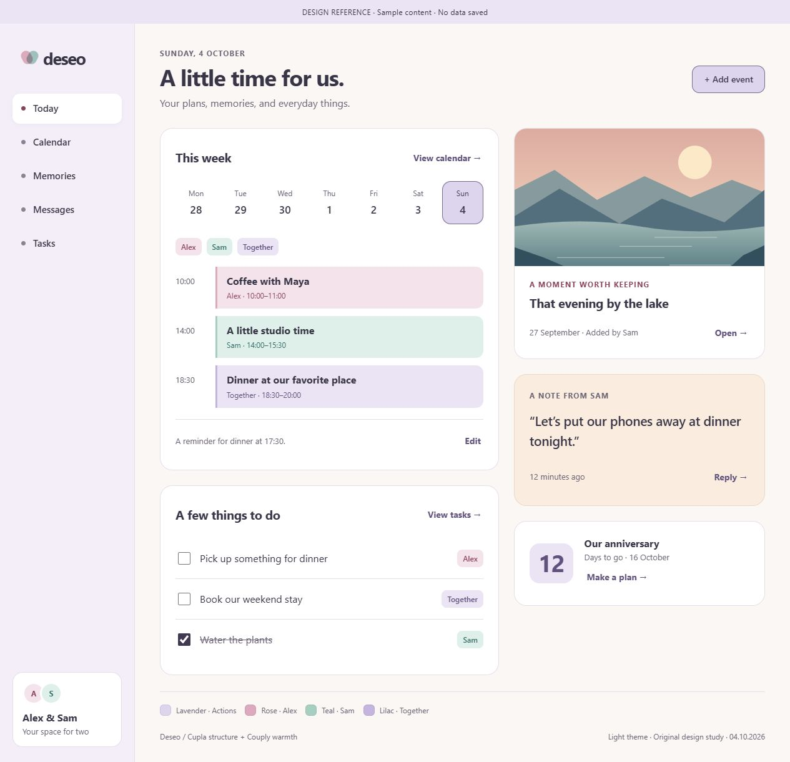
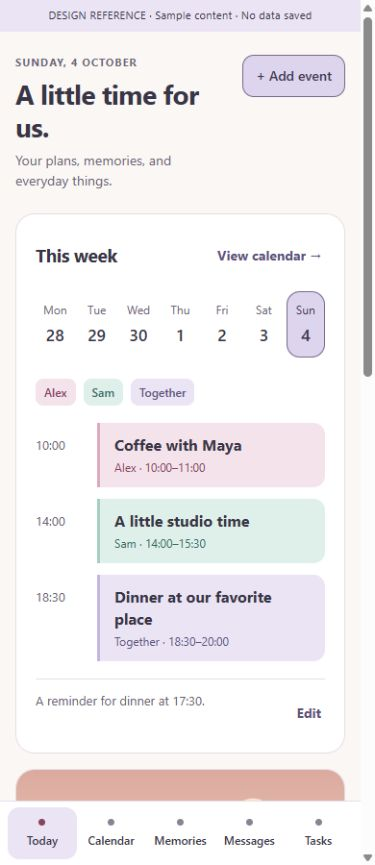
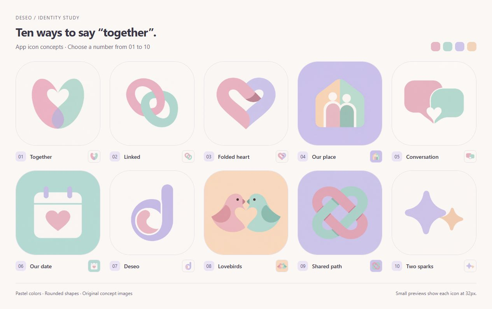

# Deseo frontend style guide

**Direction:** Cupla's planning structure with Couply's personal cards.

**Scope:** A shared app for two partners. Cover calendars, events, reminders, photos, messages, and tasks.

**Status:** The owner approved pastel styling, icon 05, and separate React browser screens beside Expo mobile.

Use this guide for frontend work. Treat the visual reference as documentation, not production code.

### Platform mapping

Expo serves Android and iOS. React DOM serves the browser portal. The planned public site has separate pages.

Use React Native StyleSheet values from shared brand tokens. The CSS examples below apply to browser surfaces only.

Use native point/dp values for spacing and type. Use system fonts and supported weights such as 400, 600, and 700.

Use at least 48dp touch targets. Respect safe areas, Dynamic Type, VoiceOver, TalkBack, and native keyboard behavior.

Use Expo Router stacks and bottom tabs on native devices. Use React Router links and a sidebar in the portal.

Follow [browser scope](docs/README.md#browser-portal) for routes. Use the responsive layout rules below for browser dimensions.

Follow [the screen guide](docs/README.md#screens) for native routes and complete flows.

## 1. Visual reference

Open [the design reference](design/preview.html) in a browser. Choose a navigation item to inspect its sample screen.

The reference includes Today, Calendar, Memories, Messages, and Tasks. Sample actions do not save or send data.





The landscape is an original placeholder illustration. Use the couple's own photos in the product.

### App icon selection

Review [the ten numbered icon concepts](design/icons/comparison.html). See [the saved prompts](docs/README.md#visual-assets) for generation details.



Selected icon: **05 — Two voices, round two**. Two pastel speech bubbles frame an ivory heart.

Use [the selected icon](design/icons-round-2/icon-05-two-voices.png) as the app identity reference.
Keep the blush and lavender colors, rounded shapes, and central heart.


## 2. Reference analysis and design decision

### Cupla

Cupla separates each partner's schedule with color. Its white surfaces and compact controls support calendar scanning.

Its current product page uses pink, teal, and navy for personal and shared plans.

Carry forward its owner labels, schedule comparison, and clear event structure.

Source: [Cupla product overview](https://www.cupla.app/the-app/).

### Couply

Couply combines white panels, pink and blue accents, photo cards, and paired activity summaries.

Its home screen gives the couple personal content beside practical actions.

Carry forward its photo cards, paired identity, and short personal prompts.

Sources: [Couply](https://www.couply.io/) and [official screenshots](https://apps.apple.com/us/app/couply-couples-relationship/id1484241314).

### Blend

Use a planning layout with pastel surfaces and warm personal content. Keep functional screens compact and memory screens spacious.

| Element | Decision | Reason |
|---|---|---|
| Page structure | Calendar and tasks beside memories and notes | Cover daily work and personal connection |
| Background | Warm off-white | Reduce the office-dashboard feel |
| Main action | Pastel lavender button with dark text | Separate actions from partner colors |
| Partner identity | Rose and teal, with visible names | Show ownership across features |
| Shared content | Soft lilac with a Together label | Distinguish joint plans |
| Personal content | Photos, notes, paired avatars | Make the couple's content the visual focus |
| Progress | Concrete task completion | Avoid rating the relationship |

I considered three balances:

- A planner-led version makes dates clear but gives memories little space.
- An activity-led version gives photos more space but makes schedules harder to scan.
- The selected version gives Today two columns, with planning first and personal content beside it.

Use the selected version. On mobile, place a memory and a note after the schedule, before tasks.

Do not copy either app's logo, illustrations, screenshots, or exact screen composition into the product.

## 3. Product fit

| User need | Interface treatment |
|---|---|
| Know each other's plans | Owner colors, names, day agenda, and shared event labels |
| Save photos together | Large image cards, captions, and a chronological memory feed |
| Send texts and notes | One shared conversation with clear sender labels |
| Remember a date | Upcoming event cards and explicit reminder times |
| Coordinate daily work | Shared task rows with owners and due dates |
| Feel like a pair | Partner names, small paired avatars, and personal content on Today |

Keep questions, streaks, quizzes, AI advice, and relationship scores outside the current scope.

Use English sample copy until the product owner selects launch languages. Support longer translated labels in the layout.

## 4. Color tokens

Define colors once. Use semantic tokens in components.

| Token | Value | Use |
|---|---|---|
| `--canvas` | `#FAF7F5` | Page background |
| `--surface` | `#FFFFFF` | Cards, forms, navigation |
| `--ink` | `#383547` | Headings and body text |
| `--muted` | `#6C6475` | Secondary text and timestamps |
| `--line` | `#E5DEE8` | Decorative dividers and card borders |
| `--control` | `#8B8293` | Input and checkbox boundaries |
| `--action` | `#DDD4EE` | Main buttons and selected dates |
| `--action-hover` | `#D2C6E7` | Main button hover |
| `--on-action` | `#413852` | Text on pastel action surfaces |
| `--action-border` | `#786A8B` | Pastel action boundary |
| `--link` | `#60527C` | Text buttons and links |
| `--sidebar` | `#F3EEF7` | Pale lavender navigation surface |
| `--rose-accent` | `#DCA9BD` | Decorative blush marks |
| `--teal-accent` | `#A7CEC1` | Decorative mint marks |
| `--shared-accent` | `#C3B5DD` | Decorative lilac marks |
| `--rose` | `#89435D` | Partner A foreground |
| `--rose-soft` | `#F5E3EB` | Partner A background |
| `--teal` | `#356B66` | Partner B foreground |
| `--teal-soft` | `#DEF0E9` | Partner B background |
| `--shared` | `#60527C` | Shared content foreground |
| `--shared-soft` | `#EAE4F5` | Shared content background |
| `--note` | `#FAEDDF` | Personal note background |
| `--note-line` | `#EAD8C8` | Note border |
| `--focus` | `#68518C` | Focus ring |
| `--success` | `#236644` | Success text |
| `--success-soft` | `#EAF4ED` | Success background |
| `--warning` | `#805500` | Warning text |
| `--warning-soft` | `#FFF2D6` | Warning background |
| `--danger` | `#A92F3E` | Error text and destructive actions |
| `--danger-soft` | `#FCECEF` | Error background |

Use blush, mint, lilac, and peach fills across events, notes, and actions. Keep text and essential boundaries dark.

Use `--on-action` text and `--action-border` borders on primary buttons and selected dates.

Use `--link` for text buttons. Do not use the pastel action fill as a text color.

Use accent tokens for decorative marks. Keep owner foreground tokens for names and metadata.

Assign partner colors to stable partner IDs. Keep these assignments consistent on both partners' devices.

Do not assign colors by gender or change colors when the viewer changes.

Show a name beside each owner color. Use an icon and explicit text for errors and warnings.

The mobile app follows the device appearance. The browser portal stays light.

### Dark appearance

`brand/tokens.json` keeps the dark palette in `darkColors`. It uses the same roles as `colors`.

| Token | Dark value | Use |
|---|---|---|
| `canvas` | `#1C1A22` | Page background |
| `surface` | `#25222D` | Cards, forms, navigation |
| `ink` | `#F1ECF4` | Headings and body text |
| `muted` | `#B4AABD` | Secondary text and timestamps |
| `line` | `#3A3543` | Decorative dividers and card borders |
| `control` | `#8F859A` | Input and checkbox boundaries |
| `action` | `#4A3F5E` | Main buttons and selected dates |
| `actionHover` | `#564A6C` | Pressed main button |
| `onAction` | `#F1EBFA` | Text on action surfaces |
| `actionBorder` | `#9C8CB3` | Action boundary |
| `link` | `#C9B8EA` | Text buttons and links |
| `sidebar` | `#221F29` | Chips and pressed rows |
| `roseAccent` | `#8A5468` | Decorative blush marks |
| `tealAccent` | `#4C7C70` | Decorative mint marks |
| `sharedAccent` | `#6E5F8C` | Decorative lilac marks |
| `rose` | `#F0A9C2` | Partner A foreground |
| `roseSoft` | `#3F2731` | Partner A background |
| `teal` | `#8FD3C4` | Partner B foreground |
| `tealSoft` | `#1F3632` | Partner B background |
| `shared` | `#C9B8EA` | Shared content foreground |
| `sharedSoft` | `#2E2840` | Shared content background |
| `note` | `#3A2F25` | Personal note background |
| `noteLine` | `#57473A` | Note border |
| `focus` | `#B9A3E0` | Focus ring |
| `success` | `#8FD6AE` | Success text |
| `successSoft` | `#1D3326` | Success background |
| `warning` | `#F0C46B` | Warning text |
| `warningSoft` | `#3A2E15` | Warning background |
| `danger` | `#F2939F` | Error text and destructive actions |
| `dangerSoft` | `#3E2227` | Error background |

Dark foregrounds are light and fills are dark. Keep each role's meaning from the light table.

Read colors through `useTheme()` or `makeStyles()` in `apps/mobile/src/theme`. Do not import `tokens.json` in components.

Add a new color role to both palettes in one change. A test compares their keys.

In the dark palette, every text color passes 4.5:1 on canvas, surface, sidebar, note, and its own soft fill.

### CSS foundation

```css
:root {
  color-scheme: light;
  --canvas: #FAF7F5;
  --surface: #FFFFFF;
  --ink: #383547;
  --muted: #6C6475;
  --line: #E5DEE8;
  --control: #8B8293;
  --action: #DDD4EE;
  --action-hover: #D2C6E7;
  --on-action: #413852;
  --action-border: #786A8B;
  --link: #60527C;
  --sidebar: #F3EEF7;
  --rose-accent: #DCA9BD;
  --teal-accent: #A7CEC1;
  --shared-accent: #C3B5DD;
  --rose: #89435D;
  --rose-soft: #F5E3EB;
  --teal: #356B66;
  --teal-soft: #DEF0E9;
  --shared: #60527C;
  --shared-soft: #EAE4F5;
  --note: #FAEDDF;
  --note-line: #EAD8C8;
  --focus: #68518C;
  --success: #236644;
  --success-soft: #EAF4ED;
  --warning: #805500;
  --warning-soft: #FFF2D6;
  --danger: #A92F3E;
  --danger-soft: #FCECEF;
  --space-1: 4px;
  --space-2: 8px;
  --space-3: 12px;
  --space-4: 16px;
  --space-5: 20px;
  --space-6: 24px;
  --space-8: 32px;
  --space-10: 40px;
  --radius-control: 12px;
  --radius-card: 20px;
  --radius-badge: 8px;
  --shadow-popover: 0 8px 24px rgb(37 50 75 / 12%);
  --duration-feedback: 140ms;
  --duration-panel: 200ms;
  --ease: cubic-bezier(.2, .8, .2, 1);
}

* { box-sizing: border-box; }
body {
  margin: 0;
  background: var(--canvas);
  color: var(--ink);
  font: 1rem/1.5 system-ui, -apple-system, BlinkMacSystemFont, "Segoe UI", sans-serif;
}
button, input, textarea, select { font: inherit; }
:focus-visible {
  outline: 3px solid var(--focus);
  outline-offset: 3px;
}
```

Keep the token table and CSS values aligned. Do not create per-screen color aliases with the same meaning.

## 5. Typography, spacing, and shape

Use the system sans-serif stack from the CSS foundation. Use real text for labels and numbers.

| Role | Desktop | Mobile | Weight / line height |
|---|---|---|---|
| Page title | 32px | 28px | 650 / 1.2 |
| Section title | 20px | 19px | 650 / 1.3 |
| Body and input | 16px | 16px | 400 / 1.5 |
| Button | 14px | 14px | 600 / 1.4 |
| Secondary text | 13px | 13px | 400 / 1.5 |
| Badge | 12px | 12px | 600 / 1.4 |
| Navigation label | 15px | 12px | 550 / 1.4 |

Use uppercase text for short decorative labels only. Keep instructions and controls in sentence case.

Use tabular numbers for times and countdowns. Limit title tracking to `-0.03em`.

Use the spacing tokens above. Use 24px card padding on desktop and 20px on mobile.

Use 24px section gaps on desktop and 16px on mobile. Keep form field groups 20px apart.

Use 20px card corners, 12px control corners, and 8px badges. Use circles for avatars.

Use a one-pixel card border. Reserve shadows for popovers, dialogs, and selected navigation.

## 6. Responsive layout

Build from a single-column layout. Set breakpoints by available space.

| Width | Shell | Content |
|---|---|---|
| 320–767px | Browser menu and drawer | One column, 16px page padding |
| 768–1023px | 72px browser rail | 24px page padding |
| 1024px and above | 256px sidebar; 72px collapsed | 32px page padding |

Cap browser content at 1440px, forms at 720px, and messages at 960px. Use a header at least 72px high.

Use a flexible planning column and a 360px personal column for desktop Today.

Use `min-width: 0` on grid children. Let long event names and partner names wrap.

Keep native bottom navigation visible. Add native content padding for its height and the device safe area.

Use at least 44px touch targets. Give checkbox labels a full-row target.

At narrow widths, move the header action below the heading before either element becomes crowded.

Use an agenda as the mobile calendar default. Offer a month grid with event counts and a selected-day list.

Use side-by-side day columns for the desktop calendar. Show shared events once, across the available width.

Do not shrink desktop calendar cells into unreadable mobile columns.

## 7. Navigation and screen contracts

Use five primary destinations: **Today, Calendar, Memories, Messages, Tasks**.

Use labeled navigation icons in the product. Reuse the selected icon library; do not mix icon families.

The reference uses dots as navigation markers. Replace those markers with icons during app implementation.

Open pair settings through the pair avatar in the header or sidebar. Place notification preferences there.

Use real routes in the app. Preserve native Back behavior and links to events, memories, and messages.

### Today

Desktop left column: week summary, next events, then shared tasks.

Desktop right column: one recent memory, one note, then the next important date.

Mobile order: week summary, next events, recent memory, note, tasks, important date.

Show three upcoming events at most. Open Calendar to see the full schedule.

Show one main action, **Add event**. Keep section actions as text buttons.

Use a real upcoming reminder time. Do not show connection scores or sample progress as live information.

### Calendar and events

Show the date, owner legend, view control, and Add event action above the calendar.

Each event includes a title, time, owner name, and reminder status. Add the location when present.

Open event details before editing. Show personal or shared visibility beside the owner.

The event form contains title, date, start, end, all-day state, owner, visibility, location, and reminder.

Keep optional fields below required fields. Explain invalid end times beside the time field.

Group overlapping events without hiding their owners. Include an agenda alternative to a dense time grid.

Store timezone information with timed events. Format dates and times through `Intl` using the user's locale.

Preserve all-day dates as dates. Do not shift them through UTC conversion.

Show the timezone during creation and editing. Show timezone labels in details when partners use different zones.

### Memories

Use a chronological feed with month headings. Use a two-column photo grid only when card captions remain readable.

Show the image, caption, date, and author. Keep captions outside images for reliable contrast.

Use a 3:2 crop in compact cards. Show the full image in the detail view.

Prepare uploads without location metadata, within the size limits in [Data contract](docs/ARCHITECTURE.md#data-contract).

Preserve the accepted full image. Display card crops without changing that image. Keep the camera original on the person's device.

Use virtualized native lists and Expo Image for photos. Reserve image space before loading to avoid layout shifts.

Show upload progress, failure, and Retry on the affected image. Preserve the caption after a failed upload.

Use partner photos with consent. Do not use stock couples as if they were the user's own memories.

### Messages and notes

Use one conversation for the connected pair. Use sender names and timestamps, with restrained rose and teal fills.

Limit message width to 80% of the conversation area. Align the viewer's messages to the trailing edge.

Keep sender colors stable when alignment changes between devices. Use whitespace to separate consecutive message groups.

Show Sending, Sent, or Failed. Show Read only when the product has a real read receipt.

Keep the composer above the keyboard and safe area. Preserve unsent drafts during navigation and connection loss.

Treat notes as messages that users can pin to Today. Avoid a second text system with different delivery rules.

### Tasks and reminders

Use a checkbox, title, owner label, and optional due time in each row.

Show completed tasks with checked boxes and readable text. Let users undo completion.

Use reminders on events and tasks. Show their actual delivery state and notification permission state.

Use a warning only for actionable overdue work. Keep overdue labels separate from partner colors.

### Pair setup and settings

Start with a name and a partner invitation. Explain which information the partner will see.

Show a pending invitation state before the partner joins. Keep personal drafts available during setup.

Provide name, avatar, timezone, and reminder settings. Show sharing controls beside the content they affect.

Explain data effects before disconnecting a pair or deleting shared content. Keep destructive actions separate from normal editing.

## 8. Component rules

| Component | Anatomy and behavior |
|---|---|
| App shell | Responsive navigation, page header, content region, safe-area padding |
| Page header | One heading, short context, one main action |
| Partner badge | Stable owner color and visible name |
| Event row | Time column, tinted body, owner strip, title, metadata |
| Memory card | Reserved image area, caption, author, date, detail action |
| Note card | Warm fill, sender, short text, Reply action |
| Task row | Labeled checkbox, wrapping title, owner, optional due time |
| Date countdown | Number, unit, event name, absolute date |
| Button | Primary, secondary, text, or destructive variant |
| Input field | Visible label, input, optional hint, local error |
| Dialog | Title, focused task, primary action, Cancel action |
| Status message | Plain explanation, recovery action when available |

Use one primary button per form. Show loading within the original button without changing its width.

Use secondary buttons for Cancel. Use text buttons for section navigation and small edits.

Use `--control` for essential input boundaries. Decorative card borders can use `--line`.

Keep badge content static unless it performs a clear action. Use buttons for interactive filters.

Use short dialogs on desktop and full-height forms on mobile. Preserve visible labels while the keyboard is open.

Use established accessible dialog and menu primitives from the chosen stack. Inspect installed dependencies before adding packages.

Trap focus in modal dialogs. Restore focus to the trigger after closing. Support Escape where cancellation is safe.

Use consistent 20px outline icons, with a two-pixel stroke. Give icon-only buttons an accessible name.

## 9. Screen states and interaction

| State | Required behavior | Example text |
|---|---|---|
| First use | Explain the screen and offer one action | Add your first shared event |
| No events | Show the date and a creation action | Nothing planned for today |
| No memories | Offer an upload action | Add a photo from your day |
| Loading | Keep the final layout's dimensions | Loading your calendar… |
| Save failure | Keep entered data and offer Retry | We could not save this event. Try again. |
| Offline | Show a persistent status and preserve drafts | You are offline. Your draft is on this device. |
| Message failure | Show failure beside that message | Message not sent. Retry |
| Permission blocked | Explain the effect and offer settings | Reminders are off on this device |
| Partner changed data | Refresh the view or request conflict resolution | Sam changed this event. Review the update. |
| Upload failure | Preserve the caption and retry the file | Photo upload failed. Retry |

Do not claim local persistence unless the app implements it. Keep draft and sent states distinct.

Use optimistic updates only with rollback and visible failure handling. Prevent duplicate saves while a request is pending.

Announce save results with a polite live region. Keep errors visible until users resolve or dismiss them.

Use 140ms transitions for feedback and 200ms transitions for panels. Animate opacity or transform when useful.

Avoid looping animation, parallax, and decorative counters. Do not add reduced-motion variants unless the owner requests them.

Keep static data, formatters, and icon definitions outside repeated render work where the framework permits.

## 10. Frontend structure

Follow the module rules in [ARCHITECTURE.md](docs/ARCHITECTURE.md).

Use `apps/mobile` for Expo screens and native capabilities. Use `apps/web` for React DOM screens and browser capabilities.

Keep shared schemas, payloads, types, and date rules in `packages/domain`. Keep platform UI controls in their application.

Reserve `apps/site` for the planned public information site. Share brand tokens across applications.

Keep server access inside feature data modules. Pass explicit view data into display components.

Use one source of truth for partner identity, timezone, and sharing state.

Reuse EventRow in Today and Calendar. Reuse MemoryCard in Today and Memories.

Keep authorization on the server. Frontend visibility controls do not grant data access.

Keep prototype fixtures outside product modules. Remove the reference's demo controls when implementing real actions.

Use production images with explicit dimensions and responsive sizes. Avoid runtime layout measurements for ordinary responsive layouts.

## 11. Implementation sequence

1. Add tokens, base typography, navigation, and accessible controls.
2. Complete pair setup and one shared calendar flow, from creation through refresh.
3. Add tasks and reminders to the working shared state.
4. Add memory uploads, captions, and detail views.
5. Add messages, delivery states, and pinned notes.
6. Compose Today from the working features.

Add each working feature to Today through its public queries.

Follow [Development](docs/DEVELOPMENT.md) for backend, native, public-site, and release work. This list describes visual dependencies only.

Keep each layer usable before adding the next. Do not expose routes with placeholder product behavior.

## 12. Verification and release checks

Use [the review record](docs/README.md#visual-review) for the checks performed on this reference.

### Measured palette contrast

These ratios use the WCAG relative luminance formula. They apply to the listed solid color pairs.

| Foreground / background | Ratio |
|---|---|
| Ink / white | 11.88:1 |
| Muted / canvas | 5.30:1 |
| Action text / action | 7.70:1 |
| Rose / rose-soft | 5.64:1 |
| Teal / teal-soft | 5.15:1 |
| Shared / shared-soft | 5.65:1 |
| Muted / note | 4.91:1 |
| Control / white | 3.68:1 |
| Focus / canvas | 6.26:1 |
| Action border / action | 3.48:1 |

| Dark foreground / background | Ratio |
|---|---|
| Ink / surface | 13.41:1 |
| Muted / canvas | 7.72:1 |
| Action text / action | 8.32:1 |
| Rose / rose-soft | 7.22:1 |
| Teal / teal-soft | 7.53:1 |
| Shared / shared-soft | 7.72:1 |
| Muted / note | 5.84:1 |
| Control / surface | 4.45:1 |
| Focus / canvas | 7.69:1 |
| Action border / action | 3.15:1 |

Require 4.5:1 for normal text. Require 3:1 for essential control boundaries and focus indicators.

Sources: [WCAG text contrast](https://www.w3.org/WAI/WCAG22/Understanding/contrast-minimum.html) and [non-text contrast](https://www.w3.org/WAI/WCAG22/Understanding/non-text-contrast.html).

Do not use decorative border colors as essential control boundaries. Recheck contrast after changing a token or opacity.

### Product review checklist

- Inspect Today, Calendar, Memories, Messages, Tasks, and pair setup at 360px, 390px, 768px, and 1440px.
- Check 320px layouts and 200% text zoom before release.
- Verify full keyboard navigation and visible focus.
- Check dialog focus, errors, and live announcements with a screen reader.
- Test long names, long event titles, and translated navigation labels.
- Check event ownership without relying on color.
- Verify date behavior across timezones and daylight-saving changes.
- Confirm failed saves preserve entered data and prevent duplicate records.
- Verify photo upload progress, retries, and image loading space.
- Check the composer with the mobile keyboard open.
- Confirm the bottom navigation does not cover the final content item.
- Check invitation, offline, loading, empty, error, and conflict states with real data.

### Test importance

Rate tests before implementing them. Implement only tests scoring at least 90, per AGENTS.md.

| Proposed product test | Importance | Decision |
|---|---|---|
| Pair isolation and unauthorized access | 100 | Implement with the data layer |
| Shared event edits, conflicts, and duplicate prevention | 98 | Implement with calendar flows |
| Timezone and all-day date preservation | 96 | Implement with calendar flows |
| Message failure, draft preservation, and retry | 95 | Implement with messaging |
| Keyboard access and dialog focus | 93 | Implement with shared controls |
| Responsive navigation and form overflow | 90 | Implement with the app shell |
| Exact decorative shadow snapshots | 30 | Skip |

The reference supports a visual review. It does not prove product usability, accessibility, delivery, or synchronization.

## 13. Writing rules

Use the [stop-slop skill](https://github.com/hardikpandya/stop-slop/blob/main/SKILL.md) for UI text and documentation.

Use short sentences and concrete actions. Keep instructions within 20 words.

Use **event**, **memory**, **message**, **note**, **task**, and **reminder** with the meanings defined in this guide.

Write button labels as actions: Add event, Save changes, Send message, Upload photo, Retry.

Describe the actual state. Avoid guilt, inflated praise, vague promises, and relationship scoring.
