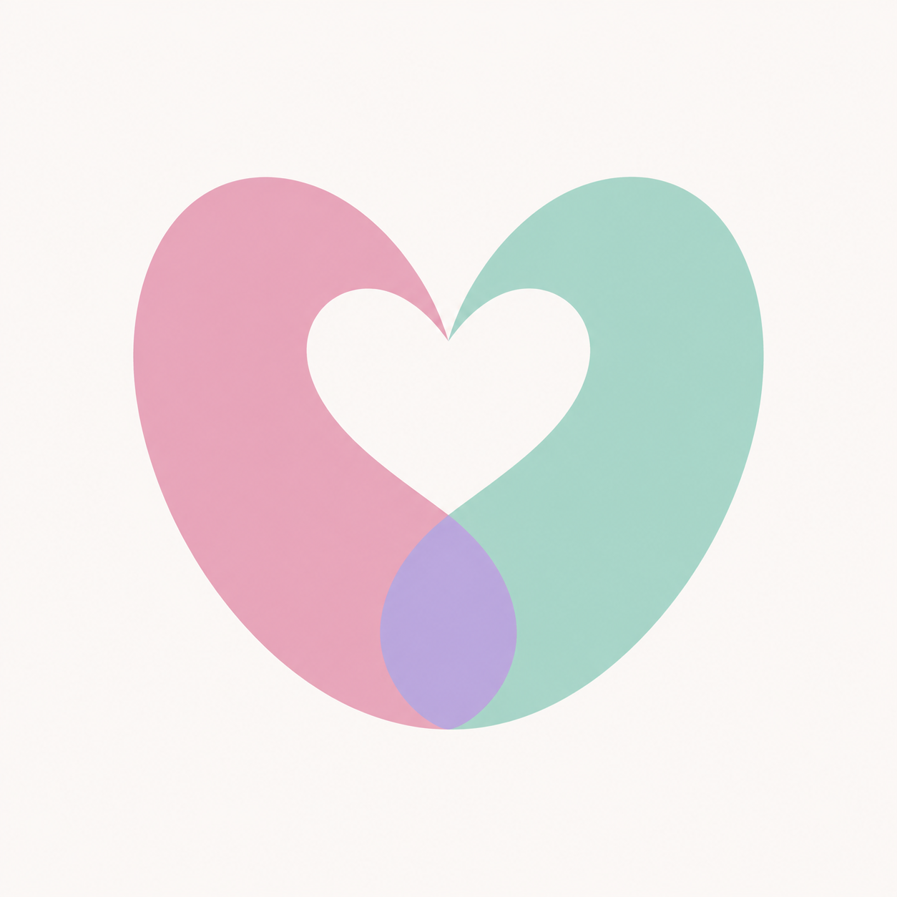
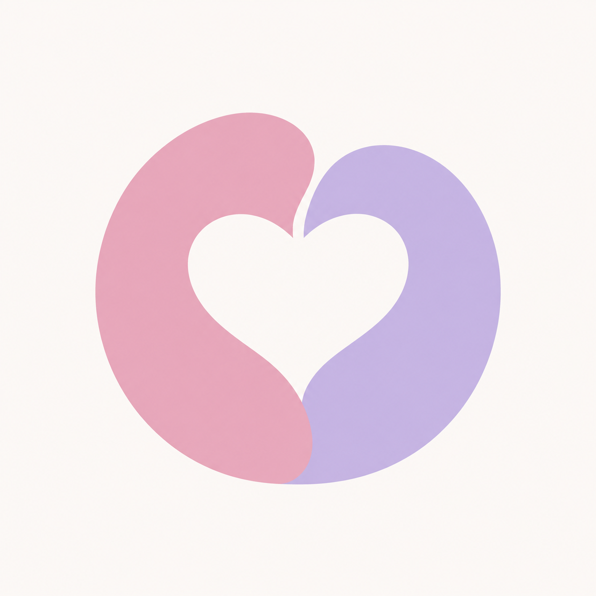
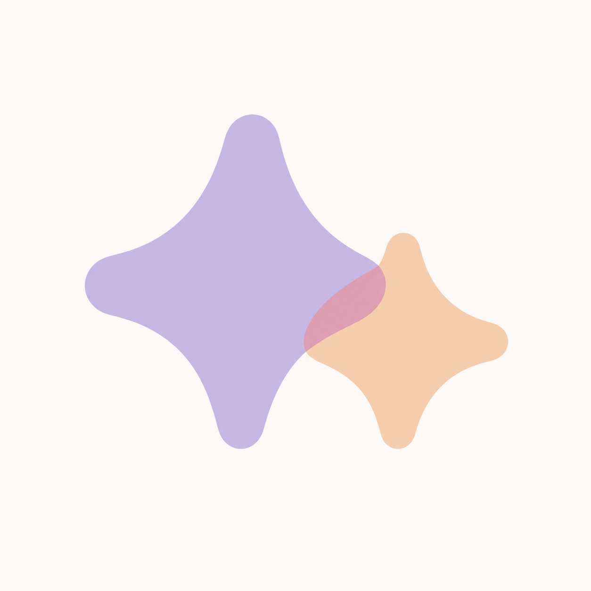
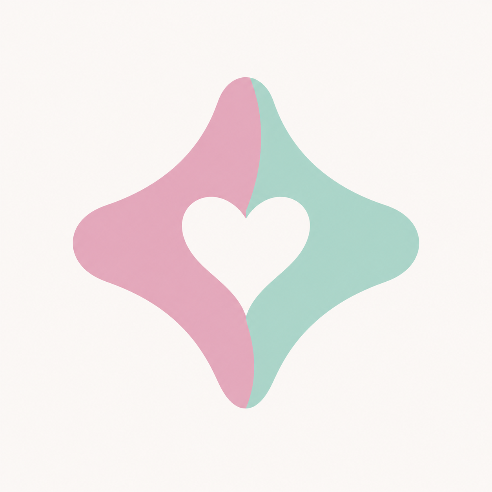
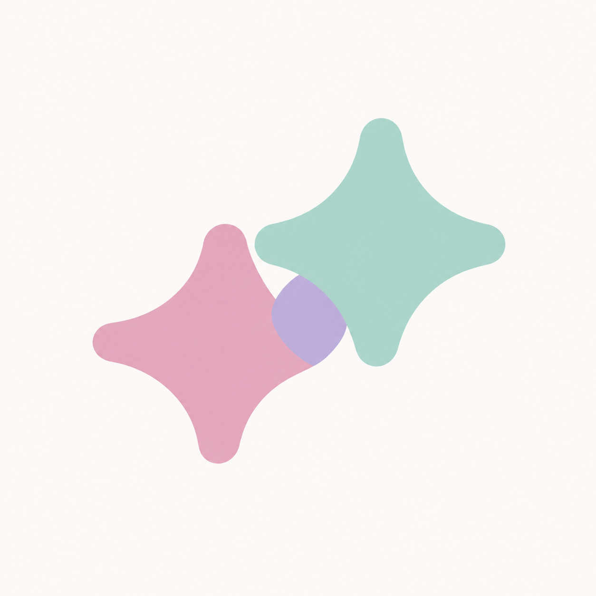
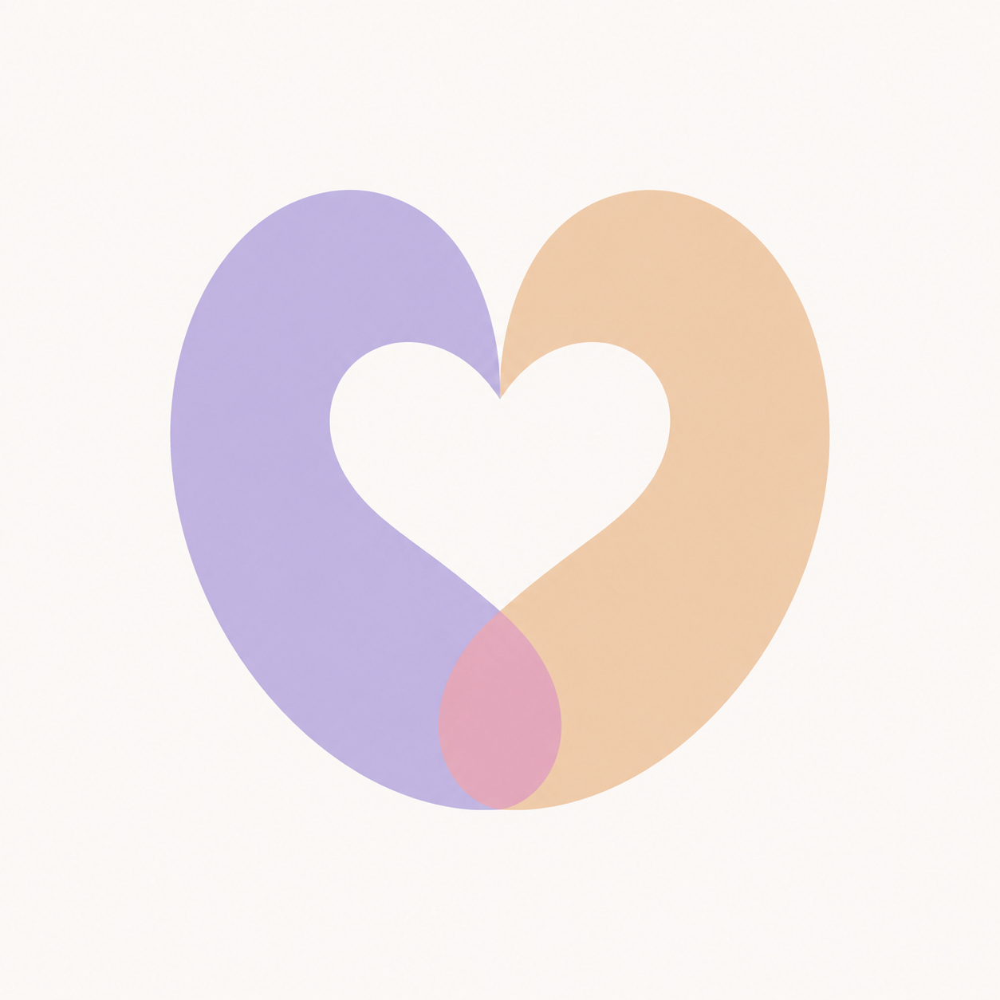
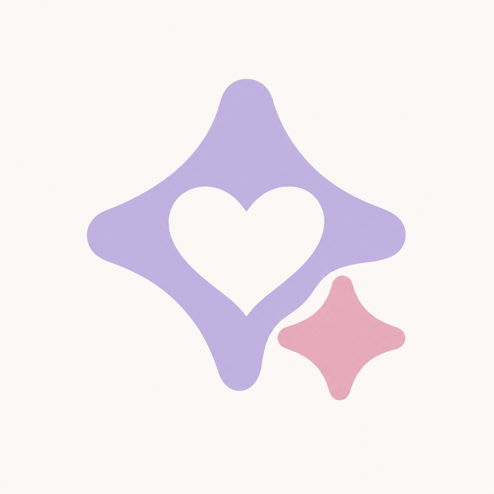

# Deseo icon concepts: round two

Ten variations of the first round: 01 Together, 10 Two sparks, and 05 Conversation.

Generated with the built-in image tool. Each concept used all three reference images.

[Open the comparison board](comparison.html). Small previews show each icon at 32 pixels.

Selected: **05 — Two voices**. The owner chose this icon for Deseo.

## 01 Closer

### Generation prompt

Use case: logo-brand. Create ONE improved app icon concept for Deseo, a couples app. The three attached images are STYLE AND SHAPE REFERENCES, not a sheet to reproduce. Reference 1 is the paired petals with a heart gap; reference 2 is the paired rounded stars; reference 3 is the two chat bubbles with a heart gap. Keep the same warm pastel personality. Improve optical balance, silhouette, smooth curves, and small-size clarity. Flat crisp vector-like design with uniform solid fills. Square canvas with edge-to-edge warm ivory #FAF7F5 background. Center a single icon symbol occupying 65 percent of the canvas, with clear margins. Palette: blush #DFA9BD, mint #A5D1C5, lavender #BEB1DE, peach #EEC9A8. Optional slightly deeper overlap. Medium pastel saturation, clear separation from ivory. No text, numbers, device mockups, border, shadows, gradients, grain, 3D, tiny details, sparkles beyond the specified motif, or watermark. Specific concept: Refine reference 1: two broad softly rounded upright petals in blush and mint, leaning together. A larger smooth heart-shaped negative space in the upper middle; a smaller tidy lavender overlap at the base. Balanced compact silhouette, very simple and recognizable.

## 02 Embrace

### Generation prompt

Use case: logo-brand. Create ONE improved app icon concept for Deseo, a couples app. The three attached images are STYLE AND SHAPE REFERENCES, not a sheet to reproduce. Reference 1 is the paired petals with a heart gap; reference 2 is the paired rounded stars; reference 3 is the two chat bubbles with a heart gap. Keep the same warm pastel personality. Improve optical balance, silhouette, smooth curves, and small-size clarity. Flat crisp vector-like design with uniform solid fills. Square canvas with edge-to-edge warm ivory #FAF7F5 background. Center a single icon symbol occupying 65 percent of the canvas, with clear margins. Palette: blush #DFA9BD, mint #A5D1C5, lavender #BEB1DE, peach #EEC9A8. Optional slightly deeper overlap. Medium pastel saturation, clear separation from ivory. No text, numbers, device mockups, border, shadows, gradients, grain, 3D, tiny details, sparkles beyond the specified motif, or watermark. Specific concept: Evolve reference 1 into two thick curved comma-like petals embracing one another in a nearly circular silhouette. Blush left and lavender right, a single clean ivory heart cutout between them. Closed lower silhouette, generous internal heart opening.

## 03 Heart talk

### Generation prompt

Use case: logo-brand. Create ONE improved app icon concept for Deseo, a couples app. The three attached images are STYLE AND SHAPE REFERENCES, not a sheet to reproduce. Reference 1 is the paired petals with a heart gap; reference 2 is the paired rounded stars; reference 3 is the two chat bubbles with a heart gap. Keep the same warm pastel personality. Improve optical balance, silhouette, smooth curves, and small-size clarity. Flat crisp vector-like design with uniform solid fills. Square canvas with edge-to-edge warm ivory #FAF7F5 background. Center a single icon symbol occupying 65 percent of the canvas, with clear margins. Palette: blush #DFA9BD, mint #A5D1C5, lavender #BEB1DE, peach #EEC9A8. Optional slightly deeper overlap. Medium pastel saturation, clear separation from ivory. No text, numbers, device mockups, border, shadows, gradients, grain, 3D, tiny details, sparkles beyond the specified motif, or watermark. Specific concept: Refine reference 3: two equal rounded speech bubbles side by side, one blush one mint, sharing a large clean heart-shaped ivory gap between their lower inner corners. Shorter thicker tails, compact symmetric silhouette, avoid fragile points.

## 04 Shared spark

### Generation prompt

Use case: logo-brand. Create ONE improved app icon concept for Deseo, a couples app. The three attached images are STYLE AND SHAPE REFERENCES, not a sheet to reproduce. Reference 1 is the paired petals with a heart gap; reference 2 is the paired rounded stars; reference 3 is the two chat bubbles with a heart gap. Keep the same warm pastel personality. Improve optical balance, silhouette, smooth curves, and small-size clarity. Flat crisp vector-like design with uniform solid fills. Square canvas with edge-to-edge warm ivory #FAF7F5 background. Center a single icon symbol occupying 65 percent of the canvas, with clear margins. Palette: blush #DFA9BD, mint #A5D1C5, lavender #BEB1DE, peach #EEC9A8. Optional slightly deeper overlap. Medium pastel saturation, clear separation from ivory. No text, numbers, device mockups, border, shadows, gradients, grain, 3D, tiny details, sparkles beyond the specified motif, or watermark. Specific concept: Refine reference 2: two rounded four-point stars, large lavender on the left and a medium peach star on the lower right. Bring them closer with a single small overlap in dusty blush. Preserve four clearly readable rounded tips on each star.

## 05 Two voices

### Generation prompt

Use case: logo-brand. Create ONE improved app icon concept for Deseo, a couples app. The three attached images are STYLE AND SHAPE REFERENCES, not a sheet to reproduce. Reference 1 is the paired petals with a heart gap; reference 2 is the paired rounded stars; reference 3 is the two chat bubbles with a heart gap. Keep the same warm pastel personality. Improve optical balance, silhouette, smooth curves, and small-size clarity. Flat crisp vector-like design with uniform solid fills. Square canvas with edge-to-edge warm ivory #FAF7F5 background. Center a single icon symbol occupying 65 percent of the canvas, with clear margins. Palette: blush #DFA9BD, mint #A5D1C5, lavender #BEB1DE, peach #EEC9A8. Optional slightly deeper overlap. Medium pastel saturation, clear separation from ivory. No text, numbers, device mockups, border, shadows, gradients, grain, 3D, tiny details, sparkles beyond the specified motif, or watermark. Specific concept: Evolve reference 3: two offset rounded-square conversation bubbles, blush upper left and lavender lower right, smoothly interlocking. A prominent ivory heart sits in the overlap center. Compact near-square emblem, short soft bubble tails, no extra marks.

## 06 Heart petals

### Generation prompt

Use case: logo-brand. Create ONE improved app icon concept for Deseo, a couples app. The three attached images are STYLE AND SHAPE REFERENCES, not a sheet to reproduce. Reference 1 is the paired petals with a heart gap; reference 2 is the paired rounded stars; reference 3 is the two chat bubbles with a heart gap. Keep the same warm pastel personality. Improve optical balance, silhouette, smooth curves, and small-size clarity. Flat crisp vector-like design with uniform solid fills. Square canvas with edge-to-edge warm ivory #FAF7F5 background. Center a single icon symbol occupying 65 percent of the canvas, with clear margins. Palette: blush #DFA9BD, mint #A5D1C5, lavender #BEB1DE, peach #EEC9A8. Optional slightly deeper overlap. Medium pastel saturation, clear separation from ivory. No text, numbers, device mockups, border, shadows, gradients, grain, 3D, tiny details, sparkles beyond the specified motif, or watermark. Specific concept: Blend reference 1 and reference 2: two plush petal-like halves in blush and mint form a single rounded four-point sparkle silhouette. Their inner edges create one clear heart-shaped ivory opening. Elegant simple positive and negative space, no detached pieces.

## 07 Twin stars

### Generation prompt

Use case: logo-brand. Create ONE improved app icon concept for Deseo, a couples app. The three attached images are STYLE AND SHAPE REFERENCES, not a sheet to reproduce. Reference 1 is the paired petals with a heart gap; reference 2 is the paired rounded stars; reference 3 is the two chat bubbles with a heart gap. Keep the same warm pastel personality. Improve optical balance, silhouette, smooth curves, and small-size clarity. Flat crisp vector-like design with uniform solid fills. Square canvas with edge-to-edge warm ivory #FAF7F5 background. Center a single icon symbol occupying 65 percent of the canvas, with clear margins. Palette: blush #DFA9BD, mint #A5D1C5, lavender #BEB1DE, peach #EEC9A8. Optional slightly deeper overlap. Medium pastel saturation, clear separation from ivory. No text, numbers, device mockups, border, shadows, gradients, grain, 3D, tiny details, sparkles beyond the specified motif, or watermark. Specific concept: Evolve reference 2: two equal-size rounded four-point stars in blush and mint placed diagonally from lower left to upper right. They overlap at one broad tip into a small lavender diamond. Close paired composition, slightly rotated toward one another.

## 08 Spark talk

### Generation prompt

Use case: logo-brand. Create ONE improved app icon concept for Deseo, a couples app. The three attached images are STYLE AND SHAPE REFERENCES, not a sheet to reproduce. Reference 1 is the paired petals with a heart gap; reference 2 is the paired rounded stars; reference 3 is the two chat bubbles with a heart gap. Keep the same warm pastel personality. Improve optical balance, silhouette, smooth curves, and small-size clarity. Flat crisp vector-like design with uniform solid fills. Square canvas with edge-to-edge warm ivory #FAF7F5 background. Center a single icon symbol occupying 65 percent of the canvas, with clear margins. Palette: blush #DFA9BD, mint #A5D1C5, lavender #BEB1DE, peach #EEC9A8. Optional slightly deeper overlap. Medium pastel saturation, clear separation from ivory. No text, numbers, device mockups, border, shadows, gradients, grain, 3D, tiny details, sparkles beyond the specified motif, or watermark. Specific concept: Blend reference 3 and reference 2: two compact rounded speech bubbles, mint and lavender, interlock around an ivory four-point rounded sparkle gap in the center. Short clean tails face inward. The bubbles stay the dominant recognizable shape.

## 09 Heart orbit

### Generation prompt

Use case: logo-brand. Create ONE improved app icon concept for Deseo, a couples app. The three attached images are STYLE AND SHAPE REFERENCES, not a sheet to reproduce. Reference 1 is the paired petals with a heart gap; reference 2 is the paired rounded stars; reference 3 is the two chat bubbles with a heart gap. Keep the same warm pastel personality. Improve optical balance, silhouette, smooth curves, and small-size clarity. Flat crisp vector-like design with uniform solid fills. Square canvas with edge-to-edge warm ivory #FAF7F5 background. Center a single icon symbol occupying 65 percent of the canvas, with clear margins. Palette: blush #DFA9BD, mint #A5D1C5, lavender #BEB1DE, peach #EEC9A8. Optional slightly deeper overlap. Medium pastel saturation, clear separation from ivory. No text, numbers, device mockups, border, shadows, gradients, grain, 3D, tiny details, sparkles beyond the specified motif, or watermark. Specific concept: Evolve reference 1: two broad curved oval halves in lavender and peach wrap around a centered ivory heart opening, forming a compact upright oval. Small blush overlap at the bottom. Softer heart notch and cleaner symmetrical proportions, strong silhouette.

## 10 Spark embrace

### Generation prompt

Use case: logo-brand. Create ONE improved app icon concept for Deseo, a couples app. The three attached images are STYLE AND SHAPE REFERENCES, not a sheet to reproduce. Reference 1 is the paired petals with a heart gap; reference 2 is the paired rounded stars; reference 3 is the two chat bubbles with a heart gap. Keep the same warm pastel personality. Improve optical balance, silhouette, smooth curves, and small-size clarity. Flat crisp vector-like design with uniform solid fills. Square canvas with edge-to-edge warm ivory #FAF7F5 background. Center a single icon symbol occupying 65 percent of the canvas, with clear margins. Palette: blush #DFA9BD, mint #A5D1C5, lavender #BEB1DE, peach #EEC9A8. Optional slightly deeper overlap. Medium pastel saturation, clear separation from ivory. No text, numbers, device mockups, border, shadows, gradients, grain, 3D, tiny details, sparkles beyond the specified motif, or watermark. Specific concept: Blend reference 2 and reference 1: one large rounded lavender four-point star with a broad heart-shaped ivory cutout, joined at its lower-right tip by a small blush rounded four-point star. Keep the heart large and the small star simple. Two shapes only.
