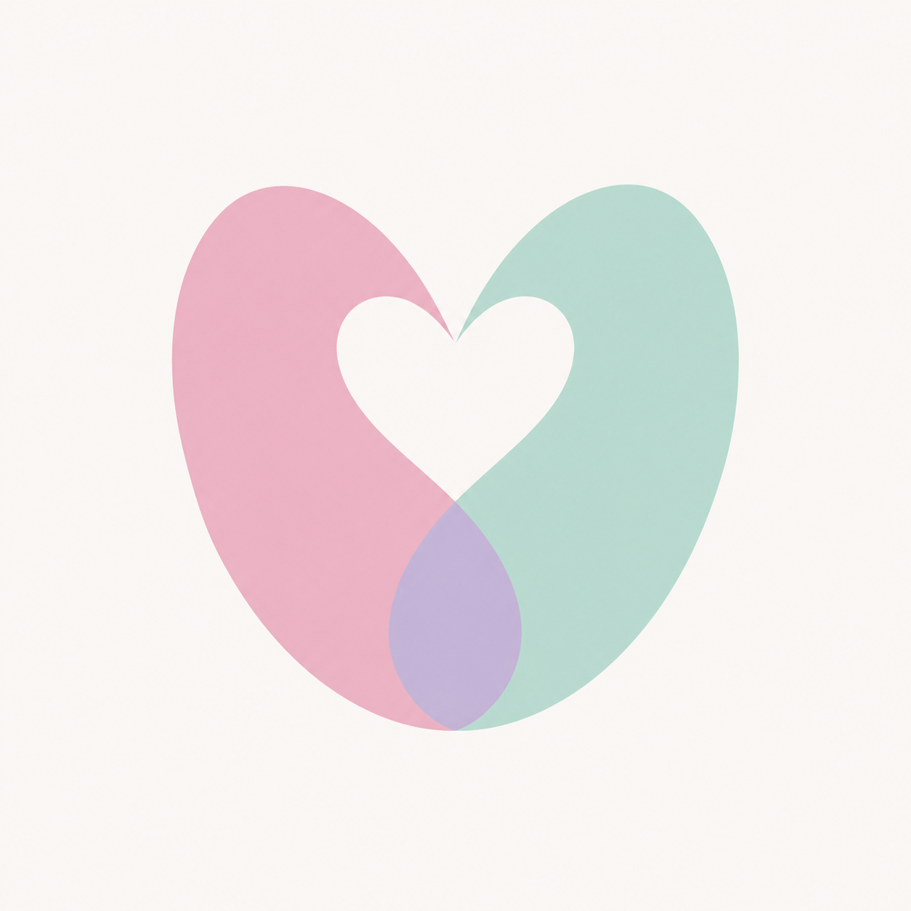
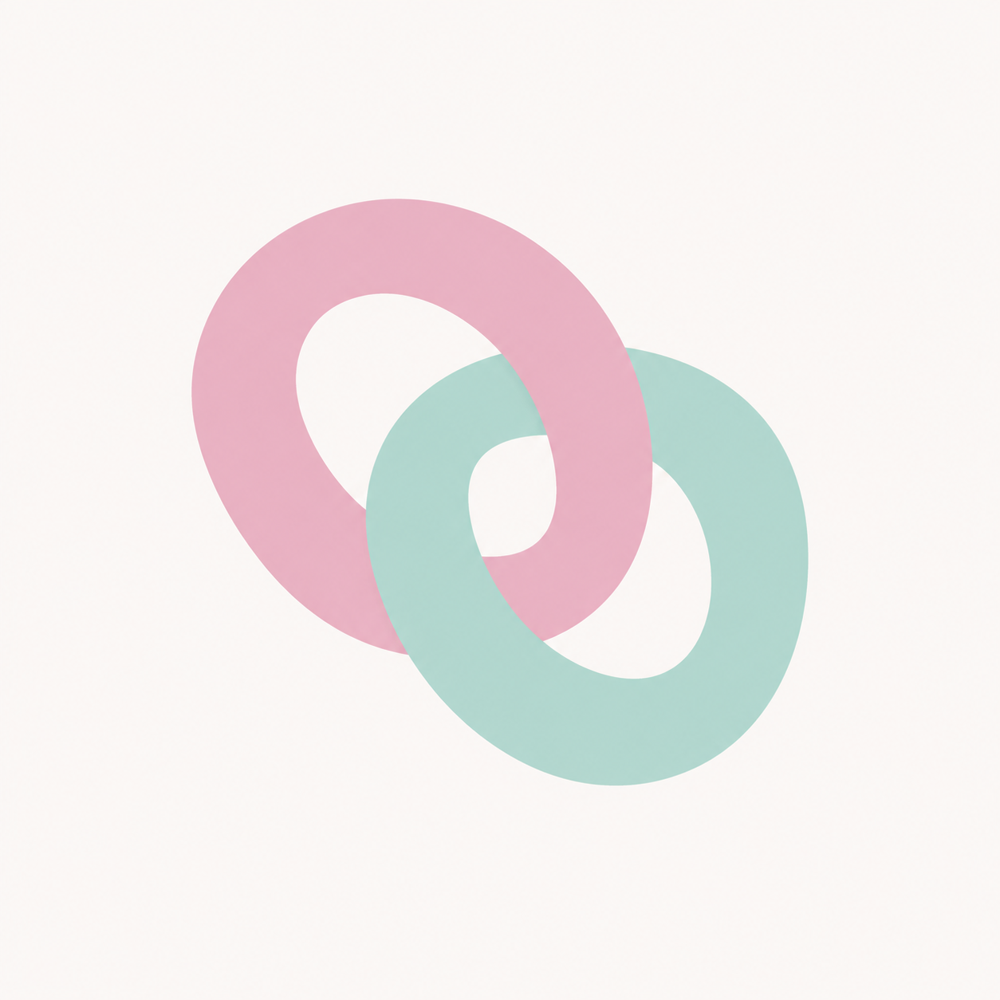
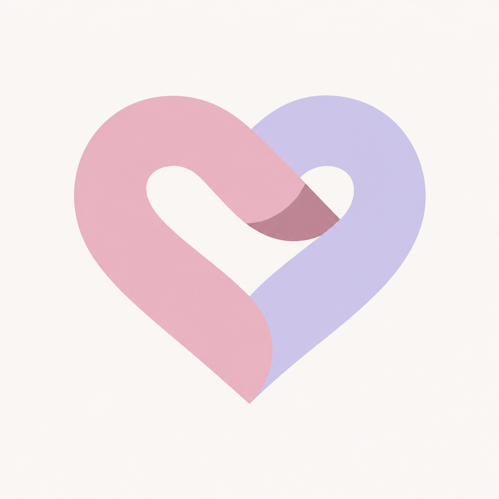
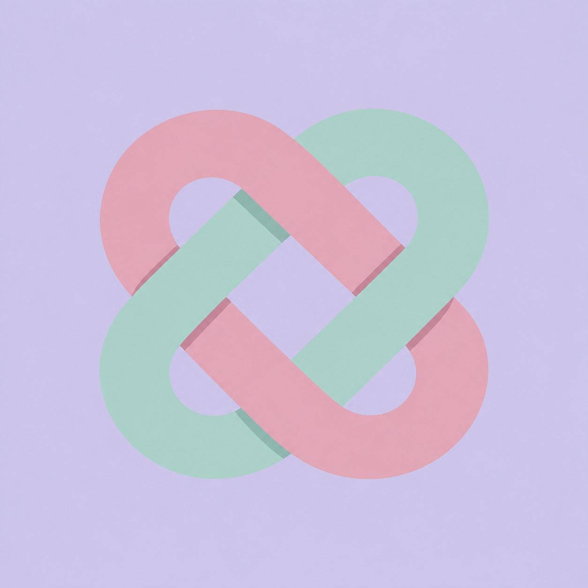
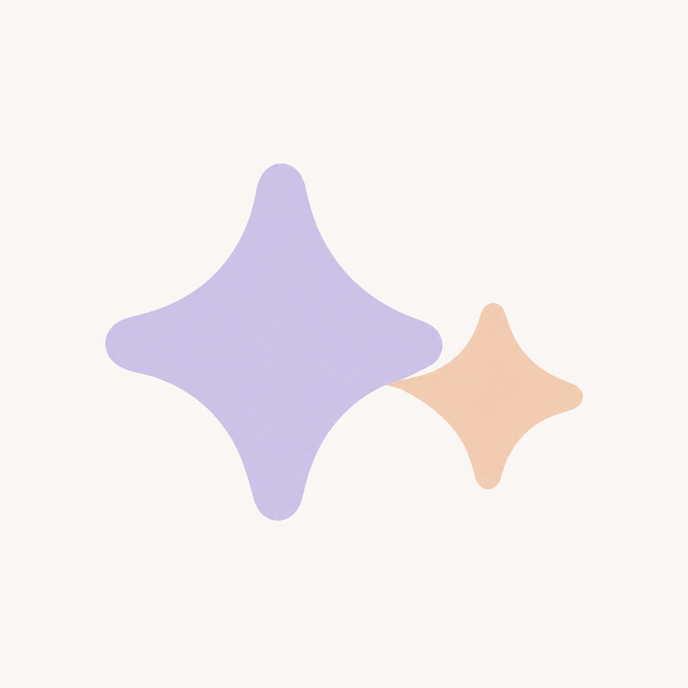

# Deseo icon concepts

Generated with the built-in imagegen tool on 4 October 2026.

These are selection concepts. No icon has been selected for the app.

Open [the comparison](comparison.html) to inspect all ten icons.

## 01. Together

Prompt:

Use case: logo-brand. Create ONE polished app icon concept for Deseo, a couples app for shared calendars, photos, messages, and reminders. Square image, edge-to-edge solid background; the app platform will apply corner masking. Large centered original symbol occupying about 60 percent of the canvas with generous safe margins. Soft pastel palette: blush #E6B8C7, mint #B9DAD2, lavender #CEC7E9, peach #F2D4BA, warm ivory #FAF7F5. Use slightly deeper dusty accents only for useful separation. Crisp clean flat vector-like brand design, warm and refined, adult and friendly. Bold simple geometry readable at small app icon sizes. No device mockup, no border, no outer shadow, no gloss, no 3D, no grain, no gradients, no watermark, no words or numbers except a monogram when specifically requested. Concept: Two soft upright rounded petals, blush pink and mint, leaning toward one another and overlapping once in the middle. Their shared negative space subtly suggests a heart. Warm ivory background.

## 02. Linked

Prompt:

Use case: logo-brand. Create ONE polished app icon concept for Deseo, a couples app for shared calendars, photos, messages, and reminders. Square image, edge-to-edge solid background; the app platform will apply corner masking. Large centered original symbol occupying about 60 percent of the canvas with generous safe margins. Soft pastel palette: blush #E6B8C7, mint #B9DAD2, lavender #CEC7E9, peach #F2D4BA, warm ivory #FAF7F5. Use slightly deeper dusty accents only for useful separation. Crisp clean flat vector-like brand design, warm and refined, adult and friendly. Bold simple geometry readable at small app icon sizes. No device mockup, no border, no outer shadow, no gloss, no 3D, no grain, no gradients, no watermark, no words or numbers except a monogram when specifically requested. Concept: Two chunky interlocking oval loops, one dusty blush and one soft sage mint, arranged diagonally as a calm compact knot. Warm ivory background.

## 03. Folded heart

Prompt:

Use case: logo-brand. Create ONE polished app icon concept for Deseo, a couples app for shared calendars, photos, messages, and reminders. Square image, edge-to-edge solid background; the app platform will apply corner masking. Large centered original symbol occupying about 60 percent of the canvas with generous safe margins. Soft pastel palette: blush #E6B8C7, mint #B9DAD2, lavender #CEC7E9, peach #F2D4BA, warm ivory #FAF7F5. Use slightly deeper dusty accents only for useful separation. Crisp clean flat vector-like brand design, warm and refined, adult and friendly. Bold simple geometry readable at small app icon sizes. No device mockup, no border, no outer shadow, no gloss, no 3D, no grain, no gradients, no watermark, no words or numbers except a monogram when specifically requested. Concept: One distinctive heart built from two broad folded ribbon shapes, pastel blush and lavender, with one simple darker overlap seam. Warm ivory background.

## 04. Our place

Prompt:

Use case: logo-brand. Create ONE polished app icon concept for Deseo, a couples app for shared calendars, photos, messages, and reminders. Square image, edge-to-edge solid background; the app platform will apply corner masking. Large centered original symbol occupying about 60 percent of the canvas with generous safe margins. Soft pastel palette: blush #E6B8C7, mint #B9DAD2, lavender #CEC7E9, peach #F2D4BA, warm ivory #FAF7F5. Use slightly deeper dusty accents only for useful separation. Crisp clean flat vector-like brand design, warm and refined, adult and friendly. Bold simple geometry readable at small app icon sizes. No device mockup, no border, no outer shadow, no gloss, no 3D, no grain, no gradients, no watermark, no words or numbers except a monogram when specifically requested. Concept: A small softly rounded arch representing a shared home, split into peach and mint halves, with two rounded doorway shapes nestling together. Pale lavender background.

## 05. Conversation

Prompt:

Use case: logo-brand. Create ONE polished app icon concept for Deseo, a couples app for shared calendars, photos, messages, and reminders. Square image, edge-to-edge solid background; the app platform will apply corner masking. Large centered original symbol occupying about 60 percent of the canvas with generous safe margins. Soft pastel palette: blush #E6B8C7, mint #B9DAD2, lavender #CEC7E9, peach #F2D4BA, warm ivory #FAF7F5. Use slightly deeper dusty accents only for useful separation. Crisp clean flat vector-like brand design, warm and refined, adult and friendly. Bold simple geometry readable at small app icon sizes. No device mockup, no border, no outer shadow, no gloss, no 3D, no grain, no gradients, no watermark, no words or numbers except a monogram when specifically requested. Concept: Two offset rounded speech bubbles, pastel blush and mint, whose overlapping tails form a tiny heart in negative space. Warm ivory background.

## 06. Our date

Prompt:

Use case: logo-brand. Create ONE polished app icon concept for Deseo, a couples app for shared calendars, photos, messages, and reminders. Square image, edge-to-edge solid background; the app platform will apply corner masking. Large centered original symbol occupying about 60 percent of the canvas with generous safe margins. Soft pastel palette: blush #E6B8C7, mint #B9DAD2, lavender #CEC7E9, peach #F2D4BA, warm ivory #FAF7F5. Use slightly deeper dusty accents only for useful separation. Crisp clean flat vector-like brand design, warm and refined, adult and friendly. Bold simple geometry readable at small app icon sizes. No device mockup, no border, no outer shadow, no gloss, no 3D, no grain, no gradients, no watermark, no words or numbers except a monogram when specifically requested. Concept: A minimal rounded calendar page in warm ivory on a pastel mint background, two short lavender binding tabs and one simple blush heart as the only calendar content.

## 07. Deseo

Prompt:

Use case: logo-brand. Create ONE polished app icon concept for Deseo, a couples app for shared calendars, photos, messages, and reminders. Square image, edge-to-edge solid background; the app platform will apply corner masking. Large centered original symbol occupying about 60 percent of the canvas with generous safe margins. Soft pastel palette: blush #E6B8C7, mint #B9DAD2, lavender #CEC7E9, peach #F2D4BA, warm ivory #FAF7F5. Use slightly deeper dusty accents only for useful separation. Crisp clean flat vector-like brand design, warm and refined, adult and friendly. Bold simple geometry readable at small app icon sizes. No device mockup, no border, no outer shadow, no gloss, no 3D, no grain, no gradients, no watermark, no words or numbers except a monogram when specifically requested. Concept: A custom lowercase d monogram, made from a single thick curved lavender ribbon with a blush inner curved stroke suggesting a partner leaning in. Pale cream background. Only the stylized d, no other lettering.

## 08. Lovebirds

Prompt:

Use case: logo-brand. Create ONE polished app icon concept for Deseo, a couples app for shared calendars, photos, messages, and reminders. Square image, edge-to-edge solid background; the app platform will apply corner masking. Large centered original symbol occupying about 60 percent of the canvas with generous safe margins. Soft pastel palette: blush #E6B8C7, mint #B9DAD2, lavender #CEC7E9, peach #F2D4BA, warm ivory #FAF7F5. Use slightly deeper dusty accents only for useful separation. Crisp clean flat vector-like brand design, warm and refined, adult and friendly. Bold simple geometry readable at small app icon sizes. No device mockup, no border, no outer shadow, no gloss, no 3D, no grain, no gradients, no watermark, no words or numbers except a monogram when specifically requested. Concept: Two minimal abstract birds facing one another, one blush and one mint, their bodies formed from large simple teardrops, with tiny dark eyes and a shared heart-shaped gap. Pale peach background.

## 09. Shared path

Prompt:

Use case: logo-brand. Create ONE polished app icon concept for Deseo, a couples app for shared calendars, photos, messages, and reminders. Square image, edge-to-edge solid background; the app platform will apply corner masking. Large centered original symbol occupying about 60 percent of the canvas with generous safe margins. Soft pastel palette: blush #E6B8C7, mint #B9DAD2, lavender #CEC7E9, peach #F2D4BA, warm ivory #FAF7F5. Use slightly deeper dusty accents only for useful separation. Crisp clean flat vector-like brand design, warm and refined, adult and friendly. Bold simple geometry readable at small app icon sizes. No device mockup, no border, no outer shadow, no gloss, no 3D, no grain, no gradients, no watermark, no words or numbers except a monogram when specifically requested. Concept: Two broad rounded paths in dusty rose and soft teal weave together into a compact square knot with a clean open center. Pale lavender background.

## 10. Two sparks

Prompt:

Use case: logo-brand. Create ONE polished app icon concept for Deseo, a couples app for shared calendars, photos, messages, and reminders. Square image, edge-to-edge solid background; the app platform will apply corner masking. Large centered original symbol occupying about 60 percent of the canvas with generous safe margins. Soft pastel palette: blush #E6B8C7, mint #B9DAD2, lavender #CEC7E9, peach #F2D4BA, warm ivory #FAF7F5. Use slightly deeper dusty accents only for useful separation. Crisp clean flat vector-like brand design, warm and refined, adult and friendly. Bold simple geometry readable at small app icon sizes. No device mockup, no border, no outer shadow, no gloss, no 3D, no grain, no gradients, no watermark, no words or numbers except a monogram when specifically requested. Concept: Two four-point rounded stars, one larger lavender and one smaller peach, touching at one point to form a compact asymmetric paired mark. Warm ivory background.

