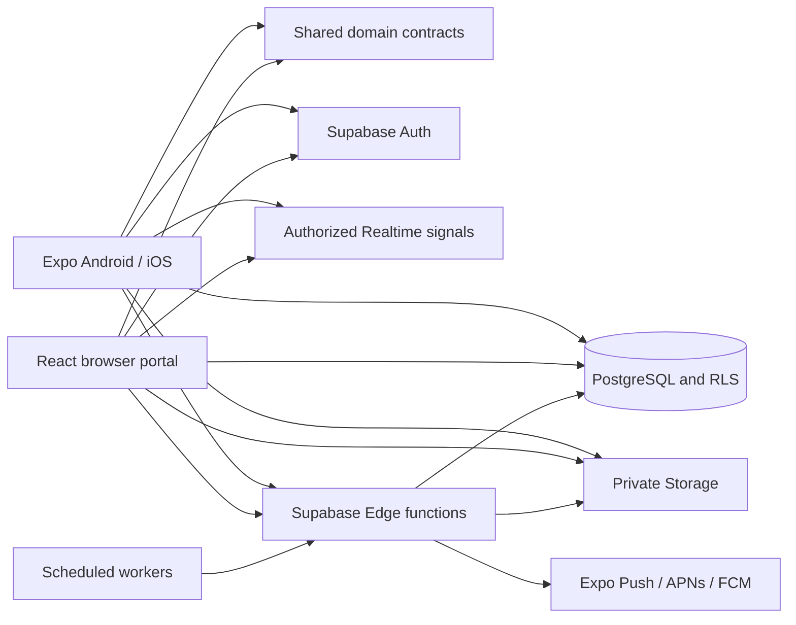

# Architecture

Use [Development](DEVELOPMENT.md) for setup and checks, and [Screens](README.md#screens) for user flows.
Read [modules](#module-structure), [access rules](#server-authorization), and the [data contract](#data-contract) before changing product code.
Data sections: [records](#records), [access](#access-matrix), [pairing](#pair-transactions), [commands](#content-commands-and-conflicts),
[messages](#messages-and-realtime), [photos](#photos), [reminders](#reminders-and-push), and [end pair](#end-pair).

## Applications

Expo owns Android and iOS screens, native storage, photo selection, and push registration.
React DOM owns browser screens, URLs, file inputs, and browser session lifecycle.
The planned Astro site owns public information and installation handoff.
PostgreSQL owns durable content, permissions, pairing, versions, and transactions.



## Stack

| Area | Choice |
|---|---|
| Native | Expo, React Native, TypeScript, Expo Router |
| Browser | React DOM, TypeScript, Vite, React Router |
| Queries | TanStack Query; one client per application |
| Forms | React Hook Form and Zod resolver |
| Dates | Luxon and shared date rules |
| Backend | Supabase Auth, PostgreSQL, RLS, Storage, Realtime, Edge functions |
| Brand | `brand/tokens.json` and Two voices icon |

Keep exact package pins and one root lockfile. Use Node 24.18.0 and npm 11.16.0.

## Module structure

```text
apps/mobile/src/
  app/                      Expo route files and providers
  features/                 Native screens, queries, commands, capabilities
  components/ui/            Native controls
  theme/                    Native brand mapping
  lib/                      Native client, encrypted storage, lifecycle
apps/web/src/
  app/                      Browser router, providers, gate, shell
  features/                 Browser pages, queries, commands, controls
  components/ui/            Browser controls
  styles/                   Browser tokens and feature styles
  lib/                      Browser client, RPC calls, command IDs, signals, unsaved changes
apps/web/tests/             Real-browser account isolation and revocation checks
packages/domain/src/       Shared schemas, date rules, message merging, payloads, results
supabase/
  migrations/              One baseline schema with feature sections
  functions/               Narrow server operations and workers
  tests/                   SQL, access, and race checks
  dev/                     Local stack keys, env, and synthetic pair fixtures
brand/                     Shared tokens and icon
```

Keep native UI and browser UI separate. Extract only contracts both applications use.
Remove old contract copies and compatibility exports when moving shared code.
Shared domain modules must not import React Native, Expo, MMKV, browser storage, or application routes.

## Dependency rules

1. Routes import feature pages, screens, and UI controls.
2. Feature commands and queries import that application's backend client and shared contracts.
3. Features import another feature's public interface, not its internal files.
4. Today reads `get_today` and the Memories public interface. Screens do not call database tables.
5. UI controls import platform libraries and brand values, not feature data.
6. Backend functions share code only where multiple functions use it.
7. Public pages import brand assets, not signed-in application screens.

The pair module owns membership. Messages owns notes. Calendar owns events, important dates, and date ideas.
Each application owns its client and lifecycle. Avoid a second global copy of query data.
Use the installed Supabase query builder without a generic repository layer.

## Reads, writes, and refresh

- **Read.** A page or screen calls a feature query. The query sends an authenticated request, RLS filters the rows, and the typed result goes into the Query cache.
- **Write.** A form runs a TanStack Query mutation. The command runs one transaction and invalidates the affected queries. On error, the form keeps its input and shows a retry button.
- **Refresh.** Any authorized Realtime signal invalidates the matching feature queries. The app then reads them again with authentication.
- **Keys.** Every query key starts with a `QueryRoot` from `lib/query-keys.ts`. Invalidate only through its `invalidate` function.
- **Photo.** The app prepares the selected photo, reserves an upload, and uploads it to private storage. The server validates the photo before it publishes the memory.
- **Push.** A scheduled worker claims a durable job and checks current access. It sends the job to Expo and then processes the receipt.

Scope keys to account and pair. Clear private caches on sign-out and on account or pair change.
On web focus and reconnect, refetch the session context. A membership or profile signal also refetches it.
Ignore an older session check when a newer check or a sign-out starts after it.
On native resume, cover the mounted screens and keep the cache until the account and pair checks pass.
Events, tasks, ideas, lists, reminders, preferences, and profiles send an expected version. A concurrent edit fails with CONFLICT and keeps the draft.
Web forms keep one command ID per submitted input. A retry of the same input reuses it, so the server receipt stores the write once. Changed input or a success gets a new ID. A message retry keeps its client ID.

## Platform storage

Native uses SecureStore for its encryption key and encrypted MMKV for Auth sessions and scoped drafts.
Handle storage failure by explaining the failure and requiring sign-in. Do not add plaintext fallback storage.
Native photos use private temporary files. Purge them on discard, scope change, and sign-out.
Browser Auth uses Supabase's supported browser session storage.
Shared rows and private images stay in memory. Form input stays in its page. Leaving the page or a reload discards it.
Use no-store media requests and scoped blobs. Release object URLs after use and on authority loss.
Warn before navigation or reload discards changed input. Explicit or forced sign-out clears private state immediately.
A failed global Auth sign-out remains visible after local session removal.
Keep fetched shared content in memory on both platforms. Revalidate account status and membership before displaying it.

## Browser navigation and loading

Use ordinary links, reloadable record URLs, browser Back, document titles, and visible active navigation.
Keep navigation and account controls outside route loading boundaries.
Load route pages with React lazy and Suspense. The route boundary reports loading and handles load failures.
Keep shared form rules in `controls.css` and shared text wrapping in `base.css`.
Each page loads its feature styles. Do not depend on a previously visited feature's stylesheet.
Put each stylesheet in one cascade layer. `tokens.css` declares the order: `reset`, `base`, `components` (`controls.css`), `shell`, and `pages` (feature styles). A later layer wins, so use no `!important` to win between files.
Do not style `*`. Use logical properties, such as `margin-inline-start` and `inline-size`, and set breakpoints in `em`, so layouts follow the text size.
A built portal page carries a Content Security Policy: its own scripts and styles, Supabase connections, and Trusted Types with no policy. Do not write HTML strings into the page.
Keep one router blocker with memory-scoped dirty registrations. Retain unresolved input when the user cancels leaving.
Do not add service workers, offline content storage, browser push, or installation prompts.

## Server authorization

RLS checks current account status and membership. Ignore editable JWT metadata for authorization.
Restricted helpers check JWT session IDs against Auth sessions. Global sign-out blocks revoked sessions.
Use ordinary RLS reads and named transactions for multi-record invariants.
In row policies, compare `pair_id` with `(select private.actor_pair())`. PostgreSQL then checks membership once per statement, not once per row.
Expose narrow invoker wrappers around hardened private implementations.
Revoke default execution, grant required roles, set an empty search path, and check callers.
Keep internal tables outside exposed schemas. Do not accept client-supplied trusted actor IDs.
Keep server keys inside verified server jobs and test processes.
Edge functions reject unknown and null browser origins before Auth or action work. See [Web portal](DEVELOPMENT.md#web-portal).

## Design decisions

Use named commands for retries and conflicts, validated photo finalization, and durable reminder jobs.
Do not add generic repositories, backend adapters, microservices, a global event bus, or a second form framework.
Add an interface when multiple callers need it. Keep public pages static unless product requirements change.
Revisit offline writes or calendar sync only after a new scope decision.

## Data contract

Both applications call the same authenticated reads, transactions, and Edge functions.
PostgreSQL remains authoritative for membership, permissions, versions, and lifecycle changes.
Shared schemas and payloads live in `packages/domain`; each application owns its client and private state.

### Shared conventions

Use UUID record IDs. Use UTC `timestamptz` values for instants and `date` values for calendar dates.
Use `created_by`, `created_at`, `updated_at`, and an integer `version` on mutable content records.
Each pair record carries `pair_id`. Composite foreign keys prevent references to a record from another pair.
Include current account status in access checks. Include active membership and pair status for shared content reads.
Generate database types from the actual schema. Keep database checks authoritative when client validation duplicates them.

### Records

| Record | Required fields and constraints |
|---|---|
| `profiles` | `user_id`, display name 1–40, IANA timezone, locale, `account_status` |
| `pairs` | ID, state `pending/active/ended`, created/ended timestamps, purge deadline |
| `pair_members` | Pair, user, stable slot `a/b`, joined/left timestamps; unique active membership per user |
| `pair_invites` | Pair, token hash, creator, expiry, accepted/revoked time; only one live invite per pending pair |
| `events` | Pair, author, who `together/a/b/private`, title, temporal fields, optional location/description |
| `date_ideas` | Pair, author, title 1–120, note ≤1,000, HTTPS link ≤2,048, state `saved/planned/archived`, linked event |
| `task_lists` | Pair, name 1–40, creation time; General list exists once per pair |
| `tasks` | Pair, list, title 1–200, optional assignee, optional due date, completed time/person, version |
| `messages` | Pair, author, body 1–4,000, server timestamp, client UUID, optional pinned time |
| `conversation_reads` | Pair, user, last seen `(created_at,id)` cursor; private to the reader |
| `memories` | Pair, author, memory date, caption ≤1,000, state `pending/published/deleting`, version |
| `memory_photos` | Pair, memory, uploader, object paths, order 0–4, dimensions, byte counts, validation state |
| `reminders` | User, exactly one event or task reference, choice/instant, active state, version |
| `notification_preferences` | User, message alerts, default event reminder, quiet-hour times and timezone |
| `devices` | User, installation ID, Expo token, platform, permission state, last seen, revoked time |
| `notifications` | Recipient, pair, source reference, generic kind, created time, read time |
| `notification_jobs` | Notification, device, due time, source version, attempt count, lease, provider ticket, state |
| `command_receipts` | Actor, pair, command UUID, command type, result ID, result version, expiry |

Keep invites, delivery jobs, and command receipts outside the exposed schema.
No separate table exists for Today, notes, countdowns, or a relationship score.

### Temporal fields

Timed event: `starts_at`, `ends_at`; require `ends_at > starts_at`.
All-day event: `start_date`, `end_date_exclusive`; require a positive date span.
A check constraint permits exactly one temporal representation, never both.
Yearly important dates use a one-day all-day event with `repeat = yearly` and a stored month/day.
Other events use `repeat = none`. Yearly edits affect the series; there are no occurrence overrides.
Calendar queries expand yearly dates only inside the requested range, limited to 366 days per request.
A yearly date has no occurrence before its start date. Agenda reads, reminder state, and reminder jobs follow this rule.
Include events that overlap the requested range, even when they start before it. Treat the query end as exclusive.
Each person reads and enters times in their profile timezone. Luxon converts wall times to instants.
A wall time that occurs twice at a clock change uses its first instant.
Event reminder offsets are 15, 60, or 1440 minutes. Zero-offset reminders are not supported.
All-day offsets count back from 09:00 in the reminder owner's timezone. Yearly dates follow the February 28 leap-day rule.
Task due dates are dates in the viewer's timezone. A task reminder stores an explicit chosen instant.

### Access matrix

| Record | Read | Create | Change / delete |
|---|---|---|---|
| Profile | Self and current partner; email remains self-only | Authenticated self | Self |
| Pair/membership | Current members | Verified unpaired account | Named pairing commands only |
| Invitation | Creator sees metadata; verified token recipient sees limited inviter data | Pending-pair creator | Creator revoke; join transaction consume |
| Shared event | Active pair members | Either member | Either member |
| Private event | Author only | Author as sole owner | Author only |
| Date idea/list/task | Active pair members | Either member | Either member |
| Message/note | Active pair members | Authenticated author | Author deletes/pins; no sent-text edits |
| Published memory | Active pair members | Either member | Author only |
| Pending photo/memory | Author only | Author with reserved upload | Author or validated job |
| Reminder | Owner only | Owner for visible source | Owner; source changes invalidate jobs |
| Notification/device/preference | Owner only | Owner or verified job | Owner or verified job |
| Ended-pair content | No normal reads | None | None |

Moving content to another pair is forbidden. Changes to author, pair, and membership slot are server-controlled.
Changing an event to Private requires its author. It revokes the partner's reminders. A private event takes its author's color.
Changing it back from Private requires the author and explicit sharing confirmation.
RLS covers direct reads, reads through views, subscriptions, and storage objects. Test every path with a third account.
Use `security_invoker` views if a view is required. Do not expose unrestricted views or storage buckets.

### Pair transactions

#### Create and regenerate

`create_pair(command_id)` creates a pending pair and membership atomically.
`create_invite(pair_id, command_id)` generates a cryptographically random 12-character Crockford code and returns it once.
Store only its hash. Regeneration revokes the prior live invitation. Expire it after 24 hours.
The same token works in a link and manual entry. Treat it as a secret, not an account identifier.
Apply verified-account and network-level rate limits to validation and acceptance. Start with five failed attempts per 15 minutes per account.

#### Join

`accept_invite(token, command_id)` derives the actor from verified authentication.
Lock the relevant account rows in sorted ID order, then the pair and invitation rows.
Check account status, expiry, revocation, self-join, active membership, and available slot within the same transaction.
Insert slot `b`, mark the pair active, consume the invitation, and record the command result.
Create the General list through an active-pair trigger within the join transaction.
Create task tables before installing that trigger. Initialize General lists for existing active pairs.
A unique partial index on active membership backs the account check. A unique pair/slot constraint caps capacity.
Acquire the same locks during invite regeneration and pair termination. A failed transaction leaves no partial membership.
Idempotent replay by the same actor returns the original pair. A different actor cannot reuse that result.
Cancel an empty pending pair before joining another. A pending pair cannot contain published shared content.

### Content commands and conflicts

Create commands accept `command_id`. Durable content IDs also use client UUIDs where appropriate.
Use a unique `(actor, command_id, command_type)` receipt. Keep receipts for 30 days.
Never create a new UUID for a retry. After receipt expiry, stable content IDs still prevent duplicate creates.
Edit commands accept `expected_version`. Update only when it matches; return `CONFLICT` otherwise.
Return a stable result shape: `ok`, `data`, `error.code`, and optional `error.field`.
Error codes: `UNAUTHENTICATED`, `FORBIDDEN`, `VALIDATION`, `CONFLICT`, `INVITE_UNAVAILABLE`, `ALREADY_PAIRED`, `RATE_LIMITED`, `QUOTA_EXCEEDED`, `RETRYABLE`.
`set_task_completed(task_id, completed, expected_version, command_id)` sets a desired state, not a toggle.
Lists have unique case-insensitive names within a pair. General cannot be deleted or renamed.
Delete other lists only when empty. Move tasks to General through an explicit user action before removing a nonempty list.
`pin_message(message_id, command_id)` unpins the author's prior note and pins the selected message atomically.
`plan_date_idea(idea_id, event_input, expected_version, command_id)` creates the shared event and links the idea atomically.
Creating or editing a source record updates pending reminder work within the same transaction or an authoritative database trigger.

### Messages and realtime

Use `(created_at,id)` keyset pagination. Timestamps come from the server; UUIDs break ties.
Unique `(pair_id, author_id, client_id)` prevents duplicate sends after timeouts.
Keep failed local sends outside the confirmed message query. Reconcile by client ID after reconnect.
Subscribe only while the app is active. On reconnect, fetch the durable rows before updating unread state.
Update the viewer's private read cursor when messages are visible. Never send a read receipt to the partner.
Pair closure emits only a revocation signal. Revalidate access and remove content from screen and cache.
Do not send message bodies through an unrestricted broadcast channel.

### Photos

Limit each memory to five photos. Limit a prepared photo to 5 MiB and 2,560 pixels on its longest side.
Accept prepared JPEG files only. Prepare native selections or browser file inputs before upload and remove metadata.
Keep each original camera file on the person's device. The accepted prepared image becomes Deseo's full image.
Create a separate thumbnail up to 512 pixels. Validate actual byte type, dimensions, size, and absence of location metadata.
Reject invalid files on the server. Do not trust extension, client MIME type, or client-reported dimensions.
Use a maintained file metadata parser. Do not write a custom image decoder or cryptographic format.
Reserve storage against a 1 GiB pair quota, including pending uploads. Return a clear quota message before upload.
Paths follow `pair_id/memory_id/photo_id/{full,thumb}.jpg`. Check all IDs against authorized database rows.
Upload with no overwrite. Storage RLS permits the insert only for the author's live reservation.
A database trigger checks that the stored size equals the reserved size.
On retry, the client treats an existing file (409) as uploaded and sends only missing files.
A browser retry of the same input reuses its memory, photo, and command IDs.
Changed input reserves again with new IDs. The old reservation expires.
The `finalize-memory` Edge function takes `{memoryId, commandId}`. It downloads each unvalidated file and checks its bytes with `validate-jpeg.ts`.
Bucket `allowed_mime_types` and `file_size_limit` check only declared type and size, so this byte check stays on the server.
The function then calls `publish_memory`. That transaction checks current membership and marks the memory published once.
A retry skips validated photos and returns the same publish result.
An object uploaded after disconnect cannot publish. Cleanup removes abandoned reservations and files after 24 hours.
Policy `memory_photos_readable` lets current pair members read validated photos of published memories.
The client signs its own links with `createSignedUrl(path, 60)`. Pending, deleted, and foreign photos return 400.
Clear app image caches on disconnect and sign-out.
Browser media uses no-store requests and in-memory blobs in the query cache. Release object URLs on removal, scope change, and sign-out.
An already issued link may work until expiry. Explain this technical limit in the privacy design; never claim instant copy revocation.
Delete memory metadata visibility first. Retry storage removal until completion. Keep failed cleanup visible to operations.

### Reminders and push

Create one notification for each recipient and source occurrence. Create a delivery job for each active opted-in device.
Use a unique `(recipient, source, occurrence, source_version, device)` delivery key.
Cron claims due jobs every minute using leases and row locks. Workers skip locked jobs.
A daily job materializes the next 90 days of yearly reminder occurrences. Source edits refresh the same horizon immediately.
Use the occurrence's local date in its unique key. Skip past reminder times and show that state to the requester.
The server expands yearly dates for agenda queries and reminder jobs. Native screens format those returned occurrences.
Native screens support None, 15 minutes, one hour, or one day before.
The web portal has no reminder, preference, or notification screens. It does not register native push devices or request browser push permission.
Recheck current account status, pair membership, source existence/version, reminder preference, device status, and quiet hours before sending.
Cancel superseded unsent jobs when the event changes, the task completes, or the pair ends.
Use generic payload text: **You have an update in Deseo.** Put only an opaque notification ID in the data payload.
Open the notification through an authenticated fetch. A revoked source shows an unavailable state.
Retry transient provider failures at one, five, and fifteen minutes, bounded by source expiry.
Check provider receipts after submission. Remove tokens that return `DeviceNotRegistered`.
Distinguish queued, submitted, provider-accepted, failed, expired, and canceled. Provider acceptance does not prove device display.
A network timeout after provider acceptance can cause a duplicate push. Do not claim exactly-once delivery.
Never submit the same known accepted provider ticket again. App content remains idempotent regardless of push duplication.
Quiet hours use the recipient's timezone. Defer messages until quiet hours end; expire event pushes after event start.
Persist notifications for 30 days. Do not maintain a second calendar inside the notification system.

### End pair

Require fresh verification within ten minutes and explicit confirmation.
Atomically mark the pair ended, close memberships, revoke invitations, and cancel unsent jobs.
Allow a new pair immediately after termination. Never copy the former pair's records into it.
No worker purges ended-pair records yet. `purge_after` records the 30-day deadline.

#### Fresh verification

The browser sends an email code with Supabase Auth `signInWithOtp`. It verifies the code with `verifyOtp` in a separate in-memory client.
That client sends the sensitive command, then signs out its session. The saved browser session does not change.
`private.recently_signed_in()` accepts only a session with an `auth.mfa_amr_claims` row from the last ten minutes.
Auth writes that row at sign-in. Token refresh does not change it, and the client cannot set it.
`supabase.auth.reauthenticate()` cannot replace this check. Its nonce works only with a password change in `updateUser`.
Check the JWT session ID against the current Auth session for protected reads and commands, including global sign-out enforcement.

### Limits

Page lists at 50 rows. Limit agenda reads to 366 days. Add an index only for a query that needs it.
See [verification](DEVELOPMENT.md#verification) for required tests.

## Today summary

Both applications use `get_today(pair_id, date)` and `@deseo/domain/today`.
Domain owns the Result schema and `TodaySummary` type. Each application owns its client, cancellation, lifecycle, and query keys.

| Stored field | Shared field | Rule |
|---|---|---|
| `agenda` | `agenda` | Complete Event agenda |
| `important_dates` | `importantDates` | Important Event rows within the existing 366-day range |
| `due_tasks` | `dueTasks` | At most three Task rows |
| `notes` | `notes` | At most two Message rows |

`list_agenda` and `get_today` use the same query, `private.list_agenda`.
For `important_dates`, the query reads only important Events. Yearly Events are always important.
It removes other Events before it expands and converts rows. Range, overlap, leap-day, and private Event rules do not change.
The shared schema reuses Event, Task, Message, and Result schemas.
Queries validate the Pair UUID and calendar date before requesting data.
Invalid dates raise `AppError` with code `VALIDATION` and field `date`.
Malformed responses raise `AppError` with code `RETRYABLE`. Server Result errors retain their typed codes.
Queries check all four arrays for foreign Pair rows before filtering ended timed Events.
Foreign rows raise `FORBIDDEN`. Sign-out and pair change cancel reads and clear the cache.
Browser Today reads `get_today` and the Memories `latestMemory` query together, with one error state.
Both applications show at most three plans that have not ended. Section order: plans, memory, note, tasks, then important date.

## Render calculations

Calendar and Messages cache their grouping Maps per query change. Month cells use direct date lookups.
Groups keep input order and exclusive ends. Messages keep the highest version per ID.
The browser uses `brand/icon-web.webp`, a 192-pixel copy of the Two voices source.

## Feature interfaces

ESLint enforces the [dependency rules](#dependency-rules) in both applications. Cross-feature imports use public interfaces.

## Local backend and Edge

All Edge entrypoints use `supabase/functions/deno.json`, its frozen lockfile, and Deno 2.9.6. Hosted bundling remains unverified.
Nothing runs in production. Edit the baseline migration in place until the first release, then add new migrations.
