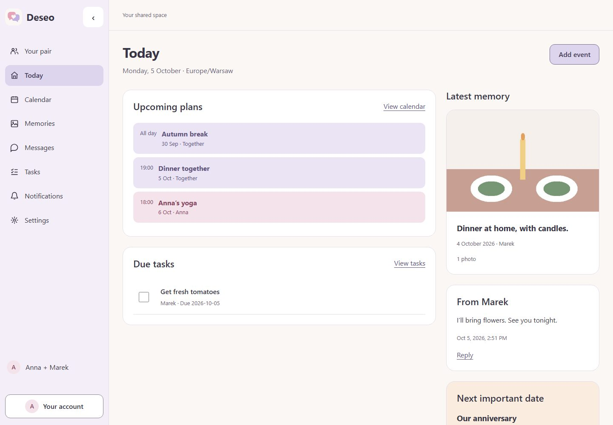
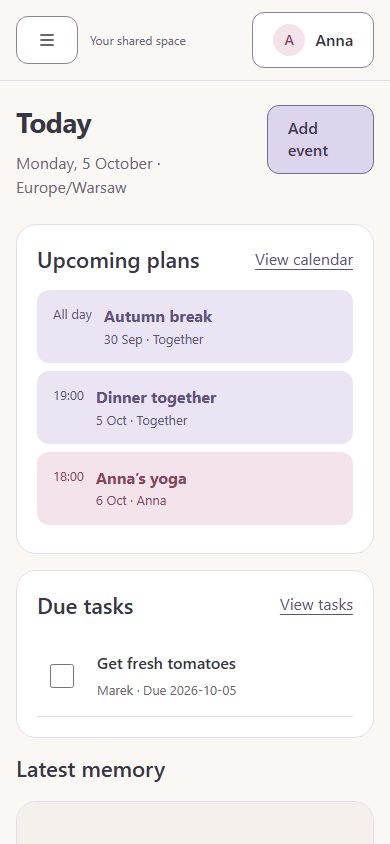
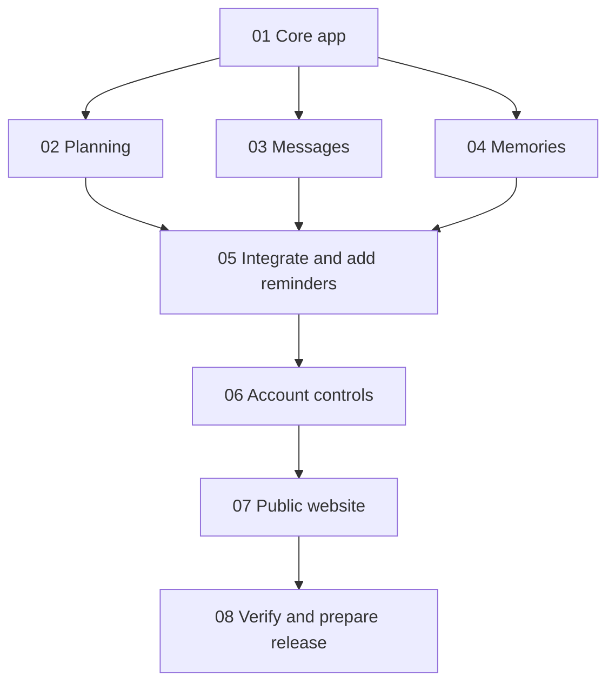

# Development

Use [the workflow](#development-workflow), [verification](#verification), and [release](#release) sections for commands and acceptance gates.
Use [the frontend handoff](#frontend-design-handoff) for current frontend evidence.
The product and data rules remain in [README](README.md) and [Architecture](ARCHITECTURE.md).
Implementation plans and chat records below retain their dated scope and measured results.
Their requirements do not establish deployment or device acceptance.

<a id="development-workflow"></a>
## Development workflow
Use Node 24.18.0, npm 11.16.0, and the committed root lockfile.
Read AGENTS.md, STYLE.md, the approved portal design, ARCHITECTURE.md, and DATA.md before product work.

<a id="development-workflow-1-install-and-verify-source"></a>
### 1. Install and verify source

Run these commands from the repository root:

```powershell
npm ci
npm run verify:mobile
npm run test:domain
```

Mobile verification runs native TypeScript, lint, and Jest. It does not require Docker.
The domain suite checks shared schemas, payloads, and results.
Keep exact pins. Add packages only when a feature needs them.

<a id="development-workflow-2-local-browser-backend"></a>
### 2. Local browser backend

Run Docker Desktop. Use the guarded dedicated `deseo-web` project under `.superpowers/web-backend`.
Its API uses 55721, database 55722, mail 55724, and inspector 55728.
The separate `deseo-integration` project uses 55620–55629.

```powershell
npm run prepare:web:backend
npm run start:web:backend
```

Set CLI telemetry controls before direct commands:

```powershell
$env:DO_NOT_TRACK = '1'
$env:SUPABASE_TELEMETRY_DISABLED = 'true'
```

Save this helper as `.superpowers/web-backend/save-status.cjs`:

```javascript
const { spawnSync } = require('node:child_process');
const { writeFileSync } = require('node:fs');
const { join } = require('node:path');
const workdir = process.argv[2];
const run = spawnSync(process.execPath,
  ['node_modules/supabase/dist/supabase.js', '--workdir', workdir, 'status', '-o', 'json'],
  { encoding: 'utf8', windowsHide: true });
writeFileSync(join(workdir, 'status.stderr.local.log'), run.stderr ?? '');
if (run.error || run.status !== 0) throw new Error('Read the private status error log.');
writeFileSync(join(workdir, 'status.local.json'), run.stdout, 'utf8');
```

```powershell
node .superpowers/web-backend/save-status.cjs .superpowers/web-backend
```

The helper writes UTF-8 without a BOM. Keep the ignored files private; do not print keys.
Create `apps/web/.env.local` from `.env.example` and use the local publishable key.

| Browser variable | Use |
|---|---|
| `VITE_SUPABASE_URL` | API address; local value `http://127.0.0.1:55721` |
| `VITE_SUPABASE_PUBLISHABLE_KEY` | Public browser key |

Browser invitations use `location.origin`. The portal has no separate site-URL environment setting.
Do not add the unused planned `VITE_SITE_URL` variable.

<a id="development-workflow-3-one-edge-origin"></a>
### 3. One Edge origin

Start one Edge process in a separate terminal. Stop it before changing modes.

Development:

```powershell
npm run start:web:functions -- -Mode Development
npm run dev:web
```

Tests:

```powershell
npm run start:web:functions -- -Mode Test
npm run verify:web
```

Run each second command in another terminal while Edge remains active.
Development uses `http://127.0.0.1:5174`. Tests use `http://127.0.0.1:4174`.
Stop the other portal server before switching modes. The guarded script rejects the conflicting listener.
Playwright starts and stops its own preview. Run Windows browser checks elevated for Docker and owned process teardown.

| Server variable | Use |
|---|---|
| `WEB_APP_ORIGIN` | One exact browser origin selected by mode |
| `PUBLIC_SUPABASE_URL` | Reachable public API address for signed media links |
| `SUPABASE_URL` | Runtime-injected internal address for server calls |

Keep injected internal configuration intact. A deployed public API address must also be reachable by mobile devices.

Local Kong intercepts OPTIONS and stamps wildcard CORS headers.
The handler rejects unknown and null origins before work. Native calls can omit Origin.
See [the handoff](DEVELOPMENT.md#portal-handoff) for live measurements and deployment limits.

<a id="development-workflow-4-named-pair-and-gallery"></a>
### 4. Named pair and gallery

With the local backend and Edge process running:

```powershell
npm run seed:web
```

The command creates or reuses Anna and Marek with stable content IDs.
Their emails are `anna@deseo.example.test` and `marek@deseo.example.test`.
Use the ordinary sign-in screen and codes from the local mail inbox at `http://127.0.0.1:55724`.

Open [the gallery](../design/web-portal/index.html) for route, state, viewport, and fixture evidence.
Use disposable fixtures for failures, end-pair actions, and destructive tests.
Remove only IDs recorded by ownership journals. Preserve unknown rows and user edits.

<a id="development-workflow-5-backend-checks-and-clean-replay"></a>
### 5. Backend checks and clean replay

Check the populated web database without resetting it:

```powershell
npm run test:web:db
```

SQL suites use fixed fixture IDs inside transactions and roll back their changes.
Do not run race workers alongside browser fixtures. Global worker claims need their own test window.
Race harnesses accept only supported loopback projects; notification races also require an empty notification table.

Use a new project for a clean replay. Copy config, migrations, tests, and templates into its `supabase` directory.
Before starting, inspect Docker containers, volumes, project labels, workdir, and ports.
Do not reuse a populated project or volume.

The final replay used project `deseo-web-replay` with database 55822 and shadow database 55820.
It copied the current config, changed the project ID and ports, and disabled the absent seed file.
It used supported Postgres-only commands:

```powershell
npx supabase --workdir <fresh-replay-directory> db start
npx supabase --workdir <fresh-replay-directory> db reset --local
npx supabase --workdir <fresh-replay-directory> test db --local
```

Keep replay logs before removing only its verified container and volume.
The final replay did not reset `deseo-web` or `deseo-integration`.

The memory race harness removes claimed objects. Use the isolated replay project when populated stacks contain unknown cleanup jobs.
The final memory race target used replay API 55821.
The CLI short-circuits `start` while its Postgres-only container runs.
Stop only that verified replay project with data preservation, then start its required services:

```powershell
npx supabase --workdir <fresh-replay-directory> stop --project-id deseo-web-replay
npx supabase --workdir <fresh-replay-directory> start -x realtime,imgproxy,postgres-meta,studio,edge-runtime,logflare,vector,supavisor,mailpit
node .superpowers/web-backend/save-status.cjs <fresh-replay-directory>
```

Verify the new services' project labels, workdir, and API address before testing.
The exclusions keep Edge runtime off. The original Edge process remains separate.
Core and notification races can use API 55721 during their dedicated test window.
Load each target's keys inside the Node test process and pass them only through its child environment.

Save this helper as `.superpowers/web-backend/run-races.cjs`:

```javascript
const fs = require('node:fs');
const { spawnSync } = require('node:child_process');
const assert = require('node:assert/strict');
const suites = {
  core: ['pairing-races', 'planning-races', 'messages-races'],
  memories: ['memories-races'],
  notifications: ['notification-races'],
};
const suite = process.argv[2];
const status = JSON.parse(fs.readFileSync(process.argv[3], 'utf8'));
assert(suites[suite]);
assert.equal(status.API_URL, suite === 'memories'
  ? 'http://127.0.0.1:55821' : 'http://127.0.0.1:55721');
assert(status.PUBLISHABLE_KEY && status.SERVICE_ROLE_KEY);
const run = spawnSync(process.execPath, ['--experimental-strip-types', '--test',
  ...suites[suite].map(name => 'supabase/tests/' + name + '.test.ts')], {
  stdio: 'inherit',
  env: { ...process.env,
    SUPABASE_TEST_URL: status.API_URL,
    SUPABASE_TEST_PUBLISHABLE_KEY: status.PUBLISHABLE_KEY,
    SUPABASE_TEST_SERVICE_ROLE_KEY: status.SERVICE_ROLE_KEY,
  },
});
if (run.error) throw run.error;
process.exit(run.status ?? 1);
```

Run it from the repository root after verifying each stack's identity:

```powershell
node .superpowers/web-backend/run-races.cjs core .superpowers/web-backend/status.local.json
node .superpowers/web-backend/run-races.cjs notifications .superpowers/web-backend/status.local.json
node .superpowers/web-backend/run-races.cjs memories <fresh-replay-directory>/status.local.json
```

These calls match the root race scripts. Their keys stay inside the Node process and its child.

Run Edge checks from the root:

```powershell
npm run test:memories:functions
npm run typecheck:memories:functions
npm run test:notifications:functions
npm run typecheck:notifications:functions
npm exec --yes --package deno@2.9.6 -- deno check --frozen --config supabase/functions/verify-sensitive-action/deno.json supabase/functions/verify-sensitive-action/index.ts
```

The sensitive function has its own committed dependency map. Use its config for standalone checks.
Discover CLI options through the installed help before changing commands.

<a id="development-workflow-6-expo-mobile"></a>
### 6. Expo mobile

Copy `apps/mobile/.env.example` to its `.env.local` before connecting a native build.
Use `EXPO_PUBLIC_SUPABASE_URL` and `EXPO_PUBLIC_SUPABASE_PUBLISHABLE_KEY` for that backend.
Native links use `EXPO_PUBLIC_SITE_URL`; configured development push uses `EXPO_PUBLIC_EAS_PROJECT_ID`.
These values are public build configuration. Keep server keys out of them.

A phone's loopback address refers to that phone. Use an API address the device can reach.
Android emulators can use `10.0.2.2`; physical devices need a reachable host address.

```powershell
npm run dev:mobile
npm run android --workspace @deseo/mobile
npm run ios --workspace @deseo/mobile
npm exec --workspace @deseo/mobile -- expo export --platform android --platform ios --output-dir dist
```

MMKV needs a development build. Expo Go cannot run its native storage.
Android requires installed Android tooling. iOS local builds require macOS and Xcode.
JavaScript exports verify bundling; physical device, push, native binary, and store checks remain separate.

<a id="development-workflow-7-implementation-rules"></a>
### 7. Implementation rules

Rate tests before writing them. Implement only tests scoring at least 90.
Use feature public interfaces and shared domain contracts. Keep database calls out of screens.
Run focused checks during a fix, then one fresh full check on final source.
Preserve failed logs and state each rerun's scope.
Generate database types after schema changes. Test fresh replay and populated fixtures.
Keep account, pair, and private-state cleanup contracts intact.

The [portal handoff](DEVELOPMENT.md#portal-handoff) records current results, dependency findings, and remaining acceptance work.

<a id="verification"></a>
## Verification
Status: Automated source, browser, backend, and bundle checks have measured evidence in the [portal handoff](DEVELOPMENT.md#portal-handoff).
Physical Android and iOS acceptance remains unverified.

<a id="verification-portal-verification"></a>
### Portal verification

Run `npm run verify:mobile`, `npm run test:domain`, and `npm run verify:web` on final source.
Browser verification runs TypeScript, scoped lint, production build, and the complete Playwright suite.
Use real local Auth, pair transactions, private media, and durable writes.
Controlled transport failures cover unknown outcomes, replay, conflicts, focus, remount, and authority changes.

Run SQL suites on the populated local web stack and a clean isolated replay.
Scope test reads, updates, and assertions to fixture IDs. Keep real cross-pair and disabled-session denial checks.
SQL transactions roll back. Cleanup worker assertions select their fixture from bounded claims.
Preserve populated data and unknown rows. Fixture cleanup requires ownership records and checked deletion results.

Run pairing, planning, messages, memory, and notification race harnesses in a separate test window.
Do not overlap global worker claims with browser fixture setup.
Notification races require an empty notification table and never call Expo.

Check modified Edge functions with their committed Deno config and frozen dependency locks.
The sensitive function uses `supabase/functions/verify-sensitive-action/deno.json`.
Record live gateway behavior separately from direct handler tests.
Valid-user unknown/null-origin requests must reject before action work. Native no-Origin requests remain supported.

Export Android and iOS JavaScript after final shared changes. Record device checks separately.
Scan compiled web assets for server values, fixture tokens, native imports, and obsolete paths.
Check reachable compiled dependencies against the lockfile audit. Workspace audit flags alone do not isolate web production.

Verify gallery links, JPEG bytes, viewport dimensions, and route/view coverage.
The current gallery contains 39 routes, 119 views, 238 records, and 324 JPEGs.
Check 320px, 768px, and 1024px layouts, keyboard controls, drawer focus, and 200% text sizes.
Normal captures use Anna and Marek. Failure and destructive states use disposable accounts.
Mask invitation tokens, verification codes, and proof values in evidence.

Verify named users through normal email-code UI. Save new content, read it as the partner, and remove only that record.
Keep earlier failed runs separate. A focused rerun does not replace the required fresh full suite.

The remaining sections describe product acceptance, including separate account, site, and native delivery work.

<a id="verification-1-test-selection"></a>
### 1. Test selection

Rate importance before implementation. Implement only scores of 90 or higher, as AGENTS.md requires.

Test user behavior, security rules, and failure recovery. Avoid tests that repeat markup or internal function bodies.

| Suite | Importance | Required cases |
|---|---:|---|
| Pair isolation | 100 | Foreign pair IDs, private events, media, views, direct calls, live subscriptions |
| Pair transaction | 100 | Simultaneous joins, self-join, one account joining two pairs, regeneration race |
| Account disable/delete | 100 | Valid old JWT, session revocation, partial cleanup, deleted account restore |
| Disconnect | 100 | Open screens, app resume, writes, export, upload, and push races |
| Sensitive verification | 100 | Forged, expired, wrong-account, wrong-action, and replayed proof |
| Message durability | 100 | Lost acknowledgement, duplicate UUID, reconnect, paging while new rows arrive |
| Photo access | 100 | Pending access, forged file type, metadata, quota race, stale media links |
| Event changes | 98 | Conflicts, duplicate creates, changing visibility, deleted sources |
| Time semantics | 98 | All-day dates, DST gaps/overlaps, partner timezone differences, travel |
| Reminder delivery | 100 | Duplicate workers, crashes, timeout ambiguity, quiet hours, stale versions, bad tokens |
| Encrypted local data | 98 | Large session, key loss, storage failure, restart, account switch, cleanup |
| Important dates/ideas | 96 | Leap days, yearly expansion, atomic planning, deleted linked event |
| Shared tasks | 95 | Assignment, concurrent edits, repeat completion, Undo, stale version |
| Notes | 94 | Own-note replacement, partner pin attempt, deleted source message |
| Native navigation | 95 | Deep links, Back, keyboard, restore, expired session |
| Accessibility | 95 | VoiceOver, TalkBack, large text, focus, labels, status announcements |
| Public site | 96 | Mobile layout, download handoff, privacy links, independent account deletion |
| Feed performance | 90 | Bounded queries, paging, image memory, long text |
| Decorative snapshots | 25 | Skip; inspect visual evidence instead |
| Trivial getter tests | 20 | Skip; test the owning feature behavior |

<a id="verification-2-fixtures"></a>
### 2. Fixtures

Use four synthetic accounts: A and B in one pair, C in another pair, and D unpaired.

Also create a disabled account, an ended pair, an expired invitation, and a pending photo.

Use Europe/Warsaw and America/New_York for ordinary cross-zone checks.

Use a DST spring gap and autumn overlap from the installed timezone data. Pin expected instants in the test.

Use February 29 in both leap and non-leap years. Preserve dates independently of UTC offsets.

Seed 1,000 messages, 200 memories, and a 366-day agenda for pagination checks.

Use generated or licensed test photos. Include metadata, invalid extension, large size, and malformed file fixtures.

<a id="verification-3-test-surfaces"></a>
### 3. Test surfaces

**Database:** Use real PostgreSQL policies, grants, constraints, and transactions. Do not replace access tests with client mocks.

**Concurrent writes:** Use separate clients or connections. Sequential calls cannot prove invitation or worker race safety.

**Feature modules:** Test commands and screens through their public interfaces. Mock external transport only when testing local failure presentation.

**Workers:** Use recorded provider outcomes and bounded test clocks. Verify database state before and after crashes.

**Native:** Use development and release builds on both platforms. Expo Go is insufficient for storage and push evidence.

**Portal:** Test the production preview through real browser routes and local authenticated data.

**Public site:** Test the generated static site when that separate delivery starts.

<a id="verification-4-complete-journeys"></a>
### 4. Complete journeys

1. A creates an account and invitation; B joins; C cannot retrieve their data.
2. A creates a shared event; B sees it; A creates a private event; B cannot retrieve it.
3. Both edit the same event; the second save preserves a draft and reports a conflict.
4. A adds a task; B completes it; a failed Undo restores the confirmed state.
5. A enables reminders; B declines permission; both still use the app.
6. A sends a message; the response is lost; retry creates one message.
7. B pins a message; Today shows it; deleting the message removes the note.
8. A uploads photos; one upload fails; retry preserves the caption and creates one memory.
9. A ends the pair during an upload and export; shared access stops and pending work cannot publish.
10. B joins a new pair; no old content enters it.
11. A deletes the account with an old session still open; that session cannot retrieve data.
12. A verified user deletes the account through the public page without reinstalling the app.

<a id="verification-5-manual-checks"></a>
### 5. Manual checks

Inspect 320–430dp phones, a tablet-sized native viewport, and 360/768/1440px public pages.

Test system font scaling to 200%, long names, long titles, screen readers, keyboards, and safe areas.

Check offline drafting, denied photo access, limited photo access, missing notification permission, and operating system termination.

Verify image metadata removal from an actual uploaded object. A picker setting alone is not evidence.

Verify an expired media URL stops working. Record the permitted 60-second access window after revocation.

<a id="verification-6-evidence"></a>
### 6. Evidence

Record app version, commit, platform, operating system, device, environment, command, and result.

Capture screenshots or recordings for native flows and public pages. Redact test tokens and email codes.

A passing unit suite does not prove push delivery, operating system behavior, or store readiness.

The existing [visual review](../design/REVIEW.md#) covers only the static reference.

<a id="release"></a>
## Release
Status: Future release checklist. No environment has been provisioned or published.

<a id="release-1-required-owner-inputs"></a>
### 1. Required owner inputs

| Input | Required before |
|---|---|
| Legal operator, launch regions, intended audience, and reviewed policies | Public beta |
| Production domain and support address | App links, email, and store listing |
| Apple and Google developer accounts | Signed distribution |
| Stable bundle/package identifiers | Production push credentials and association files |
| Hosting regions and verified backup retention | Privacy disclosures |
| Consenting beta testers | Usability sessions |
| Final store descriptions and screenshots | Submission |

These inputs are external release dependencies. Do not replace them with invented names, claims, or URLs.

<a id="release-2-environments"></a>
### 2. Environments

Use isolated local, staging, and production data. Restrict production secrets to approved build and backend contexts.

Use verified SMTP with tested code delivery. Check sender identity, expiry copy, resend behavior, and junk-folder outcomes.

Configure APNs and FCM through the chosen Expo build setup. Test production credentials on signed preview builds.

Use restricted scheduled-worker credentials. Check JWTs for user calls and reject public worker calls.

Apply migrations to staging first. Rebuild a fresh local database from history and run access tests before production changes.

<a id="release-3-operational-checks"></a>
### 3. Operational checks

| Area | Initial target / action |
|---|---|
| Reminder claim interval | One minute; alert when due jobs remain unclaimed for five minutes |
| Message persistence | Show Sent only after database acknowledgement |
| Orphan uploads | Remove abandoned reservations after 24 hours |
| Account deletion | Revoke access immediately; alert if active-data purge exceeds 24 hours |
| Ended pair | Author-only export for 30 days, then purge |
| Export files | Private, split into bounded parts, expire after 24 hours |
| Media links | At most 60 seconds; never log them |
| Delivery history | Keep notification records for 30 days |
| Backup restore | Test in an isolated environment before release |

Push timing is best effort. Operating systems, device settings, and provider outages can delay display.

Use content-free metrics: command failures, queue age, invalid tokens, export failures, purge lag, and storage usage.

Do not collect message text, captions, event titles, invitation tokens, or browsing trails for analytics.

Use manual consenting-test observations for early product validation. Add product analytics only for a defined question.

<a id="release-4-incident-handling"></a>
### 4. Incident handling

For suspected cross-pair access, disable the affected path, preserve content-free evidence, and stop related jobs.

Reproduce the access failure with synthetic accounts. Fix policies and run direct-request regression tests before reopening the path.

For push outages, retain bounded pending jobs and expire stale event reminders. Do not retry indefinitely.

For partial deletion, keep the account disabled and continue the stored cleanup phase. Do not restore access to bypass an error.

For storage failures, preserve upload drafts and reservations. Do not mark a memory published before validation.

For schema rollback, protect existing data. Prefer a reviewed corrective change over restoring an old database onto live writes.

<a id="release-5-release-candidate"></a>
### 5. Release candidate

- [ ] Pin dependencies and commit the lockfile.
- [ ] Run typecheck, lint, database tests, feature tests, worker tests, and public-site tests.
- [ ] Run the pairing and worker concurrency tests.
- [ ] Run SQL security advisors and resolve material findings.
- [ ] Test exact signed artifacts on physical Android and iOS devices.
- [ ] Complete VoiceOver, TalkBack, large-text, keyboard, permission, and timezone checks.
- [ ] Complete the five-pair usability review and fix core-flow failures.
- [ ] Confirm no sample content or inactive feature controls appear in production.
- [ ] Verify universal links and app links from email and a messaging app.
- [ ] Test installation handoff without the app installed.
- [ ] Verify in-app and independent web account deletion.
- [ ] Check privacy disclosures against actual SDKs, processors, storage, and retention.
- [ ] Replace prototype landing imagery with screenshots of the release candidate.
- [ ] Verify support links and support handling.
- [ ] Verify backups, restoration, queue alerts, and deletion alerts.
- [ ] Review the release candidate with the owner before publishing.

<a id="release-6-store-preparation"></a>
### 6. Store preparation

Prepare app name, subtitle, description, screenshots, icon exports, content rating, support URL, and privacy URL.

Describe only working features. Do not claim therapy, guaranteed reminders, complete calendar synchronization, or end-to-end encryption.

Provide review access to a synthetic pair without exposing real users.

Ensure the store privacy labels match the exact build and enabled SDK configuration.

Review current [Apple deletion guidance](https://developer.apple.com/support/offering-account-deletion-in-your-app/) and [Google deletion requirements](https://support.google.com/googleplay/android-developer/answer/13327111).

<a id="release-7-after-launch"></a>
### 7. After launch

Review failures, queue age, storage usage, and support reports daily during the initial beta.

Fix blocked core actions before adding features. Record a new scope decision for calendar sync, subscriptions, or offline writes.

Keep draft documentation status distinct from shipped behavior. Update the README only after the release evidence exists.

<a id="handoffs-01-core"></a>
## handoffs 01 core
<a id="handoffs-01-core-identity"></a>
### Identity

- Scope: native foundation, authentication, pairing, one-off calendar, Today, and early access revocation.
- Master Tasks 1–5: source implemented; backend and device acceptance remain partial.
- Integration branch: `codex/deseo-integration`.
- Checkout: `C:\Users\Corashina\Documents\Projects\deseo`.
- Documentation base: `17095fa5cb0f9e6e2b3fb789bcf374b9312e4dda`.
- Tested code commit: `118fdf553ed3c37ffe2ff01a9cf2b68e2de08485`.
- This report is committed separately after the code commit.
- No shared baseline is approved for Chats 02–04 yet.

<a id="handoffs-01-core-status"></a>
### Status

- Code status: **In progress**. Mobile checks pass; required backend security checks remain unrun.
- Device status: **Pending**, Android and iOS. JavaScript bundles passed; native binaries and devices were unavailable.
- Release status: **Blocked**. Backend checks, device checks, network invitation limits, and dependency advisories remain open.

The owner deferred Docker setup. This defers database validation; it does not change the backend or acceptance rules.
No remote services, real users, EAS projects, builds, deployments, or store submissions were created.

<a id="handoffs-01-core-implemented-behavior"></a>
### Implemented behavior

The source supports these flows. Mobile tests cover their client behavior; real backend journeys remain unverified.

- Native Welcome, email entry, six-digit verification, and profile entry.
- Verified session restoration before protected routes open. Network and storage failures keep those routes closed.
- AES-256 MMKV storage for sessions, drafts, and invitation intent. SecureStore holds the encryption key.
- Pair creation, invitation copy/share, preview, explicit acceptance, waiting, cancellation, and pair welcome.
- Incoming invitation preservation through sign-in and restart. A complete typed code can also save while offline.
- Calendar agenda, month selection, owner filters, details, creation, editing, and deletion.
- Timed and all-day events, private visibility, explicit sharing consent, version conflicts, and stable retry IDs.
- Warsaw DST gap rejection and explicit selection of repeated times. Timed events render in the viewer's timezone.
- Encrypted event drafts preserve input, original versions, and uncertain submissions.
- Today shows up to three upcoming plans from the calendar. Confirmed saves invalidate its cache.
- Pair closure uses a fresh, action-bound proof. Local and global sign-out clear private client state.
- Foreground and reconnect checks refresh account and pair access before protected content opens.
- Durable pair scope and event revocation records remove inaccessible drafts after restart.

Only Today and Calendar tabs exist. Later chats add tasks, messages, memories, reminders, export, and deletion.
The 30-day own-export deadline is metadata. Chat 06 implements the export and retention workflow.

<a id="handoffs-01-core-review-and-execution-decisions"></a>
#### Review and execution decisions

The saved design and master Tasks 1–5 supplied the accepted scope. Product brainstorming was not repeated.
The direct request for subagents took precedence over the prompt's embedded no-agent instruction.
Auth, backend, and calendar work used separate file ownership in the new integration checkout.
One independent review covered the complete change, followed by one fix pass.

Review fixes address current visibility before receipt replay, draft revocation signals, background draft flushing, restart cleanup, and Today invalidation.
A related Today fix removes completed timed events before applying the result limit.
Regression tests failed before their fixes and passed afterward. The SQL regression remains unexecuted.

<a id="handoffs-01-core-changed-files"></a>
### Changed files

| Area | Files |
|---|---|
| Workspace | Root manifests, lockfile, Node pin, npm settings, Git ignore rules, and ESLint rules |
| Native configuration | `apps/mobile/app.config.ts`, `eas.json`, `tsconfig.json`, and `.env.example` |
| Brand and controls | `brand/`, `apps/mobile/assets/`, `src/theme/`, and `src/components/ui/` |
| Features | `apps/mobile/src/features/{auth,pair,calendar,today}/` |
| Shared runtime | `apps/mobile/src/lib/` |
| Routes | `apps/mobile/src/app/` |
| Backend | `supabase/config.toml`, four migrations, verification function, email template, and tests |
| Setup documents | Root README, documentation index, development guide, plan status, and backend guide |

All `src/` paths below are relative to `apps/mobile/`.
The selected icon is copied unchanged into `assets/icon.png` and `brand/icon-source.png`.
The monochrome notification source is `brand/notification-icon.svg`. Notification registration belongs to Chat 05.
Generated database types remain pending. No hand-written file claims to be generated schema output.

<a id="handoffs-01-core-public-interfaces"></a>
### Public interfaces

Import other features through their `index.ts` files. ESLint rejects cross-feature imports into internal files.

<a id="handoffs-01-core-results-and-sessions"></a>
#### Results and sessions

`src/lib/result.ts` exports `Id`, `CommandError`, `Result<T>`, `Page<T>`, `AppError`, validation schemas, and error conversion helpers.

```ts
type Id = string;
type Result<T> = { ok: true; data: T } | { ok: false; error: CommandError };
type Page<T> = { items: T[]; nextCursor: string | null };
```

`CommandError` contains `code`, plus optional `field`, `message`, and `retryAt` strings.
Codes are `UNAUTHENTICATED`, `FORBIDDEN`, `VALIDATION`, `CONFLICT`, `INVITE_UNAVAILABLE`, `ALREADY_PAIRED`, `RATE_LIMITED`, `QUOTA_EXCEEDED`, and `RETRYABLE`.
Commands validate UUIDs at their boundary. The server derives the actor from the live Auth session.

`src/features/auth/index.ts` exports these contracts:

| Export | Return value |
|---|---|
| `requestEmailCode(email: string)` | `Promise<Result<{retryAt: string}>>` |
| `verifyEmailCode(email: string, code: string)` | `Promise<Result<{userId: Id}>>` |
| `saveProfile(input: ProfileInput, expectedVersion?: number)` | `Promise<Result<Account>>` |
| `getAccount()` | `Promise<Account \| null>` |
| `restoreSession()` | `Promise<SessionContext \| null>` |
| `signOut(scope: 'local' \| 'global')` | `Promise<void>`; throws if revocation or cleanup fails |
| `requestSensitiveActionCode(action: SensitiveAction)` | `Promise<Result<{retryAt: string}>>` |
| `verifySensitiveAction(action: SensitiveAction, code: string)` | `Promise<Result<{proof: string; expiresAt: string}>>` |
| `useAuth()` | `{state: AuthState; refresh(): Promise<void>; retryStorage(): Promise<void>}` |

`Account` is `{id, displayName, timezone, locale, status: 'active'|'disabled', version: number}`.
`ProfileInput` contains `displayName`, `timezone`, and `locale`.
`SessionContext` is `{userId: Id; account: Account|null}`.
`AuthState.status` is `loading`, `signedOut`, `error`, or `authenticated`. Only the last contains session context.
`SensitiveAction` currently permits only `end_pair`.

Other auth exports: `AuthProvider`, `emailSchema`, `emailCodeSchema`, `profileSchema`, `timezoneSchema`, and the four auth screens.
`src/lib/supabase.ts` exports the lazy `getSupabase(): Promise<SupabaseClient>` and `resetSupabaseClient(): Promise<void>`.
The single client uses encrypted storage, `processLock`, and requests scoped to the current client access state.
`get_session_context` checks the JWT session ID against `auth.sessions` and checks current account status.

<a id="handoffs-01-core-pairing-and-membership"></a>
#### Pairing and membership

`src/features/pair/index.ts` exports `PairContext`, `PairMember`, `InvitePreview`, `pairContextSchema`, and these functions:

| Export | Return value |
|---|---|
| `getPairContext()` | `Promise<PairContext>` |
| `createPair(timezone: string, commandId: Id)` | `Promise<Result<{pairId: Id}>>` |
| `createInvite(pairId: Id, commandId: Id)` | `Promise<Result<{token: string|null; expiresAt: string; alreadyDelivered: boolean}>>` |
| `previewInvite(token: string)` | `Promise<Result<InvitePreview>>` |
| `acceptInvite(token: string, commandId: Id)` | `Promise<Result<{pairId: Id}>>` |
| `cancelPendingPair(pairId: Id, commandId: Id)` | `Promise<Result<{endedAt: string}>>` |
| `endPair(pairId: Id, verificationProof: string, commandId: Id)` | `Promise<Result<{endedAt: string}>>` |
| `useCore()` | `{account: Account; pair: PairContext; online: boolean; refresh(): Promise<void>}` |

`PairMember` is `{userId: Id; displayName: string; slot: 'a'|'b'}`.
`PairContext` has these shapes:

- `unpaired`: `{status}`.
- `pending`: `{status, pairId, timezone, member, invite: {expiresAt}|null}`. The creator occupies slot `a`.
- `active`: `{status, pairId, timezone, members}`. Runtime validation requires exactly two members.
- `ended`: `{status, pairId, endedAt, ownExportDeadline}`.

`InvitePreview` is `{pairId, inviterName, timezone, expiresAt}`.
`PairProvider` requires `reconcileDrafts(accountId, pairId): Promise<void>`; the root supplies the calendar implementation.
`usePairGate()` returns `{account, pair, checking, error, online, refresh}` with nullable account and pair.

Screen exports are `StartScreen`, `JoinScreen`, `WaitingScreen`, `EndedScreen`, `EntryScreen`, `InviteScreen`, `PairWelcomeScreen`, and `PairSettingsScreen`.

<a id="handoffs-01-core-calendar-and-today"></a>
#### Calendar and Today

`src/features/calendar/index.ts` exports the following:

| Export | Return value |
|---|---|
| `listAgenda({pairId, from, to}: AgendaRange)` | `Promise<AgendaItem[]>` |
| `getEvent(pairId: Id, id: Id)` | `Promise<Event|null>` |
| `createEvent(input: EventInput, commandId: Id)` | `Promise<Result<Event>>` |
| `updateEvent(id: Id, input: EventInput, expectedVersion: number, commandId: Id)` | `Promise<Result<Event>>` |
| `deleteEvent(id: Id, expectedVersion: number, commandId: Id)` | `Promise<Result<{id: Id}>>` |
| `reconcileEventDrafts(accountId: Id, pairId: Id)` | `Promise<void>` |

```ts
type Owner = 'a' | 'b' | 'together';
type Visibility = 'shared' | 'private';
type EventTime =
  | { kind: 'timed'; startsAt: string; endsAt: string }
  | { kind: 'allDay'; startDate: string; endDateExclusive: string };
type EventInput = {
  id: Id; pairId: Id; title: string; owner: Owner; visibility: Visibility;
  timezone: string; temporal: EventTime; location?: string; description?: string;
  confirmShared?: boolean;
};
type Event = Omit<EventInput, 'confirmShared'> & { authorId: Id; version: number };
type AgendaItem = Event;
type AgendaRange = { pairId: Id; from: string; to: string };
```

Agenda ranges use dates in the pair timezone. They include overlaps and exclude the end date; the maximum range is 366 days.
Timed values use UTC instants. All-day values use dates with an exclusive end; forms show the last included date.
`EventFormValues` is exported from the feature; its full field contract is in `types.ts`.

Other exports: `calendarKeys`, `agendaDates`, `eventInputSchema`, `eventFormSchema`, `resolveWallTime`, `wallTimeChoices`, and `inclusiveEndDate`.
Screen/component exports: `CalendarScreen`, `EventDetailScreen`, `EventFormScreen`, `EventRow`, `EventRowProps`, and `eventDateLabel`.

`src/features/today/index.ts` exports `getToday(pairId: Id, date: string): Promise<TodayView>`, `TodayScreen`, and `todayKeys`.
`TodayView` is `{pair: Extract<PairContext, {status: 'active'}>; agenda: AgendaItem[]}`.

<a id="handoffs-01-core-query-keys-and-drafts"></a>
#### Query keys and drafts

| Builder | Exact key |
|---|---|
| `pairKeys.context(accountId)` | `['account', accountId, 'pair']` |
| `calendarKeys.all(accountId, pairId)` | `['calendar', accountId, pairId]` |
| `calendarKeys.agenda(accountId, {pairId, from, to})` | `['calendar', accountId, pairId, 'agenda', from, to]` |
| `calendarKeys.event(accountId, pairId, id)` | `['calendar', accountId, pairId, 'event', id]` |
| `todayKeys.day(accountId, pairId, date)` | `['today', accountId, pairId, date]` |

`src/lib/query-client.ts` exports `queryClient`, `captureQueryScope`, `resetPrivateQueries`, and `connectQueryLifecycle`.
`captureQueryScope()` returns `{signal, assertCurrent()}`. A reset aborts requests, clears queries, and rejects stale completion.
Fetched content remains in memory. Persistent storage contains sessions, intent, and local drafts only.

`getPrivateStorage(): Promise<PrivateStorage>` is exported from `src/lib/private-storage.ts`.
All storage operations are asynchronous and serialized. Read methods return `string|null`; writes and purges return `void`.

```ts
session.getItem(key); session.setItem(key, value); session.removeItem(key);
clearSession();
getDraft(accountId, pairId: string|null, key);
setDraft(accountId, pairId: string|null, key, value);
removeDraft(accountId, pairId: string|null, key);
purgeAccountDrafts(accountId); purgePairDrafts(accountId, pairId);
getIntent(key); setIntent(key, value); removeIntent(key);
```

The module also exports `PrivateStorageError`, `onPrivateStorageFailure`, and `resetPrivateStorage`.
Storage failure blocks private access. Reset requires the user's explicit destructive choice and removes local sessions and drafts.
Intent keys include `invite`, `emailAttempt`, `lastAccount`, and `lastPair:<accountId>`.
Calendar draft keys are `calendar:new` and `calendar:<eventId>`, inside the account/pair scope.
Drafts contain form values, event UUID, command UUID, expected version, and any uncertain submission.

`src/lib/draft-lifecycle.ts` exports `registerDraftFlush(writer)` and `flushPrivateDrafts()`.
New draft editors must register a writer so backgrounding saves the latest input before access resets.
Sign-out purges account drafts. Account changes purge the previous account's drafts. Pair changes purge the previous pair's drafts.
Before opening an active pair, `reconcileEventDrafts` removes drafts listed in the caller's event revocations.

<a id="handoffs-01-core-theme-controls-and-routes"></a>
#### Theme, controls, and routes

`src/theme/index.ts` exports `theme` and `ui`. Tokens come from `brand/tokens.json`.
Theme fields include colors, spacing, radii, 48dp targets, and native typography.
`ui` exports `card`, `row`, and `stack` styles.

Controls are named exports from `src/components/ui/<Name>.tsx`:

- `Button`: `label`, `onPress`, optional `variant`, `loading`, and `disabled`.
- `Field`: native text input props plus `label`, optional `error`, and `hint`.
- `Screen`: children, optional `title`, `subtitle`, `refreshing`, and `onRefresh`.
- `Status`: `message`, optional `tone`, `actionLabel`, and `onAction`.
- `Avatar`: `name`, optional `slot`.
- `Badge`: `label`, optional `owner`.

Routes: `/`, `/invite`, `/(auth)/{welcome,email,verify,profile}`, and `/(pair)/{start,join,waiting,welcome,ended}`.
Protected routes: `/(tabs)/{today,calendar}`, `/events/new`, `/events/[eventId]`, `/events/[eventId]/edit`, and `/settings/pair`.
The root stack stays mounted during restoration. Guards remove protected screens until account and pair checks succeed.

The native scheme is `deseo-dev`. Invitation links use `deseo-dev://invite?token=<code>`.
`parseInviteLink` also accepts HTTPS `/invite?token=<code>` links from the configured `EXPO_PUBLIC_SITE_URL` origin.
Foreign origins, fragments, extra query parameters, and malformed codes are rejected.
`src/lib/links.ts` exports the parser, `inviteTokenSchema`, `setPendingInvite`, `getPendingInvite`, and `clearPendingInvite`.
Associated domains and public invitation landing pages remain with Chat 07.

<a id="handoffs-01-core-database-and-dependencies"></a>
### Database and dependencies

The CLI generated these migration filenames in dependency order:

1. `20261004151119_accounts.sql`: profiles, receipts, proofs, session checks, self-only profile access, and account RPCs.
2. `20261004151120_pairing.sql`: pairs, membership, hashed invitations, attempt limits, partner reads, and pairing RPCs.
3. `20261004151121_events.sql`: event permissions, immutable identity, versions, receipts, agenda reads, and draft revocations.
4. `20261004151123_end-pair-core.sql`: proof consumption, pair closure, invitation cancellation, and access removal.

The API exposes only `public`. Internal tables and privileged functions use `private` with fixed search paths.
Public command wrappers call private functions with explicit session, account, membership, and content checks.
RLS helpers are `private.active_actor()`, `private.is_member(pairId, activeOnly default true)`, and `private.is_partner(userId)`.
Commands use `private.lock_pair` and lock profiles in UUID order before pair rows.
Do not bypass current access checks when replaying a command receipt.

Receipts are actor/command scoped, bind a payload hash, and expire after 30 days.
Invitations use 12-character Crockford codes, stored as hashes, with 24-hour expiry.
A replayed invitation receipt returns no token. Use a new command UUID to replace the invitation.
Five failed invitation attempts trigger a 15-minute account limit. Trusted network limits remain unimplemented.
The service-only proof issuer binds an opaque proof to account, session, action, and expiry.
The Edge function verifies the actual Auth email and revokes the extra session created by OTP verification.

See [the backend guide](../supabase/README.md) for exact RPC parameters, response fields, function requests, and local commands.
Profiles, membership, and events are in the Realtime publication.
Own-profile updates signal pair changes and private-event revocations after shared rows become unreadable.
Client code treats Realtime as an invalidation signal and rechecks access on reconnect and foreground.

Local project ID: `deseo`. Ports: API `54321`, PostgreSQL `54322`, Studio `54323`, local email `54324`, shadow database `54320`.
No local stack is running. No test keys or service secrets are committed.

Primary versions: Node `24.18.0`, npm `11.16.0`, Expo `57.0.26`, React Native `0.86.3`, React `19.2.3`.
Router `57.0.24`, Supabase JS `2.117.2`, Supabase CLI `2.119.0`, TanStack Query `5.104.1`, and TypeScript `6.0.3`.
MMKV `4.3.2`, Nitro Modules `0.37.1`, SecureStore `57.0.4`, Luxon `3.7.2`, Zod `3.25.76`.
React Hook Form `7.89.0`, Jest `29.7.0`, Jest Expo `57.0.5`, and Testing Library `14.0.1`.
Manifests and the single lockfile record all exact versions. Root overrides keep Expo's React and native peers consistent.
Both development native identifiers are `dev.deseo.mobile`. MMKV requires development builds; Expo Go is unsupported.

<a id="handoffs-01-core-verification"></a>
### Verification

Environment: Windows, PowerShell, Node `24.18.0`, npm `11.16.0`; checks completed on 2026-10-04.
No Android/iOS device, simulator, native build ID, or device screenshot is available.
Test importance was recorded before implementation. Mobile scores range from 93 to 100; SQL and races score 100.

| Check | Importance | Exact command or action | Actual result |
|---|---|---|---|
| Mobile behavior | 93–100 | `npm run test:mobile` | Passed: 14 suites, 60 tests |
| Mobile types | Required | `npm run typecheck` | Passed |
| Lint and import rules | Required | `npm run lint` | Passed |
| Expo compatibility | Required | `npx --yes expo-doctor@1.20.4` in `apps/mobile` | Passed: 21/21 |
| Native JS exports | Required | `npx expo export --platform android --platform ios --output-dir dist` in `apps/mobile` | Passed: both Hermes bundles |
| SQL syntax | Supporting only | Inline Python using pglast 7.9; reproduction below | Passed: 119 statements, 22 PL/pgSQL bodies |
| SQL assertion plans | 100 | Same parser script | 67 assertions counted: accounts 12, pairing 19, events 21, end-pair 15 |
| Edge types | Required | `npm exec --yes --package deno@2.9.6 -- deno check --frozen --config supabase/functions/verify-sensitive-action/deno.json supabase/functions/verify-sensitive-action/index.ts` | Passed |
| Race harness types | Required | `node_modules/.bin/tsc.cmd --noEmit --target es2022 --module esnext --moduleResolution bundler --types node --strict --skipLibCheck supabase/tests/pairing-races.test.ts` | Passed |
| Database behavior | 100 | `npm run test:db` | Could not connect to `127.0.0.1:54322`; no assertions ran |
| Concurrent Auth/HTTP races | 100 | `node --experimental-strip-types supabase/tests/pairing-races.test.ts` | Stopped: local test keys absent |
| Advisors | Required | `npx supabase db advisors --local --type all --fail-on warn` | Could not connect to local database |
| Generated types | Required | `npx supabase gen types --local --schema public` | Blocked: Docker/Podman unavailable |
| Native safety and usability | 93–100 | Android/iOS safe areas, keyboard, large text, restart, and two-device Stage A | Not run; devices/build access unavailable |
| Dependency audit | Required | `npm audit --json` | Failed: 93 affected dependency entries; see below |
| Diff whitespace | Required | `git diff --cached --check` | Passed before code commit |

Exports are ignored under `apps/mobile/dist/`. They are not installable binaries.
Syntax and unit checks do not prove SQL execution, RLS, transaction races, email verification, or Realtime delivery.
No database or physical acceptance check is reported as passed.

<a id="handoffs-01-core-dependency-audit"></a>
#### Dependency audit

The final audit reports 83 high and 10 moderate entries propagated from four transitive advisories:

- `braces`: [GHSA-vfj7-8cjw-p6xm](https://github.com/advisories/GHSA-vfj7-8cjw-p6xm), nested-pattern stack exhaustion.
- `decode-uri-component`: [GHSA-vcc3-ghjq-m6fr](https://github.com/advisories/GHSA-vcc3-ghjq-m6fr), malformed-input denial of service.
- `node-forge`: [GHSA-86w9-cpqp-85rv](https://github.com/advisories/GHSA-86w9-cpqp-85rv), signature verification parsing.
- `uuid`: [GHSA-w5hq-g745-h8pq](https://github.com/advisories/GHSA-w5hq-g745-h8pq), supplied-buffer bounds checks.

Registry checks returned latest `braces` 3.0.3 and `node-forge` 1.4.0, both inside the reported affected ranges.
Newer `decode-uri-component` and `uuid` releases exist outside the installed dependency ranges.
Their upstream upgrades or targeted overrides still require compatibility review.
The audit suggested incompatible major changes, including Expo 44. No forced upgrade or downgrade was applied.
Do not treat the current dependency tree as release-ready.

<a id="handoffs-01-core-sql-parser-reproduction"></a>
#### SQL parser reproduction

The temporary parser package is `pglast==7.9` under `$env:TEMP/deseo-sql-parser`.
The check used the bundled Python executable shown below. This is a static check, separate from pgTAP.

```powershell
@'
import sys, pathlib, re, os
sys.path.insert(0, os.path.join(os.environ['TEMP'], 'deseo-sql-parser'))
from pglast import parse_sql, parse_plpgsql
for path in sorted(pathlib.Path('supabase/migrations').glob('*.sql')):
    content = path.read_text(encoding='utf-8')
    statements = parse_sql(content)
    functions = 0
    for match in re.finditer(r'create function[\s\S]*?\$\$;', content, re.I):
        sql = match.group()
        if 'language plpgsql' in sql.lower():
            parse_plpgsql(sql)
            functions += 1
    print(path.name, len(statements), 'statements;', functions, 'PL/pgSQL bodies')
fixture = pathlib.Path('supabase/tests/fixtures/setup.sql').read_text(encoding='utf-8')
for path in sorted(pathlib.Path('supabase/tests').glob('*.sql')):
    content = path.read_text(encoding='utf-8')
    parse_sql(content.replace('\\ir fixtures/setup.sql', fixture))
    expected = int(re.search(r'select plan\((\d+)\)', content).group(1))
    assertions = len(re.findall(r'^select (?:ok|is|matches|throws_ok|has_table|has_function)\(', content, re.M))
    assert expected == assertions, path
    print(path.name, assertions, 'assertions; execution pending')
'@ | & 'C:/Users/Corashina/.cache/codex-runtimes/codex-primary-runtime/dependencies/python/python.exe' -
```

<a id="handoffs-01-core-integration-instructions"></a>
### Integration instructions

1. Continue this core checkout before opening Chats 02–04.
2. When Docker setup resumes, start a disposable local Supabase stack and apply migrations in order.
3. Run SQL tests, race tests, advisors, and fresh verification against real local Auth accounts.
4. Verify private visibility changes, receipt replay, remote disconnect, stale sessions, and Realtime revocation signals.
5. Generate `src/lib/database.types.ts` from the verified schema and apply it to the client.
6. Complete native acceptance or record each unavailable physical check separately.
7. Commit required fixes and publish one verified core baseline for all three parallel chats.

Chat 02 adds General task lists and their active-pair trigger. Pairing currently references no task tables.
Later editors must preserve account/pair draft scopes, stable source UUIDs, version checks, and command UUIDs across uncertain retries.
Chat 05 owns new tabs, Today composition, reminders, and cancellation hooks after the related tables exist.
There are no unresolved file conflicts. The public contract is recorded but is not cleared for parallel implementation yet.

<a id="handoffs-01-core-remaining-work"></a>
### Remaining work

- **Backend checks:** Run all 67 pgTAP assertions, the real-account race harness, advisors, and fresh database reset.
- **Backend integration:** Verify OTP/proof issuance, current-session rejection, Realtime signals, and the full two-account flow.
- **Code inputs:** Generate database types and add trusted network invitation limits with a spoofing test before deployment.
- **Dependency work:** Resolve or explicitly assess the four audit advisories before release.
- **Local credentials:** Supply local publishable/server test keys through ignored environment files after starting Supabase.
- **Native devices:** Build Android/iOS, inspect controls and icons, test keyboard and large text, and verify encrypted restart behavior.
- **Human checks:** Review invitation consent, privacy text, conflict recovery, and destructive-action confirmation on devices.
- **Later scope:** Complete notifications, export/retention, deletion, production domains, identifiers, and release credentials in their assigned chats.

The next eligible work is continued Chat 01 validation. Chats 02–04 must wait for the automated security gate.

<a id="handoffs-02-planning"></a>
## handoffs 02 planning
<a id="handoffs-02-planning-identity"></a>
### Identity

- Scope: shared lists, tasks, important dates, and saved date ideas; master Tasks 6–7.
- Branch: `codex/deseo-02-planning`.
- Worktree: `C:\Users\Corashina\Documents\Projects\deseo\.worktrees\deseo-02-planning`.
- Base: `7564cd0e13bfa9df492603f5e1f6a0919aeddfcf`.
- Core code: `118fdf553ed3c37ffe2ff01a9cf2b68e2de08485`.
- Tested code commit, source checks only: `97684cd04f6d215c77b0b19bb2bf9cc178b85342`.
- Integration branch: `codex/deseo-integration`; this branch remains separate.

The base adds core handoff documents without product changes. Git created the worktree after the app tool failed.
The primary checkout advanced separately to `master` at `d66b9d2bed0f92f6f7c2165d3b980276a1327463` during this work.
This branch retains its recorded base. Chat 05 must confirm the integration target before merging.

<a id="handoffs-02-planning-status"></a>
### Status

- Code status: **In progress**. Required database checks remain unrun.
- Device status: **Pending**, Android and iOS.
- Release status: **Blocked** by backend and device acceptance.

The owner requested source implementation without Docker on 2026-10-04.
This permits coding before the core security gate clears. It does not approve database behavior or integration.
The verification gaps in [01-core.md](DEVELOPMENT.md#handoffs-01-core) remain open.

<a id="handoffs-02-planning-implemented-behavior"></a>
### Implemented behavior

Tasks support lists, quick add, assignment, optional due dates, details, edits, deletion, completion, and Undo.
Completed tasks form a collapsed group. Failed changes restore confirmed state and provide Retry.
Conflict review keeps both local and saved values encrypted, including after remount.
Lists support create, versioned rename, explicit move to General, and empty-list deletion.
Rename conflicts preserve the entered name and opened version across restart, including uncertain retries.
The migration creates General for active pairs and protects its identity.
Missing-list screens can retry an uncertain delete without fabricated rows.

Calendar supports one-off important dates and yearly, one-day all-day dates.
The server expands yearly occurrences within a requested range of at most 366 days.
February 29 becomes February 28 in non-leap years. Edits change the stored series.
The Calendar shows a next-date countdown using the pair timezone.
Saved ideas support title, note, HTTPS link, edits, archive, and Plan date.
Plan date prefills a shared event. One transaction creates the event and marks the idea Planned.
Deleting its future event returns the idea to Saved. Archived ideas remain Archived.
Planning drafts preserve the source idea and version, including when a response is lost before restart.

Feature screens use the public pair gate. Queries keep fetched records in memory.
Drafts and uncertain actions use encrypted private storage. Retries retain IDs, expected versions, and submitted values.
Chat 05 owns the Tasks tab, Today sections, shared navigation, and reminders.

<a id="handoffs-02-planning-changed-files"></a>
### Changed files

- `apps/mobile/src/features/tasks/**` and `apps/mobile/src/app/tasks/**`.
- `apps/mobile/src/features/calendar/**`, event routes, and idea routes.
- `supabase/migrations/20261004161300_tasks.sql`.
- `supabase/migrations/20261004161305_dates-and-ideas.sql`.
- `supabase/tests/tasks.test.sql`, `date-ideas.test.sql`, and `planning-races.test.ts`.
- `package.json`: the existing race command includes the planning harness.
- `apps/mobile/src/features/today/cache.test.ts`: three new screen boundary mocks; its cache assertion is unchanged.
- This handoff.

No dependency version or native configuration changed. The lockfile is unchanged.
Generated database types remain pending a real schema.
Root/tab layouts, Today product code, auth, pair, shared controls, and shared status documents are unchanged.

<a id="handoffs-02-planning-public-interfaces"></a>
### Public interfaces

Import task APIs from `apps/mobile/src/features/tasks`.

| Export | Return or behavior |
|---|---|
| `listTaskLists(pairId)` | `Promise<TaskList[]>`; 50-row requests through the last page |
| `listTasks(pairId,listId)` | `Promise<Task[]>`; 50-row requests through the last page |
| `getTask(pairId,id)` | `Promise<Task\|null>` |
| `listDueTasks(pairId,date)` | `Promise<Task[]>`; up to three unfinished tasks due on or before the pair-local date |
| `createTask(input,commandId)` | `Promise<Result<Task>>` |
| `updateTask(id,input,expectedVersion,commandId)` | `Promise<Result<Task>>` |
| `setTaskCompleted(id,completed,expectedVersion,commandId)` | `Promise<Result<Task>>`; desired state, with version checks |
| `deleteTask(id,expectedVersion,commandId)` | `Promise<Result<{id:string}>>` |
| `createList(pairId,name,commandId)` | `Promise<Result<TaskList>>`; list ID equals command ID |
| `renameList(id,name,expectedVersion,commandId)` | `Promise<Result<TaskList>>`; stale names require conflict review |
| `moveListTasksToGeneral(id,commandId)` | `Promise<Result<{id:string;generalListId:string;moved:number}>>` |
| `deleteEmptyList(id,commandId)` | `Promise<Result<{id:string}>>` |

`TaskInput`: `id,pairId,listId,title,assigneeId:string|null,dueDate:string|null`.
`Task` adds `authorId,completedAt:string|null,completedBy:string|null,version`.
`TaskList`: `id,pairId,name,isGeneral,authorId:string|null,version`.

Screens: `TasksScreen()`, `TaskFormScreen({taskId?,listId?,quick?})`, `TaskDetailScreen({taskId})`, and `ListDetailScreen({listId})`.
Each screen includes the exported `TaskAccess` guard.
`TaskRow` and `TaskRowProps` expose the native checkbox row.
Validation exports: `taskInputSchema`, `taskDateSchema`, and `listNameSchema`.
`taskKeys.all` returns `['tasks',accountId,pairId]`; `.lists`, `.list`, `.task`, and `.due` add their scope.

Import calendar APIs from `apps/mobile/src/features/calendar`.
Existing event exports remain available: `CalendarScreen`, `EventDetailScreen`, `EventFormScreen`, `EventRow`, and `eventDateLabel`.
Existing queries and commands retain their signatures: `listAgenda`, `getEvent`, `createEvent`, `updateEvent`, and `deleteEvent`.
Existing validation, temporal, revocation, and type exports remain in `index.ts`.

| New export | Return or behavior |
|---|---|
| `listImportantDates(pairId,from,to)` | `Promise<AgendaItem[]>`; important dates from the server agenda |
| `importantDateCountdown(date,pairTimezone,now?)` | `number`; calendar-day difference; optional Luxon `DateTime` clock |
| `nextImportantDate(items,pairTimezone,now?)` | `AgendaItem\|undefined`; first upcoming all-day start, excluding past overlapping starts |
| `listDateIdeas(pairId,state?,cursor?)` | `Promise<Page<DateIdea>>`; state defaults to Saved; pages contain up to 50 items |
| `getDateIdea(pairId,id)` | `Promise<DateIdea\|null>` |
| `createIdea(input,commandId)` | `Promise<Result<DateIdea>>` |
| `updateIdea(id,input,expectedVersion,commandId)` | `Promise<Result<DateIdea>>` |
| `archiveIdea(id,expectedVersion,commandId)` | `Promise<Result<DateIdea>>` |
| `planDateIdea(ideaId,eventInput,expectedVersion,commandId)` | `Promise<Result<Event>>`; version belongs to the source idea |

`IdeaInput`: `id,pairId,title,note,link`. Optional note/link values are empty strings in the client.
`IdeaState`: `'saved'|'planned'|'archived'`.
`DateIdea` adds `authorId,state,linkedEventId:string|null,version,createdAt`.
`Page<T>` is the core `{items:T[];nextCursor:string|null}`. Pass the opaque cursor unchanged.
`ideaInputSchema` and `ideaKeys` are exported.
Idea list keys are `['calendar',accountId,pairId,'ideas',state]`; detail keys end with `'idea',id`.

New screens: `IdeaListScreen()`, `IdeaFormScreen({ideaId?})`, and `IdeaDetailScreen({ideaId})`.
`EventFormScreen` also accepts `ideaId` for planning.
`EventInput` and `EventFormValues` add optional `importantDate:boolean` and `repeat:'none'|'yearly'`.
Yearly events imply importance and require one-day all-day values.
Expanded rows retain the event ID. Their temporal fields show the occurrence; `seriesDate` retains the stored date.
Fetch `getEvent(pairId,id)` for detail and series edits. Keep occurrence dates distinct when rendering repeated rows.
`calendarKeys`, `agendaDates`, and the existing `AgendaItem`/`Event` types remain the integration contract.

All commands use the core `Result<T>` contract.
Feature errors include `UNAUTHENTICATED`, `FORBIDDEN`, `VALIDATION`, `CONFLICT`, and `RETRYABLE`.
Queries and storage use the core query scope to reject stale work after account or pair changes.
Do not generate a new command ID while retrying an uncertain result.

<a id="handoffs-02-planning-database-and-dependencies"></a>
### Database and dependencies

Apply the four core migrations before these CLI-generated migrations:

1. `20261004161300_tasks.sql`.
2. `20261004161305_dates-and-ideas.sql`.

Tasks add `public.task_lists` and `public.tasks`.
Composite foreign keys prevent references across pairs. General has a system author; named lists have member authors.
Names are unique within each pair, without case sensitivity. General cannot be renamed or deleted through feature commands.
Commands use current access checks, `private.lock_pair`, versions, and the core receipt table.
Content tables grant authenticated SELECT access only. Mutations use narrow RPC wrappers.

| Task RPC | Parameters |
|---|---|
| `create_task` | `p_input jsonb,p_command_id uuid` |
| `update_task` | `p_task_id uuid,p_input jsonb,p_expected_version integer,p_command_id uuid` |
| `set_task_completed` | `p_task_id uuid,p_completed boolean,p_expected_version integer,p_command_id uuid` |
| `delete_task` | `p_task_id uuid,p_expected_version integer,p_command_id uuid` |
| `create_list` | `p_pair_id uuid,p_name text,p_command_id uuid` |
| `rename_list` | `p_list_id uuid,p_name text,p_expected_version integer,p_command_id uuid` |
| `move_list_tasks_to_general` | `p_list_id uuid,p_command_id uuid` |
| `delete_empty_list` | `p_list_id uuid,p_command_id uuid` |

Task input uses `id,pair_id,list_id,title,assignee_id,due_date`. Optional values use JSON null.
Task/list RPC results use database rows. Client schemas convert snake-case fields to exported types.
Private task signals use topic `tasks:<pair UUID>`, event `changed`, and payload `{}`.
The SELECT policy on `realtime.messages` checks current membership and topic.
Tasks and lists stay outside Postgres Changes. Mounted task screens share one channel.
Ordinary task changes do not bump profile versions or force auth reloads.

Calendar adds `important_date`, `repeat_month`, and `repeat_day` to `public.events`, plus `public.date_ideas`.
It replaces `list_agenda` and the private event command while preserving public event RPC signatures.
Ideas have composite author/event references, a unique event link, current-member RLS, and private mutation functions.
The plan command rejects foreign pairs, stale versions, private events, yearly plans, and reused event IDs.
Receipt replay rechecks current access and linked event existence.
Deleting a past event clears the idea link while retaining Planned state.
A linked event cannot become Private while its shared idea link exists.

| Idea RPC | Parameters |
|---|---|
| `create_date_idea` | `p_input jsonb,p_command_id uuid` |
| `update_date_idea` | `p_idea_id uuid,p_input jsonb,p_expected_version integer,p_command_id uuid` |
| `archive_date_idea` | `p_idea_id uuid,p_expected_version integer,p_command_id uuid` |
| `plan_date_idea` | `p_idea_id uuid,p_event_input jsonb,p_expected_version integer,p_command_id uuid` |

Idea input uses `id,pair_id,title,note,link`. Plan input uses the existing event JSON plus repeat/importance fields.
Create/update/archive return an idea row; plan returns an event row. Clients convert them to exported types.
Idea signals use private topic `calendar:<pair UUID>`, event `changed`, and an empty payload.
The idea table stays outside Postgres Changes. Existing event publication and core subscribers remain unchanged.
Baseline limitation: event DELETE can expose an opaque record ID through Postgres Changes.
The core table keeps default replica identity; this branch does not enable full old-row payloads.

Local override: `.superpowers/local-backend/supabase/config.toml`; project ID `deseo-02-planning`.

| Service | Port |
|---|---:|
| Shadow database | 55320 |
| API | 55321 |
| Database | 55322 |
| Studio | 55323 |
| Mail UI | 55324 |
| Analytics | 55327 |
| Edge inspector | 55328 |
| Pooler, disabled | 55329 |

Ports `55320–55339` were free during preparation. Check again before starting Supabase.
Migrations, tests, functions, and templates use junctions to this worktree. The seed file was copied.
No stack, accounts, or keys were created. Do not commit the override or reset another chat's database.
Docker Desktop `4.93.0` and WSL `2.7.13.0` are installed.
Virtual Machine Platform setup requires a Windows restart. The engine remains unavailable.

<a id="handoffs-02-planning-verification"></a>
### Verification

Environment: Windows 11 Education, x64; Node `24.18.0`, npm `11.16.0`, Supabase CLI `2.119.0`.
Package installation and rebuild passed using the repository lockfile.

| Check | Importance | Exact command or action | Actual result |
|---|---:|---|---|
| Mobile types | Required | `npm run typecheck` | Passed |
| Mobile lint | Required | `npm run lint`; scoped ESLint after fixes | Passed; all changed source and test files passed scoped ESLint |
| All mobile behavior | 93–100 | Full Jest command below | Passed: 25 suites, 105 tests, no test warnings |
| Calendar behavior | 95–100 | Jest with `--testPathPattern 'features/calendar'` | Initial 48 passed; the link fix passed two covering suites with 12 tests |
| Task behavior | 93–100 | Jest with `--testPathPattern 'features/tasks'` | Passed: 6 suites, 22 tests, including list rename recovery |
| Auth race harness types | 100 | Standalone TypeScript command below | Both harnesses passed |
| SQL syntax and assertion count | Supporting | Local pglast `7.9` via `.superpowers/sdd/2026-10-04-deseo-implementation/check-sql.py` | Parsed 200 migration statements, 36 PL/pgSQL functions, and 187 assertions |
| Real database assertions | 95–100 | Isolated `supabase test db --local` | Not run: 67 core, 67 task, and 53 idea assertions |
| Concurrent Auth and Realtime behavior | 100 | `npm run test:db:race` with local keys | Not run; Docker engine unavailable |
| Advisors and generated types | Required | Isolated commands below | Not run; database unavailable |
| Android/iOS JavaScript exports | Required | From `apps/mobile`: `npx expo export --platform android --platform ios --output-dir dist` | Passed: both bundles and 54 assets |
| Native routes, restart, and two-account changes | 93–100 | Android/iOS development builds on devices | Not run; no native build or device |

The final export removed `Env:NO_COLOR` and set `FORCE_COLOR=0` for that process. It produced no warnings.
JavaScript exports do not verify native storage or device behavior.
Initial combined Jest failed when new screen exports loaded MMKV through the Today cache test.
Three screen mocks fixed the test boundary. The full rerun passed without changing Today product code.
Task review also found conflict values stored only in memory. The fix now persists both versions through restart.
Yearly query parsing caught a reserved alias. The corrected query and all function bodies parse.
Calendar review added a shared server URL validator and both private-channel boundaries to the Auth harness.
Final review found stale list renames could overwrite newer names. The fix adds expected versions and durable conflict review.
New rename tests failed before the fix. The corrected client passed all task tests and the full mobile suite.
Scoped final review accepted the fix and found no new source defects.
Source review does not replace the pending database and native acceptance checks.

Jest's absolute pattern fails inside this hidden Windows worktree. Use the source-relative override:

```powershell
node node_modules/jest/bin/jest.js --config apps/mobile/jest.config.cjs --testMatch '**/src/**/*.test.ts' '**/src/**/*.test.tsx' --runInBand
```

Add `--testPathPattern 'features/tasks'` or `'features/calendar'` for focused checks.
The shared Jest configuration is unchanged.

```powershell
node_modules/.bin/tsc.cmd --noEmit --target es2022 --module esnext --moduleResolution bundler --types node --strict --skipLibCheck supabase/tests/pairing-races.test.ts supabase/tests/planning-races.test.ts
```

The planning harness uses real Auth accounts and separate clients when run.
It covers task/list conflicts, receipt replay, assignment, list moves, private channels, atomic planning, and access revocation.
A type check does not prove those behaviors. SQL parsing does not execute policies, constraints, triggers, or transactions.

<a id="handoffs-02-planning-integration-instructions"></a>
### Integration instructions

1. Complete the Windows restart when convenient, then verify the Docker engine.
2. Check the isolated project ID and ports before starting Supabase.
3. Run core and planning database checks. Fix failures before using this branch as an integration baseline.
4. Generate types from the verified schema.
5. Integrate through Chat 05. Keep source and handoff commits together.
6. Wire `TasksScreen` into the Tasks tab. Supply the pair-local date to `listDueTasks` for Today.
7. Wire the calendar queries into Today. Add reminders in Chat 05.
8. Verify native routes, two-account updates, restart, offline drafts, conflict recovery, and revoked access.

CLI help was checked for these pending commands. Run from this worktree:

```powershell
node_modules/.bin/supabase.cmd start --workdir .superpowers/local-backend
node_modules/.bin/supabase.cmd db reset --local --workdir .superpowers/local-backend
node_modules/.bin/supabase.cmd test db --local --workdir .superpowers/local-backend
node_modules/.bin/supabase.cmd db advisors --local --type all --fail-on warn --workdir .superpowers/local-backend
node_modules/.bin/supabase.cmd gen types --local --schema public --workdir .superpowers/local-backend
```

Set `SUPABASE_TEST_URL=http://127.0.0.1:55321` for the race command.
Supply local `SUPABASE_TEST_PUBLISHABLE_KEY` and `SUPABASE_TEST_SERVICE_ROLE_KEY` without committing or printing their values.
Then run `npm run test:db:race`. It runs core and planning harnesses, with cleanup of their synthetic accounts and pairs.
Complete core OTP, session, and Realtime acceptance from [01-core.md](DEVELOPMENT.md#handoffs-01-core).

Native task links use `deseo-dev://tasks`, `deseo-dev://tasks/new`, `deseo-dev://tasks/<taskId>`, and `deseo-dev://tasks/lists/<listId>`.
Idea routes: `/ideas`, `/ideas/new`, `/ideas/<ideaId>`, and `/ideas/<ideaId>/edit`.
Plan route: `/events/new?ideaId=<ideaId>`. Existing event detail and edit routes remain available.
Use actual synthetic IDs. Do not add temporary navigation or fake data.

<a id="handoffs-02-planning-decisions-and-remaining-work"></a>
### Decisions and remaining work

- Continue source work without Docker, as requested. Backend failures can still require changes.
- Use the accepted design and Tasks 6–7. No new design gate was needed.
  Changes to that accepted scope require later design work.
- Use agents, as requested, despite the embedded inline-execution instruction.
  One implementer wrote each task; separate agents reviewed the changes.
- Keep tabs, Today, and reminders with Chat 05. Their integration remains incomplete here.
- Generate types only from a real schema; none were fabricated.
  Integration still requires schema generation and a type check.
- Use PowerShell after Git Bash plan helpers failed. Task briefs retain the original text.
- Use the Jest glob override. Reconcile the normal command during integration.
- Include one-off important dates because the screen spec makes yearly repeat optional.
  This adds one importance field and form control.
- Maintain three screen mocks in the Today cache test. This narrow test-only exception preserves the public API assertion.
- Add `expectedVersion` to list rename. The data and screen contracts require conflict checks for text edits.
  This corrects the three-argument signature in Task 6. Chat 05 must use the four-argument API.

The local review ledger remains available while required backend checks are pending.

Pending backend work: migrations, pgTAP, Auth races, Broadcast delivery, advisors, generated types, and core security acceptance.
Pending device work: Android/iOS routes, process termination/restart, large text, screen readers, keyboard, and Back behavior.
This branch is not ready for Chat 05 integration until required automated backend checks pass.

<a id="handoffs-03-messages"></a>
## handoffs 03 messages
<a id="handoffs-03-messages-identity"></a>
### Identity

- Scope: one durable conversation, unread cursors, encrypted drafts, and pinned notes.
- Master Tasks 11–12: feature source implemented. Backend validation, device checks, and shared integration remain open.
- Branch: `codex/deseo-03-messages`.
- Worktree: `C:\Users\Corashina\Documents\Projects\deseo\.worktrees\deseo-03-messages`.
- Base commit: `7564cd0e13bfa9df492603f5e1f6a0919aeddfcf`.
- Core source commit: `118fdf553ed3c37ffe2ff01a9cf2b68e2de08485`. The base adds the core handoff.
- Tested code commit: `fd445b274af9799039205e073183d6da379e14a1`.
- Integration branch: `codex/deseo-integration`.
- This report is committed separately after the code commit.

<a id="handoffs-03-messages-status"></a>
### Status

- Code status: **In progress**. Feature source and mobile checks are complete. Required backend checks remain unrun.
- Device status: **Pending**, Android and iOS. JavaScript exports passed. No native binary or device was tested.
- Release status: **Blocked**. Backend validation, native checks, shared integration, and inherited core gaps remain open.

The owner explicitly chose: “Implement Messages; defer backend validation.”
This permits feature implementation from the recorded core commit. It does not establish a verified security baseline.
No database, remote service, push job, native build, deployment, or store submission was created.

<a id="handoffs-03-messages-implemented-behavior"></a>
### Implemented behavior

These flows exist in source. Mobile tests cover client behavior. Database behavior has static checks only.

- `/messages` guards account and pair access. Signed-out and unpaired users return to the root route.
- The conversation loads 50 rows per page using a server timestamp and UUID cursor.
- New arrivals preserve loaded history, including arrivals during older-page requests and command-triggered refreshes.
- Sending, Sent, and Failed states preserve the meaning of an uncertain response.
- A failed send retains its original client UUID and text for retry.
- A confirmed send enters its scoped cache before refresh. A refresh failure cannot undo that confirmation.
- Draft text and pending sends use existing encrypted account/pair storage.
- Restart restores uncertain sends as failed. Durable reconciliation removes confirmed or deleted sends without automatic resending.
- Offline users can edit drafts. Sending and retry require a connection.
- Message text supports 4,000 Unicode code points. Up to 100 pending sends can remain in a draft.
- Visible durable rows advance a private, monotonic read cursor while the screen is active, focused, and online.
- Unread counts include partner messages only. The feature exposes no partner read receipts.
- Each author can pin one own message. Replacement is atomic; a pair can have two notes.
- Deletion clears text and pins. A retained UUID and hash prevent old retries from restoring deleted messages.
- Notes use the same message record. A note can open in full or focus the reply composer.
- Native rows expose author, time, status, links, and own-message actions.
- The composer uses safe-area and keyboard handling. These behaviors still need device checks.
- Realtime events request durable reads. Event payloads do not supply conversation content.

Chat 05 owns the Messages tab, unread badge, Today note, and message alerts.
This branch does not change shared layouts, Today, shared controls, or other feature modules.

<a id="handoffs-03-messages-review-decisions"></a>
#### Review decisions

The saved design and master tasks supplied the accepted scope. Product design approval was not repeated.
The direct request for multiple agents took precedence over the embedded inline-only instruction.
Backend and client data work had separate file ownership. A separate agent reviewed the complete feature.

One review and fix pass addressed loaded-history loss, uncertain-send text, and inconsistent Unicode limits.
Regression tests failed before their fixes and passed afterward.

The standalone route prevents automatic tab exposure before Chat 05 owns navigation.
Server timestamps are assigned after the pair lock. Each send advances beyond existing timestamps by at least one microsecond.
Deletion uses the existing profile-version signal because deleted rows fail message RLS and cannot notify prior readers.
Native access, live SQL, Auth races, Realtime delivery, and advisors remain unverified.

<a id="handoffs-03-messages-changed-files"></a>
### Changed files

| Area | Files |
|---|---|
| Route | `apps/mobile/src/app/messages.tsx` |
| Data and state | `apps/mobile/src/features/messages/{commands,queries,types,schema,notes,model,drafts,useMessageDraft,realtime,index}.ts` |
| Components | `apps/mobile/src/features/messages/components/{Composer,MessageRow,NoteCard}.tsx` |
| Screen | `apps/mobile/src/features/messages/screens/MessagesScreen.tsx` |
| Mobile tests | `commands.test.ts`, `queries.test.ts`, `model.test.ts`, `drafts.test.ts`, `useMessageDraft.test.tsx`, `screens/MessagesScreen.test.tsx` within the feature |
| Migrations | `supabase/migrations/20261004155449_messages.sql`, `supabase/migrations/20261004155450_pinned-notes.sql` |
| Backend tests | `supabase/tests/messages.test.sql`, `supabase/tests/notes.test.sql`, `supabase/tests/messages-races.test.ts` |
| Report | `docs/DEVELOPMENT.md#handoffs-03-messages` |

No package, lockfile, native configuration, core contract, or generated-type file changed.
The feature uses installed Expo Router navigation exports, TanStack Query, Zod, and the shared encrypted storage.

<a id="handoffs-03-messages-public-interfaces"></a>
### Public interfaces

Import through `apps/mobile/src/features/messages/index.ts`.
Shared `Id`, `Page`, and `Result` come from `apps/mobile/src/lib/result.ts`.

```ts
type Id = string;
type MessageCursor = { createdAt: string; id: Id };
type Message = MessageCursor & {
  pairId: Id;
  authorId: Id;
  clientId: Id;
  body: string;
  pinnedAt: string | null;
  version: number;
};
type SendMessageInput = { pairId: Id; clientId: Id; body: string };
type Page<T> = { items: T[]; nextCursor: string | null };
type Result<T> =
  | { ok: true; data: T }
  | { ok: false; error: CommandError };

listMessages(pairId: string, before?: string): Promise<Page<Message>>;
getUnreadCount(pairId: string): Promise<number>;
reconcileMessageSends(pairId: string, clientIds: readonly string[]): Promise<{
  messages: Message[];
  deletedClientIds: Id[];
}>;
sendMessage(input: SendMessageInput): Promise<Result<Message>>;
deleteMessage(id: string, commandId: string): Promise<Result<{ id: string }>>;
setReadCursor(pairId: string, cursor: MessageCursor): Promise<Result<MessageCursor>>;
pinMessage(id: string, commandId: string): Promise<Result<{ id: string }>>;
unpinMessage(id: string, commandId: string): Promise<Result<{ id: string }>>;
listPinnedNotes(pairId: string): Promise<Message[]>;
encodeMessageCursor(cursor: MessageCursor): string;
decodeMessageCursor(value: string): MessageCursor;

type NoteCardProps = {
  message: Message;
  authorName: string;
  onReply(): void;
  onOpen?(): void;
};
// Also exported: MessagesScreen (no props), NoteCard, and messageKeys.
```

`Message`, `MessageCursor`, `SendMessageInput`, and `NoteCardProps` are exported types.
The reconciliation result type is inferred by consumers; its named type remains internal.

`listMessages` returns newest rows first. It reads 51 rows to detect another 50-row page.
The JSON cursor contains `createdAt` and `id`. Keep the timestamp string intact to preserve microseconds.
`listPinnedNotes` returns up to two rows, newest `pinnedAt` first, then descending `id`.
`reconcileMessageSends` accepts up to 100 client UUIDs and returns only the current author's sends.
Queries reject on validation, transport, or access errors. Commands return the shared `Result` union.

The unchanged `CommandError` has `code`, optional `field`, optional `message`, and optional `retryAt`.
Its codes are `UNAUTHENTICATED`, `FORBIDDEN`, `VALIDATION`, `CONFLICT`, `INVITE_UNAVAILABLE`, `ALREADY_PAIRED`, `RATE_LIMITED`, `QUOTA_EXCEEDED`, and `RETRYABLE`.
Messages adds no codes. Its domain checks use access, validation, and conflict codes.
A changed body with an existing client UUID returns `CONFLICT`. A deleted send retry returns `FORBIDDEN`.

<a id="handoffs-03-messages-query-keys-and-cancellation"></a>
#### Query keys and cancellation

```ts
messageKeys.all(accountId, pairId)
// ['messages', accountId, pairId]
messageKeys.conversation(accountId, pairId)
// ['messages', accountId, pairId, 'conversation']
messageKeys.unread(accountId, pairId)
// ['messages', accountId, pairId, 'unread']
messageKeys.notes(accountId, pairId)
// ['messages', accountId, pairId, 'notes']
```

Commands invalidate message queries. Delete, pin, and unpin also invalidate Today queries.
Cursor writes invalidate unread queries only. Confirmed sends update the author's account/pair conversation cache before invalidation.
All requests use shared `captureQueryScope`, its abort signal, and scope checks before consuming responses.
The shared core clears caches and scoped storage after account or pair access changes.

The draft key is `messages` within existing account/pair storage.
Its value is `{ body, pending: [{ clientId, body, state: 'sending' | 'failed' }] }`.
Fetched message rows are never stored in drafts. Serialized writes use the existing `registerDraftFlush` hook.
Draft loading changes persisted `sending` entries to `failed`. Retry preserves the UUID and exact text.
Reconciliation runs after durable reads and reconnect. It does not resend automatically.

<a id="handoffs-03-messages-database-and-dependencies"></a>
### Database and dependencies

Apply the four core migrations first, ending with `20261004151123_end-pair-core.sql`.
Then apply `20261004155449_messages.sql`, followed by `20261004155450_pinned-notes.sql`.
No migration was applied to a local or shared database during this chat.

<a id="handoffs-03-messages-tables-and-access"></a>
#### Tables and access

- `public.messages` holds text, ownership, client UUID, payload hash, timestamps, deletion state, and version.
- Unique `(pair_id, author_id, client_id)` binds a retry UUID to one durable message.
- Index `(pair_id, created_at DESC, id DESC)` supports keyset reads.
- The partial unique pin index permits one live pinned message per author and pair.
- Immutable identity and body checks prevent message edits. Deletion replaces text with null.
- Pair deletion cascades message rows. Author membership uses the existing pair-members foreign key.
- Active-member RLS excludes deleted rows. Authenticated clients have selected-column read grants and no direct writes.
- The payload hash is not granted to authenticated clients.
- `private.conversation_reads` stores each member's private cursor. Its RLS permits only that member to read it.
- Read cursors have no direct client writes and are excluded from the Realtime publication.
- `public.messages` joins the existing Realtime publication.

Public RPCs are invoker wrappers. Private implementations use restricted grants and an empty `search_path`.
They depend on core actor/session checks, pair locks, membership checks, and command receipts.
Current access is checked before receipt replay. Pin replacement and deletion share the pair lock.
Deletion increments member profile versions to trigger the existing invalidation channel.

<a id="handoffs-03-messages-rpc-names-and-parameters"></a>
#### RPC names and parameters

| RPC | Parameters | Success data |
|---|---|---|
| `send_message` | `p_pair_id uuid, p_client_id uuid, p_body text` | Message row |
| `delete_message` | `p_message_id uuid, p_command_id uuid` | `{ id }` |
| `set_read_cursor` | `p_pair_id uuid, p_created_at timestamptz, p_message_id uuid` | `{ created_at, id }` |
| `get_unread_count` | `p_pair_id uuid` | `{ count }` |
| `reconcile_message_sends` | `p_pair_id uuid, p_client_ids uuid[]` | `{ messages, deleted_client_ids }` |
| `pin_message` | `p_message_id uuid, p_command_id uuid` | `{ id }` |
| `unpin_message` | `p_message_id uuid, p_command_id uuid` | `{ id }` |

Each RPC returns the shared JSON `Result` shape.
Message rows expose `id`, `pair_id`, `author_id`, `client_id`, `body`, `created_at`, `pinned_at`, and `version`.
The client schema converts these fields to camel case. RPC results omit hashes and deleted text.
There is no message `updated_at`: text is immutable, and `version` identifies pin and deletion changes.

<a id="handoffs-03-messages-local-project-and-ports"></a>
#### Local project and ports

No Messages stack was started. The planned isolated project ID is `deseo-03-messages`.
Ports `55420–55439` were available during the initial audit. Recheck them before starting a stack.
No local port override is committed.

The inherited config still uses project `deseo` and core ports.
These include API `54321`, database `54322`, shadow `54320`, Studio `54323`, mail `54324`, analytics `54327`, and inspector `8083`.
The disabled pooler specifies `54329`.

Inspect current CLI override support before starting the isolated stack.
Use API `55421`, database `55422`, shadow `55420`, Studio `55423`, mail `55424`, analytics `55427`, and inspector `55428`.
Use pooler `55429` if enabled. Assign any further enabled service within the reserved range.
Keep local configuration changes out of integration commits.

The race harness accepts only local HTTP hosts on port `55421`.
It reads `SUPABASE_TEST_URL`, `SUPABASE_TEST_PUBLISHABLE_KEY`, and `SUPABASE_TEST_SERVICE_ROLE_KEY`.
The URL defaults to `http://127.0.0.1:55421`. Keep key values outside the repository and report.
The harness creates synthetic accounts and removes only its own pair and accounts.

No packages or native settings were added. Combined database type generation remains assigned to Chat 05.

<a id="handoffs-03-messages-verification"></a>
### Verification

Environment: Windows, PowerShell, Node `24.18.0`, npm `11.16.0`.
Commands ran in this worktree unless another directory is named.
Test scores were assigned before implementation. Only scores of 90 or above were implemented.

| Check | Importance | Exact command or action | Actual result |
|---|---|---|---|
| Reproducible install | Existing setup | `npm ci --ignore-scripts --no-audit --no-fund` | Passed; 1,019 packages installed, no manifest or lockfile changes |
| TypeScript | Existing check | `npm run typecheck` | Passed |
| Module boundaries and lint | Existing check | `npm run lint` | Passed |
| Mobile suite | 100 security/retry/cursor; 98 drafts; 95 paging/native interaction; 94 pins | `npm run test:mobile -- --testMatch '**/src/**/*.test.ts' '**/src/**/*.test.tsx'` | Passed: 20 suites, 98 tests; 38 new tests |
| Race harness types | 100/94 | `node_modules/.bin/tsc.cmd --noEmit --target es2022 --module esnext --moduleResolution bundler --types node --strict --skipLibCheck supabase/tests/messages-races.test.ts` | Passed |
| Static migration and fixture parsing | Supports backend tests | Python `pglast==7.9`, script below | Passed: 37 migration statements, seven PL/pgSQL bodies; fixture plans match 62 and 21 assertions |
| Android and iOS JavaScript bundles | Existing check | In `apps/mobile`: `npx expo export --platform android --platform ios --output-dir dist` | Passed for both platforms; native binaries were not built |
| Staged whitespace | Existing check | `git diff --cached --check` | Passed before the code commit |
| pgTAP security, retries, cursors, and pins | 100/94 | After isolated setup: `npx supabase test db supabase/tests/messages.test.sql supabase/tests/notes.test.sql` | Not run; owner deferred backend validation |
| Auth and transaction races | 100/94 | With isolated test keys: `node --experimental-strip-types --test supabase/tests/messages-races.test.ts` | Not run; no isolated stack or test keys |
| Live schema, Realtime, RLS, and advisors | 100 | Apply migrations; run core tests, schema lint, and security/performance advisors; verify two-member Realtime delivery | Not run |
| Native route and interaction | 95 | Open `deseo-dev://messages` on Android and iOS; verify keyboard, safe areas, restart, offline retry, and 200% text | Not run; no device or emulator available |

The default Jest glob finds no tests under this Windows worktree path.
The explicit `--testMatch` override above runs the full suite without changing shared configuration.

Regression coverage includes late account responses, lost acknowledgements, duplicate UUIDs, cursor ordering, and timestamp precision.
It also covers draft restoration, arrivals during paging, loaded-history retention, command refreshes, signed-out routing, and Unicode limits.
Mobile mocks verify client behavior. They do not establish live database or device behavior.

The Android export is `apps/mobile/dist/_expo/static/js/android/entry-04556c5328e3a482c6b11b6c4ccc1fb3.hbc`.
The iOS export is `apps/mobile/dist/_expo/static/js/ios/entry-2b18d5f8f20ea5c98043c1f469bd1635.hbc`.
These ignored local artifacts are JavaScript bundles. No native build ID exists.

<a id="handoffs-03-messages-static-sql-check"></a>
#### Static SQL check

The parser used the bundled Python runtime and a temporary installation of `pglast==7.9`.
The script below ran against the tested code commit. Parsing does not verify PostgreSQL execution or access rules.

```python
import os
import pathlib
import re
import sys

sys.path.insert(0, os.path.join(os.environ['TEMP'], 'deseo-messages-parser-20261004'))
from pglast import parse_sql, parse_plpgsql

for name in ['20261004155449_messages.sql', '20261004155450_pinned-notes.sql']:
    content = (pathlib.Path('supabase/migrations') / name).read_text(encoding='utf-8')
    statements = parse_sql(content)
    bodies = 0
    for match in re.finditer(r'create function[\s\S]*?\$\$;', content, re.I):
        if 'language plpgsql' in match.group().lower():
            parse_plpgsql(match.group())
            bodies += 1
    print(name, len(statements), 'statements;', bodies, 'PL/pgSQL bodies')

fixture = pathlib.Path('supabase/tests/fixtures/setup.sql').read_text(encoding='utf-8')
for name in ['messages.test.sql', 'notes.test.sql']:
    content = (pathlib.Path('supabase/tests') / name).read_text(encoding='utf-8')
    parse_sql(content.replace('\\ir fixtures/setup.sql', fixture))
    expected = int(re.search(r'select plan\((\d+)\)', content).group(1))
    actual = len(re.findall(r'^select (?:ok|is|matches|throws_ok|has_table|has_function)\(', content, re.M))
    assert actual == expected
    print(name, actual, 'assertions; execution pending')
```

<a id="handoffs-03-messages-integration-instructions"></a>
### Integration instructions

1. Read the core, planning, messages, and memories handoffs.
2. Resolve deferred core and Messages security and transaction checks before treating this branch as a verified baseline.
3. Check that this branch descends from `7564cd0e13bfa9df492603f5e1f6a0919aeddfcf`.
4. Confirm that changes after `fd445b274af9799039205e073183d6da379e14a1` contain only this report.
5. Integrate feature branches in the guide's order: 02, 03, then 04.
6. Check migration version uniqueness and preserve core-before-messages ordering.
7. Rebuild a disposable integration database and run all core and feature backend tests.
8. Regenerate database types from the combined schema.
9. Add the Messages tab using the exported `MessagesScreen`.
10. Preserve guarded direct-route access and avoid duplicate tab entries.
11. Use `getUnreadCount(pairId)` with `messageKeys.unread(accountId, pairId)` for the unread badge.
12. Use `listPinnedNotes(pairId)` with `messageKeys.notes(accountId, pairId)` for notes.
13. Show the first returned note on Today with `NoteCard`, an author name, and a reply action.
14. Route note replies to Messages. Provide `onOpen` when the full note must be available from Today.
15. Connect message alerts and cancellation to durable message IDs and current pair access.
16. Verify background, reconnect, deletion, and notification navigation on both native platforms.

No feature branches were merged here. No known shared-file conflict was introduced.
Chat 05 must connect shared invalidation while Messages is closed, including unread and Today refreshes.
The route is `deseo-dev://messages` with the current development scheme. No temporary navigation was added.

<a id="handoffs-03-messages-remaining-work"></a>
### Remaining work

- **Backend validation:** run migrations, core tests, 83 new pgTAP assertions, Auth races, Realtime checks, and advisors.
- **Environment:** provide an isolated local stack and synthetic test keys. Docker and Podman were unavailable during this chat.
- **Native checks:** provide Android and iOS builds and devices. Android tools and a default SDK were unavailable.
- **Usability:** check keyboard overlap, safe areas, screen reader actions, large text, link handling, and note expansion.
- **Persistence:** verify encrypted restart recovery, uncertain sends, airplane mode, account switching, and pair revocation on devices.
- **Chat 05:** add tabs, unread badges, Today notes, alerts, generated schema types, and combined verification.
- **Chat 06:** include messages, tombstones, and read cursors in export, retention, and account-deletion workflows.
- **Inherited core gaps:** backend acceptance, network invitation limits, and recorded dependency advisories remain open in `01-core.md`.
- **Release inputs:** device evidence, notification setup, and owner release review remain required under the later briefs.

Chat 05 is the next integration owner after all parallel reports are available.
This branch is suitable for source review and integration preparation under the owner's deferral.
It is not a verified backend baseline. Master Tasks 11–12 remain incomplete until shared integration and acceptance checks pass.

<a id="handoffs-04-memories"></a>
## handoffs 04 memories
<a id="handoffs-04-memories-identity"></a>
### Identity

- Scope: private photo memories, uploads, feed, author controls, and initial media cleanup.
- Master Tasks 13–14: source implemented. Backend and device acceptance remain pending.
- Branch: `codex/deseo-04-memories`.
- Worktree: `C:\Users\Corashina\Documents\Projects\deseo\.worktrees\deseo-04-memories`.
- Base commit: `7564cd0e13bfa9df492603f5e1f6a0919aeddfcf`.
- Tested code commit: `021d6b48c7724488bf31540424412a01cb7b63f3`.
- Integration branch: `codex/deseo-integration`. Chat 05 integrates this branch.

<a id="handoffs-04-memories-status"></a>
### Status

- Code status: **In progress**. Source checks pass; required backend acceptance remains pending.
- Device status: **Pending**, Android and iOS.
- Release status: **Blocked** by backend, device, and inherited core release checks.

The owner explicitly approved implementation while backend checks remain pending.
This overrides the core handoff's coding gate. It does not establish backend security or release acceptance.
The branch remains separate. No remote services, deployments, native builds, or real users were created.

<a id="handoffs-04-memories-implemented-behavior"></a>
### Implemented behavior

These flows exist in source. Local unit checks do not establish real Storage or native behavior.

- Choose one to five photos, prepare JPEG full images and thumbnails, and preserve originals.
- Store captions, dates, retry identifiers, and upload state in encrypted account/pair drafts.
- Reserve quota before immutable uploads. Inspect uncertain uploads, validate each photo, then publish the complete memory.
- Read a dated feed and details. Authors can edit dates/captions and delete memories.
- Request private media links with a 60-second lifetime. Use memory-only fetched image caching.
- Save a library copy after an explicit action. Explain that saved copies remain after deletion or disconnect.
- Remove abandoned uploads and deleted files through leased cleanup jobs with bounded retries.

Chat 05 owns the Memories tab and Today's latest memory. Chat 06 owns export, retention, and full account cleanup.

<a id="handoffs-04-memories-review-decisions"></a>
#### Review decisions

The saved design and master tasks supplied the accepted scope. Product brainstorming was not repeated.
The direct request for agents overrode the prompt's embedded no-agent instruction.
Native dependency configuration, test discovery, and verification scripts were required scope exceptions.
Independent database, Edge, and final reviews ran. All reported source findings were fixed and reviewed again.
Fixes cover Storage session identity, transaction locks, service outages, cleanup retries, cache eviction, and active save-copy files.
Backend and device checks remain separate acceptance work under the owner's explicit instruction.

<a id="handoffs-04-memories-changed-files"></a>
### Changed files

| Area | Paths |
|---|---|
| Feature | `apps/mobile/src/features/memories/` |
| Routes | `apps/mobile/src/app/memories/` |
| Schema | `supabase/migrations/20261004155832_memories.sql` |
| Edge | `supabase/functions/{_shared,finalize-memory,get-memory-media,cleanup}/` |
| Edge setup | `supabase/functions/{deno.json,deno.lock,.env.example}`, `supabase/config.toml` |
| Backend tests | `supabase/tests/memories*.{sql,ts}`, `supabase/tests/prepare-memory-stack.ps1` |
| Dependencies and checks | Root manifests/lockfile, mobile manifest/config/Jest setup, feature import boundaries |

Shared layouts, Today, core APIs, shared controls, and other features were not edited.
Jest discovery uses relative patterns because absolute Windows paths under `.worktrees` found no tests.

<a id="handoffs-04-memories-public-interfaces"></a>
### Public interfaces

Import through `apps/mobile/src/features/memories/index.ts`.
Types: `Memory`, `MemoryPhoto`, `MemoryInput`, `MemoryDraft`, `LocalMemoryPhoto`, `MemoryReservationInput`, `MemoryMedia`, and `MemoryInspection`.
`MemoryInput` is `{memoryDate,caption}`. Dates use `YYYY-MM-DD`; captions permit 1,000 characters.
`Memory` contains IDs, author, date, caption, state, version, timestamps, expiry, and ordered photos.
`MemoryPhoto` contains IDs, immutable full/thumb paths, declared byte counts, dimensions, order, and validation state.

| Export | Parameters | Result |
|---|---|---|
| `prepareMemoryDraft` | `{draft,assets,assertCurrent}` | `Promise<MemoryDraft>` |
| `reserveMemory` | `input: MemoryReservationInput, commandId: string` | `Promise<Result<Memory>>` |
| `uploadMemoryPhoto` | `reservation: Memory, localFile: {id,fullUri,thumbUri}` | `Promise<Result<MemoryPhoto>>` |
| `inspectMemory` | `memoryId: string` | `Promise<MemoryInspection>` |
| `finalizeMemory` | `memoryId: string, commandId: string` | `Promise<Result<Memory>>` |
| `updateMemory` | `id, input: MemoryInput, expectedVersion, commandId` | `Promise<Result<Memory>>` |
| `deleteMemory` | `id, expectedVersion, commandId` | `Promise<Result<{id:string}>>` |
| `listMemories` | `pairId: string, cursor: string\|null = null` | `Promise<Page<Memory>>` |
| `latestMemory` | `pairId: string` | `Promise<Memory\|null>` |
| `getMemory` | `pairId: string, id: string` | `Promise<Memory>` |
| `getMemoryMedia` | `photoId: string, variant: 'full'\|'thumb' = 'full'` | `Promise<Result<MemoryMedia>>` |
| `saveMemoryCopy` | `photoId: string` | `Promise<void>` |
| `ensureMemoryLifecycle` | None | Idempotent process setup |
| `reconcileMemoryAccess` | None | `Promise<void>` |

Reads throw `AppError`; commands return `Result<T>`. `MemoryMedia` is `{url,expiresAt}`.
Errors use core codes: `UNAUTHENTICATED`, `FORBIDDEN`, `VALIDATION`, `CONFLICT`, `QUOTA_EXCEEDED`, and `RETRYABLE`.
Deletion requires `expectedVersion`, matching core content deletion rules. Chat 05 must use this actual signature.
Page cursors are JSON strings containing `{memoryDate,id}`. Pages contain at most 50 memories.

`memoryKeys.all(accountId,pairId)` starts with `['memories',accountId,pairId]`.
Suffixes are `feed`, `latest`, `detail,id`, and `media,photoId,variant`.
`subscribeMemorySignals(accountId,pairId,onRevocation)` returns `Promise<() => void>`.
The callback is required. It must hide mounted photos and clear image memory after a deletion signal.
The process lifecycle owns this subscription and callback. Integrated screens normally need only `ensureMemoryLifecycle()`.

Screen exports: `MemoriesScreen()`, `MemoryDetailScreen({memoryId})`, `MemoryFormScreen({memoryId?})`, `MemoryLayout()`, and `MemoryAccessBoundary({children})`.
`MemoryCard` and `MemoryImage` are feature-owned presentation exports. Use the actual component prop types during integration.
Routes and screens require the current Auth and pair providers.
No fetched records or signed URLs are persisted. Stable memory, photo, and command IDs survive retry through encrypted drafts.
Retry checks remote reservation state before requiring local files. Cache eviction cannot block confirmation of a completed publication.

<a id="handoffs-04-memories-edge-functions"></a>
#### Edge functions

All functions accept POST. Responses use the core `Result<T>` shape and `Cache-Control: no-store`.
The app endpoints validate the JWT, live Auth session, account status, and current pair membership.

| Function | Body | Success data |
|---|---|---|
| `finalize-memory` | `{action:'inspect',memoryId}` | `{memory,photos:[{id,full,thumb,validated}]}` |
| `finalize-memory` | `{action:'validate',memoryId,photoId}` | `MemoryPhoto` |
| `finalize-memory` | `{action:'publish',memoryId,commandId}` | `Memory` |
| `get-memory-media` | `{photoId,variant?:'full'\|'thumb'}` | `{url,expiresAt}` |
| `cleanup` | Empty body; secret Bearer header | `{completed,retried}` |

Each validation request decodes one full image and thumbnail. Publication waits for all photo validations.
The validator uses ExifReader `4.46.0` and jpeg-js `0.4.4`. Supabase JS is pinned to `2.117.2`.
An envelope check rejects metadata segments, malformed framing, and trailing bytes before full JPEG decoding.
The Deno lockfile pins transitive dependencies. The development runner is Deno `2.9.6`.

Runtime variables: `SUPABASE_URL`, `SUPABASE_SERVICE_ROLE_KEY`, `SUPABASE_PUBLISHABLE_KEY`, and `MEMORY_CLEANUP_SECRET`.
The cleanup secret needs at least 32 random characters. Keep it outside source and mobile configuration.
Function JWT gateway verification is disabled because these handlers verify their own credentials.

<a id="handoffs-04-memories-database-and-dependencies"></a>
### Database and dependencies

Apply the four core migrations first, then `20261004155832_memories.sql`.
The migration depends on core profiles, pairing locks, Auth session checks, and command receipts.
Generated database types remain pending until a local database can run.

Public tables are `memories`, `memory_photos`, and `memory_access_revocations`.
Private tables are `memory_reservations`, `memory_tombstones`, and `memory_cleanup_jobs`.
Clients cannot write metadata tables directly. RLS permits published pair reads and pending author reads.
Realtime publishes memories and content-free deletion signals for current members.

The private `memory-photos` bucket grants authenticated INSERT only.
It grants no client SELECT, UPDATE, or DELETE, including direct creation of arbitrary-lifetime signed URLs.
Paths are `pair_id/memory_id/photo_id/{full,thumb}.jpg`.
Upload with `upsert:false`, `contentType:'image/jpeg'`, and `metadata:{sessionId}` from the actual upload JWT.
The final Storage service write checks its owner, original live session, reservation, pair, and measured bytes.

Each memory permits 1–5 photos. Each full image and thumbnail permits 1–5,242,880 bytes.
Full dimensions permit 2,560 pixels per side. Thumbnails permit 512 pixels per side.
The 1 GiB pair quota includes pending, published, and deleting reservations until object removal succeeds.
Pending reservations expire after 24 hours. Pair closure queues pending reservations and prevents publication.
An issued media link can remain usable until expiry. Library copies cannot be revoked.

Client RPCs:

- `reserve_memory(p_input jsonb,p_command_id uuid)`.
- `get_memory(p_memory_id uuid)`.
- `list_memories(p_pair_id uuid,p_cursor jsonb=null,p_limit integer=50)`.
- `latest_memory(p_pair_id uuid)`.
- `update_memory(p_memory_id uuid,p_input jsonb,p_expected_version integer,p_command_id uuid)`.
- `delete_memory(p_memory_id uuid,p_expected_version integer,p_command_id uuid)`.
- `get_memory_media(p_photo_id uuid,p_variant text='full')`.

Reserve input is `{id,pairId,memoryDate,caption,photos:[{id,fullBytes,thumbBytes,width,height,thumbWidth,thumbHeight}]}`.
Update input is `{memoryDate,caption}`. Mutation and read RPCs return `Result<T>` JSON.
The media RPC returns `{bucket,path,expiresIn:60,photoId}` only after current authorization.

Service-only RPCs:

- `verify_memory_reservation(p_memory_id uuid,p_actor_id uuid,p_session_id uuid)`.
- `validate_memory_photo(p_memory_id uuid,p_photo_id uuid,p_actor_id uuid,p_session_id uuid,p_evidence jsonb)`.
- `publish_memory(p_memory_id uuid,p_actor_id uuid,p_session_id uuid,p_command_id uuid)`.
- `claim_memory_cleanup(p_limit integer=20)`.
- `complete_memory_cleanup(p_job_id uuid,p_lease_token uuid,p_error_code text=null)`.
- `retry_memory_cleanup(p_job_id uuid)`.

Photo evidence contains measured full/thumb byte counts and dimensions from the Edge decoder.
Validation stores immutable Storage object IDs. Publication rechecks these IDs and current access in one transaction.
Claims return `{id,memoryId,bucket,paths,leaseToken,attempt}[]`. Completion returns `{id,state}`.

Cleanup leases last five minutes. Claims and expiry sweeps cap each batch at 50 memories.
The Edge worker requests two jobs per invocation. Failures wait one, five, then fifteen minutes.
After five failed attempts, the worker retains a failed job for operations.
`retry_memory_cleanup` resets a retained failure after its cause is fixed.
Successful cleanup removes photo rows, captions, dates, reservations, and content-bearing receipts.
Private tombstones retain memory/pair/author UUIDs. Deletion signals retain memory/pair UUIDs and an operational timestamp.
Chat 06 must include these records in account and pair cleanup.

<a id="handoffs-04-memories-local-stack"></a>
#### Local stack

Project ID: `deseo-memories`. The helper creates ignored setup under `.superpowers/memories-backend`.
Ports: API 55521, database 55522, shadow 55520, Studio 55523, email 55524, analytics 55527, inspector 55528.
Pooler port 55529 is reserved but disabled. The helper stops if a required port already has a listener.

```powershell
./supabase/tests/prepare-memory-stack.ps1
npx supabase --workdir .superpowers/memories-backend start
npx supabase --workdir .superpowers/memories-backend db reset
npx supabase --workdir .superpowers/memories-backend test db
```

Supply local test keys outside the repository. Set `SUPABASE_TEST_URL=http://127.0.0.1:55521` for both race harnesses.
The memory harness rejects non-loopback hosts. Its synthetic fixtures are removed after the run.
Use the isolated SQL command above here. Root `npm run verify` targets the repository's default stack.
Serve functions with the isolated workdir and a private environment file.
Configure cleanup scheduling and failed-job monitoring before release. No scheduler was provisioned here.

<a id="handoffs-04-memories-native-dependencies"></a>
#### Native dependencies

Added `expo-image@57.0.5`, `expo-image-picker@57.0.20`, `expo-image-manipulator@57.0.20`, `expo-file-system@57.0.7`, and `expo-media-library@57.0.5`.
Native plugins add photo selection and save-copy permission text. Camera, microphone, and location-media access remain disabled.
A new native development build is required. Expo Go cannot validate the existing encrypted MMKV setup.

<a id="handoffs-04-memories-verification"></a>
### Verification

| Check | Importance | Exact command or action | Actual result |
|---|---|---|---|
| Mobile types and boundaries | Required | `npm run typecheck`; `npm run lint` | Passed |
| Mobile regression suite | 90–100, declared before tests | `npm run verify:mobile` | 20 suites, 91 tests passed |
| Edge validation and workers | 100 | `npm run test:memories:functions` | 18 tests passed |
| Edge entrypoint types | Required | `npm run typecheck:memories:functions` | Passed |
| Dependency compatibility | Required | `npx expo-doctor` | 21/21 checks passed after native dependency changes |
| Android bundle | Required | From `apps/mobile`: `../../node_modules/.bin/expo.cmd export --platform android --output-dir ../../.superpowers/memories-export/android --max-workers 2` | Passed, 1,619 modules |
| iOS bundle | Required | From `apps/mobile`: `../../node_modules/.bin/expo.cmd export --platform ios --output-dir ../../.superpowers/memories-export/ios --max-workers 2` | Passed, 1,537 modules |
| SQL syntax | 100 | Pinned pglast command below | 74 migration statements, 30 function definitions; fixtures 126/64 statements |
| Race harness syntax | 100 | `node --experimental-strip-types --check supabase/tests/memories-races.test.ts` | Passed |
| Race harness lint | 100 | `npx eslint supabase/tests/memories-races.test.ts` | Passed |
| Race harness types | 100 | `npx tsc --noEmit --skipLibCheck --allowImportingTsExtensions --module esnext --moduleResolution bundler --target es2022 --types node supabase/tests/memories-races.test.ts` | Passed |
| Isolated setup | Required | `./supabase/tests/prepare-memory-stack.ps1` | Configuration prepared; PowerShell syntax passed |
| Live SQL tests | 100 | `npx supabase --workdir .superpowers/memories-backend test db` | Not run: connection refused at `127.0.0.1:55522` |
| Live race tests | 100 | `npm run test:memories:race`, with local URL 55521 | Not run: local test keys unavailable |
| Native journeys | 95–100 | Deep links, picker, retries, sign-out, and save copy on Android/iOS | Not run: no native builds or devices |
| Whitespace | Required | `git diff --cached --check` | Passed |

Six memory suites add 31 tests. The final complete mobile run passed 20 suites and 91 tests.
SQL test fixtures use synthetic accounts and photos. The progressive JPEG fixture contains a synthetic 16×16 image.

SQL parsing used Python and pinned `pglast==7.9`, installed in a temporary directory.
Run from this worktree after that parser setup:

```powershell
$memoryPython = 'C:/Users/Corashina/.cache/codex-runtimes/codex-primary-runtime/dependencies/python/python.exe'
$memorySqlParser = Join-Path $env:TEMP 'deseo-sql-parser'
& $memoryPython -m pip install pglast==7.9 --target $memorySqlParser --upgrade --no-cache-dir --disable-pip-version-check
& $memoryPython -c "import sys,os,json; sys.path.insert(0,os.path.join(os.environ['TEMP'],'deseo-sql-parser')); from pathlib import Path; from pglast import parse_sql; from pglast.parser import parse_plpgsql_json; q=Path('supabase/migrations/20261004155832_memories.sql').read_text(); print(len(parse_sql(q)), 'SQL statements'); print(len(json.loads(parse_plpgsql_json(q))), 'function definitions'); [print(str(p),len(parse_sql(''.join(line for line in p.read_text().splitlines(True) if not line.startswith(chr(92))))),'statements') for p in Path('supabase/tests').glob('memories*.sql')]"
```

The environment is Windows with Node `24.18.0`, npm `11.16.0`, and Supabase CLI `2.119.0`.
Docker and a native device were unavailable. No native build ID exists for this work.
SQL parsing proves syntax only. It does not prove function behavior, RLS, Storage registration, or concurrency.
Mocked Edge/client tests do not replace backend or device checks.

<a id="handoffs-04-memories-integration-instructions"></a>
### Integration instructions

1. Review this branch and retain the backend gate.
2. Apply the memories migration after core, then configure the three Edge functions.
3. Merge the scoped dependency, Jest, ESLint, and verification-script changes with parallel feature work.
4. Wire `MemoriesScreen` within `MemoryAccessBoundary` into the Memories tab. Keep feature routes for creation, details, and edits.
5. Use `latestMemory`, `memoryKeys.latest`, and guarded media exports for Today's tile. Wrap private memory views in `MemoryAccessBoundary`.
6. Start `ensureMemoryLifecycle()` once from the integrated app shell. It owns memory and deletion-signal subscriptions.
7. Run real backend and native checks before declaring Stage C complete.

Routes: `/memories`, `/memories/new`, `/memories/[memoryId]`, and `/memories/[memoryId]/edit`.
Feature routes use their own guarded layout. Root and tab layouts remain Chat 05's responsibility.
Captions, dates, conflict text, and retry IDs use encrypted `memories:new` and `memories:edit:<memory UUID>` drafts.
An encrypted `memories:files` intent registry records ownership and survives core draft purges.
Temporary photos use `Paths.cache/deseo-memories`. Destinations are registered before copying or downloading.
Startup removes unregistered files from this root and direct files in the known native picker/manipulator cache directories.
These native sweeps pause while selection or preparation runs. Chat 06 must review ownership before adding another image caller.
Unknown native cache locations remain a device check; the feature does not delete external source files.

Query resets cancel work and hide photos. They do not prove account or pair loss.
The controller verifies access before admitting resumed picker results or removing another scope's registered files.
Confirmed access loss removes drafts and files. Failed file removal remains registered for retry.
Core sign-out cannot await this feature's native file cleanup. Cleanup follows its signals and retries after restart.
This source does not prove synchronous device erasure or recovery after Android destroys the JavaScript process during selection.
An OS-accepted library save cannot be revoked after access changes.
Live save-copy operations retain their temporary files during same-owner reconciliation.
Confirmed access loss cancels downloads and waits for active native work before deleting their files.
This live ownership is not persisted. After restart, abandoned temporary copies become eligible for cleanup.

<a id="handoffs-04-memories-remaining-work"></a>
### Remaining work

- Backend: replay migrations, run core/memory SQL and races, inspect query plans, and run security/performance advisors.
- Storage: verify service-role final registration, rejected-upload cleanup, exact bytes, immutable writes, quota races, and link expiry.
- Workers: test object-removal failures, lost acknowledgements, expired leases, failed-job recovery, and scheduled invocation.
- Devices: open deep links in Android/iOS builds; test picker cancellation, backgrounding, process death, and restart recovery.
- Photos: test owned JPEG, PNG, and supported HEIC input; verify prepared bytes contain no location metadata.
- Privacy: test two accounts, two pairs, deletion signals, stale links, sign-out, account switching, and image-cache clearing.
- Usability: test large text, photo permissions, offline retries, edit conflicts, and deliberate save-copy notices.
- Integration: Chat 05 adds the tab and Today tile. Chat 06 extends image preparation for avatars and adds retention/export.
- Release: keep the unresolved core handoff requirements, including dependency advisory review.

Chat 05 may use this source under the owner's explicit pending-backend decision.
This branch is not a backend-accepted or device-accepted release baseline.

<a id="handoffs-05-integration-reminders"></a>
## handoffs 05 integration reminders
<a id="handoffs-05-integration-reminders-identity"></a>
### Identity

- Branch: `codex/deseo-integration`.
- Worktree: `C:\Users\Corashina\Documents\Projects\deseo\.worktrees\deseo-05-integration`.
- Core baseline: `7564cd0e13bfa9df492603f5e1f6a0919aeddfcf`.
- Feature merges: Planning `e5c4abc`, Messages `619c8b8`, Memories `eb06f89`.
- Tested source checkpoint: `c2fa060a7e10f8e0c2fa9770ed74d9df42c6f25d`.
- This report follows the source commit in a separate documentation commit.

The primary checkout remains on `master`. No feature worktree was reset or removed.
The app worktree tool failed an ownership check. Git created the requested worktree in the ignored `.worktrees` directory.
The owner requested multiple agents. Agents handled frontend integration, SQL, workers, and independent review.

<a id="handoffs-05-integration-reminders-status"></a>
### Status

- Code status: **In progress**. Source checks pass. The at-start timing conflict remains unresolved.
- Backend status: **Blocked**. Docker's engine pipe is unavailable. No combined schema replay or live security check passed.
- Device status: **Pending**. Android and iOS JavaScript exports pass; native binaries and devices remain untested.
- Release status: **Blocked**. This checkpoint does not establish Stage B or Stage C acceptance.

The owner requested source integration. That request did not convert earlier unrun checks into acceptance evidence.
No remote service, deployment, native build, real push, or real user contact occurred.

<a id="handoffs-05-integration-reminders-implemented-source"></a>
### Implemented source

The app has Today, Calendar, Memories, Messages, and Tasks tabs. Root guards cover the feature routes.
Today reads due tasks, the important-date countdown, the newest pinned note, and the latest memory through public feature interfaces.
Messages shows an unread badge. Today shows a recent unread notification indicator without claiming a total count.
Shared subscriptions refresh visible feature data. The memory boundary controls memory reads and image lifecycle access.
Obsolete standalone tab entry routes were removed.

Event and task details contain personal reminder controls. Event defaults prefill a choice; Save reminder confirms it.
Task reminders convert an explicit local date and time to an instant. Ambiguous or missing DST times require another choice.
Permission prompts follow Save reminder or enabled message alerts. Resume checks never request permission.
The app shows allowed, denied, and not-requested states and links to device settings.

Device registration binds installation, token, account, and live Auth session. Token transfer revokes the previous owner.
Sign-out attempts device revocation before Auth sign-out and clears local private state even after a network failure.
Workers also check live Auth sessions. Failed remote revocation still requires retry; local cleanup cannot prove remote success.

SQL source creates per-recipient notifications and per-device jobs. Jobs use leases, source versions, retries, and expiry.
Source, preference, device, profile, and pair changes cancel or refresh unsent work.
Yearly reminders use a rolling 90-day horizon. Quiet hours use the recipient's timezone.
Known provider tickets cannot resubmit. Receipts track provider acceptance and revoke invalid tokens.
Timeouts after provider submission can cause duplicate pushes. Provider acceptance does not prove device display.

Notification payloads contain generic text and an opaque notification ID. Navigation fetches current source authorization.
The client rejects route text in push data and refuses destinations from a different active pair.

<a id="handoffs-05-integration-reminders-open-timing-decision"></a>
### Open timing decision

SCREENS.md offers “At start” and 09:00 all-day reminders. DATA.md expires event pushes at the corresponding start time.
The current zero-offset choice therefore has equal due and expiry times. The worker cannot submit it after claiming it.
The UI warning describes possible expiry but does not fix this contract conflict.

The owner has a pending choice:

1. Permit a one-minute delivery window for zero-offset reminders.
2. Remove zero-offset choices and retain reminders before the event.

Do not mark Chat 05 complete until that choice is implemented and tested. Include both timed and all-day cases.

<a id="handoffs-05-integration-reminders-public-interfaces"></a>
### Public interfaces

Import notification APIs from `apps/mobile/src/features/notifications/index.ts`.

| Export | Contract |
|---|---|
| `registerDevice(input)` | `Result<{deviceId}>`; input has `installationId`, `token`, `platform`, `permission` |
| `revokeDevice(installationId, all=false)` | `Result<{revoked:true}>` |
| `revokeCurrentDevice(all)` | Rejects when remote revocation cannot be confirmed |
| `getNotificationPreferences()` | Preferences with message alerts, default offset, quiet times, timezone, version |
| `saveNotificationPreferences(input)` | Uses the input version as the expected version |
| `setReminder(input, commandId)` | Stable command ID, source ID, expected version; returns personal reminder state |
| `getReminder(eventId, taskId)` | Exactly one source; returns the viewer's reminder or null |
| `listNotifications(cursor)` | `{items, nextCursor}`, at most 50 items |
| `markNotificationRead(id)` | `Result<{id}>` |
| `resolveNotification(id)` | `Result<{kind:'event'|'task'|'messages', id, pairId}>` |
| `ReminderControl` | Source ID/version, timezone, optional all-day/completed/due-date values |

Reminder input fields are `id`, `pairId`, `eventId`, `taskId`, `minutesBefore`, `remindAt`, `active`, and `expectedVersion`.
Exactly one source ID is non-null. Inactive reminders may have no schedule.
Reminder output adds `version`, `state: scheduled|past|off`, and `nextDueAt`.
Event offsets currently accept 0, 15, 60, or 1440 minutes, subject to the open zero-offset decision.

Query keys start with `notifications`, followed by account and pair where relevant.
Reminder keys include the source version. Confirmed commands invalidate the notification namespace.
Auth and pair changes retain the existing full private-cache reset.

Routes: `/notifications`, `/settings/notifications`, and the five tab routes.
Push opens `/notifications?notificationId=...`; it cannot select an arbitrary route.

<a id="handoffs-05-integration-reminders-worker-interfaces"></a>
### Worker interfaces

The following public RPC wrappers grant access only to `service_role`. Their private implementations use fixed search paths.

| RPC | Input | Output |
|---|---|---|
| `claim_due_jobs` | `p_limit`, `p_lease_seconds` | Jobs with ID, lease, notification ID, token, attempt, expiry |
| `revalidate_notification_job` | `p_id`, `p_lease_id` | Rechecked job or null |
| `complete_job` | `p_id`, `p_lease_id`, `p_outcome` | `{ok}` |
| `claim_push_receipts` | `p_limit`, `p_lease_seconds` | Receipt jobs with ticket and lease |
| `complete_push_receipt` | `p_id`, `p_lease_id`, `p_outcome` | `{ok}` |
| `refresh_notification_horizon` | None | `{refreshed}` |

Dispatch outcomes: `submitted` plus `ticket`, `retry` plus `code`, `failed` plus `code`, or `device_not_registered`.
Receipt outcomes: `accepted`, `pending`, `failed`, or `device_not_registered`.
Workers authenticate `Authorization: Bearer <NOTIFICATION_WORKER_SECRET>`. Minimum secret length is 32 characters.
Dispatch accepts `{}` or `{"action":"refresh_horizon"}`. Receipt checks accept `{}`.
Provider calls use a ten-second timeout and a 64 KiB response bound.

Authorization rechecks serialize with source changes. A disconnect after that transaction cannot recall an in-flight provider request.

<a id="handoffs-05-integration-reminders-database-and-dependencies"></a>
### Database and dependencies

All nine feature migration versions remain unchanged and unique. Two CLI-generated migrations follow them:

1. `20261004175809_notification-preferences.sql`.
2. `20261004175817_notification-jobs.sql`.

New public tables: `notification_preferences`, `devices`, `reminders`, and `notifications`.
New private table: `notification_jobs`.
RLS restricts personal reads. Clients cannot read push tokens or write job state directly.
Notification uniqueness binds recipient, source, and occurrence. Delivery uniqueness adds source version and device.
Preference and reminder versions guard pending work without creating another delivery identity.

No migration reached a database in this chat. Syntax parsing does not validate grants, triggers, or transaction behavior.
Generated database types remain absent. Do not replace them with hand-written declarations labeled as generated output.

Added package: `expo-notifications@57.0.21`, matching the installed Expo SDK's compatibility map.
The app config adds its native plugin. Authorized development builds need `EXPO_PUBLIC_EAS_PROJECT_ID` and platform push credentials.
The package manifests retain all feature dependencies. npm regenerated the combined lockfile.

The disposable stack uses project ID `deseo-integration` and ports 55620–55629.
`supabase/tests/prepare-integration-stack.ps1` creates its local configuration and source junctions without starting Docker.
All race harnesses default to port 55621. Messages and Notifications also enforce that port.

Cron dispatches and checks receipts every minute. Daily horizon refresh runs at 00:07 UTC.
Vault needs `notification_function_url` and `notification_worker_secret`; neither was provisioned.
The function URL is an environment-specific `/functions/v1` base.
Functions use runtime Supabase server credentials and optional `EXPO_ACCESS_TOKEN`.

<a id="handoffs-05-integration-reminders-account-module-dependencies-for-chat-06"></a>
### Account-module dependencies for Chat 06

- `profiles.user_id`, account status, and timezone drive recipient authorization and quiet hours.
- Profile timezone changes update the notification preference timezone and refresh pending work.
- `pair_members.left_at` and `pairs.state` drive cancellation and current access.
- `devices.session_id` must retain its link to live `auth.sessions` checks after account-control changes.
- Account deletion must revoke sessions and disable the profile before cleanup proceeds.
- Device and profile foreign keys cascade notification records and private jobs during final deletion.
- Export must exclude push tokens, device secrets, worker secrets, and provider metadata.
- Personal reminders and preferences belong only to their owner. Partner reminder settings must remain private.
- Existing event timezones remain authoritative for all-day reminders. A pair-zone edit must not reinterpret them silently.
- Keep the public `revokeCurrentDevice` call in Auth sign-out or provide an equally verified lifecycle path.
- Keep private-cache resets and memory cleanup before showing a different account or pair.

<a id="handoffs-05-integration-reminders-verification"></a>
### Verification

Test ratings preceded implementation. No new test rated below 90 was added.

| Check | Importance | Command or action | Result |
|---|---:|---|---|
| Combined baseline | Required | `npm run verify:mobile` | 37 suites, 174 tests passed |
| Final mobile | 95–100 | `npm run verify:mobile` | Typecheck, lint, 45 suites, 200 tests passed |
| Edge functions | 100 | Pinned Deno 2.9.6, tests listed below | 33 tests passed, including 15 notification tests |
| Edge types | Required | Deno check for all five memory/notification entry points | Passed |
| Native compatibility | Required | Cached Expo Doctor 1.20.4, network enabled | 21/21 passed |
| Native JavaScript | Required | `npx --no-install expo export --platform android --platform ios --output-dir dist` | Both exports passed |
| Race harness types | 100 | TypeScript command below | All five harnesses passed |
| SQL syntax | Required | Pinned pglast parse | 98 statements and 46 function definitions parsed |
| SQL fixtures | 98–100 | Fixture plan counts | 38 device and 81 job assertions; zero executed |
| Backend startup | Required | Dedicated-stack `supabase start` | Failed: Docker engine pipe absent |
| Live pgTAP | 98–100 | `supabase test db` | Blocked; connection refused |
| SQL concurrency | 100 | Existing races plus `test:notifications:race` | Not run; no local backend |
| Maestro flows | 98–100 | Files under `apps/mobile/e2e` | Authored; not run |
| Stage B/C devices | Required | Two real development builds | Not run |
| Real push/receipts | 100 | Authorized platform setup and devices | Not run |

Edge checks used the cached executable at:
`C:/Users/Corashina/AppData/Local/npm-cache/_npx/7a40be787520bede/node_modules/deno/deno.exe`.

```powershell
deno test --allow-env --frozen --config supabase/functions/deno.json supabase/functions/finalize-memory/validate-jpeg.test.ts supabase/functions/memories.test.ts supabase/functions/notifications.test.ts
deno check --frozen --config supabase/functions/deno.json supabase/functions/finalize-memory/index.ts supabase/functions/get-memory-media/index.ts supabase/functions/cleanup/index.ts supabase/functions/dispatch-notifications/index.ts supabase/functions/check-push-receipts/index.ts
node node_modules/typescript/bin/tsc --noEmit --strict --skipLibCheck --types node --target es2022 --module esnext --moduleResolution bundler supabase/tests/pairing-races.test.ts supabase/tests/planning-races.test.ts supabase/tests/messages-races.test.ts supabase/tests/memories-races.test.ts supabase/tests/notification-races.test.ts
```

npm wrapper commands are in package.json. The first npm network attempt failed inside the sandbox; cached Deno ran the checks.
Expo Doctor's network checks passed after approved network access.
An initial CommonJS-mode race typecheck was unsuitable for existing top-level await. The documented ES module command passed.

<a id="handoffs-05-integration-reminders-review-and-remaining-work"></a>
### Review and remaining work

Independent review found three important issues. The source-version UI regression failed before its fix and passed afterward.
SQL changes address lost deferred work during token and preference changes. Their new regression assertions remain unrun.
The zero-offset timing issue remains open. Review found no deferred minor issue.

Continue this chat before starting Chat 06:

1. Resolve and test the zero-offset timing rule.
2. Start Docker and replay the combined schema in the disposable integration stack.
3. Run all SQL, concurrency, advisor, and generated-type checks. Fix failures before accepting this baseline.
4. Run both native permission flows, denied-permission planning, quiet hours, real push, and receipt checks.
5. Complete Stage B and Stage C on two devices, including disconnect and source-edit races.

Chat 06 may inspect these source interfaces. This checkpoint is not a verified backend baseline for downstream acceptance.
Keep the worktree and its `.superpowers` verification logs until these checks finish.

Reference contracts: [Expo push delivery](https://docs.expo.dev/push-notifications/sending-notifications/),
[Expo Notifications](https://docs.expo.dev/versions/latest/sdk/notifications/),
and [Maestro permissions](https://docs.maestro.dev/reference/commands-available/setpermissions).

<a id="handoffs-readme"></a>
## handoffs README
Implementation chats save their results here.

[Chat 05: Integration and reminders](DEVELOPMENT.md#handoffs-05-integration-reminders) records the integrated source checkpoint.
That report records an earlier checkpoint. The portal handoff records the resolved reminder offsets and current backend checks.

[React web portal](DEVELOPMENT.md#portal-handoff) records shared contracts, local validation, screenshots, dependency findings, and native device limits.

[Chat 01: Core app](DEVELOPMENT.md#handoffs-01-core) records implemented source and passing mobile checks.
Backend security and native device checks remain pending. Chats 02–04 must wait for the security gate.

Follow [the chat guide](DEVELOPMENT.md#implementation-chat_guide) and [handoff template](DEVELOPMENT.md#implementation-handoff_template).

Expected reports:

1. `01-core.md`
2. `02-planning.md`
3. `03-messages.md`
4. `04-memories.md`
5. `05-integration-reminders.md`
6. `06-account.md`
7. `07-site.md`
8. `08-release.md`

Create a report only when that chat performs work. Do not create placeholder completion reports.

Each chat owns its report. Parallel chats must not edit another report.

<a id="portal-handoff"></a>
## Portal handoff
Date: 6 October 2026. Status: Automated verification and independent reviews complete. Open findings: 0.

<a id="portal-handoff-current-reviewed-correction"></a>
### Current reviewed correction

Correction base: `964b085495569111f9cccb0326fb324a77d65386`.
Product and SQL correction: `ad736e6f75a725a69a5789899ac0ca50ea9d17ba`.
Capture and test correction: `d1bd51eb9d11a9e5ded6fb7d25b574a18a7159ff`.
The full browser run and compiled audit use committed `d1bd51e`.
Independent whole-branch review covered all 11 tasks from `e4dbdcfc31f7cb968ac05f1b8e3f58f981259278` through `964b085`.
That review found 0 Critical, 1 Important, and 5 Minor issues.
Independent scoped re-review checked the correction from `964b085` through `a417abb37b564e97072db0ae1688038eb23d5e4b`.
The reviewer confirmed all six findings addressed and found no new breakage.
Open findings: 0 Critical, 0 Important, 0 Minor.
The reviewed head changes documentation only after tested browser source `d1bd51eb9d11a9e5ded6fb7d25b574a18a7159ff`.

The correction addresses the six whole-branch findings:

- I1: Common tabs include their narrow rules in eager controls. Reminder and notification consumers load their owned styles.
- M1: Compare keeps personal plans in their columns and shows each Together plan once per day across them.
- M2: A narrow Calendar entry defaults to Agenda. Valid Month, Agenda, and Compare URL choices remain authoritative.
- M3: Shell Avatars use the current verified member slot. Role data has no separate stored copy.
- M4: SQL tests prioritize only owned eligible positive fixtures within rollback transactions. Negative notification checks preserve timing and leases.
- M5: STYLE now names mobile, browser, domain, and planned public-site boundaries.

| Current check | Measured result | Exit | Source |
|---|---|---:|---|
| Complete `npm run verify:web` | TypeScript, lint, and build passed; 236 passed, zero failed, two explicit capture skips; 30.0 minutes | 0 | `d1bd51e` |
| `npm run test:web -- route-controls.spec.ts screenshot-layout.spec.ts` | 10 passed across both projects; five widths and 200 percent text | 0 | Exact correction files committed in `ad736e6` |
| `npm run test:web:db` | 13 files, 511 assertions; 19 seconds | 0 | SQL files committed in `ad736e6` |
| `supabase --workdir <owned replay> test db --local` | 13 files, 511 assertions; 18 seconds | 0 | Same SQL blobs as `ad736e6` |
| Filtered capture and personal Compare command below | Four passed; 38 viewport images and three existing full-page counterparts refreshed | 0 | Exact capture/test files committed in `d1bd51e` |
| Compiled module, asset, and CSS command below | 220 modules; 19 dependency paths; five direct CSS route checks; zero audited/server/native/fixture matches | 0 | `d1bd51e` |
| Named preservation check | Anna and Marek retain active profiles, stable a/b slots, and the same active pair | 0 | `d1bd51e`; read-only backend check |

The focused and SQL commands ran before commit creation, with owned edits on runner HEAD `964b085`.
The capture command ran before its commit, with owned capture/test edits on runner HEAD `ad736e6`.
The source-scope check confirmed matching SQL blobs in `ad736e6` and `d1bd51e`.
The full browser result uses committed source and includes the stronger personal Compare assertions.
Windows browser commands ran elevated so their owned preview teardown could finish.

The filtered capture command used `DESEO_CAPTURE=1` and this scene filter:

```text
^(tasks/|ideas/|task-detail/|notifications/|calendar/compare$|memory-detail/partner$)
```

```powershell
npm run test:web -- screenshot-coverage.spec.ts route-controls.spec.ts --grep 'complete screenshot gallery|Compare places'
```

The compiled audit used this temporary script after the production build finished:

```powershell
node .superpowers/sdd/2026-10-05-deseo-web-portal-implementation/final-fix-bundle-audit.mjs
```

It compiled the Vite entry with `write: false`, checked reachable dependency paths, and scanned built assets for server values.
It checked eager tabs and direct CSS dependencies for Tasks, Ideas, task details, event details, and Notifications.

Gallery coverage remains 39 routes, 119 views, 238 records, and 324 JPEGs.
The refresh includes all Tasks, Ideas, task details, and Notifications states, plus Compare and Marek's partner-memory view.
The capture runner shares one normal UI session file per named role across viewport projects.
It verifies the owner, loads the server profile, and saves refreshed browser SDK state.
A new UI sign-in observes the real email-code interval. No admin recovery flow or hand-edited token supplies captures.
Invitation and verification masks remain in the capture path.
Four ownership journals confirmed complete cleanup, each with 11 removed disposable accounts and checked removal records.
Named accounts and unknown older rows remain intact.

The first targeted run printed eight passes but stalled in sandbox preview teardown.
Revalidated owned process cleanup let it exit 0. The elevated rerun passed 10 cases with exit 0.
The first capture run passed desktop but failed narrow at the real email-code rate limit, exit 1.
The role-keyed session correction passed both viewport captures, exit 0.
Each run used a separate raw log. New elevated runs used separate HTML reports and result folders.
The first targeted command replaced the previous default HTML summary; earlier raw logs and result files supported the review.

The earlier clean replay applied 12 migrations and passed 505 assertions at its recorded source below.
The current 511-assertion replay used its restored preserved backup. This correction ran no new reset.
Memory fixtures include 120 unrelated eligible jobs and 120 expired reservations in an owned third pair.
Notification fixtures include 60 unrelated eligible delivery jobs and 60 receipt jobs in that pair.
Workers retain their production limits, errors, and access checks. Test effects roll back.
No production migration, function, access policy, or dependency changed.

Native, domain, Edge, races, and dependency sources remain unchanged from `964b085`.
The earlier native 209, domain seven, Edge 37, and five race harness results retain their exact sources below.
This correction did not repeat those unchanged suites.
The compiled audit uses the existing lockfile audit and does not certify native or tool dependency safety.

After verification, the owned replay DB stopped with default backup, exit 0. No replay container remains.
The controller then checked project labels, exact creation times, and zero consumers before removing these two volumes:

| Removed volume | Verified creation time | Verified project |
|---|---|---|
| `supabase_db_deseo-web-replay` | 2026-10-06T12:26:06Z | deseo-web-replay |
| `supabase_storage_deseo-web-replay` | 2026-10-06T12:46:51Z | deseo-web-replay |

Replay cleanup is complete. The controller changed no other volume or container.
Protected web/integration running service IDs stayed unchanged. Root Edge session 58924 remained untouched.

Reviewers checked raw evidence in `.superpowers/sdd/2026-10-05-deseo-web-portal-implementation/`.
This included the full browser log, both SQL logs, compiled audit, source-scope record, and capture cleanup journals.
The controller will remove scratch raw artifacts after this handoff.
This committed document preserves the counts, commands, source IDs, review verdicts, cleanup identities, and limits.
Physical devices, hosted deployment, other browser engines, and the prior delivery limits remain unverified.

<a id="portal-handoff-source-and-scope"></a>
### Source and scope

Final browser Code HEAD: `d1bd51eb9d11a9e5ded6fb7d25b574a18a7159ff`.
Task 11 baseline: `d4837a81cb108abf43772608461e316463974fac`.
Initial source correction: `67775e7`, `fix: complete portal verification corrections`.
Shared-style and capture correction: `0db22a6`, `fix: own common styles across lazy portal routes`.
Lifecycle correction: `50bac2e`, `fix: retain commands after represented realtime signals`.
The earlier documentation commit uses `docs: record portal verification and platform architecture`.

The portal uses React DOM, Vite, React Router, and separate browser pages.
Expo remains the Android and iOS application. Both applications import `packages/domain` and use the same backend.
Shared contracts contain schemas, payloads, types, date rules, and command results.
Native capabilities and browser capabilities stay inside their applications.

The portal includes sign-in, pairing, Today, Calendar, events, ideas, tasks, lists, Messages, Memories, notifications, and Settings.
It retains private-event isolation, immutable retry commands, conflicts, author-only memory changes, and authority cleanup.
Browser Auth uses supported Supabase session storage. Rows, drafts, blobs, and object URLs remain memory-scoped.

Account export, deletion, avatar backend work, and public pages remain separate delivery tasks.
The portal adds no service worker, offline content storage, browser push prompt, or installation prompt.

<a id="portal-handoff-earlier-task-11-commands-and-results"></a>
### Earlier Task 11 commands and results

All commands ran from the portal worktree root, except Expo's workspace command.
Each row records its actual Code HEAD. Physical device checks remain separate.
Native, domain, backend, and race sources have no changes between `67775e7` and `50bac2e`.
Their earlier checks remain valid for those unchanged modules. The final browser run uses committed `50bac2e`.

| Command | Measured result | Exit | Code HEAD |
|---|---|---:|---|
| `npm run verify:mobile` | 46 suites, 209 tests passed; TypeScript and lint passed | 0 | `67775e7` |
| `npm run test:domain` | 2 suites, 7 tests passed | 0 | `67775e7` |
| `npm run verify:web` | TypeScript, lint, build passed; 228 tests passed, zero failed, two opt-in capture skips; 27.6 minutes | 0 | `50bac2e` |
| `npm run test:web:db` | 13 files, 505 assertions passed on populated 55722 | 0 | `0db22a6` |
| Fresh replay `supabase db reset --local` | 12 current migrations applied, including idea-update locals | 0 | `d4837a8` |
| Fresh replay `supabase test db --local` | 13 files, 505 assertions passed | 0 | `67775e7` |
| `npm run test:db:race` | Three Node harnesses passed: pairing, planning, messages | 0 | `0db22a6` |
| `npm run test:memories:race` | One Node harness passed on isolated replay API 55821 | 0 | `67775e7` |
| `npm run test:notifications:race` | One Node harness passed on guarded API 55721 | 0 | `0db22a6` |
| `npm run test:memories:functions` | 22 tests passed | 0 | `67775e7` |
| `npm run typecheck:memories:functions` | Three Edge entrypoints checked | 0 | `67775e7` |
| `npm run test:notifications:functions` | 15 tests passed | 0 | `67775e7` |
| `npm run typecheck:notifications:functions` | Two worker entrypoints checked | 0 | `67775e7` |
| Sensitive function Deno check with its local config | Entrypoint checked | 0 | `67775e7` |
| Android and iOS Expo export | One Hermes bundle per platform; 5.2 MB Android and 5.0 MB iOS | 0 | `67775e7` |
| Final compiled module and asset scan | 218 modules; 19 dependency paths; zero server/native/fixture/audit matches | 0 | `50bac2e` |
| Named Anna and Marek UI smoke | Both email-code logins; create, partner edit, reload, and owned-task deletion passed | 0 | `50bac2e` |
| `git diff --check` | No whitespace errors | 0 | `50bac2e` |

The replay reset used baseline migrations. Task 11 changed SQL tests, not migration files.
The two opt-in gallery regeneration cases remain explicit skips in ordinary verification.
Gallery declarations and physical JPEG validation run during ordinary verification.
The final complete run passed both validation cases in each viewport. It did not regenerate unchanged captures.

Sensitive function command:

```powershell
npm exec --yes --package deno@2.9.6 -- deno check --frozen --config supabase/functions/verify-sensitive-action/deno.json supabase/functions/verify-sensitive-action/index.ts
```

Native export command:

```powershell
npm exec --workspace @deseo/mobile -- expo export --platform android --platform ios --output-dir ../../.superpowers/sdd/2026-10-05-deseo-web-portal-implementation/native-export
```

Focused source corrections passed: Today dates 2/2; live authenticated origin checks 2/2.
The origin test used real valid actors. Unknown and null origins returned 403 without creating verification mail.
The same actor's native no-Origin request returned 200 and created one mail message.

The final named smoke at `50bac2e` created one new task and removed that task through the normal UI.
It changed no existing named content. Its journal retained the task ID and confirmed deletion.

<a id="portal-handoff-backend-preservation-and-replay"></a>
### Backend preservation and replay

The populated `deseo-web` project uses API 55721, DB 55722, and mail 55724.
The separate integration project uses 55620–55629. This task did not reset either project.
The named pair and unknown older screenshot remnants remain intact.
Cleanup used only recorded fixture IDs and checked returned errors.

The replay used a new `deseo-web-replay` Postgres-only project.
Its copied config used DB 55822 and shadow DB 55820, with the absent seed disabled.
Docker labels, workdir, config, port, and creation time identified its database before reset.
Supported `db start`, `db reset --local`, and `test db --local` commands produced the replay evidence.
The controller approved this separate replay method before startup.

Six SQL suites needed fixture-scoped assertions: tasks, devices, end-pair, memories, memories-quota, and notification-jobs.
Memory cleanup assertions select the fixture's job from supported bounded claims.
Explicit JSON column aliases prevent a correlated outer job from replacing a new lease.
The tests retain actual RLS denials and roll back transactions. This task changed no production SQL policy or migration.

Core and notification races use guarded API 55721. Notification races require an empty notification table.
The populated stack has unknown queued memory cleanup jobs. Its memory harness must not globally claim them.
Memory races used the new replay API 55821 with DB, Auth, Kong, PostgREST, and Storage only.
The installed CLI short-circuited startup with its existing Postgres-only container.
A verified replay-only stop preserved its data; the next minimal startup added those services.
The replay excludes Edge runtime. The original Edge process remained unchanged.
After saving evidence, a verified replay-only stop preserved its two labeled database/storage volumes.
After scoped review, the controller removed those exact unused volumes with the checks recorded above.
Replay ports 55821 and 55822 have no listeners. The original web and integration stacks remain unchanged.
The test process reads keys from ignored local status JSON and does not print them.

<a id="portal-handoff-browser-configuration-and-gateway"></a>
### Browser configuration and gateway

Browser variables: `VITE_SUPABASE_URL` and `VITE_SUPABASE_PUBLISHABLE_KEY`.
Server variables: `WEB_APP_ORIGIN` and `PUBLIC_SUPABASE_URL`.
Runtime-injected `SUPABASE_URL` remains the internal server address.
Invitations use `location.origin`; the unused planned `VITE_SITE_URL` setting was not added.

Development uses origin `http://127.0.0.1:5174`; tests use `http://127.0.0.1:4174`.
One guarded Edge process serves one origin per start. Stop it before switching modes.
The public backend address must be reachable from browser and mobile devices in a deployed environment.

Measured local gateway behavior:

| Request | External response |
|---|---|
| Allowed-origin OPTIONS | 200, `Access-Control-Allow-Origin: *` |
| Allowed-origin unauthenticated POST | 401 UNAUTHENTICATED, no-store, wildcard header |
| Unknown/null-origin POST | 403 FORBIDDEN, no-store, wildcard header |
| Direct helper allowed OPTIONS | 204, exact configured origin |
| Direct helper unknown/null request | 403 |

Local Kong intercepts OPTIONS and overrides response CORS headers.
The controller retained provider gateway behavior and exact function request policy.
No gateway patch, proxy, extra allowed origin, or browser-Origin override was added.
These results do not prove deployed gateway headers or deployment acceptance.
See [Supabase CORS guidance](https://supabase.com/docs/guides/functions/cors) and [the official gateway config](https://github.com/supabase/supabase/blob/master/docker/volumes/api/kong.yml).

<a id="portal-handoff-bundle-and-dependency-findings"></a>
### Bundle and dependency findings

The lockfile SHA256 stayed `2DB5CF4C6E0EF087EE97F4BC1D69E195AFD9F9CFDAF754BF47375D9F55AE3E7C`.
The recorded shared audit reports 66 package findings: 50 high, 16 moderate, and zero critical.
The workspace/omit-dev audit still includes the shared graph. Its 61 findings do not mean 61 web production vulnerabilities.

The production dependency tree contains 34 paths. None intersect the audit's vulnerable node paths.
A no-write compilation of the actual web entry at `d1bd51e` contains 220 modules and 19 installed package paths.
It also confirms five lazy routes load their required CSS without earlier route navigation.
Those compiled paths also intersect no reported vulnerable node path.
This finding describes this lockfile and entry; it does not remove the shared native/tooling advisories.

The asset scan found no local server key, secret key, JWT secret, or S3 secret value.
It found no fixture helper/token path, native import, private-storage path, or obsolete site-URL path.
The compiled resolver imports use Zod and contain no AJV module.
The root AJV 6 optional-peer warning remains; adding unused AJV 8 would not improve the Zod path.
No package manifest, package pin, or lockfile changed during this task.

React lazy route loading replaced the former large entry chunk.
The final entry is 219.13 kB, gzip 68.27 kB. The largest chunk is 303.55 kB, gzip 77.42 kB.
The build reports no size warning. This task did not increase the warning threshold.

<a id="portal-handoff-screenshots-and-named-pair"></a>
### Screenshots and named pair

Open [the HTML gallery](../design/web-portal/index.html), [Markdown index](../design/web-portal/README.md), and [coverage records](../design/web-portal/coverage.json).
The gallery contains 39 routes, 119 views, 238 viewport records, and 324 JPEGs, including 88 full-page images.
Captures use 1440×1000 and 390×844. Layout tests cover 320, 390, 768, 1024, and 1440px with normal and 200% text.
Text enlargement evidence does not claim operating-system scaling or browser toolbar zoom.
The display clock is 5 October 2026, 10:00 Europe/Warsaw; backend and Auth clocks keep real time.

Today now labels each upcoming plan with its date.
The existing gallery runner refreshed only its two planning captures after that source change.
After the common-style correction, it regenerated all ten Memory create/edit records and their full-page images.
After the lifecycle correction, it refreshed twelve invitation and profile records.
The helper saves current SDK state after owner/profile verification. It changes no Auth token field.
All Memory form headings match their requested view; no account-error page remains mislabeled in the gallery.
Normal captures use Anna and Marek. Other states use disposable fixtures or controlled transport failures.
Captures mask codes; gallery URLs contain no invitation token or verification proof.
Browser confirmation prompts belong to browser UI; navigation tests cover their behavior.





<a id="portal-handoff-retained-failures-and-limits"></a>
### Retained failures and limits

Task 8's earlier full run passed 153/158. Task 9's pre-fix full run passed 194/196.
Those runs remain separate from the final current-source run.
The first Task 11 full run at `67775e7` passed 222 tests, failed two layouts, and skipped two capture cases.
Both failures exposed Memory form styles that depended on an eagerly loaded planning stylesheet.
Common form rules now live in `controls.css`. Shared text wrapping lives in `base.css`.
Focused layouts and real multiline messages passed 4/4 before the committed-source full rerun.
The second full run at `0db22a6` passed 221 tests, failed three lifecycle cases, and skipped two capture cases.
Late Realtime signals interrupted profile recovery in both viewports and ordinary invitation delivery in the narrow viewport.
Deterministic tests delayed real server frames and reproduced both command-settlement failures before the fix.
The provider now skips only signals represented by its latest fully server-verified snapshot.
It checks exact user, row, state, version, and slot. Incomplete, disabled, left, and new-state signals still revalidate.
Channels follow the verified account ID. Removed prior-user callbacks cannot interrupt a new user's commands.
Focus, reconnect, Auth, and genuine authority changes retain cancellation and private-state cleanup.
The corrected source passed 22 focused cases, including real events, original failures, and privacy cancellation.
The final complete run at `50bac2e` passed 228 tests with zero failures and two explicit capture skips.
Driver-only subscription, link, and drawer precondition failures remain separate from the valid regression RED.
An initial capture refresh returned expired saved state after SDK validation. Its default images showed an account error.
The corrected helper returned current SDK state, then both capture runs passed all ten Memory scenes.
The named smoke retained a wrong-selector failure and a too-early OTP attempt before complete success.
An unquoted pipe regex failed command parsing before gallery tests. The whole coverage file passed 4/4 with two explicit capture skips.
The bundle scan's ENOENT attempt overlapped preview rebuilding. Its later scan passed after build completion.
Earlier Task 5 memory-finalization transport failure remains unclassified; no instance occurred during current verification.
SQL diagnostics retained failed runs with 409, 457, and 505 executed assertions before the passing 505-assertion run.
The first sensitive Deno command used the wrong shared config and failed import resolution.
Its corrected command used the existing function-local map and passed. No dependency changed.
Windows PowerShell wrapped ordinary stderr test/build output as NativeCommandError text; recorded process exits determine results.

Android and iOS JavaScript exports do not prove native binaries, devices, push delivery, or store readiness.
Physical checks remain unverified for encrypted storage, process termination, photo permissions, media download, deep links, accessibility, and push.
Windows cannot run an iOS simulator. Use macOS/Xcode or an authorized EAS build and a physical iPhone.
Hosted Auth, SMTP, gateway behavior, public URL reachability, and deployment remain unverified.
Independent whole-branch review and scoped correction re-review are complete, with zero open findings.
Firefox, Safari/WebKit, screen readers, operating-system font scaling, and browser toolbar zoom remain unverified.

<a id="portal-handoff-raw-evidence"></a>
### Raw evidence

The owned execution folder is `.superpowers/sdd/2026-10-05-deseo-web-portal-implementation`.
It held `task-11-report.md`, command logs, audit JSON/tree files, compiled module details, and native export metadata.
It also held the whole-branch review, scoped review, correction report, and controller cleanup report.
The controller will remove these scratch raw artifacts after this completion record.
This handoff and the committed gallery remain the self-contained delivery record.

<a id="implementation-chat_guide"></a>
## implementation CHAT_GUIDE
Use this guide to run the existing [implementation plan](DEVELOPMENT.md#superpowers-plans-2026-10-04-deseo-implementation) across separate chats.

The guide changes task ordering and file ownership. It does not add product scope.

No implementation chats, worktrees, branches, or product files have been created by this guide.

<a id="implementation-chat_guide-1-numbered-work-list"></a>
### 1. Numbered work list

Each prompt file contains materials, ownership rules, completion checks, and one ready-to-paste prompt.

| Chat | Work | Master tasks | Start after | Can run with | Prompt |
|---|---|---|---|---|---|
| 01 | Foundation, authentication, pairing, first calendar, and Today | 1–5 | Nothing | Run alone | [Core app](DEVELOPMENT.md#implementation-prompts-01-core) |
| 02 | Shared lists, tasks, important dates, and saved date ideas | 6–7 | 01 integrated | 03 and 04 | [Planning](DEVELOPMENT.md#implementation-prompts-02-planning) |
| 03 | Messages, unread state, and pinned love notes | 11–12 | 01 integrated | 02 and 04 | [Messages](DEVELOPMENT.md#implementation-prompts-03-messages) |
| 04 | Private photo uploads, memories, and media cleanup | 13–14 | 01 integrated | 02 and 03 | [Memories](DEVELOPMENT.md#implementation-prompts-04-memories) |
| 05 | Integrate 02–04, finish shared navigation/Today, then build reminders | 8–10 plus deferred shared integration | 02, 03, and 04 ready | Run alone | [Integration and reminders](DEVELOPMENT.md#implementation-prompts-05-integration-reminders) |
| 06 | Settings, profile, export, disconnect completion, and account deletion | 15–17 | 05 integrated | Run alone | [Account controls](DEVELOPMENT.md#implementation-prompts-06-account) |
| 07 | Landing, support, legal pages, invitation handoff, and web account deletion | 18 | 06 integrated | Run alone | [Public website](DEVELOPMENT.md#implementation-prompts-07-site) |
| 08 | Device testing, accessibility, usability review, operations, and release candidate | 19–20 | 07 integrated | Run alone | [Verification and release](DEVELOPMENT.md#implementation-prompts-08-release) |

Do not confuse chat numbers with master task numbers. Chat 03 implements master Tasks 11–12.

<a id="implementation-chat_guide-2-execution-order"></a>
### 2. Execution order



Only 02, 03, and 04 form a parallel group. Start them from the same completed core commit.

Chat 05 integrates the group before later work starts. Feature branches do not merge each other.

The public website waits for account deletion because its external deletion flow needs a working backend.

Reminders wait for calendar, task, and message records because their jobs depend on those sources.

Account export and deletion wait for all content types because partial coverage can leave private data behind.

<a id="implementation-chat_guide-smaller-operating-steps"></a>
#### Smaller operating steps

1. Open Chat 01 and paste its prompt.
2. Read its handoff and confirm the core checks have evidence.
3. Open Chats 02, 03, and 04 from the same core baseline.
4. Let those three chats work in separate Git worktrees.
5. Open Chat 05 after all three handoffs are ready.
6. Run Chats 06, 07, and 08 in order.

Keep the same chat for corrections to its task. Do not start a duplicate chat for unfinished work.

<a id="implementation-chat_guide-3-common-materials"></a>
### 3. Common materials

Every chat must read these local documents. The task briefs add narrower sections.

| Material | Purpose |
|---|---|
| [AGENTS.md](../AGENTS.md) | Contributor rules and test threshold |
| [Product design](README.md#product-design) | Scope and product decisions |
| [Master implementation plan](DEVELOPMENT.md#superpowers-plans-2026-10-04-deseo-implementation) | Detailed tasks and interfaces |
| [Architecture](ARCHITECTURE.md#architecture) | Target folders, dependency rules, and stack |
| [Data contract](ARCHITECTURE.md#data-contract) | Permissions, transactions, limits, and retention |
| [Screen guide](README.md#screens) | Native and public user flows |
| [STYLE.md](../STYLE.md) | Pastel tokens, native mapping, and selected icon |
| [Glossary](../GLOSSARY.md) | Stable product names |
| [Development](DEVELOPMENT.md#development-workflow) | Environment and command contract |
| [Testing](DEVELOPMENT.md#verification) | Required checks and test importance |
| [Release](DEVELOPMENT.md#release) | External inputs and release checks |
| [Research](README.md#sources) | Official product, platform, and skill sources |

Visual materials:

- [Selected icon 05](../design/icons-round-2/icon-05-two-voices.png).
- [Desktop reference](../design/desktop.jpg) and [mobile reference](../design/mobile.jpg).
- [Calendar reference](../design/mobile-calendar.jpg) and [message reference](../design/mobile-messages.jpg).
- [HTML reference](../design/preview.html), which contains sample behavior only.

The new chats must inspect current code before implementing. The documents describe planned files, not installed capabilities.

<a id="implementation-chat_guide-4-worktree-and-branch-rules"></a>
### 4. Worktree and branch rules

Chat 01 initializes Git if needed and records the integration branch in its handoff.

Suggested integration branch: `codex/deseo-integration`. Preserve an existing suitable branch instead of resetting it.

Chats 02–04 each create or reuse an isolated worktree from that branch's verified core baseline.

| Chat | Suggested feature branch | Writes outside its feature |
|---|---|---|
| 02 | `codex/deseo-02-planning` | Its migrations, generated types, dependency files, and own handoff |
| 03 | `codex/deseo-03-messages` | Its migrations, generated types, dependency files, and own handoff |
| 04 | `codex/deseo-04-memories` | Its migrations, image functions, generated types, dependency files, and own handoff |

Separate branches inside one checkout are not isolation. Concurrent chats must use separate filesystem worktrees.

Never reset another chat's checkout. Never delete its branch or archive its worktree before integration has passed.

Do not share one running local database between parallel chats.

Use distinct local Supabase project IDs and non-overlapping ports. Record them in each handoff.

Suggested port ranges: 55320–55339 for 02, 55420–55439 for 03, and 55520–55539 for 04.

Check port availability first. Apply the range to every enabled local component, not just PostgreSQL.

Keep local port overrides out of integration commits. Inspect current CLI support before choosing an override method.

If local resources prevent isolated database stacks, serialize database checks. Never report unrun checks as passed.

<a id="implementation-chat_guide-5-ownership-during-parallel-work"></a>
### 5. Ownership during parallel work

| Shared area | Owner |
|---|---|
| Auth, membership, encryption, result types, base controls, and theme | 01 establishes them; 05 owns later integration changes |
| Calendar feature and its event/idea routes | 02 |
| Tasks feature and its task/list routes | 02 |
| Messages feature and its screen route | 03 |
| Memories feature, its routes, and image functions | 04 |
| Root layout, tab layout, Today composition, and notification navigation | 05 after 01 |
| Account settings and complete retention/deletion | 06 |
| Public website | 07 |
| Final CI, release checks, and cross-feature fixes | 08 |

Chats 02–04 must not edit root/tab layouts, Today composition, shared UI controls, or the frozen core interfaces.

They may add feature routes that the existing router resolves. Test those routes through native deep links.

They must export working feature screens and queries, then document exact integration calls for Chat 05.

Do not add temporary navigation, stub data, or fake success paths to make a branch appear complete.

Dependency manifests, the lockfile, and generated database types are controlled exceptions to shared-file ownership.

Each branch may update these files for reproducible tests. Chat 05 must reconcile them after merging all feature changes.

Do not choose one branch's generated types or lockfile over another. Regenerate them from the combined schema and manifests.

Parallel chats write only their own handoff. They do not edit this guide, master task checkboxes, or shared status documents.

<a id="implementation-chat_guide-6-core-contract-required-before-parallel-work"></a>
### 6. Core contract required before parallel work

Chat 01 records these concrete exports and behaviors in `docs/DEVELOPMENT.md#handoffs-01-core`:

- Actual integration branch, tested commit, worktree path, and available verification commands.
- Account, PairContext, command result, error, and paging types, with their exact file paths.
- `Page<T>` uses `{ items: T[]; nextCursor: string | null }` for feature list results.
- Authentication, current-session checks, fresh verification proofs, and pair membership helpers.
- Invitation and pair-termination transaction interfaces.
- Event input, stored event, agenda item, and time representation.
- Query key conventions and full cache clearing on disconnect or account change.
- Encrypted draft storage interface, including account/pair scoping and purge behavior.
- Theme and UI control exports; native link and route conventions.
- RLS helpers, immutable ownership fields, command receipts, version checks, and migration ordering.

Resolve the core's own dependency order before committing:

- Add partner profile access after membership tables exist. Self-only access works before pairing.
- Create command receipts and fresh verification records before commands use them.
- General task lists are introduced by Chat 02, not by a pairing function that references a missing table.

Chat 02 adds the General-list trigger and initializes lists for already active local pairs.

These are prerequisites, not a request for speculative abstractions. Keep the implementations small.

<a id="implementation-chat_guide-7-integration-checklist-for-chat-05"></a>
### 7. Integration checklist for Chat 05

1. Read all four earlier handoffs and verify the recorded branches exist.
2. Verify 02–04 derive from the agreed core baseline.
3. Inspect outstanding changes before merging. Preserve unrelated work.
4. Merge 02, then 03, then 04 into the integration branch.
5. Resolve source conflicts from the data contract and recorded feature interfaces.
6. Reconcile package manifests and regenerate the root lockfile.
7. Check migration ordering and unique version identifiers before applying the combined history.
8. Regenerate only conflicting migrations that have never reached a shared environment, using the documented CLI workflow.
9. Rebuild a disposable integration database. Never reset another chat's database.
10. Regenerate database types from the combined schema.
11. Wire the five tabs, Today sections, feature actions, and shared cache invalidation.
12. Add reminders, message alerts, device registration, notification jobs, and notification navigation.
13. Run feature, database, race, and integrated native checks.
14. Record the integrated commit and remaining external checks.

Do not rewrite migrations already applied to a shared environment. Use a reviewed forward schema change instead.

Shared integration deferred from parallel branches belongs to Chat 05:

- Tasks tab, Today's due tasks, and important-date countdown.
- Messages tab, unread indicator, and Today's pinned note.
- Memories tab and Today's latest memory.
- Notification hooks for all source records and cancellation after disconnect.

Master Tasks 6–7 and 11–14 are not fully complete until these connections pass.

<a id="implementation-chat_guide-8-handoff-contract"></a>
### 8. Handoff contract

Every chat saves its own numbered report under `docs/handoffs/`.

Use the [handoff template](DEVELOPMENT.md#implementation-handoff_template). Record actual results, not expected results copied from the plan.

Keep statuses distinct:

| Status | Meaning |
|---|---|
| In progress | Implementation or required automated checks remain |
| Blocked | A named dependency prevents the assigned work |
| Ready for integration | Feature code and applicable automated checks pass; branch has not joined the product |
| Integrated | Code is in the integration branch and combined checks pass |
| Device verification pending | Code passed relevant automated checks; named physical-device checks remain unrun |
| Verified | All required checks for that chat have recorded evidence |

Record code/integration status and device status separately. Missing device access must not appear as a passing test.

Downstream coding may use an integrated baseline with pending physical checks. Security and transaction tests must already pass.

Physical and human usability checks remain required before release. Chat 08 cannot replace them with simulated results.

Record the tested code commit, then commit the handoff separately. Report the final branch tip in the chat's final reply.

Start later branches from the integration tip containing the handoff. Verify changes after the tested commit are documentation only.

Do not rely on another chat's hidden history. Use committed files and named interfaces.

<a id="implementation-chat_guide-9-resources-by-phase"></a>
### 9. Resources by phase

| Phase | Needed materials |
|---|---|
| 01 | Project docs, icon, Node/npm, Expo tools, local Supabase/Docker, Android/iOS build access |
| 02–04 | Core handoff, same core baseline, isolated worktrees/databases, synthetic test accounts and photos |
| 05 | Three feature handoffs, combined database, authorized push setup, physical device access |
| 06 | Every content type, complete access rules, export fixtures, deletion test accounts |
| 07 | Account deletion interface, working app screenshots, actual domain/support/legal/store inputs before publication |
| 08 | Integrated build, release checklist, signed build access, real devices, consenting testers, operator inputs |

Use available local tools first. Report external inputs that are missing, and continue work that does not depend on them.

Do not expose keys, codes, invitation tokens, or private user content in prompts or handoffs.

<a id="implementation-chat_guide-10-prompt-usage"></a>
### 10. Prompt usage

Open the linked brief and copy its **Prompt** block into a new chat for this project.

Pasting a prompt authorizes implementation of that brief. It does not authorize deployment, store submission, or contacting real users.

The prompts use the saved design as their baseline. They do not ask each chat to repeat product brainstorming.

Do not create more chats or send messages between chats automatically. The owner starts and controls these chats.

<a id="implementation-handoff_template"></a>
## implementation HANDOFF_TEMPLATE
Copy this structure into the assigned `docs/handoffs/NN-name.md` file.

Replace each instruction with the actual result. Never include secrets or private user content.

<a id="implementation-handoff_template-identity"></a>
### Identity

- Chat number and scope: record the assigned brief.
- Master tasks: list full and partial task coverage.
- Branch and worktree: record their actual names and paths.
- Base commit: record the starting integration commit.
- Tested code commit: record the commit that passed the listed checks.
- Integration branch: record where the work belongs.

<a id="implementation-handoff_template-status"></a>
### Status

- Code status: In progress, Blocked, Ready for integration, or Integrated.
- Device status: Pending or Verified, with platforms named.
- Release status: Not assessed, Blocked, or Candidate ready for owner review.

<a id="implementation-handoff_template-implemented-behavior"></a>
### Implemented behavior

List working user flows. Separate completed behavior from integration work assigned to a later chat.

<a id="implementation-handoff_template-changed-files"></a>
### Changed files

List feature folders, routes, migration files, functions, dependency changes, and generated files.

<a id="implementation-handoff_template-public-interfaces"></a>
### Public interfaces

Record exact exports, types, parameter names, return values, query keys, error codes, and import paths.

Record assumptions about authentication, membership, local drafts, source IDs, and cancellation.

<a id="implementation-handoff_template-database-and-dependencies"></a>
### Database and dependencies

List migration order, new tables/functions/policies, and any shared schema dependencies.

Record local project ID and ports. Do not include connection passwords or tokens.

List added package versions and any native configuration changes needed during integration.

<a id="implementation-handoff_template-verification"></a>
### Verification

| Check | Importance | Exact command or device action | Actual result |
|---|---|---|---|
| Record each relevant check | Record score before implementing a test | Record the actual command or action | Passed, failed, or not run |

Include environment, device, operating system, build ID, and evidence paths when applicable.

<a id="implementation-handoff_template-integration-instructions"></a>
### Integration instructions

Name routes and shared screens to wire. Include exact feature exports and required schema ordering.

List unresolved conflicts or interface requests. Do not silently redefine the common contract.

<a id="implementation-handoff_template-remaining-work"></a>
### Remaining work

Separate code gaps, missing credentials, unavailable devices, human usability checks, and owner release inputs.

Name the next eligible chat. Explain whether the current result is safe as its starting point.

<a id="implementation-prompts-01-core"></a>
## implementation prompts 01 core
**Master tasks:** 1–5. **Start:** First. **Parallel work:** None.

**Output:** Two accounts can sign in, pair, share an event, and disconnect.

<a id="implementation-prompts-01-core-materials"></a>
### Materials

- [Execution guide](DEVELOPMENT.md#implementation-chat_guide), especially the core contract.
- [Master Tasks 1–5](DEVELOPMENT.md#superpowers-plans-2026-10-04-deseo-implementation-stage-a-two-people-share-one-event).
- [Architecture and target folders](ARCHITECTURE.md#architecture).
- [Data contract](ARCHITECTURE.md#data-contract), sections 1–6 and fresh verification.
- [Screens](README.md#screens), sections 3–7 and common states.
- [Style](../STYLE.md), [selected icon](../design/icons-round-2/icon-05-two-voices.png), and [mobile reference](../design/mobile.jpg).
- [Development setup](DEVELOPMENT.md#development-workflow) and [testing](DEVELOPMENT.md#verification).

Needed tools: Node/npm, Expo development builds, local Supabase, and Docker.
Android and iOS checks need suitable build and device access.

<a id="implementation-prompts-01-core-ownership-and-checks"></a>
### Ownership and checks

Establish the integration branch, workspace, native theme, shared controls, auth, pairing, calendar, and Today.
Create only folders needed by these tasks. Later chats add the other features.

Record exact shared exports before parallel work starts. Include result types, paging, sessions, drafts, membership, routes, and query keys.

Prove these cases:

- Verified account restoration and encrypted storage failure.
- Concurrent invitation acceptance with two slots and a third account.
- Private-event access, shared-event updates, dates, and conflicts.
- Access revocation after disconnect, sign-out, and account change.
- Native rendering, safe areas, keyboard use, and large text.

Automated security checks must pass before Chats 02–04 start.
Record unavailable physical checks as pending.

**Handoff:** `docs/DEVELOPMENT.md#handoffs-01-core`.

<a id="implementation-prompts-01-core-prompt"></a>
### Prompt

```text
Implement Chat 01, Core app, for Deseo.
Project: C:\Users\Corashina\Documents\Projects\deseo

Read AGENTS.md and docs/DEVELOPMENT.md#implementation-prompts-01-core first.
Read docs/DEVELOPMENT.md#implementation-chat_guide and its common materials.
Use the saved design and master Tasks 1–5 as this chat's accepted scope.
Use superpowers:executing-plans for inline execution.
Do not repeat product brainstorming or create other chats or agents.

Inspect current files, Git state, installed tools, and package versions.
Preserve existing work and design assets.
Initialize Git if this project still has no repository.
Commit the relevant documentation baseline before product changes. Exclude secrets and unrelated files.
Create or reuse the integration branch described in CHAT_GUIDE.md.
Record its actual name and starting commit.

Implement the native foundation, email-code authentication, encrypted sessions, pairing, calendar, and Today.
Complete one working flow before adding the next layer.
Apply STYLE.md and the selected icon 05.
Check current official Expo and Supabase documentation before installing dependencies.
Apply the Supabase skill to backend work.

Resolve core dependencies in order.
Create verification records and command receipts before commands use them.
Start with self-only profile access. Add partner access after membership tables exist.
Do not reference task lists from pairing before Chat 02 introduces them.
Export the concrete core contracts required by CHAT_GUIDE.md.
Define Page<T> with items and nextCursor.
Do not add shells for unimplemented features.

Rate tests before writing them. Implement only tests rated at least 90.
Run the plan's relevant database, race, native, and type checks.
Use real local test accounts. Do not fake persistence or verification results.
Record unavailable device checks separately and continue independent work.

Commit tested code, then write docs/DEVELOPMENT.md#handoffs-01-core using the handoff template.
Commit that report separately. Include exact exports, commands, results, and remaining inputs.
Report the final branch tip and the shared baseline for Chats 02, 03, and 04.
Do not provision remote services, deploy, submit builds, or contact real users.
```

<a id="implementation-prompts-02-planning"></a>
## implementation prompts 02 planning
**Master tasks:** 6–7. **Start:** After 01. **Parallel work:** 03 and 04.

**Output:** Shared lists, tasks, important dates, and saved date ideas.

<a id="implementation-prompts-02-planning-materials"></a>
### Materials

- [Execution and ownership guide](DEVELOPMENT.md#implementation-chat_guide).
- Read the future core report at `docs/DEVELOPMENT.md#handoffs-01-core`.
- [Master Tasks 6–7](DEVELOPMENT.md#superpowers-plans-2026-10-04-deseo-implementation-task-6-shared-lists-and-tasks).
- [Screens](README.md#screens), sections 6–8.
- [Data contract](ARCHITECTURE.md#data-contract), records, temporal fields, access, and content commands.
- [Calendar reference](../design/mobile-calendar.jpg) and [style](../STYLE.md).
- [Development](DEVELOPMENT.md#development-workflow) and [testing](DEVELOPMENT.md#verification).

Needed materials: the core commit, its real exports, an isolated database, and synthetic pair accounts.

<a id="implementation-prompts-02-planning-ownership-and-checks"></a>
### Ownership and checks

Own the calendar and tasks modules, their routes, migrations, and tests.
Use the core's event commands, permissions, theme, and input controls.

Create General lists when pairs become active. Initialize lists for existing local pairs.
Protect General from rename and deletion.

Prove task conflicts, assignment rules, list deletion, leap dates, and atomic idea-to-event creation.
Verify both accounts receive confirmed changes after restart.

Export due-task and important-date queries for Today.
Chat 05 adds the Tasks tab, Today sections, and reminder controls.
Do not change shared layouts or Today in this branch.

**Handoff:** `docs/DEVELOPMENT.md#handoffs-02-planning`.

<a id="implementation-prompts-02-planning-prompt"></a>
### Prompt

```text
Implement Chat 02, Shared planning, for Deseo.
Project: C:\Users\Corashina\Documents\Projects\deseo

Read AGENTS.md and docs/DEVELOPMENT.md#implementation-prompts-02-planning.
Read CHAT_GUIDE.md, its common materials, and docs/DEVELOPMENT.md#handoffs-01-core.
Use the saved design and master Tasks 6–7 as this chat's accepted scope.
Use superpowers:executing-plans inline. Do not create other chats or agents.

Verify the core baseline and recorded checks before coding.
Create or reuse an isolated Git worktree from that exact baseline.
Use branch codex/deseo-02-planning unless an existing assigned branch already serves this work.
Perform all product edits in that worktree.
Use a separate local Supabase project and available ports, following CHAT_GUIDE.md.
Inspect existing exports and dependencies. Apply the Supabase skill to backend work.

Implement shared lists, tasks, assignment, due dates, completion, Undo, and safe list deletion.
Add General-list creation when pairs become active. Initialize existing local pairs once.
Implement yearly important dates, the leap-date rule, saved ideas, and atomic Plan date behavior.
Reuse the calendar's event and temporal contracts.

Own only calendar/tasks modules, feature routes, migrations, tests, and your handoff.
Use the documented dependency and generated-type exceptions only when required.
Do not edit shared layouts, Today, core contracts, shared UI, or other feature modules.
Export tested screens and queries for Chat 05.
Test feature routes through native deep links without temporary navigation or fake data.
Document tab, Today, and reminder integration as deferred work for Chat 05.

Rate tests before writing them. Implement only tests rated at least 90.
Run relevant database, concurrency, temporal, native, and type checks.
Record actual results and unavailable device checks separately.
Do not edit shared status documents or master task checkboxes in this parallel branch.

Commit tested code, then write docs/DEVELOPMENT.md#handoffs-02-planning using the handoff template.
Include exact exports, migrations, local ports, dependency changes, and integration instructions.
Commit the report separately. Report the final branch tip.
Leave this branch for Chat 05 to integrate. Do not merge other feature branches.
Do not provision remote services, deploy, submit builds, or contact real users.
```

<a id="implementation-prompts-03-messages"></a>
## implementation prompts 03 messages
**Master tasks:** 11–12. **Start:** After 01. **Parallel work:** 02 and 04.

**Output:** One durable conversation, unread state, and two possible pinned notes.

<a id="implementation-prompts-03-messages-materials"></a>
### Materials

- [Execution and ownership guide](DEVELOPMENT.md#implementation-chat_guide).
- Read the future core report at `docs/DEVELOPMENT.md#handoffs-01-core`.
- [Master Tasks 11–12](DEVELOPMENT.md#superpowers-plans-2026-10-04-deseo-implementation-stage-c-personal-content).
- [Messages and notes screens](README.md#screens-9-messages-and-notes).
- [Data contract](ARCHITECTURE.md#data-contract), sections 4, 6, and 7.
- [Message reference](../design/mobile-messages.jpg), [style](../STYLE.md), and [testing](DEVELOPMENT.md#verification).

Needed materials: core auth/membership exports, encrypted draft storage, isolated database, and synthetic conversation fixtures.

<a id="implementation-prompts-03-messages-ownership-and-checks"></a>
### Ownership and checks

Own the messages module, its route, migrations, and tests.
Use one durable message record for conversation content and pinned notes.

Prove lost-response retries, duplicate sends, read cursors, reordered updates, and pagination during new arrivals.
Check draft restoration, keyboard behavior, own-note replacement, and cross-pair denial.

Export message, unread, and pinned-note queries.
Chat 05 adds the Messages tab, unread badge, Today note, and message alerts.
Do not implement push jobs or change shared layouts in this branch.

**Handoff:** `docs/DEVELOPMENT.md#handoffs-03-messages`.

<a id="implementation-prompts-03-messages-prompt"></a>
### Prompt

```text
Implement Chat 03, Messages and notes, for Deseo.
Project: C:\Users\Corashina\Documents\Projects\deseo

Read AGENTS.md and docs/DEVELOPMENT.md#implementation-prompts-03-messages.
Read CHAT_GUIDE.md, its common materials, and docs/DEVELOPMENT.md#handoffs-01-core.
Use the saved design and master Tasks 11–12 as this chat's accepted scope.
Use superpowers:executing-plans inline. Do not create other chats or agents.

Verify the core baseline and recorded checks before coding.
Create or reuse an isolated Git worktree from that exact baseline.
Use branch codex/deseo-03-messages unless an existing assigned branch already serves this work.
Perform all product edits in that worktree.
Use a separate local Supabase project and available ports, following CHAT_GUIDE.md.
Inspect existing exports and dependencies. Apply the Supabase skill to backend work.

Implement durable messages, keyset paging, read cursors, and Sending/Sent/Failed states.
Preserve encrypted drafts and failed client IDs across restart.
Reconcile successful retries without duplicate messages.
Implement one own pinned message per member, with atomic replacement and deletion handling.
Build accessible message rows and a keyboard-safe composer using the existing UI controls.

Own only messages code, its route, migrations, tests, and your handoff.
Use the documented dependency and generated-type exceptions only when required.
Do not edit shared layouts, Today, core contracts, shared UI, or other feature modules.
Export tested screens and message, unread, and note queries for Chat 05.
Test feature routes through native deep links without temporary navigation or fake data.
Leave tab wiring, Today's note, unread badges, and push alerts to Chat 05.

Rate tests before writing them. Implement only tests rated at least 90.
Run relevant database, retry, pagination, storage, native, and type checks.
Record actual results and unavailable device checks separately.
Do not edit shared status documents or master task checkboxes in this parallel branch.

Commit tested code, then write docs/DEVELOPMENT.md#handoffs-03-messages using the handoff template.
Include exact exports, query keys, migrations, and integration instructions.
Commit the report separately. Report the final branch tip.
Leave this branch for Chat 05 to integrate. Do not merge other feature branches.
Do not provision remote services, deploy, submit builds, or contact real users.
```

<a id="implementation-prompts-04-memories"></a>
## implementation prompts 04 memories
**Master tasks:** 13–14. **Start:** After 01. **Parallel work:** 02 and 03.

**Output:** Private photo memories with captions, dates, safe retries, and cleanup.

<a id="implementation-prompts-04-memories-materials"></a>
### Materials

- [Execution and ownership guide](DEVELOPMENT.md#implementation-chat_guide).
- Read the future core report at `docs/DEVELOPMENT.md#handoffs-01-core`.
- [Master Tasks 13–14](DEVELOPMENT.md#superpowers-plans-2026-10-04-deseo-implementation-task-13-private-memory-upload).
- [Memory screens](README.md#screens-10-memories).
- [Photo contract](ARCHITECTURE.md#data-contract-8-photos), access rules, and record limits.
- [Style](../STYLE.md), [mobile reference](../design/mobile.jpg), and [testing](DEVELOPMENT.md#verification).

Needed materials: isolated storage/database, synthetic JPEG/PNG/HEIC samples, malformed files, and device photo-picker access.
Use owned or synthetic photos for testing.

<a id="implementation-prompts-04-memories-ownership-and-checks"></a>
### Ownership and checks

Own memories, feature routes, memory finalization, initial media cleanup, migrations, and tests.
Keep image preparation inside memories until Chat 06 adds its second caller.

Prove quota races, file validation, metadata removal, retry recovery, author controls, and membership revocation.
Verify private media URLs expire within the contract limit.
Test cleanup after interrupted uploads and object deletion failures.

Export feed, latest-memory, and authorized-media queries.
Chat 05 adds the Memories tab and Today's latest memory.
Chat 06 extends cleanup for full account deletion and retention.

**Handoff:** `docs/DEVELOPMENT.md#handoffs-04-memories`.

<a id="implementation-prompts-04-memories-prompt"></a>
### Prompt

```text
Implement Chat 04, Private memories, for Deseo.
Project: C:\Users\Corashina\Documents\Projects\deseo

Read AGENTS.md and docs/DEVELOPMENT.md#implementation-prompts-04-memories.
Read CHAT_GUIDE.md, its common materials, and docs/DEVELOPMENT.md#handoffs-01-core.
Use the saved design and master Tasks 13–14 as this chat's accepted scope.
Use superpowers:executing-plans inline. Do not create other chats or agents.

Verify the core baseline and recorded checks before coding.
Create or reuse an isolated Git worktree from that exact baseline.
Use branch codex/deseo-04-memories unless an existing assigned branch already serves this work.
Perform all product edits in that worktree.
Use a separate local Supabase project and available ports, following CHAT_GUIDE.md.
Inspect existing exports and dependencies. Apply the Supabase skill to backend work.

Implement private memory reservations, photo preparation, uploads, validation, and atomic finalization.
Apply DATA.md limits for photo count, bytes, dimensions, storage quota, and signed URLs.
Keep captions and upload retry state encrypted locally.
Build the dated feed, detail, author edits/deletion, and deliberate save-copy flow.
Add abandoned-upload and deleted-object cleanup with bounded retries.
Keep shared fetched content and image caches memory-only as specified.

Own only memories, feature routes, image functions, cleanup, migrations, tests, and your handoff.
Use the documented dependency and generated-type exceptions only when required.
Do not edit shared layouts, Today, core contracts, shared UI, or other feature modules.
Keep image preparation in memories until the account module provides a second caller.
Export tested screens and feed/media queries for Chat 05.
Test feature routes through native deep links without temporary navigation or fake data.
Leave the Memories tab and Today's latest memory to Chat 05.

Rate tests before writing them. Implement only tests rated at least 90.
Run relevant storage, database, worker, retry, native, and type checks.
Record actual results and unavailable device checks separately.
Do not edit shared status documents or master task checkboxes in this parallel branch.

Commit tested code, then write docs/DEVELOPMENT.md#handoffs-04-memories using the handoff template.
Include exact exports, storage rules, migrations, function dependencies, and integration instructions.
Commit the report separately. Report the final branch tip.
Leave this branch for Chat 05 to integrate. Do not merge other feature branches.
Do not provision remote services, deploy, submit builds, or contact real users.
```

<a id="implementation-prompts-05-integration-reminders"></a>
## implementation prompts 05 integration reminders
**Master tasks:** 8–10, plus deferred shared work from 6–7 and 11–14.
**Start:** After 02, 03, and 04 are ready. **Parallel work:** None.

**Output:** One app with five tabs, complete Today content, and durable notifications.

<a id="implementation-prompts-05-integration-reminders-materials"></a>
### Materials

- [Integration checklist](DEVELOPMENT.md#implementation-chat_guide-7-integration-checklist-for-chat-05).
- Read `docs/DEVELOPMENT.md#handoffs-01-core` through the three feature reports.
- [Master Tasks 8–10](DEVELOPMENT.md#superpowers-plans-2026-10-04-deseo-implementation-task-8-device-permission-and-notification-preferences).
- [Reminder and push contract](ARCHITECTURE.md#data-contract-9-reminders-and-push).
- [Screen guide](README.md#screens), shell, Today, permissions, and common states.
- [Style](../STYLE.md), [testing](DEVELOPMENT.md#verification), and [release inputs](DEVELOPMENT.md#release).

Needed materials: three feature branches, a disposable integration database, and authorized push credentials for device verification.
Real push checks need Android and iOS development builds.

<a id="implementation-prompts-05-integration-reminders-ownership-and-checks"></a>
### Ownership and checks

Own branch integration, dependency reconciliation, combined database types, shared navigation, and notification code.
Merge Planning, Messages, then Memories. Do not discard one branch's dependency or schema changes.

Finish the Tasks, Messages, and Memories tabs. Connect their queries to Today.
Add reminder actions, unread indicators, notification preferences, message alerts, and notification navigation.

Prove source edits cancel obsolete jobs. Prove disconnect blocks workers and notification navigation.
Cover token reassignment, quiet hours, DST, worker leases, retries, receipts, and duplicate provider submission risks.
Run the complete Stage B and Stage C checks against the combined app.

**Handoff:** `docs/DEVELOPMENT.md#handoffs-05-integration-reminders`.

<a id="implementation-prompts-05-integration-reminders-prompt"></a>
### Prompt

```text
Implement Chat 05, Integration and reminders, for Deseo.
Project: C:\Users\Corashina\Documents\Projects\deseo

Read AGENTS.md and docs/DEVELOPMENT.md#implementation-prompts-05-integration-reminders.
Read CHAT_GUIDE.md, its common materials, and all handoffs from Chats 01–04.
Use the saved design, master Tasks 8–10, and deferred integration as this chat's accepted scope.
Use superpowers:executing-plans inline. Do not create other chats or agents.

Inspect actual branch tips, baseline ancestry, outstanding changes, and verification evidence.
Work on the recorded integration branch in its own checkout.
Do not reset feature worktrees or change unrelated files.
Follow CHAT_GUIDE.md's integration checklist in order.
Merge Chat 02, then Chat 03, then Chat 04.
Resolve conflicts from actual feature contracts and DATA.md.
Reconcile package manifests. Regenerate the lockfile and combined database types.
Resolve migration collisions before rebuilding a disposable integration database.
Never rewrite schema history already applied to a shared environment.

Finish all five tabs and Today's tasks, important date, pinned note, and latest memory.
Wire unread state, feature actions, route guards, and cache invalidation.
Implement master Tasks 8–10 using the integrated source records.
Apply the Supabase skill to backend work.
Add contextual permissions, preferences, device ownership, reminder jobs, and message alerts.
Implement quiet hours, leases, retries, receipt checks, expiry, and safe notification navigation.
Cancel obsolete jobs after source changes, completion, deletion, and disconnect.
Do not claim guaranteed or exactly-once push display.

Rate tests before writing them. Implement only tests rated at least 90.
Run combined feature, database, concurrency, worker, native, and type checks.
Check the Stage B and Stage C acceptance flows against this integrated build.
Use available authorized push credentials. Report missing credentials or devices without inventing success.
Update master checkboxes only for work with recorded evidence.

Commit tested code, then write docs/DEVELOPMENT.md#handoffs-05-integration-reminders using the handoff template.
Record the combined schema, exact account-module dependencies, results, and remaining device checks.
Commit the report separately. Report the final integration tip for Chat 06.
Do not provision remote services, deploy, submit builds, or contact real users.
```

<a id="implementation-prompts-06-account"></a>
## implementation prompts 06 account
**Master tasks:** 15–17. **Start:** After 05. **Parallel work:** None.

**Output:** Complete settings, profile controls, export, disconnect, and account deletion.

<a id="implementation-prompts-06-account-materials"></a>
### Materials

- [Execution guide](DEVELOPMENT.md#implementation-chat_guide).
- Read `docs/DEVELOPMENT.md#handoffs-05-integration-reminders` and its referenced feature interfaces.
- [Master Tasks 15–17](DEVELOPMENT.md#superpowers-plans-2026-10-04-deseo-implementation-stage-d-public-beta-and-complete-account-control).
- [Settings screens](README.md#screens-11-settings).
- [Export and deletion contract](ARCHITECTURE.md#data-contract-10-export-disconnect-and-deletion).
- [Photo contract](ARCHITECTURE.md#data-contract-8-photos), [testing](DEVELOPMENT.md#verification), and [release](DEVELOPMENT.md#release).

Needed materials: the integrated content schema, private image pipeline, fresh verification, and synthetic export/deletion fixtures.

<a id="implementation-prompts-06-account-ownership-and-checks"></a>
### Ownership and checks

Own account screens, profile commands, exports, deletion jobs, and complete retention cleanup.
Extract shared image preparation only when avatar and memory callers both use it.

Prove fresh verification, stale JWT denial, export scope, interrupted cleanup, and account switching.
Check timezone changes without shifting saved event instants.
Verify exports contain the expected records and files.
Verify deletion removes authored records and objects within the defined lifecycle.

Give Chat 07 the actual verified deletion interface, error states, origin controls, and status receipt contract.
Do not build a second deletion backend for the website.

**Handoff:** `docs/handoffs/06-account.md`.

<a id="implementation-prompts-06-account-prompt"></a>
### Prompt

```text
Implement Chat 06, Account controls, for Deseo.
Project: C:\Users\Corashina\Documents\Projects\deseo

Read AGENTS.md and docs/DEVELOPMENT.md#implementation-prompts-06-account.
Read CHAT_GUIDE.md, its common materials, and docs/DEVELOPMENT.md#handoffs-05-integration-reminders.
Read earlier feature handoffs when their interfaces affect export, images, or deletion.
Use the saved design and master Tasks 15–17 as this chat's accepted scope.
Use superpowers:executing-plans inline. Do not create other chats or agents.

Verify the integrated baseline and checks before coding.
Work serially on the recorded integration branch. Preserve unrelated changes.
Inspect current dependencies, schema, functions, and account/session checks.
Apply the Supabase skill to backend work.

Implement profile, pair, notification, help, version, and account settings.
Add private avatar upload using the validated image pipeline.
Extract shared image preparation now that avatars and memories both need it.
Implement verified email changes and timezone changes under the existing identity contract.
Keep disconnect and account deletion as distinct, deliberate actions.

Implement paired exports and ended-pair author-only exports for every existing content type.
Use bounded private export parts, resumable jobs, and access checks at each step.
Implement immediate account disabling, session revocation, and bounded deletion jobs.
Complete retention, object cleanup, deletion receipts, and expiry behavior from DATA.md.
Preserve the former partner's permitted own-content export period.
Use the existing fresh verification contract. Do not trust cached membership or stale JWTs alone.

Rate tests before writing them. Implement only tests rated at least 90.
Run account, export, deletion, storage, race, worker, native, and type checks.
Verify synthetic export integrity and final deletion of authored files.
Record actual results and unavailable physical checks separately.

Commit tested code, then write docs/handoffs/06-account.md using the handoff template.
Document the real external deletion interface needed by Chat 07.
Include verification, endpoint, origin, receipt, error, and rate-limit contracts without secrets.
Commit the report separately. Report the final integration tip for Chat 07.
Do not provision remote services, deploy, submit builds, or contact real users.
```

<a id="implementation-prompts-07-site"></a>
## implementation prompts 07 site
**Master task:** 18. **Start:** After 06. **Parallel work:** None.

**Output:** Landing, support, privacy, terms, invitation, and account-deletion pages.

<a id="implementation-prompts-07-site-materials"></a>
### Materials

- [Execution guide](DEVELOPMENT.md#implementation-chat_guide).
- Read `docs/handoffs/06-account.md` for the working deletion contract.
- [Master Task 18](DEVELOPMENT.md#superpowers-plans-2026-10-04-deseo-implementation-task-18-public-website-and-installation-handoff).
- [Public screen guide](README.md#screens-2-public-site).
- [Architecture](ARCHITECTURE.md#architecture), especially the static site boundary.
- [Style](../STYLE.md), [selected icon](../design/icons-round-2/icon-05-two-voices.png), and [release inputs](DEVELOPMENT.md#release).
- [Data contract](ARCHITECTURE.md#data-contract), invitation and account-deletion behavior.

Needed materials: screenshots from the working app, actual domain, support contact, operator details, and approved legal text.
Store destinations and signed association values must be real before publication.
Missing publication inputs do not block independent local page work.

<a id="implementation-prompts-07-site-ownership-and-checks"></a>
### Ownership and checks

Own `apps/site`, public assets, association files, site configuration, and site tests.
Use the actual deletion backend and fresh email verification flow.

Prove mobile layout, keyboard use, invitation handoff without the app, and independent account deletion.
Check that invitation tokens do not reach logs, analytics, referrers, or generated HTML.
Check public output contains no account or pair data.

Use honest prelaunch store states. Never invent addresses, store IDs, legal approval, or privacy claims.
Record missing operator facts as publication blockers in the handoff.

**Handoff:** `docs/handoffs/07-site.md`.

<a id="implementation-prompts-07-site-prompt"></a>
### Prompt

```text
Implement Chat 07, Public website, for Deseo.
Project: C:\Users\Corashina\Documents\Projects\deseo

Read AGENTS.md and docs/DEVELOPMENT.md#implementation-prompts-07-site.
Read CHAT_GUIDE.md, its common materials, and docs/handoffs/06-account.md.
Use the saved design and master Task 18 as this chat's accepted scope.
Use superpowers:executing-plans inline. Do not create other chats or agents.

Verify the integrated baseline and actual deletion interface before coding.
Work serially on the recorded integration branch. Preserve unrelated changes.
Inspect existing workspace scripts and brand assets.
Check official Astro and native-link documentation before adding dependencies or association configuration.
Apply the Supabase skill when connecting authentication or deletion endpoints.

Build the static landing page, support, privacy, terms, invitation, and account-deletion pages.
Follow STYLE.md. Use concise copy and screenshots from the working native app.
Keep native screens separate from website markup.
Implement invitation handoff with app-installed and app-missing states.
Implement independently usable web deletion through Chat 06's backend and fresh verification.
Do not duplicate deletion logic or report success before the backend confirms it.

Add token redaction, no-referrer behavior, security headers, and restricted deletion-request CORS.
Use actual domain, support, operator, store, and signing values when available.
Request missing owner facts while continuing independent local work.
Never invent legal approval, business details, working store links, or association values.
Use truthful prelaunch states and record missing publication inputs in the handoff.

Rate tests before writing them. Implement only tests rated at least 90.
Run site tests, static build, responsive checks, keyboard checks, and external deletion checks.
Inspect output for token leakage and private data.
Record unavailable production-domain checks separately.

Commit tested code, then write docs/handoffs/07-site.md using the handoff template.
Record routes, backend dependencies, real screenshots, check results, and publication blockers.
Commit the report separately. Report the final integration tip for Chat 08.
Do not provision remote services, deploy, submit builds, or contact real users.
```

<a id="implementation-prompts-08-release"></a>
## implementation prompts 08 release
**Master tasks:** 19–20. **Start:** After 07. **Parallel work:** None.

**Output:** A verified release candidate, or an exact list of remaining release blockers.

<a id="implementation-prompts-08-release-materials"></a>
### Materials

- [Execution guide](DEVELOPMENT.md#implementation-chat_guide) and all implementation handoffs.
- [Master Tasks 19–20](DEVELOPMENT.md#superpowers-plans-2026-10-04-deseo-implementation-task-19-device-accessibility-and-product-review).
- [Testing contract](DEVELOPMENT.md#verification).
- [Release checklist](DEVELOPMENT.md#release).
- [Product acceptance](README.md#product-design).
- [Screen behavior](README.md#screens), [style](../STYLE.md), and [data risks](ARCHITECTURE.md#data-contract).

Needed materials: integrated code, signed-build access, both device platforms, consenting testers, and authorized operator credentials.
Backup drills need an isolated target. Production publication requires separate authorization.

<a id="implementation-prompts-08-release-ownership-and-checks"></a>
### Ownership and checks

Own final CI, release runbooks, evidence, and fixes required by failed acceptance checks.
Do not expand product scope during this review.

Verify complete two-account flows, accessibility, permission denial, session expiry, network failure, and temporal behavior.
Use the planned large datasets to check paging and native performance.
Run the five-pair usability review only with available, consenting testers.

Prepare content-free monitoring, environment validation, restricted worker invocation, and backup recovery evidence.
Distinguish configuration written locally from infrastructure configured remotely.
Attach results to exact commits, builds, platforms, and devices.

If credentials, devices, or testers are missing, finish independent checks and list the remaining actions.
Never mark an unrun check as passed or an unsigned build as a signed release candidate.

**Handoff:** `docs/handoffs/08-release.md`.

<a id="implementation-prompts-08-release-prompt"></a>
### Prompt

```text
Implement Chat 08, Verification and release preparation, for Deseo.
Project: C:\Users\Corashina\Documents\Projects\deseo

Read AGENTS.md and docs/DEVELOPMENT.md#implementation-prompts-08-release.
Read CHAT_GUIDE.md, its common materials, and every implementation handoff.
Use the saved design and master Tasks 19–20 as this chat's accepted scope.
Use superpowers:executing-plans inline. Do not create other chats or agents.

Verify the integrated baseline and list all earlier pending checks.
Work serially on the recorded integration branch. Preserve unrelated changes.
Inspect actual scripts, CI, migrations, functions, native builds, and public output.
Apply the Supabase skill to database and operational checks.

Complete the planned end-to-end, accessibility, performance, security, and recovery checks.
Rate new tests before writing them. Implement only tests rated at least 90.
Fix failures in existing product scope and rerun affected checks.
Use real Android and iOS evidence when devices are available.
Run human usability checks only with available, consenting testers.
Do not fabricate reviews, device results, delivery evidence, or restore results.

Add CI, environment validation, restricted worker invocation, and release runbooks.
Prepare content-free alerts and backup recovery procedures.
Run restore drills only against an authorized isolated environment.
Do not alter live services or apply production migrations without separate authorization.
Validate store materials, disclosures, support details, legal inputs, and deletion requirements.
Build signed release candidates only when authorized credentials and build access are available.
Record exact artifacts, code commits, platforms, and checks.

Finish all independent local work when external inputs are missing.
List each remaining blocker, needed input, owner action, and verification step.
Do not describe the release as ready while required checks remain pending.
Update master task status and release evidence to match actual results.

Commit tested code, then write docs/handoffs/08-release.md using the handoff template.
Commit the report separately. Report the final integration tip and verified artifacts.
Present the candidate or blocker list for owner review.
Do not provision remote services, deploy, submit to stores, or contact real users.
```

<a id="superpowers-plans-2026-10-04-deseo-implementation"></a>
## superpowers plans 2026 10 04 deseo implementation
> **For agentic workers:** Use `superpowers:executing-plans` inline. Follow the assigned [chat brief](DEVELOPMENT.md#implementation-chat_guide) and its file ownership rules.

**Goal:** Deliver a private Android and iOS app for two people to plan, message, and keep memories.

**Architecture:** Expo feature modules use one Supabase backend. A separate static Astro site handles public pages and installation handoff. Database commands protect shared writes.

**Tech Stack:** Expo, TypeScript, Expo Router, TanStack Query, Supabase, PostgreSQL, Astro, native Expo modules.

**Spec:** [Product design](README.md#product-design), [screens](README.md#screens), [data](ARCHITECTURE.md#data-contract), [architecture](ARCHITECTURE.md#architecture).

**Status:** Tasks 1–5 have core source and mobile checks. Backend and device acceptance remain pending.

The Chat 01 handoff records partial coverage. Unchecked acceptance items must pass before parallel work starts.

**Multi-chat execution:** Use the [eight-chat guide](DEVELOPMENT.md#implementation-chat_guide) for order, prerequisites, materials, and prompts.

Chat briefs override execution order and shared-file ownership only. Product requirements and acceptance checks remain unchanged.

Chats 02–04 defer shared navigation and Today wiring to Chat 05. Their master tasks stay partial until integration passes.

<a id="superpowers-plans-2026-10-04-deseo-implementation-global-constraints"></a>
### Global constraints

- The native app uses Expo and TypeScript for Android and iOS.
- Each account can join one active pair. Each pair has two people.
- Use the pastel palette and selected Two voices icon in STYLE.md.
- Use English first and one light theme.
- Use current membership checks for data access.
- Private events are visible only to their author.
- Notes are pinned messages. Today composes existing feature data.
- Keep fetched shared data in memory. Store local drafts encrypted.
- Use one npm workspace, exact dependency versions, and one lockfile.
- Rate tests before writing them. Implement only tests rated 90 or higher.
- Keep schema migrations for current evolution. Do not add legacy compatibility paths.
- Do not add reduced-motion variants unless the owner requests them.
- Do not provision, publish, submit to stores, or contact real users during local implementation without the required authorization.

<a id="superpowers-plans-2026-10-04-deseo-implementation-file-and-command-conventions"></a>
### File and command conventions

The complete target tree is in [ARCHITECTURE.md](ARCHITECTURE.md#architecture).

Paths below are planned files. Create them only when their task starts.

Unless a path starts with `apps/`, `supabase/`, `brand/`, or `docs/`, native source paths are relative to `apps/mobile/`.

Generate SQL filenames with `supabase migration new <task-name>`. Never guess timestamped filenames.

Each task names its migration label. Keep related policies, constraints, triggers, and functions in that generated migration.

The scaffold defines the command contract in DEVELOPMENT.md. Add each test script when its feature suite starts.

`test:mobile -- <path>` forwards to Jest in `apps/mobile`. `test:db` runs the documented Supabase database suite.

Use the installed CLI's help before adding CLI commands. Record the working commands in DEVELOPMENT.md.

For each test-bearing task: write the named failing test, confirm failure, implement the behavior, then rerun it.

Finish each task with typecheck, relevant checks, and a focused commit if Git is initialized. Do not stage unrelated files.

<a id="superpowers-plans-2026-10-04-deseo-implementation-interface-conventions"></a>
### Interface conventions

Create `apps/mobile/src/lib/result.ts` in Task 2:

```ts
type Id = string;
type CommandError = {
  code: 'UNAUTHENTICATED' | 'FORBIDDEN' | 'VALIDATION' | 'CONFLICT'
    | 'INVITE_UNAVAILABLE' | 'ALREADY_PAIRED' | 'RATE_LIMITED'
    | 'QUOTA_EXCEEDED' | 'RETRYABLE';
  field?: string;
};
type Result<T> = { ok: true; data: T } | { ok: false; error: CommandError };
type Page<T> = { items: T[]; nextCursor: string | null };
```

Validate IDs as UUIDs at command input. Derive the authenticated actor on the server.

Use `commandId: Id` for create/retry commands and `expectedVersion: number` for mutable content edits.

Define feature input and view types in that feature's `types.ts`. Follow DATA.md field limits exactly.

<a id="superpowers-plans-2026-10-04-deseo-implementation-review-focus"></a>
### Review focus

| Risk | Owning task and required evidence |
|---|---|
| Account restore after remote deletion | Task 2 rejects disabled accounts before displaying shared data; Task 17 verifies stale JWT behavior |
| Two simultaneous joins or invite replacement | Task 3 uses real concurrent database clients; at most one second member succeeds |
| DST gaps, repeated times, and leap dates | Tasks 4 and 7 cover real IANA transitions and February 29 |
| Lost response after successful message or upload | Tasks 11 and 13 retry the same UUID without duplicate records |
| Disconnect while a job, export, or media link is active | Tasks 9, 13, 16, and 17 recheck access and document link expiry limits |

<a id="superpowers-plans-2026-10-04-deseo-implementation-stage-a-two-people-share-one-event"></a>
### Stage A: Two people share one event

<a id="superpowers-plans-2026-10-04-deseo-implementation-task-1-native-foundation-and-brand"></a>
#### Task 1: Native foundation and brand

**Files:** Root workspace manifest/lockfile; `apps/mobile/{package.json,app.config.ts,eas.json,tsconfig.json}`; `src/app/_layout.tsx`; `src/components/ui/{Button,Field,Screen,Status,Avatar,Badge}.tsx`; `src/theme/index.ts`; `brand/tokens.json`; mobile assets.

**Consumes:** STYLE.md and selected icon PNG.

**Produces:** Native theme, accessible base controls, and a development build with a working Welcome screen.

- [ ] Confirm stable Expo SDK, Node support, and npm workspace behavior from current documentation.
- [ ] Scaffold Expo Router in `apps/mobile`; pin compatible versions and define root verification scripts.
- [ ] Map brand tokens to native colors, spacing, typography, radii, and 48dp targets.
- [ ] Add the selected icon, splash, Android adaptive icon, and monochrome notification asset.
- [ ] Write `src/components/ui/Field.test.tsx` for labels, errors, and submit access. Importance: 93.
- [ ] Run the field test; confirm its initial failure, then complete the controls.
- [ ] Build and open a development build on Android and iOS; inspect safe areas and large text.
- [ ] Run Expo Doctor, typecheck, and the control test. Record exact versions and device evidence.

**Acceptance:** Both platforms render Welcome and its form controls without a web wrapper or clipped text.

<a id="superpowers-plans-2026-10-04-deseo-implementation-task-2-verified-account-and-encrypted-session"></a>
#### Task 2: Verified account and encrypted session

**Files:** `src/features/auth/{commands,queries,schema,types,index}.ts`; `screens/{Welcome,Email,Verify,Profile}Screen.tsx`; `src/lib/{result,supabase,private-storage,query-client,database.types}.ts`; `(auth)` routes; migration `accounts`; `supabase/tests/accounts.test.sql`.

**Interfaces:** `requestEmailCode(email): Promise<Result<{retryAt:string}>>`; `verifyEmailCode(email,code): Promise<Result<{userId:Id}>>`; `getAccount(): Promise<Account|null>`; `signOut(scope:'local'|'global'): Promise<void>`.

`Account` contains `id`, `displayName`, `timezone`, `locale`, and `status:'active'|'disabled'`.

Add `verifySensitiveAction(action,code): Promise<Result<{proof:string,expiresAt:string}>>` and `supabase/functions/verify-sensitive-action/index.ts` in this task.

- [ ] Configure local Auth email codes: six digits, ten-minute expiry, and 60-second resend interval.
- [ ] Create profile records and self-only read rules; keep email outside profile records. Task 3 adds current-partner access.
- [ ] Add encrypted MMKV session/draft storage with its key in SecureStore. Never fall back to plaintext.
- [ ] Implement email verification, profile save, session restoration, and foreground refresh.
- [ ] Implement action-bound, single-use server verification proofs and current Auth session checks from DATA.md.
- [ ] Write `auth.test.ts` for invalid/expired codes, storage failure, pending intent, and disabled-account restore. Importance: 100.
- [ ] Test long session values, key loss, sign-out cache removal, and real device restart. Importance: 98.
- [ ] Test proof forgery, expiry, replay, wrong action, and wrong account. Importance: 100.
- [ ] Run account SQL checks and mobile auth tests; verify no public profile reads.

**Acceptance:** One verified account survives restart. An unverified or disabled account cannot open protected records.

<a id="superpowers-plans-2026-10-04-deseo-implementation-task-3-pairing-transaction-and-native-invitation-flow"></a>
#### Task 3: Pairing transaction and native invitation flow

**Files:** `src/features/pair/{commands,queries,schema,types,index}.ts`; pair screens; `src/app/(pair)/` routes; `src/app/invite.tsx`; `src/lib/links.ts`; migration `pairing`; `supabase/tests/pairing.test.sql`; `supabase/tests/pairing-races.test.ts`.

**Interfaces:** `getPairContext(): Promise<PairContext>`; `createPair(timezone,commandId)`; `createInvite(pairId,commandId)`; `acceptInvite(token,commandId)`; `cancelPendingPair(pairId,commandId)`. Commands return `Promise<Result<...>>`.

`PairContext` is `unpaired`, `pending` with pair/invite metadata, `active` with two members, or `ended` with own-export deadline.

- [ ] Implement DATA.md membership constraints, invite hashing, expiry, row locks, and idempotent acceptance.
- [ ] Add current-partner profile access after membership tables exist. Verify active membership on every protected read.
- [ ] Implement invitation rate limits and generic token errors.
- [ ] Build create/share, enter, preview, join, waiting, and pair-welcome screens.
- [ ] Preserve the incoming invitation through sign-in and app restart in encrypted storage.
- [ ] Write concurrent tests for three joiners, self-join, cross-pair join, stale regeneration, and replay. Importance: 100.
- [ ] Verify two accounts join once; a third account cannot read the pair or its profiles.
- [ ] Run SQL tests, the race harness, and the two-device invitation flow.

**Acceptance:** Exactly two accounts form one pair. Neither account can hold two active memberships.

<a id="superpowers-plans-2026-10-04-deseo-implementation-task-4-complete-one-off-calendar-flow"></a>
#### Task 4: Complete one-off calendar flow

**Files:** `src/features/calendar/{commands,queries,schema,types,index}.ts`; `screens/{Calendar,EventDetail,EventForm}Screen.tsx`; `components/EventRow.tsx`; calendar/event routes; migration `events`; `supabase/tests/events.test.sql`.

**Interfaces:** `listAgenda({pairId,from,to}): Promise<AgendaItem[]>`; `createEvent(input,commandId): Promise<Result<Event>>`; `updateEvent(id,input,expectedVersion,commandId)`; `deleteEvent(id,expectedVersion,commandId)`.

`EventInput` contains title, owner, visibility, optional location/description, and exactly one timed or all-day temporal value.

- [ ] Implement event rows, author/private policies, immutable pair/author fields, versions, and command receipts.
- [ ] Build agenda, month selection, event detail, and native create/edit forms.
- [ ] Use Luxon for timezone conversion; require a choice for ambiguous times and reject nonexistent local times.
- [ ] Write `calendar.test.ts` for private/shared visibility, inclusive all-day UI, stale edits, and duplicate saves. Importance: 98.
- [ ] Test Europe/Warsaw spring and autumn transitions and partners in Europe/Warsaw and America/New_York. Importance: 98.
- [ ] Test midnight crossings and events that start before, but overlap, the agenda query range. Importance: 96.
- [ ] Verify cross-pair and guessed private-event IDs through direct backend requests. Importance: 100.
- [ ] Run calendar checks and confirm a shared event appears on the second real device after refresh.

**Acceptance:** Shared and private events have correct visibility and dates after restart.

<a id="superpowers-plans-2026-10-04-deseo-implementation-task-5-today-shell-and-early-access-revocation"></a>
#### Task 5: Today, shell, and early access revocation

**Files:** `src/features/today/{queries,types,index}.ts`; `screens/TodayScreen.tsx`; `(tabs)/{_layout,today,calendar}.tsx`; `src/features/pair/realtime.ts`; migration `end-pair-core`; `supabase/tests/end-pair.test.sql`.

**Interfaces:** `getToday(pairId,date): Promise<TodayView>`; `endPair(pairId,verificationProof,commandId): Promise<Result<{endedAt:string}>>`.

`TodayView` initially contains agenda and pair identity. Add optional content fields only when later tasks implement them.

- [ ] Compose Today from calendar queries; add visible owner names and one Add event action.
- [ ] Implement authenticated app entry, current-pair refresh, route guards, and empty/loading/error states.
- [ ] Add realtime refresh signals and a durable refetch on reconnect.
- [ ] Implement pair closure, shared-cache clearing, pending invite cancellation, and access denial.
- [ ] Write navigation and revoked-session tests, including the app resuming after remote disconnect. Importance: 100.
- [ ] Run the complete Stage A journey with two devices and a third adversarial account.

**Stage A exit:** A pair can sign in, connect, share an event, and disconnect with verified access revocation.

<a id="superpowers-plans-2026-10-04-deseo-implementation-stage-b-daily-planning-and-reminders"></a>
### Stage B: Daily planning and reminders

Chat 05 source checks: 200 mobile tests and 33 Edge-function tests pass. Backend and device acceptance remain unverified.
The owner removed zero-offset reminders. Keep 15-minute, one-hour, and one-day advance choices with strict event-start expiry.

<a id="superpowers-plans-2026-10-04-deseo-implementation-task-6-shared-lists-and-tasks"></a>
#### Task 6: Shared lists and tasks

**Files:** `src/features/tasks/{commands,queries,schema,types,index}.ts`; task screens/components/routes; migration `tasks`; `supabase/tests/tasks.test.sql`.

**Interfaces:** `listTasks(pairId,listId): Promise<Task[]>`; `createTask(input,commandId)`; `updateTask(id,input,expectedVersion,commandId)`; `setTaskCompleted(id,completed,expectedVersion,commandId)`; `createList(pairId,name,commandId)`.

Also produce `deleteTask(id,expectedVersion,commandId)`, `renameList(id,name,commandId)`, `moveListTasksToGeneral(id,commandId)`, and `deleteEmptyList(id,commandId)`.

- [ ] Create pair-scoped lists/tasks with cross-pair foreign-key protection and assignee checks.
- [ ] Create General lists through an active-pair trigger. Initialize lists for existing pairs when introducing the task schema.
- [ ] Build quick add, task details, assignment, optional due date, completed group, and Undo.
- [ ] Add task deletion and safe list rename, move, and empty-list deletion.
- [x] Add Tasks to the tab shell and due tasks to Today.
- [ ] Write duplicate completion, reopen, concurrent title edit, and invalid assignee tests. Importance: 95.
- [ ] Verify checkbox semantics and large text in native task rows. Importance: 93.
- [ ] Run task checks and verify both devices show confirmed changes after restart.

<a id="superpowers-plans-2026-10-04-deseo-implementation-task-7-important-dates-and-saved-date-ideas"></a>
#### Task 7: Important dates and saved date ideas

**Files:** `src/features/calendar/{important-dates,date-ideas}.ts`; idea screens/routes; migration `dates-and-ideas`; `supabase/tests/date-ideas.test.sql`.

**Interfaces:** `listImportantDates(pairId,from,to): Promise<AgendaItem[]>`; `createIdea(input,commandId)`; `planDateIdea(ideaId,eventInput,expectedVersion,commandId)`; `archiveIdea(id,expectedVersion,commandId)`.

- [ ] Add one-day yearly important dates and the next-date countdown.
- [ ] Implement the February 29 rule and series-only editing.
- [ ] Build saved ideas, HTTPS link validation, archive, and Plan date prefilling.
- [ ] Save an idea-linked event atomically; return the idea to Saved when its future event is deleted.
- [ ] Write leap-year, timezone countdown, duplicate planning, and cross-pair link tests. Importance: 96.
- [ ] Verify yearly results inside a 366-day query without duplicate calendar rows.

<a id="superpowers-plans-2026-10-04-deseo-implementation-task-8-device-permission-and-notification-preferences"></a>
#### Task 8: Device permission and notification preferences

**Files:** `src/features/notifications/{commands,queries,types,index}.ts`; permission/settings screens; `src/app/settings/notifications.tsx`; migration `notification-preferences`; `supabase/tests/devices.test.sql`.

**Interfaces:** `registerDevice(input): Promise<Result<{deviceId:Id}>>`; `saveNotificationPreferences(input)`; `setReminder(input,commandId)`; `revokeDevice(installationId)`.

- [ ] Add per-user preferences, devices, and one-owner reminders.
- [x] Request operating system permission only after the person chooses a reminder or enables message alerts.
- [x] Show denied, allowed, and not-requested states; add a settings link.
- [ ] Bind tokens to account and installation; revoke them on local or global sign-out.
- [ ] Write token reassignment, account switching, and denied-permission tests. Importance: 98.
- [ ] Verify permission flows on real Android and iOS development builds.

<a id="superpowers-plans-2026-10-04-deseo-implementation-task-9-durable-push-delivery"></a>
#### Task 9: Durable push delivery

**Files:** `supabase/functions/{dispatch-notifications,check-push-receipts}/index.ts`; shared job helpers; migration `notification-jobs`; `supabase/tests/notification-jobs.test.sql`; worker tests.

**Interfaces:** Internal `claim_due_jobs(limit,lease_seconds)`, `complete_job(id,lease_id,outcome)`, and source-triggered job generation. No public unauthenticated worker interface.

- [ ] Add notifications, unique delivery keys, source versions, leases, and job expiry.
- [ ] Recalculate unsent jobs after source edits, timezone changes, completion, or disconnect.
- [ ] Implement minute scheduling, quiet hours, generic payloads, retry bounds, and receipt handling.
- [ ] Materialize a rolling 90-day horizon for yearly reminders; test horizon renewal without duplicate occurrences.
- [ ] Write duplicate worker, provider timeout, invalid token, DST, quiet-hour, and disconnect-race tests. Importance: 100.
- [ ] Simulate a worker crash after claim and after provider submission; preserve truthful delivery states.
- [ ] Verify delivery on both real platforms; inspect provider receipts and missed-delivery recovery.

**Acceptance:** Retries do not duplicate app records. The system never claims guaranteed or exactly-once device display.

<a id="superpowers-plans-2026-10-04-deseo-implementation-task-10-planning-notifications-and-stage-b-review"></a>
#### Task 10: Planning notifications and Stage B review

**Files:** `src/features/notifications/screens/NotificationListScreen.tsx`; `src/app/notifications.tsx`; Today reminder status; Maestro planning flows.

**Interfaces:** `listNotifications(cursor): Promise<Page<Notification>>`; `markNotificationRead(id)`; `resolveNotification(id): Promise<Result<AllowedDestination>>`.

- [x] Add a small notification list and deep links that fetch current authorized source data.
- [ ] Show unavailable content after deletion or disconnect; never restore it from a push payload.
- [x] Add notification state to event/task details without implying the partner enabled reminders.
- [ ] Test forged destinations and stale notification IDs. Importance: 98. Forged-route client tests pass; live stale-ID checks remain pending.
- [ ] Complete Stage B on two devices, including a denied-permission device.

**Stage B exit:** Calendar, tasks, important dates, date ideas, and reminders work without the app staying open.

<a id="superpowers-plans-2026-10-04-deseo-implementation-stage-c-personal-content"></a>
### Stage C: Personal content

<a id="superpowers-plans-2026-10-04-deseo-implementation-task-11-durable-messages"></a>
#### Task 11: Durable messages

**Files:** `src/features/messages/{commands,queries,schema,types,index}.ts`; `screens/MessagesScreen.tsx`; `components/{MessageRow,Composer}.tsx`; messages tab; migration `messages`; `supabase/tests/messages.test.sql`.

**Interfaces:** `listMessages(pairId,before?): Promise<Page<Message>>`; `sendMessage({pairId,clientId,body})`; `deleteMessage(id,commandId)`; `setReadCursor(pairId,cursor)`.

- [ ] Add durable messages, uniqueness, private read cursors, and keyset paging.
- [ ] Build the keyboard-safe composer and Sending/Sent/Failed states.
- [ ] Preserve encrypted drafts and failed client IDs across restart.
- [ ] Refetch after reconnect and reconcile acknowledgements by client ID.
- [ ] Write lost-response, reordered-update, duplicate-send, deleted-message, and cross-pair tests. Importance: 100.
- [ ] Verify pagination while new messages arrive and the user reads older content. Importance: 95.
- [ ] Run two-device message flows with airplane mode and app termination.

<a id="superpowers-plans-2026-10-04-deseo-implementation-task-12-notes-and-personal-today-content"></a>
#### Task 12: Notes and personal Today content

**Files:** `src/features/messages/notes.ts`; `components/NoteCard.tsx`; Today composition; migration `pinned-notes`; `supabase/tests/notes.test.sql`.

**Interfaces:** `pinMessage(id,commandId)`; `unpinMessage(id,commandId)`; `listPinnedNotes(pairId): Promise<Message[]>`.

- [ ] Enforce one own pinned message per member, with atomic replacement.
- [ ] Add Pin as note and unpin controls; show both notes in Messages.
- [x] Show the newest pin on Today without duplicating message content.
- [ ] Test concurrent pin replacement, deletion, and unauthorized partner-message pinning. Importance: 94.
- [ ] Verify note updates and revoked access on both devices.

<a id="superpowers-plans-2026-10-04-deseo-implementation-task-13-private-memory-upload"></a>
#### Task 13: Private memory upload

**Files:** `src/features/memories/{commands,queries,schema,types,upload,index}.ts`; memory form route; `supabase/functions/finalize-memory/index.ts`; migration `memories`; `supabase/tests/memories.test.sql`.

**Interfaces:** `prepareMemoryDraft(input): Promise<MemoryDraft>`; `reserveMemory(input,commandId)`; `uploadMemoryPhoto(reservation,localFile)`; `finalizeMemory(memoryId,commandId): Promise<Result<Memory>>`.

- [ ] Add private storage, memory/photo records, quota reservation, and author-only pending access.
- [ ] Convert supported native images to metadata-free JPEG at the documented size limit.
- [ ] Validate server-side file type, dimensions, size, metadata, reservation, and current membership.
- [ ] Publish all selected photos atomically after validation. Keep upload retry state and captions encrypted locally.
- [ ] Write forged MIME, oversized file, GPS metadata, quota race, lost-response, and disconnect-during-upload tests. Importance: 100.
- [ ] Verify one to five photos from Android and iOS pickers, including HEIC input conversion where supported.
- [ ] Run database and worker checks; confirm an unrelated account cannot fetch pending or published objects.

<a id="superpowers-plans-2026-10-04-deseo-implementation-task-14-memory-feed-detail-and-cleanup"></a>
#### Task 14: Memory feed, detail, and cleanup

**Files:** Memory feed/detail/edit screens; Memories tab; `supabase/functions/cleanup/index.ts`; memory media queries; photo cleanup tests.

**Interfaces:** `listMemories(pairId,cursor): Promise<Page<Memory>>`; `getMemoryMedia(photoId): Promise<Result<{url:string,expiresAt:string}>>`; `updateMemory(id,input,expectedVersion,commandId)`; `deleteMemory(id,commandId)`.

- [ ] Build dated feed cards and full-image detail, with memory-only image caching.
- [ ] Add author edits/deletion and deliberate save-copy behavior.
- [ ] Issue authorized media links for at most 60 seconds; retry one expired link after reauthorization.
- [ ] Clean abandoned upload reservations after 24 hours and retry deleted-object cleanup.
- [ ] Add the latest memory to Today and the Memories tab to the shell.
- [ ] Test stale links, partial cleanup, deleted images, account switching, and large-text captions. Importance: 98.
- [ ] Complete Stage C on two devices with all five tabs enabled.

**Stage C exit:** Messages, notes, and photos survive restart and respect pair access across failure cases.

<a id="superpowers-plans-2026-10-04-deseo-implementation-stage-d-public-beta-and-complete-account-control"></a>
### Stage D: Public beta and complete account control

<a id="superpowers-plans-2026-10-04-deseo-implementation-task-15-complete-settings-and-profile-controls"></a>
#### Task 15: Complete settings and profile controls

**Files:** `src/features/account/{commands,queries,types,index}.ts`; Settings screens/routes; profile and timezone tests.

**Interfaces:** `updateProfile(input,expectedVersion)`; `changeEmail(email,verificationProof)`; `getAccountSettings(): Promise<AccountSettings>`.

- [ ] Build profile, pair, notification, help, version, and account sections.
- [ ] Add private avatar upload using the validated image preparation from Task 13.
- [ ] Extract `src/lib/prepare-image.ts` only now, when memories and avatars both need it.
- [ ] Implement verified email change without changing account identity or pair membership.
- [ ] Apply timezone changes to display and future reminders without shifting stored event instants.
- [ ] Separate disconnect and deletion from ordinary settings.
- [ ] Test account switching, stale verification, timezone changes, and accessible destructive confirmations. Importance: 97.
- [ ] Verify the complete settings flow on both platforms.

<a id="superpowers-plans-2026-10-04-deseo-implementation-task-16-user-data-export"></a>
#### Task 16: User data export

**Files:** `supabase/functions/{request-export,process-exports}/index.ts`; data settings screen; migration `exports`; export authorization and worker tests.

**Interfaces:** `requestExport(pairId,verificationProof,commandId)`; `getExport(jobId): Promise<ExportStatus>`; `getExportPart(jobId,partId)`.

- [ ] Add current-access and ended-pair author-only export modes.
- [ ] Produce JSON and media in private parts up to 100 MiB; persist progress between worker runs.
- [ ] Recheck access at each step and download. Expire results after 24 hours.
- [ ] Test private-event exclusion, another author's media, disconnect races, job replay, and expired downloads. Importance: 100.
- [ ] Export a full synthetic pair and verify record counts, dates, and file integrity.

<a id="superpowers-plans-2026-10-04-deseo-implementation-task-17-account-deletion-and-retention-completion"></a>
#### Task 17: Account deletion and retention completion

**Files:** `supabase/functions/{delete-account,process-deletions,cleanup}/index.ts`; account deletion screens; migration `deletion-jobs`; `supabase/tests/deletion.test.sql`.

**Interfaces:** `requestAccountDeletion(verificationProof,commandId): Promise<Result<{receipt:string}>>`; `getDeletionStatus(receipt): Promise<DeletionStatus>`.

- [ ] Disable the account in the first transaction, revoke sessions, and close active membership.
- [ ] Purge authored records and files through bounded retryable steps before removing the Auth account.
- [ ] Retain only the former partner's own 30-day export access; purge ended pairs at expiry.
- [ ] Add seven-day content-free deletion receipts and 24-hour purge targets to monitoring.
- [ ] Test valid stale JWTs, interrupted cleanup, duplicate jobs, export races, and foreign-key deletion ordering. Importance: 100.
- [ ] Verify no authored files remain after the completed deletion fixture.

<a id="superpowers-plans-2026-10-04-deseo-implementation-task-18-public-website-and-installation-handoff"></a>
#### Task 18: Public website and installation handoff

**Files:** `apps/site/{package.json,astro.config.mjs}`; public pages/components/styles/scripts from the architecture tree; `.well-known` association files; site tests.

**Interfaces:** `/invite?token=...` opens the native invitation route; `/delete-account` uses Task 17 after the same fresh email verification.

- [ ] Build the landing page from real product screenshots and approved brand tokens.
- [ ] Build support, privacy, terms, invitation, and independently usable account deletion pages.
- [ ] Add truthful prelaunch store states; inject verified store links only when they exist.
- [ ] Configure the actual domain's Android App Links and iOS Universal Links before production builds.
- [ ] Set no-referrer behavior, token redaction, security headers, and restricted deletion-request CORS.
- [ ] Write mobile-width, keyboard, no-app invite handoff, token leakage, and external deletion tests. Importance: 96.
- [ ] Run site tests and static build; verify public pages have no account or pair data in generated HTML.

<a id="superpowers-plans-2026-10-04-deseo-implementation-task-19-device-accessibility-and-product-review"></a>
#### Task 19: Device, accessibility, and product review

**Files:** `apps/mobile/e2e/` flows; device evidence under `docs/release/`; amendments to SCREENS.md and STYLE.md only when findings justify them.

- [ ] Run complete pairing, planning, messaging, memory, export, and deletion flows on both real platforms.
- [ ] Test VoiceOver, TalkBack, 200% text, safe areas, Android Back, keyboards, and permission denial. Importance: 95.
- [ ] Test cold start, session expiry, reinstall, airplane mode, slow uploads, timezone travel, and deep links. Importance: 98.
- [ ] Test feed pagination with 1,000 messages, 200 memories, and a 366-day agenda fixture. Importance: 90.
- [ ] Conduct the five-pair usability review in the product spec with consenting testers.
- [ ] Record findings and fix core-flow failures before adding any new scope.

<a id="superpowers-plans-2026-10-04-deseo-implementation-task-20-operations-and-release-candidate"></a>
#### Task 20: Operations and release candidate

**Files:** `.github/workflows/verify.yml`; controlled build workflow; environment examples; release runbook and evidence.

- [ ] Configure separate staging/production values, verified SMTP, push credentials, backups, and restricted worker invocation.
- [ ] Run SQL advisors and access tests after generating and applying reviewed schema migrations.
- [ ] Add content-free alerts for failed sends, aged jobs, quota errors, and purge deadlines.
- [ ] Test backup restore in an isolated environment; never restore over a live project as a drill.
- [ ] Complete privacy disclosures, content ratings, legal pages, support handling, and store deletion requirements.
- [ ] Build signed release candidates and run the release checklist against the exact artifacts.
- [ ] Record unresolved launch inputs as release blockers. Do not fill them with fake values.
- [ ] Present the tested release candidate for owner review before publishing or store submission.

**Stage D exit:** All first-release requirements have evidence, store assets match the product, and operations can recover failed work.

<a id="superpowers-plans-2026-10-04-deseo-implementation-spec-coverage"></a>
### Spec coverage

| Requirement | Tasks |
|---|---|
| Native visual system and selected icon | 1, 19 |
| Auth, welcome, sessions, profile | 2, 15 |
| Pairing, invitation links, race safety | 3, 5, 18 |
| Today and five tabs | 5, 6, 11, 14 |
| Calendar, privacy, dates, saved ideas | 4, 7 |
| Lists, tasks, reminders | 6, 8–10 |
| Messages and love notes | 11–12 |
| Photos and memories | 13–14 |
| Settings, export, disconnect, deletion | 5, 15–17 |
| Landing, public documents, installation | 18 |
| Usability, accessibility, performance | 19 |
| Security, monitoring, store release | 20 and each feature's access tests |

<a id="superpowers-plans-2026-10-04-deseo-implementation-handoff"></a>
### Handoff

Use the [numbered chat guide](DEVELOPMENT.md#implementation-chat_guide) and copy each assigned prompt into a new project chat.

Run 01, then 02–04 in parallel, then 05–08 in order. Parallel chats use isolated worktrees and databases.

Every chat records exact interfaces and verification results using the [handoff template](DEVELOPMENT.md#implementation-handoff_template).

The owner starts each chat. Do not create chats or send messages between them automatically.

No release date or development duration is promised by this plan.

<a id="superpowers-plans-2026-10-05-deseo-web-portal-implementation"></a>
## superpowers plans 2026 10 05 deseo web portal implementation
> **For agentic workers:** REQUIRED SUB-SKILL: Use superpowers:subagent-driven-development (recommended) or superpowers:executing-plans to implement this plan task-by-task. Steps use checkbox (`- [ ]`) syntax for tracking.

**Goal:** Build a React web portal, retain Expo mobile behavior, create a local test pair, and show each product page.

**Architecture:** Separate browser and native interfaces share domain contracts and one Supabase backend. Each application owns its session, query lifecycle, navigation, and media preparation. Feature modules call existing authenticated tables, transactions, and Edge functions.

**Tech Stack:** React, TypeScript, Vite, React Router data mode, TanStack Query, React Hook Form, Zod, Luxon, Supabase, Expo, Playwright.

**Spec:** [Approved design](README.md#browser-portal-design).

<a id="superpowers-plans-2026-10-05-deseo-web-portal-implementation-global-constraints"></a>
### Global Constraints

- Keep the Expo application for Android and iOS.
- Use separate React web screens with shared rules and data.
- Keep Deseo's approved pastel colors and Two voices icon.
- Use Cupla and Couply for feature structure, visual hierarchy, spacing, and card proportions where they fit Deseo.
- Use ChatGPT's sidebar and content layout as a reference.
- Use a 256px expanded sidebar, 72px collapsed rail, and header at least 72px high.
- Use desktop padding 32px, tablet padding 24px, and narrow padding 16px.
- Cap content at 1440px, forms at 720px, and messages at 960px.
- Use card padding 24px desktop and 20px narrow; card gaps 24px desktop and 16px narrow.
- Use 20px card corners, 12px control corners, 16px body text, and 48px navigation targets.
- Use a persistent sidebar from 1024px, a rail from 768px, and a drawer below 768px.
- Keep shared rows, private images, and unsent drafts in memory.
- Keep authentication tokens in Supabase's supported browser session storage.
- Use None, 15 minutes, one hour, or one day before. Keep all-day reminders at 09:00 in the event timezone.
- Remove obsolete copies and paths. Do not add compatibility exports or fixture fallbacks.
- Add only tests scoring at least 90. State each rating before writing the test.
- Use the required stop-slop skill for interface text and documentation. Keep instructions within 20 words.
- Capture product pages at 1440×1000 and 390×844. Check layouts at 320px, 768px, and 1024px.
- Do not add browser push, a service worker, offline content storage, or an installation prompt.
- Keep public-site delivery, avatar backend work, account export, and account deletion outside this portal scope.

Use Node 24.18.0, npm 11.16.0, and the root lockfile. Preserve existing exact dependency pins.
Verify new versions through package metadata and official documentation before installing them.

<a id="superpowers-plans-2026-10-05-deseo-web-portal-implementation-review-focus"></a>
### Review Focus

1. A late response after sign-out or pair closure must not restore private content. Task 3 owns the test.
2. A daylight-saving gap or repeated hour must require a valid, explicit event time. Task 4 owns the test.
3. A timeout after server acceptance must not duplicate a message, event, or photo. Tasks 4, 6, and 7 own tests.
4. Large text and long names must fit the rail, drawer, calendar, and forms. Tasks 3 and 10 own tests.
5. An expired photo link or revoked upload must not expose content or discard editable input. Task 7 owns tests.

<a id="superpowers-plans-2026-10-05-deseo-web-portal-implementation-execution-contract"></a>
### Execution contract

The owner approved the design. The implementation plan still needs owner review and an execution choice.
Do not start product implementation before that review.

Recommend native execution with one independent branch review at the end.
The tasks share session, route, and data interfaces; serial execution limits integration overhead.
Use subagent-driven execution if the owner prefers a reviewer after each task.

<a id="superpowers-plans-2026-10-05-deseo-web-portal-implementation-file-and-responsibility-map"></a>
### File and responsibility map

| Path | Responsibility |
|---|---|
| `apps/web/src/app/router.tsx` | Registered browser routes and feature boundaries |
| `apps/web/src/app/route-manifest.ts` | Route IDs, route patterns, screenshot coverage requirements |
| `apps/web/src/app/SessionProvider.tsx` | Verified account and pair state, account transition cleanup |
| `apps/web/src/app/AppShell.tsx` | Sidebar, rail, drawer, header, account menu, content region |
| `apps/web/src/lib/supabase.ts` | One browser client; public configuration validation |
| `apps/web/src/lib/query-client.ts` | Cache scope, cancellation, browser focus and network lifecycle |
| `apps/web/src/lib/drafts.ts` | Account-scoped, in-memory drafts and unsaved-input protection |
| `apps/web/src/features/<feature>/index.ts` | Feature public interface |
| `apps/web/src/features/<feature>/queries.ts` | Authorized reads and query keys |
| `apps/web/src/features/<feature>/commands.ts` | Validation, UUID reuse, version checks, targeted invalidation |
| `apps/web/src/features/<feature>/pages/` | Browser feature screens |
| `apps/web/src/components/ui/` | Accessible browser controls without backend access |
| `apps/web/src/styles/` | CSS token mapping, shell layout, shared control styles |
| `packages/domain/src/<feature>/` | Shared schemas, types, pure payloads and date rules |
| `packages/domain/src/result.ts` | Current result envelope, error types and conversion |
| `supabase/dev/prepare-web-stack.ps1` | Dedicated disposable local stack configuration |
| `supabase/dev/seed-web-pair.ts` | Named synthetic accounts and idempotent sample content |
| `supabase/dev/web-fixtures.ts` | Stable record IDs and fixture content |
| `supabase/functions/_shared/browser-origin.ts` | Explicit browser origin and preflight handling |
| `apps/web/tests/` | Real two-user flows, browser failures, route and screenshot coverage |
| `design/web-portal/` | Product screenshot gallery, route index, evidence record |

Keep platform-specific drafts, media objects, device registration, and native lifecycle code inside their applications.
Create feature files when that task starts. Do not scaffold empty feature packages.

<a id="superpowers-plans-2026-10-05-deseo-web-portal-implementation-common-commands-and-interfaces"></a>
### Common commands and interfaces

Task 1 adds `npm run dev:web`, `npm run build:web`, `npm run test:web`, and `npm run verify:web`.
`verify:web` runs browser typecheck, scoped lint, production build, and implemented acceptance tests.
Task 2 adds `npm run test:domain`. Task 4 adds `npm run seed:web`.

Use `npm run test:web -- <file>` for a focused browser suite.
Use `npm run test:mobile -- <file>` for existing native suites.
All verification commands run from the execution worktree root unless stated otherwise.

Browser test support exposes:

```ts
type FixtureIds = {
  annaId: string; marekId: string; pairId: string;
  sharedEventId: string; privateEventId: string; ideaId: string;
  generalListId: string; groceriesListId: string; taskId: string;
  annaMessageId: string; marekMessageId: string; memoryId: string;
};
```

`loginWithLocalEmailCode(page: Page, email: string): Promise<void>` uses the real sign-in UI and local mail inbox.
Task 3's `createEntryFixture(state: 'unpaired'|'pending'|'active')` returns `{ accountIds: string[]; email: string; pairId: string|null; inviteToken: string|null }`.
`cleanupEntryFixture(fixture)` removes only those named disposable accounts and their pair.
Define these helpers in `apps/web/tests/support/entry-fixtures.ts`; they need no calendar, task, or memory records.
Task 4 defines the full content fixture helpers below.
`createPortalPairFixture(): Promise<FixtureIds>` creates an isolated test pair through local Auth and pairing commands.
`cleanupPortalPairFixture(ids: FixtureIds): Promise<void>` removes only that disposable test fixture.
Define `FixtureIds` in `supabase/dev/web-fixtures.ts`. Test support imports that type; seed code does not import application tests.
These functions live in `apps/web/tests/support/local-auth.ts` and `apps/web/tests/support/fixtures.ts`.
Their server credentials stay in the test process. No test helper enters the browser bundle.

<a id="superpowers-plans-2026-10-05-deseo-web-portal-implementation-task-1-isolated-baseline-and-reproducible-local-tooling"></a>
### Task 1: Isolated baseline and reproducible local tooling

**Files:**
- Create: `supabase/dev/prepare-web-stack.ps1`.
- Create: `apps/web/package.json`, `apps/web/tsconfig.json`, `apps/web/vite.config.ts`, `apps/web/playwright.config.ts`.
- Modify: `package.json`, `package-lock.json`, `eslint.config.mjs`, `docs/DEVELOPMENT.md#development-workflow`.
- Integrate: reviewed missing changes from commits `fa5ac67` and `03d7fd4` only.
- Verify: existing mobile, SQL, and race suites; `supabase/tests/reminder-offsets.test.sql`.

**Interfaces:**
- Consumes: approved design, primary checkout commit `c87430b`, existing integration correction commits.
- Produces: isolated `codex/deseo-web-portal` branch; working native baseline; dedicated local backend and web commands.

- [ ] Read the worktree skill. Inspect attached worktrees and current changes before creating a checkout.
- [ ] Create or reuse an isolated worktree from the approved design and plan commits. Preserve other checkouts.
- [ ] Review `git show fa5ac67` and `git show 03d7fd4`. Integrate only their missing reminder and core backend corrections.
- [ ] Run `npm ci` and `npm run verify:mobile`. Record failures before changing shared code.
- [ ] Discover the installed Supabase CLI commands with `--help`. Check current Supabase documentation before backend changes.
- [ ] Prepare `deseo-web` in `.superpowers/web-backend`, using ports 55720–55729 and inspector port 55728.
- [ ] Check listeners and container identity. Refuse to reset any stack outside the new disposable `deseo-web` project.
- [ ] Start and replay that stack. Run local SQL and race suites against `http://127.0.0.1:55721`.
- [ ] Verify that zero-minute reminders fail and 15, 60, and 1440-minute reminders pass. Existing test importance: 100.
- [ ] Pin web tooling versions. Reuse installed React 19.2.3, forms, query, validation, date, and Supabase versions.
- [ ] Configure development port 5174 and production preview port 4174 with strict port checks and loopback binding.
- [ ] Configure Playwright projects at 1440×1000 and 390×844. Keep credentials and Auth state files in ignored paths.
- [ ] Run `npm run typecheck` and `npm run lint`. Confirm existing native behavior still passes.
- [ ] Commit only baseline and local tooling files with `chore: prepare isolated web portal baseline`.

<a id="superpowers-plans-2026-10-05-deseo-web-portal-implementation-task-2-shared-contracts-without-native-regression"></a>
### Task 2: Shared contracts without native regression

**Files:**
- Create: `packages/domain/package.json`, `packages/domain/tsconfig.json`, `packages/domain/src/result.ts`.
- Create: `packages/domain/src/auth/{schema,types,index}.ts`, `packages/domain/src/pair/{schema,types,index}.ts`.
- Create: `packages/domain/src/calendar/{schema,types,payload,ideas,dates,index}.ts`.
- Create: `packages/domain/src/tasks/{schema,types,payload,index}.ts`.
- Create: `packages/domain/src/messages/{schema,types,index}.ts`.
- Create: `packages/domain/src/memories/{schema,types,index}.ts`, `packages/domain/src/notifications/{schema,types,index}.ts`.
- Modify: root workspaces, both application packages, native imports, native feature public interfaces, Jest workspace transform settings.
- Remove: moved native contract files and duplicate contract definitions; retain native-only draft and device definitions.
- Test: `packages/domain/tests/contracts.test.ts`; existing native calendar, task, message, memory, and reminder suites.

**Interfaces:**
- Consumes: current native public types and schemas after Task 1's reminder correction.
- Produces: `@deseo/domain/result`, `/auth`, `/pair`, `/calendar`, `/tasks`, `/messages`, `/memories`, `/notifications` exports.
- Preserve existing names such as `Account`, `PairContext`, `EventInput`, `EventFormValues`, `TaskInput`, `Message`, `Memory`, and `NotificationPreferences`.
- Preserve `toEventInput`, `eventToForm`, `resolveWallTime`, message cursor encoding, result conversion, and row-schema transformations.
- Add `eventPayload(input: EventInput)` and `taskPayload(input: TaskInput)` with existing database field names.
- Move pure date-idea schemas and countdown rules; leave queries and commands in application features.

- [ ] Rate the contract test 97. Assert round trips preserve all-day dates, message UUIDs, row authorship, and supported reminder offsets.

```ts
test('advance reminder contract rejects the obsolete zero offset', () => {
  const choice = preferencesSchema.shape.defaultEventReminderMinutes;
  expect(choice.safeParse(0).success).toBe(false);
  for (const value of [null, 15, 60, 1440]) expect(choice.safeParse(value).success).toBe(true);
});
```

- [ ] Run `npm run test:domain`. Confirm the new shared imports fail before extraction.
- [ ] Extract contracts and payloads. Keep native draft/device schemas local when the browser does not consume them.
- [ ] Update both application consumers and tests to shared imports. Do not leave compatibility modules at old paths.
- [ ] Add lint import rules that reject Expo, React Native, MMKV, browser globals, and application imports inside domain code.
- [ ] Run domain tests and `npm run verify:mobile`. Confirm the complete existing native suite passes after extraction.
- [ ] Export Android and iOS JavaScript bundles from `apps/mobile`; confirm workspace resolution succeeds for both platforms.
- [ ] Commit with `refactor: share portal and mobile domain contracts`.

<a id="superpowers-plans-2026-10-05-deseo-web-portal-implementation-task-3-verified-browser-entry-and-portal-shell"></a>
### Task 3: Verified browser entry and portal shell

**Files:**
- Create: `apps/web/index.html`, `apps/web/src/main.tsx`, `apps/web/src/app/{router,SessionProvider,AppShell}.tsx`.
- Create: `apps/web/src/app/route-manifest.ts`, `apps/web/src/lib/{supabase,query-client,drafts}.ts`.
- Create: `apps/web/src/features/auth/{queries,commands,index}.ts`, `apps/web/src/features/auth/pages/{WelcomePage,EmailPage,VerifyPage,ProfilePage}.tsx`.
- Create: `apps/web/src/features/pair/{queries,commands,index}.ts`, `apps/web/src/features/pair/pages/{StartPage,InvitePage,JoinPage,WaitingPage,WelcomePage,EndedPage}.tsx`.
- Create: `apps/web/src/components/ui/{Button,Field,Status,Avatar,Dialog,PageHeader}.tsx`.
- Create: `apps/web/src/styles/{tokens,base,shell,controls}.css`, `apps/web/.env.example`.
- Test: `apps/web/tests/{entry,session-isolation,shell}.spec.ts`, `apps/web/tests/support/{local-auth,entry-fixtures}.ts`.

**Interfaces:**
- `getSupabase(): SupabaseClient` validates `VITE_SUPABASE_URL` and `VITE_SUPABASE_PUBLISHABLE_KEY`; missing configuration shows an error.
- `captureQueryScope(): { signal: AbortSignal; assertCurrent(): void }`; `resetPrivateQueries(): Promise<void>`.
- `useSession(): { status: 'loading'|'signedOut'|'authenticated'|'error'; account: Account|null; pair: PairContext|null; revalidate(): Promise<void> }`.
- `requestEmailCode(email: string): Promise<Result<{ retryAt: string }>>`; `verifyEmailCode(email: string, code: string): Promise<Result<{ userId: string }>>`.
- `saveProfile(input: ProfileInput, expectedVersion?: number): Promise<Result<Account>>`.
- Pair commands keep the native signatures for create, invite, preview, accept, cancel, and end transactions.
- `useUnsavedChanges(dirty: boolean): void` protects browser route changes and reload; drafts stay in account-scoped memory.
- `RouteCoverage` contains `{ id, path, fixture: 'signedOut'|'unpaired'|'pending'|'active'|'ended', views: string[] }`.
- Export `routeManifest: readonly RouteCoverage[]`. Each registered route has one stable coverage ID.

- [ ] Rate entry tests 100, session isolation 100, and shell accessibility 93.
- [ ] Add failing tests for email-code entry, invitation preservation through sign-in, malformed code, expired code, and pair state gates.
- [ ] Add a delayed-response test: sign out before `get_pair_context` resolves; assert the new screen contains no prior partner identity.
- [ ] Add `disabled account cannot restore a cached session`: keep the old JWT, disable the disposable account, and reload.
  Assert entry shows no shared content and backend protected reads fail. Test importance: 100.
- [ ] Add keyboard tests for drawer focus, Escape, account menu focus restoration, and active navigation at 390px, 768px, and 1440px.
- [ ] Run the three focused suites. Confirm failures identify missing browser behavior.
- [ ] Implement the client, verified session gate, request cancellation, memory drafts, and pairing pages using existing backend contracts.
- [ ] Map brand JSON tokens into CSS. Use the approved shell dimensions, outline icon family, and paired identity.
- [ ] Use React Router data mode for browser history and unsaved-form blockers. Register only implemented routes.
- [ ] Set each route's page title. Scrub invitation query data from logging and use no-referrer behavior.
- [ ] Run entry, isolation, shell, typecheck, lint, and build checks. Confirm refresh validates account status before displaying shared content.
- [ ] Commit with `feat: add verified portal entry and desktop shell`.

<a id="superpowers-plans-2026-10-05-deseo-web-portal-implementation-task-4-real-local-pair-and-complete-browser-calendar"></a>
### Task 4: Real local pair and complete browser calendar

**Files:**
- Create: `supabase/dev/{web-fixtures,seed-web-pair}.ts`, `supabase/dev/assets/{sample-walk,sample-dinner}.jpg`.
- Create: `apps/web/src/features/calendar/{queries,commands,index}.ts`.
- Create: `apps/web/src/features/calendar/pages/{CalendarPage,EventDetailPage,EventFormPage}.tsx`.
- Create: `apps/web/src/features/calendar/components/{MonthGrid,Agenda,PartnerDayView,EventRow,EventFields}.tsx`.
- Create: `apps/web/tests/support/fixtures.ts`, `apps/web/tests/{calendar,fixture-safety}.spec.ts`.
- Modify: root seed script and route manifest.

**Interfaces:**
- `seedWebPair(): Promise<FixtureIds>` creates or reuses `anna@deseo.example.test` and `marek@deseo.example.test`.
- Export fixed fixture UUIDs and a fixed screenshot date from `web-fixtures.ts`; use Europe/Warsaw and English.
- `listAgenda(range: AgendaRange): Promise<AgendaItem[]>`; `getEvent(pairId: string, id: string): Promise<Event|null>`.
- `createEvent(input: EventInput, commandId: string): Promise<Result<Event>>`.
- `updateEvent(id: string, input: EventInput, expectedVersion: number, commandId: string): Promise<Result<Event>>`.
- `deleteEvent(id: string, expectedVersion: number, commandId: string): Promise<Result<{ id: string }>>`.
- Calendar views use `/calendar?view=month`, `?view=agenda`, and `?view=compare` with explicit date and owner filters.

- [ ] Rate paired calendar tests 98, privacy tests 100, timezone tests 96, and fixture safety tests 100.
- [ ] Test a shared event saved by Anna and read by Marek after refresh. Test that Marek cannot read Anna's private event.
- [ ] Test a replayed command UUID creates one event and a stale edit preserves the draft with a conflict message.
- [ ] Test Warsaw's missing spring hour and repeated autumn hour using shared `wallTimeChoices` and explicit offsets.

```ts
test('Warsaw daylight-saving input requires a valid explicit time', () => {
  expect(wallTimeChoices('2026-03-29', '02:30', 'Europe/Warsaw')).toHaveLength(0);
  expect(wallTimeChoices('2026-10-25', '02:30', 'Europe/Warsaw')).toHaveLength(2);
  expect(() => resolveWallTime('2026-10-25', '02:30', 'Europe/Warsaw')).toThrow();
});
```

- [ ] Test all-day end dates and multi-day overlap across month, agenda, and comparison views.
- [ ] Test fixture setup rejects hosted backend URLs and preserves unrelated users and content on repeat runs.
- [ ] Run focused tests. Confirm failures before implementing calendar routes and fixtures.
- [ ] Create local Auth accounts using the server-side Admin API. Obtain fixture sessions in the seed process through supported local Auth APIs.
- [ ] Create profiles, invites, active membership, and initial events through normal commands. Reuse stable UUIDs and resolve existing fixture records.
- [ ] Print fixture identifiers and mail-inbox sign-in instructions. Keep keys, codes, and tokens out of terminal output and committed files.
- [ ] Implement calendar toolbar, owner filters, month grid, agenda, partner columns, full-page create/edit, and details.
- [ ] Expose detail, edit, and delete actions with permission and version checks. Preserve command IDs after uncertain responses.
- [ ] Run `npm run seed:web`, paired calendar tests, mobile checks, and portal build. Verify the named pair remains usable.
- [ ] Commit with `feat: add paired portal calendar and local test users`.

<a id="superpowers-plans-2026-10-05-deseo-web-portal-implementation-task-5-tasks-lists-date-ideas-and-initial-today"></a>
### Task 5: Tasks, lists, date ideas, and initial Today

**Files:**
- Create: `apps/web/src/features/tasks/{queries,commands,index}.ts`, `pages/{TasksPage,TaskDetailPage,TaskFormPage,ListManagerPage,ListDetailPage}.tsx`.
- Create: `apps/web/src/features/calendar/ideas/{queries,commands,index}.ts`, `pages/{IdeasPage,IdeaDetailPage,IdeaFormPage}.tsx`.
- Create: `apps/web/src/features/today/{queries,index}.ts`, `apps/web/src/features/today/pages/TodayPage.tsx`.
- Create: `apps/web/src/features/tasks/components/TaskRow.tsx`.
- Test: `apps/web/tests/{tasks,ideas,today}.spec.ts`.
- Modify: fixture content and route manifest.

**Interfaces:**
- Preserve native task query and command names and signatures, including explicit `setTaskCompleted(id, completed, expectedVersion, commandId)`.
- Preserve `createList`, `renameList`, `moveListTasksToGeneral`, and `deleteEmptyList` command results.
- Preserve `listDateIdeas(pairId, state?, cursor?)`, `getDateIdea(pairId, id)`, `createIdea`, `updateIdea`, `archiveIdea`, and `planDateIdea` signatures.
- `getToday(pairId: string, date: string)` composes public calendar/task queries. Add personal content in Tasks 6 and 7.

- [ ] Rate completion/conflict tests 98, list integrity tests 98, date-idea tests 98, and Today composition tests 92.
- [ ] Test cross-user completion, failed-write rollback, Undo, assignment, due dates, and a stale title edit.
- [ ] Test General cannot be removed or renamed. Moving tasks to General must finish before removing a nonempty list.
- [ ] Test Plan date creates one shared event linked to its idea, and deleting that future event returns the idea to Saved.
- [ ] Test Today shows at most three upcoming events and three unfinished due tasks in the pair timezone.
- [ ] Run focused tests. Confirm failures before adding these feature pages.
- [ ] Implement named lists, compact task rows, quick add, detail/edit forms, confirmation dialogs, and list management.
- [ ] Implement saved/planned/archived idea views and full-page forms. Validate HTTPS links with the shared schema.
- [ ] Implement Today with planning first and the important-date countdown. Omit empty personal cards until real content exists.
- [ ] Extend seed content with General/Groceries, assigned/unassigned/completed tasks, a yearly date, and two ideas.
- [ ] Run focused acceptance suites, portal verification, and relevant native tests.
- [ ] Commit with `feat: add portal tasks date ideas and Today`.

<a id="superpowers-plans-2026-10-05-deseo-web-portal-implementation-task-6-conversation-pinned-notes-and-send-recovery"></a>
### Task 6: Conversation, pinned notes, and send recovery

**Files:**
- Create: `apps/web/src/features/messages/{queries,commands,notes,index}.ts`.
- Create: `apps/web/src/features/messages/pages/MessagesPage.tsx`, `components/{MessageRow,Composer,NoteCard}.tsx`.
- Create: `apps/web/src/features/messages/pending-sends.ts`.
- Test: `apps/web/tests/messages.spec.ts`.
- Modify: Today composition, unread sidebar badge, route manifest, fixture messages.

**Interfaces:**
- Preserve `listMessages(pairId, before?): Promise<Page<Message>>` and `getUnreadCount(pairId): Promise<number>`.
- `sendMessage(input: SendMessageInput): Promise<Result<Message>>`; `reconcileMessageSends(pairId, clientIds)` uses existing durable reconciliation.
- Preserve `deleteMessage`, `setReadCursor`, `pinMessage`, `unpinMessage`, and note queries.
- `/messages?view=notes` selects pinned notes; `/messages` selects the conversation.

- [ ] Rate message delivery and recovery tests 98; draft tests 95; author permission tests 100.
- [ ] Test Anna sends, Marek reads, both notes appear, and each person can pin or delete only their own messages.
- [ ] Simulate a lost accepted-send response. Retry the same client UUID and assert one durable message appears.
- [ ] Test failed text remains in the composer or pending-send row. Sign-out clears it before another account opens Messages.
- [ ] Test pagination beyond 50 messages and new messages while the reader views older content. Do not force scrolling.
- [ ] Run the message suite and confirm failures before implementation.
- [ ] Implement sender labels, stable colors, timestamps, unread counts, note cards, and a composer within the 960px content area.
- [ ] Keep read cursors private. Add no typing, online-status, or partner read-receipt indicators.
- [ ] Reconcile uncertain sends before retry. Use browser visibility and authenticated reads after Realtime invalidation.
- [ ] Add both sample messages and pins to the seed. Compose the newest note into Today.
- [ ] Run message acceptance, portal verification, and native message suites.
- [ ] Commit with `feat: add portal conversation and pinned notes`.

<a id="superpowers-plans-2026-10-05-deseo-web-portal-implementation-task-7-private-browser-memories-and-photo-upload"></a>
### Task 7: Private browser memories and photo upload

**Files:**
- Create: `apps/web/src/features/memories/{queries,commands,prepare,media,index}.ts`.
- Create: `apps/web/src/features/memories/pages/{MemoriesPage,MemoryDetailPage,MemoryFormPage}.tsx`.
- Create: `apps/web/src/features/memories/components/{MemoryCard,MemoryImage,PhotoSelection}.tsx`.
- Create: `supabase/functions/_shared/browser-origin.ts`.
- Modify: existing browser-facing memory Edge handlers and their shared response helper.
- Test: `apps/web/tests/memories.spec.ts`, `supabase/functions/browser-origin.test.ts`.
- Modify: Today, fixture memory publication, route manifest.

**Interfaces:**
- `PreparedBrowserPhoto = { id: string; full: Blob; thumb: Blob; width: number; height: number; thumbWidth: number; thumbHeight: number }`.
- `preparePhoto(file: File, signal: AbortSignal): Promise<PreparedBrowserPhoto>` returns JPEGs with metadata removed.
- Use the current `MemoryReservationInput` envelope, adding browser bytes only at the application upload boundary.
- Preserve `reserveMemory`, `inspectMemory`, `finalizeMemory`, `updateMemory`, `deleteMemory`, `listMemories`, and `getMemoryMedia` results.
- `uploadMemoryPhoto(memory: Memory, photo: PreparedBrowserPhoto): Promise<Result<MemoryPhoto>>` includes verified session metadata.
- `browserOriginHeaders(request: Request): Headers` and `browserPreflight(request: Request): Response|null` use exact `WEB_APP_ORIGIN`.
- Native requests without Origin remain supported. Browser OPTIONS accepts only the configured origin and required request headers.

- [ ] Rate publication tests 98, access tests 100, media validation tests 96, and retry/input preservation tests 95.
- [ ] Test one-to-five images, 2560px full-image limit, 512px thumbnails, and 5 MiB per prepared file.
- [ ] Test caption/date preservation after failure, removed failed photo, and one publication after uncertain immutable upload.
- [ ] Test partner viewing and author-only editing. Revoke the pair during upload and assert publication fails.
- [ ] Test expired links refresh once, forbidden links show recovery, and sign-out removes image content and object URLs.
- [ ] Test allowed/unknown/null browser origins, preflight, native requests, and no-store media responses. Rate 100.
- [ ] Run browser and Edge tests. Confirm expected failures before implementing media and CORS handling.
- [ ] Decode supported image inputs using maintained browser image support. Re-encode JPEG through canvas to remove metadata.
- [ ] Limit dimensions and bytes; reject unsupported or oversized selections with a visible error. Dispose decoded images and object URLs.
- [ ] Upload through reservations with `upsert:false` and session metadata. Inspect after uncertainty and finalize only validated photos.
- [ ] Implement month feed, 3:2 cards, full-image details, author forms, copy download, and deletion confirmation.
- [ ] Publish two synthetic fixture memories through the real upload workflow. Add the newest memory to Today.
- [ ] Run browser memories, Edge validation, backend memory races, portal build, and native memory suites.
- [ ] Commit with `feat: add private portal memories and browser uploads`.

<a id="superpowers-plans-2026-10-05-deseo-web-portal-implementation-task-8-notifications-and-scoped-settings"></a>
### Task 8: Notifications and scoped settings

**Files:**
- Create: `apps/web/src/features/notifications/{queries,commands,index}.ts`, `pages/{NotificationsPage,PreferencesPage}.tsx`.
- Create: `apps/web/src/features/notifications/components/ReminderControl.tsx`.
- Create: `apps/web/src/features/settings/pages/{SettingsPage,ProfileSettingsPage,PairSettingsPage,AccountSettingsPage}.tsx`.
- Modify: browser auth sensitive-action commands, pair end flow, router, manifest, existing sensitive-action Edge handler.
- Test: `apps/web/tests/{notifications,settings,pair-revocation}.spec.ts`.

**Interfaces:**
- Preserve notification preference, reminder, notification list, mark-read, and authorized destination contracts.
- Preserve `requestSensitiveActionCode('end_pair')`, `verifySensitiveAction('end_pair', code)`, and `endPair(pairId, proof, commandId)`.
- `signOut(scope: 'local'|'global'): Promise<void>` clears browser private state and uses supported Auth sign-out.
- Global sign-out also uses the existing revoke-all-devices command. Do not register a browser as an Expo device.
- Profile settings reuse `saveProfile(input, expectedVersion)`; account settings expose current sign-out controls.

- [ ] Rate reminder timing tests 96, settings access tests 100, and end-pair/revocation tests 100.
- [ ] Test current choices contain no zero offset. Test all-day scheduling uses 09:00 in the stored event timezone.
- [ ] Test preferences remain available while unpaired and after the pair ends. Profile edits preserve stored event instants.
- [ ] Test end-pair confirmation requires a fresh action code. Success clears both viewers' shared pages and blocks direct record links.
- [ ] Test local/global sign-out, expired sessions, revoked notification destinations, and source unavailable states.
- [ ] Run focused tests and confirm failure before implementing settings pages.
- [ ] Apply Task 7's browser-origin handling to sensitive-action verification. Keep codes and proofs in memory only.
- [ ] Implement notification list, viewer preferences, reminders, profile, pair identity, end-pair verification, and account controls.
- [ ] Keep account settings outside the active-pair gate. Show native push status as a native capability, without browser permission prompts.
- [ ] Run settings/notification browser tests, portal verification, relevant SQL access tests, and native reminder suites.
- [ ] Commit with `feat: add portal notifications and scoped settings`.

<a id="superpowers-plans-2026-10-05-deseo-web-portal-implementation-task-9-route-errors-navigation-and-shared-failure-behavior"></a>
### Task 9: Route errors, navigation, and shared failure behavior

**Files:**
- Create: `apps/web/src/app/{RouteErrorPage,NotFoundPage}.tsx`.
- Modify: implemented routes, page headings, unsaved-change guards, feature errors and loading states.
- Test: `apps/web/tests/{navigation,failures,accessibility}.spec.ts`.

**Interfaces:**
- Router resolves only implemented pages. Record unavailable and forbidden records share a privacy-safe recovery view.
- Feature results keep shared `Result<T>` error codes. Forms retain editable values after validation, conflict, or request failure.

- [ ] Rate navigation tests 92, failure tests 95, and keyboard tests 93.
- [ ] Test direct detail URL reload, browser Back from edits, unknown route, invalid UUID, and an unauthorized record ID.
- [ ] Test offline submission is disabled without losing input and reconnect requires a deliberate retry.
- [ ] Test unsaved changes across sidebar navigation, route Back, reload, and account transitions.
- [ ] Test every confirmation dialog supports keyboard focus, Escape when safe, and focus restoration.
- [ ] Run focused tests. Correct missing states with shared controls and feature commands.
- [ ] Run portal verification. Confirm no production route depends on synthetic browser state or a test-only authentication shortcut.
- [ ] Commit with `fix: complete portal navigation and failure recovery`.

<a id="superpowers-plans-2026-10-05-deseo-web-portal-implementation-task-10-visual-verification-and-complete-screenshot-gallery"></a>
### Task 10: Visual verification and complete screenshot gallery

**Files:**
- Create: `apps/web/tests/support/screenshot-scenarios.ts`, `apps/web/tests/screenshot-coverage.spec.ts`.
- Create: `design/web-portal/{README.md,index.html,coverage.json}` and product `.jpg` captures.
- Modify: feature CSS and layout components only where rendered review finds defects.

**Interfaces:**
- `ScreenshotScenario = { routeId: string; view: string; fixture: string; state: string; url: string }`.
- `ScreenshotRecord = ScreenshotScenario & { viewport: { width: number; height: number }; file: string }`.
- `coverage.json` maps every route-manifest entry and required subview to rendered desktop and narrow-browser images.
- Root redirect records identify their rendered destination. Do not count a redirect as an additional product page.

- [ ] Rate screenshot coverage tests 90 and responsive navigation/form overflow tests 92.
- [ ] Test each implemented route and subview has a declared screenshot scenario. Missing entries fail with route and view IDs.
- [ ] Assert every route/view record exists at widths 1440 and 390. Verify each referenced image file exists and has bytes.
- [ ] Test 320px, 390px, 768px, 1024px, and 1440px layouts with long names, long titles, and 200% text zoom.
- [ ] Run focused coverage and overflow tests. Fix missing scenarios and measured overflow before capture.
- [ ] Use browser tools to inspect the running portal against the approved layout and official Cupla/Couply references.
- [ ] Capture each main page, detail, create/edit form, settings page, and authentication/pairing page at both specified viewport sizes.
- [ ] Capture Calendar month/agenda/comparison, pinned notes, list management, named destructive confirmations, and representative failure states.
- [ ] Use real local fixtures for normal pages. Use isolated test fixtures and controlled request failures for failure states.
- [ ] Keep Anna and Marek active after capture. Use separate fixtures for ended, disabled, and unpaired states.
- [ ] Save full-page images for long forms. Record route, fixture, state, and viewport for each image.
- [ ] Build the gallery and Markdown index from coverage records. Show full-size images, labels, and links to each capture.
- [ ] Embed page images in the final report. Provide the gallery for the complete set; report any absent capture by route.
- [ ] Run the coverage test and `git diff --check`. Commit with `docs: add verified portal page screenshots`.

<a id="superpowers-plans-2026-10-05-deseo-web-portal-implementation-task-11-final-regression-documentation-and-review"></a>
### Task 11: Final regression, documentation, and review

**Files:**
- Modify: `README.md`, `STYLE.md`, `docs/README.md`, `docs/architecture/{ARCHITECTURE,DATA}.md`.
- Modify: `docs/README.md#screens`, `docs/engineering/{DEVELOPMENT,TESTING}.md`.
- Create: `docs/DEVELOPMENT.md#portal-handoff` with commit IDs, test commands, results, screenshot coverage, and native limits.

**Interfaces:**
- Document React web plus Expo mobile, shared domain imports, supported browser storage, and exact local commands.
- Preserve the data access and lifecycle contract. Replace obsolete native-only product restrictions and outdated workspace statements.
- Document `VITE_SUPABASE_URL`, `VITE_SUPABASE_PUBLISHABLE_KEY`, `VITE_SITE_URL`, and server-only `WEB_APP_ORIGIN`.

- [ ] Read the verification-before-completion skill before reporting completion.
- [ ] Run `npm run verify:mobile`, `npm run test:domain`, and `npm run verify:web` on the final code.
- [ ] Run clean local backend replay, SQL tests, relevant race tests, and modified Edge checks on the dedicated disposable stack.
- [ ] Export both native JavaScript bundles after the final shared-code change. Record physical device checks separately.
- [ ] Run `git diff --check`. Check the web bundle for server keys, fixture tokens, compatibility paths, and native-only imports.
- [ ] Update documentation with measured results and working commands. Do not copy another branch's test totals as new evidence.
- [ ] Verify all screenshots resolve in the gallery and the named local pair can still sign in and save content.
- [ ] If native execution was selected, request one independent whole-branch review. Fix actionable findings and repeat affected checks.
- [ ] If subagent-driven execution was selected, complete its required task and whole-branch reviews.
- [ ] Commit with `docs: record portal verification and platform architecture`.
- [ ] Use the finishing-branch skill. Present integration choices with the screenshot gallery and remaining native device checks.

<a id="superpowers-plans-2026-10-05-deseo-web-portal-implementation-self-review-result"></a>
### Self-review result

The plan covers the approved platform choice, reference layout, product routes, shared rules, real sample pair, and screenshot delivery.
Tasks 3–9 cover authentication, access, retries, conflicts, and errors. Tasks 10–11 cover visual evidence and final regression.
The five Review Focus conditions each have an owning acceptance test.
Account export, account deletion, avatars, public pages, and browser push remain outside the approved portal scope.
No product implementation step has run while writing this plan.

<a id="superpowers-plans-2026-10-05-deseo-web-portal-implementation-documentation-sources-checked-during-planning"></a>
### Documentation sources checked during planning

- [Vite guide](https://vite.dev/guide/): browser tooling and workspace file handling.
- [React Router data installation](https://reactrouter.com/start/data/installation): browser data router and history setup.
- [Supabase changelog](https://supabase.com/changelog): current changes; recheck affected APIs at execution.
- [Playwright visual comparisons](https://playwright.dev/docs/test-snapshots): deterministic viewport and visual verification practices.

<a id="frontend-implementation-plan"></a>
## Frontend implementation plan
> **For agentic workers:** REQUIRED SUB-SKILL: Use superpowers:subagent-driven-development or superpowers:executing-plans. Track work with the checkboxes below.

**Goal:** Apply the approved pastel design across the existing browser and native product.

**Architecture:** Keep platform UI separate. Update shared controls before feature screens. Keep existing feature interfaces and data access.

**Tech Stack:** React DOM, Vite, React Router, Expo, React Native, TypeScript, Playwright, Jest, existing brand tokens.

**Spec:** [Approved frontend design](README.md#frontend-design).

Status: Owner approved the spec, plan, and sequential subagent execution. Tasks 1–6 passed review; Task 7 evidence remains in progress.

<a id="frontend-implementation-plan-global-constraints"></a>
### Global Constraints

- Keep Deseo's pastel colors and Two voices icon.
- Keep the current product flows, route addresses, feature interfaces, data contracts, and access rules.
- Preserve unrelated working changes and local user data.
- Use the implemented settings controls. Pending backend work does not authorize new account controls in this design.
- The planned public site remains a separate delivery.
- Remove obsolete styles when replacing them. Do not keep compatibility selectors or introduce new product dependencies for this update.
- Do not add UI contracts to `packages/domain`.
- Keep browser drafts in memory. Preserve native draft storage and existing query ownership.
- Use system fonts. Keep 16px form text, 20px browser section titles, and 48px/dp shared control targets.
- Keep 20px card corners and 12px control corners. Use existing spacing tokens.
- Keep 1440px browser content, 720px form, and 960px message caps.
- Keep 16px phone page padding, 20px phone card padding, and 24px desktop card padding.
- Keep instructions within 20 words. Apply stop-slop to changed UI text and documentation.
- Follow AGENTS.md's motion rule; do not add reduced-motion variants.
- Rate tests before writing them. Implement tests only at importance 90 or higher.
- Use Node 24.18.0, npm 11.16.0, and the root lockfile. Inspect current scripts before running environment commands.

<a id="frontend-implementation-plan-review-focus"></a>
### Review Focus

- Narrow headers with long text: keep the action readable and reachable. Task 1 extends the existing layout test; importance 92.
- Phone Today: keep content and keyboard order aligned. Task 3 adds a behavior check; importance 90.
- Direct route loads: render note and memory styles without visiting another feature. Task 6 extends browser checks; importance 92.
- Viewer changes: keep sender colors bound to partner slots. Task 6 checks both viewers; importance 95.
- Native keyboard and large text: keep Send and the final field reachable. Task 6 records device checks; importance 95.

<a id="frontend-implementation-plan-execution-rules"></a>
### Execution rules

Read README.md, docs/README.md, STYLE.md, ARCHITECTURE.md, DATA.md, and the spec before product work.

Use Anthropic's frontend-design skill for each layer. Review its composition against Deseo's purpose before editing.

Use the worktree skill at execution start. Capture working changes and determine whether the checkout is already isolated.

Preserve the selected source state. Use the existing worktree or create an isolated checkout without moving unrelated edits.

Review each listed screen and its states. Record screens that meet the spec without further changes.

Run behavior tests before changing behavior. Reuse existing tests for visual changes that preserve behavior.

Do not add tests for decorative values. Review rendered screenshots for visual quality.

Commit each usable layer with explicit file paths. Keep unrelated edits out of commits.

<a id="frontend-implementation-plan-file-boundaries"></a>
### File boundaries

| Owner | Responsibility |
|---|---|
| `brand/tokens.json` | Existing palette, spacing, corner sizes, and target size |
| `apps/web/src/styles` | Browser foundation, shell, controls, and feature styling |
| `apps/mobile/src/theme/index.ts` | Native token mapping and type scale |
| Platform `components/ui` directories | Platform controls and layout components |
| Platform feature pages, screens, and components | Feature composition and local copy |
| `apps/web/tests` | Existing real-browser behavior, layout, and capture checks |
| Existing native feature tests | Native behavior and failure recovery |
| `design/frontend-2026-10-07` | New visual evidence for this update |
| `docs/DEVELOPMENT.md#frontend-design-handoff` | Results, source revision, coverage, and remaining device checks |

<a id="frontend-implementation-plan-task-1-foundation-controls-and-navigation"></a>
#### Task 1: Foundation, controls, and navigation

**Files:**

- Modify: `apps/web/src/styles/tokens.css`, `base.css`, `controls.css`, and `shell.css`.
- Modify: `apps/web/src/app/AppShell.tsx` and `apps/mobile/src/app/(tabs)/_layout.tsx`.
- Review: `brand/tokens.json` and `apps/web/src/main.tsx`; retain their existing palette and startup token mapping.
- Modify: `apps/mobile/src/theme/index.ts`.
- Review controls in `apps/web/src/components/ui`: `Button.tsx`, `PageHeader.tsx`, `Field.tsx`, `Dialog.tsx`, `Avatar.tsx`, `Status.tsx`.
- Review controls in `apps/mobile/src/components/ui`: `Button.tsx`, `Field.tsx`, `Screen.tsx`, `Section.tsx`, `RowGroup.tsx`.
- Review remaining native controls: `Avatar.tsx`, `Badge.tsx`, `Chips.tsx`, `Countdown.tsx`, `DetailRow.tsx`, `IconButton.tsx`, `Status.tsx`.
- Test: `apps/web/tests/screenshot-layout.spec.ts`, `shell.spec.ts`, and `accessibility.spec.ts`.
- Test: `apps/mobile/src/components/ui/Field.test.tsx`.

Bare filenames in a file list share the directory of its first full path.

**Interfaces:**

- Consume `brand/tokens.json` through the existing startup mapping and native theme.
- Preserve `PageHeader({ title, description?, action? })`; `title` is a string and `action` is a ReactNode.
- Preserve browser `Button` with HTML button attributes and `variant: 'primary' | 'secondary' | 'danger'`.
- Preserve native `Button(props: ButtonProps)` and `Field(props: FieldProps)` with their existing exports.
- Preserve `Screen` title, subtitle, action, toolbar, refreshing, onRefresh, and children props.
- Produce shared control styling for later tasks. Do not add a cross-platform control interface.

- [x] **Step 1:** Extend the importance-92 layout test with heading/action bounds at 320px and doubled text sizes.

Assert `document.documentElement.scrollWidth <= innerWidth`. Assert the header action has a visible label and nonzero bounds.

Assert the action does not overlap the heading. Use element bounds rather than an expected CSS class.

- [x] **Step 2:** Run the targeted test before changing header layout. Record whether the new assertion exposes existing drift.

Run: `npm run test:web -- screenshot-layout.spec.ts --project=narrow`.

- [x] **Step 3:** Align foundation styles with the spec.

Remove Inter from the font preference. Set browser section headings to 20px. Use the approved target and spacing values.

Give header actions their own row when space is insufficient. Keep the sidebar, rail, drawer, and native tabs.

Keep button labels visible during loading. Preserve disabled, busy, error, focus, and dialog cancellation behavior.

Keep static styles outside repeated native renders. Scope browser feature selectors to their feature.

- [x] **Step 4:** Verify the controls and shell.

Run: `npm run test:web -- screenshot-layout.spec.ts shell.spec.ts accessibility.spec.ts`.

Run: `npm run test:mobile -- --runTestsByPath src/components/ui/Field.test.tsx`.

Expected: passing assertions, preserved focus return, readable controls, and no overflow at the five widths.

- [x] **Step 5:** Render Today, Welcome, a form, and a dialog on both platforms. Review type, spacing, and ownership labels.
- [x] **Step 6:** Commit the reviewed foundation files as `style: align frontend foundation and controls`.

<a id="frontend-implementation-plan-task-2-authentication-pairing-and-settings"></a>
#### Task 2: Authentication, pairing, and settings

**Files:**

- Browser auth pages in `apps/web/src/features/auth/pages`: `WelcomePage.tsx`, `EmailPage.tsx`, `VerifyPage.tsx`, `ProfilePage.tsx`.
- Browser pair pages in `apps/web/src/features/pair/pages`: `StartPage.tsx`, `InvitePage.tsx`, `JoinPage.tsx`, `WaitingPage.tsx`, `WelcomePage.tsx`, `EndedPage.tsx`.
- Browser settings pages in `apps/web/src/features/settings/pages`: `SettingsPage.tsx`, `ProfileSettingsPage.tsx`, `PairSettingsPage.tsx`, `AccountSettingsPage.tsx`.
- Modify: `apps/web/src/styles/settings.css`; use Task 1's entry and form styles.
- Native auth screens in `apps/mobile/src/features/auth/screens`: `WelcomeScreen.tsx`, `EmailScreen.tsx`, `VerifyScreen.tsx`, `ProfileScreen.tsx`.
- Native pair screens in `apps/mobile/src/features/pair/screens`: `EntryScreen.tsx`, `StartScreen.tsx`, `InviteScreen.tsx`, `JoinScreen.tsx`, `WaitingScreen.tsx`, `WelcomeScreen.tsx`, `EndedScreen.tsx`, `SettingsScreen.tsx`.
- Review: `apps/web/src/app/NotFoundPage.tsx` and `RouteErrorPage.tsx`.
- Test: `apps/web/tests/entry.spec.ts`, `invite.spec.ts`, `settings.spec.ts`, `navigation.spec.ts`, and `accessibility.spec.ts`.
- Test: `apps/mobile/src/features/auth/auth.test.ts` and `apps/mobile/src/features/pair/pair.test.ts`.

**Interfaces:**

- Consume Task 1's platform controls without changing their props.
- Preserve exported route pages and screens. Keep existing session and pair queries and commands.
- Produce consistent entry, form, detail, and destructive-action composition for the remaining screens.

- [x] **Step 1:** Run the existing entry, invitation, settings, and draft navigation tests before editing.

Run: `npm run test:web -- entry.spec.ts invite.spec.ts settings.spec.ts navigation.spec.ts`.

- [x] **Step 2:** Apply the selected icon, focused forms, and concise copy to auth and pair screens.

Keep invitation context through sign-in. Keep code entry, expiry, waiting, unavailable, and failed-delivery states clear.

- [x] **Step 3:** Group settings by profile, pair, preferences, and account. Keep destructive actions separate.

Keep existing verification controls and their input. Preserve settings access for unpaired accounts and ended pairs.

Do not add export, deletion, or avatar controls from pending backend work.

- [x] **Step 4:** Verify normal, invalid-code, offline, waiting, ended, conflict, and cancellation states.

Run the Step 1 command and `npm run test:web -- accessibility.spec.ts`.

Run: `npm run test:mobile -- --runTestsByPath src/features/auth/auth.test.ts src/features/pair/pair.test.ts`.

Expected: existing journeys and input retention pass. Render native screens to verify composition beyond command tests.

- [x] **Step 5:** Commit reviewed auth, pair, and settings files as `style: refine entry and settings screens`.

<a id="frontend-implementation-plan-task-3-today-calendar-events-and-date-ideas"></a>
#### Task 3: Today, Calendar, events, and date ideas

**Files:**

- Modify: `apps/web/src/features/today/pages/TodayPage.tsx` and `apps/mobile/src/features/today/screens/TodayScreen.tsx`.
- Browser calendar components in `apps/web/src/features/calendar/components`: `EventRow.tsx`, `EventFields.tsx`, `MonthGrid.tsx`, `Agenda.tsx`, `PartnerDayView.tsx`.
- Browser calendar pages in `apps/web/src/features/calendar/pages`: `CalendarPage.tsx`, `EventFormPage.tsx`, `EventDetailPage.tsx`.
- Browser idea pages in `apps/web/src/features/calendar/ideas/pages`: `IdeasPage.tsx`, `IdeaFormPage.tsx`, `IdeaDetailPage.tsx`.
- Modify: `apps/web/src/styles/calendar.css` and the Today/idea selectors in `apps/web/src/styles/planning.css`.
- Native calendar screens in `apps/mobile/src/features/calendar/screens`: `CalendarScreen.tsx`, `EventFormScreen.tsx`, `EventDetailScreen.tsx`, `IdeaListScreen.tsx`, `IdeaFormScreen.tsx`, `IdeaDetailScreen.tsx`.
- Review: `apps/mobile/src/features/calendar/components/EventRow.tsx`.
- Test: `apps/web/tests/today.spec.ts`, `calendar.spec.ts`, `ideas.spec.ts`, and `route-controls.spec.ts`.
- Test: `apps/mobile/src/features/today/screens/TodayScreen.test.tsx` and `apps/mobile/src/features/calendar/screens/EventFormScreen.test.tsx`.

**Interfaces:**

- Preserve browser `EventRow({ event, names, timezone, showDate? })` with `names: OwnerNames` and `event: Event`.
- Preserve native EventRow props and the existing Today feature query results.
- Preserve event and idea forms, command IDs, time validation, and visibility confirmation.
- Produce Today source order: events, memory, note, tasks, important date.

- [x] **Step 1:** Add an importance-90 Today order check using the existing pair fixture and data-testid section markers.

Add `data-testid="today-important-date"` to the existing important-date section. Keep the other section markers.

Assert these markers occur in this document order:

```text
today-events, today-memory, today-note, today-tasks, today-important-date
```

At 390px, assert their top coordinates increase in the same order. Assert section links follow that order during keyboard navigation.

Extend the importance-95 native Today test to check displayed section order and the important date's absolute date.

- [x] **Step 2:** Run the new browser assertion before restructuring Today.

Run: `npm run test:web -- today.spec.ts --project=narrow`.

Expected: the current tasks-before-memory order fails the order assertion.

- [x] **Step 3:** Put Today sections in the approved source order and position desktop sections with CSS grid.

Use explicit grid areas for desktop planning and personal content. Keep the one-column source order below the two-column threshold.

Keep three-plan and three-task limits. Show the important date's absolute date using the existing event value and pair timezone.

- [x] **Step 4:** Refine calendar and idea layouts with clear date controls, owner labels, and grouped form fields.

Keep phone agenda access and the month count/list pattern. Preserve shared-event placement and date rules.

- [x] **Step 5:** Verify composition, event edits, visibility, and date planning.

Run: `npm run test:web -- today.spec.ts calendar.spec.ts ideas.spec.ts route-controls.spec.ts`.

Run: `npm run test:mobile -- --runTestsByPath src/features/today/screens/TodayScreen.test.tsx src/features/calendar/screens/EventFormScreen.test.tsx`.

Expected: order checks pass; existing event, timezone, conflict, and planning behavior passes.

- [x] **Step 6:** Commit reviewed planning files as `style: refine Today and calendar composition`.

<a id="frontend-implementation-plan-task-4-tasks-lists-notifications-and-preferences"></a>
#### Task 4: Tasks, lists, notifications, and preferences

**Files:**

- Browser task pages in `apps/web/src/features/tasks/pages`: `TasksPage.tsx`, `TaskFormPage.tsx`, `TaskDetailPage.tsx`, `ListManagerPage.tsx`, `ListDetailPage.tsx`.
- Review: `apps/web/src/features/tasks/components/TaskRow.tsx` and task/list selectors in `apps/web/src/styles/planning.css`.
- Browser notification pages in `apps/web/src/features/notifications/pages`: `NotificationsPage.tsx`, `PreferencesPage.tsx`.
- Modify: `apps/web/src/styles/notifications.css` and `reminders.css`.
- Review: `apps/web/src/features/notifications/components/ReminderControl.tsx`.
- Native task screens in `apps/mobile/src/features/tasks/screens`: `TasksScreen.tsx`, `TaskFormScreen.tsx`, `TaskDetailScreen.tsx`, `ListDetailScreen.tsx`.
- Native task components in `apps/mobile/src/features/tasks/components`: `TaskRow.tsx`, `ListManager.tsx`.
- Native notification screens in `apps/mobile/src/features/notifications/screens`: `NotificationListScreen.tsx`, `NotificationPreferencesScreen.tsx`.
- Native notification components in `apps/mobile/src/features/notifications/components`: `ReminderControl.tsx`, `DevicePermission.tsx`.
- Test: `apps/web/tests/tasks.spec.ts`, `notifications.spec.ts`, and `failures.spec.ts`.
- Test: `apps/mobile/src/features/tasks/components/TaskRow.test.tsx`, `ListManager.test.tsx`, and `apps/mobile/src/features/notifications/components/ReminderControl.test.tsx`.

**Interfaces:**

- Preserve browser `TaskRow({ task, accountId, assignee })` with `task: Task` and string account/name values.
- Preserve native TaskRow callbacks, completion state, and Undo behavior.
- Preserve reminder values, quiet-hours inputs, notification paging, and native permission controls.
- Produce readable task/list rows and notification states using existing platform controls.

- [x] **Step 1:** Run the existing completion, retry, list, and notification checks.

Run: `npm run test:web -- tasks.spec.ts notifications.spec.ts failures.spec.ts`.

- [x] **Step 2:** Refine task rows and list actions. Keep full-row targets and readable completed text.

Keep assignment names and due dates visible. Preserve unconfirmed completion actions and retry input.

- [x] **Step 3:** Refine notification and preference screens. Show status and recovery beside the affected setting or source.

Keep browser notification reads separate from native device permissions. Preserve unavailable-source behavior.

- [x] **Step 4:** Rerun Step 1 and the native component tests.

Run: `npm run test:mobile -- --runTestsByPath src/features/tasks/components/TaskRow.test.tsx src/features/tasks/components/ListManager.test.tsx src/features/notifications/components/ReminderControl.test.tsx`.

Expected: completion, Undo, failure recovery, list operations, and reminder values pass.

- [x] **Step 5:** Commit reviewed task and notification files as `style: refine tasks and notification screens`.

<a id="frontend-implementation-plan-task-5-memories-and-photo-forms"></a>
#### Task 5: Memories and photo forms

**Files:**

- Browser memory pages in `apps/web/src/features/memories/pages`: `MemoriesPage.tsx`, `MemoryFormPage.tsx`, `MemoryDetailPage.tsx`.
- Browser memory components in `apps/web/src/features/memories/components`: `MemoryCard.tsx`, `MemoryImage.tsx`, `PhotoSelection.tsx`.
- Modify: `apps/web/src/styles/memories.css`.
- Native memory screens in `apps/mobile/src/features/memories/screens`: `MemoryLayout.tsx`, `MemoriesScreen.tsx`, `MemoryFormScreen.tsx`, `MemoryDetailScreen.tsx`.
- Native memory components in `apps/mobile/src/features/memories/components`: `MemoryCard.tsx`, `MemoryImage.tsx`.
- Test: `apps/web/tests/memories.spec.ts` and `navigation.spec.ts`.
- Test: `apps/mobile/src/features/memories/screens/MemoryFormScreen.test.tsx` and `apps/mobile/src/features/memories/components/MemoryImage.test.tsx`.

**Interfaces:**

- Preserve browser `MemoryCard({ memory, author })` and native `MemoryCard({ memory, authorName, onOpen })`.
- Preserve browser `MemoryImage({ photoId, variant?, alt })` with `variant: 'full' | 'thumb'`.
- Preserve native image access, dimensions, and private-media lifecycle.
- Produce reserved 3:2 feed crops with captions outside images and full images in details.

- [x] **Step 1:** Run the existing memory upload, author, media failure, and draft checks.

Run: `npm run test:web -- memories.spec.ts navigation.spec.ts`.

- [x] **Step 2:** Refine month groups, image cards, caption spacing, and detail actions on both platforms.

Keep the photo as the main visual focus. Use one phone column and readable wider grids.

- [x] **Step 3:** Refine selection and upload states. Preserve captions and photo-specific Retry controls.

Keep prepared full images unchanged. Reserve image space during loading and failure.

- [x] **Step 4:** Rerun Step 1 and the native memory tests.

Run: `npm run test:mobile -- --runTestsByPath src/features/memories/screens/MemoryFormScreen.test.tsx src/features/memories/components/MemoryImage.test.tsx`.

Expected: upload retries, author controls, draft retention, and private-media access pass.

- [x] **Step 5:** Commit reviewed memory files as `style: refine memory layouts and photo forms`.

<a id="frontend-implementation-plan-task-6-messages-notes-and-direct-route-consistency"></a>
#### Task 6: Messages, notes, and direct-route consistency

**Files:**

- Modify: `apps/web/src/features/messages/pages/MessagesPage.tsx` and `apps/web/src/styles/messages.css`.
- Browser message components in `apps/web/src/features/messages/components`: `MessageRow.tsx`, `NoteCard.tsx`, `Composer.tsx`.
- Modify: `apps/mobile/src/features/messages/screens/MessagesScreen.tsx`.
- Native message components in `apps/mobile/src/features/messages/components`: `MessageRow.tsx`, `NoteCard.tsx`, `Composer.tsx`.
- Review: `apps/web/src/features/today/pages/TodayPage.tsx` feature stylesheet imports.
- Test: `apps/web/tests/messages.spec.ts`, `navigation.spec.ts`, and `screenshot-layout.spec.ts`.
- Test: `apps/mobile/src/features/messages/screens/MessagesScreen.test.tsx`.
- Create device-check records in `docs/DEVELOPMENT.md#frontend-design-handoff` during Task 7.

**Interfaces:**

- Preserve browser `MessageRow({ message, name, slot, own, disabled, onPin, onDelete })` and native member/own props.
- Preserve browser `Composer({ body, disabled, onChange, onSend })` and native Composer's forwarded TextInput ref.
- Preserve NoteCard pin/unpin and Reply callbacks. Keep notes within the message feature.
- Produce compact conversation grouping, stable sender colors, peach notes, and a reachable composer.

- [x] **Step 1:** Add importance-92 direct-route assertions for Today and the Messages notes view in fresh browser contexts.

Load each URL without visiting Calendar or Memories. Assert note backgrounds match the computed `--note` token.

Assert visible memory images keep reserved bounds while loading. Retain the current private media fixture.

- [x] **Step 2:** Add an importance-95 sender identity check to the existing browser conversation test.

Sign in as each fixture partner. Assert the same message keeps its author name and background while alignment changes.

Compare computed backgrounds for that message across both viewers. Check that the viewer's own message aligns to the trailing edge.

- [x] **Step 3:** Run the extended browser checks before editing message composition.

Run: `npm run test:web -- messages.spec.ts today.spec.ts navigation.spec.ts`.

- [x] **Step 4:** Refine message density, timestamp spacing, note surfaces, and composer placement.

Keep message width at most 80%. Keep drafts, failed sends, retry IDs, and existing text behavior.

Keep route styles available on direct loads. Keep captions and notes readable with long multiline text.

- [x] **Step 5:** Rerun Step 3 and the native MessagesScreen test.

Run: `npm run test:mobile -- --runTestsByPath src/features/messages/screens/MessagesScreen.test.tsx`.

Expected: sender checks, direct-route presentation, draft retention, and delivery states pass.

- [ ] **Step 6:** Perform importance-95 Android/iOS keyboard and large-text checks on available development builds.

Enter multiline text, set system text to 200%, and open the keyboard. Reach Message, Send, and the final form field.

Check native Back, safe areas, and screen reader labels. Mark unavailable device checks as unverified with their reason.

- [x] **Step 7:** Commit reviewed messaging files as `style: refine conversation and pinned notes`.

<a id="frontend-implementation-plan-task-7-final-evidence-and-documentation"></a>
#### Task 7: Final evidence and documentation

**Files:**

- Modify: `apps/web/tests/screenshot-coverage.spec.ts` and `screenshot-cleanup.spec.ts`.
- Modify: `STYLE.md` and `docs/README.md` with verified implementation and evidence links.
- Create: `design/frontend-2026-10-07/web/index.html`, `README.md`, `coverage.json`, and generated `images/*.jpg`.
- Create: `docs/DEVELOPMENT.md#native-frontend-evidence` and available device captures.
- Create: `docs/DEVELOPMENT.md#frontend-design-handoff`.
- Review all modified product files and the existing route manifest; retain its 39 routes and 119 views.

**Interfaces:**

- Consume the existing route manifest, screenshot scenarios, fixture journals, and capture record type.
- Produce a new gallery with 238 viewport records and actual JPEG bytes for each referenced image.
- Produce a handoff with source revision, command results, screen coverage, and explicit device-check status.

- [x] **Step 1:** Update capture destinations to `design/frontend-2026-10-07/web` and `.superpowers/frontend-design/capture`.

Update the cleanup suite to use that same scratch directory. Keep the existing recorded fixture display date of 5 October.

Record actual capture time and tested source revision in gallery metadata. Keep the earlier `design/web-portal` gallery unchanged.

- [x] **Step 2:** Prepare the existing local stack using the current development guide. Preserve its populated data.

Use `npm run start:backend` only if needed. Select Test mode for one owned Edge process before browser checks.

Keep browser test and race harness execution separate. Do not reset data or start competing origin modes.

- [ ] **Step 3:** Generate the fresh full gallery on final source.

```powershell
$env:DESEO_CAPTURE = '1'
npm run test:web -- screenshot-coverage.spec.ts screenshot-cleanup.spec.ts
Remove-Item Env:DESEO_CAPTURE
```

Run without capture filters or resume for the first full capture. Expect 238 records covering both viewport sizes.

- [ ] **Step 4:** Inspect all gallery views and the five browser widths. Check long text, 200% text, keyboard, and dialogs.

Use the existing importance-92 layout suite. Record each route/view review, including unchanged screens.

Record native screen coverage, keyboard tests, VoiceOver/TalkBack checks, and device screenshots where available.

- [ ] **Step 5:** Run the required final source and browser checks.

```powershell
npm run verify:mobile
npm run test:domain
npm run verify:web
npm exec --workspace @deseo/mobile -- expo export --platform android --platform ios --output-dir dist
```

Expected: commands exit zero, no failed assertions, a complete decoded gallery, and successful Android/iOS JavaScript exports.

Preserve failure logs. Resolve frontend regressions and rerun the affected checks before the final full verification.

- [ ] **Step 6:** Update documentation and the handoff from measured results.

Record commit, environment, command, result, browser widths, and coverage. Separate native exports from physical-device acceptance.

Keep historical evidence links. Make the new gallery the current design reference. Review changed copy with stop-slop.

- [ ] **Step 7:** Check the final diff and commit reviewed evidence as `docs: record frontend design verification`.

Run `git diff --check`. Review changed files against the approved spec and this plan.

<a id="frontend-implementation-plan-plan-self-review"></a>
### Plan self-review

The seven tasks cover the spec's six delivery layers and final evidence. Task 5 and Task 6 split the personal-content layer.

Each task preserves platform feature interfaces. The plan adds no product dependencies or shared UI abstraction.

The five review-focus conditions have named behavior checks or device checks. Decorative snapshots remain outside automated test work.

Implementation starts after owner review and execution choice. Recommended choice: Native, because the tasks share controls and feature styles.

<a id="frontend-design-handoff"></a>
## Frontend design handoff

Date: 7 October 2026. Status: final capture and whole-branch review pending.

The owner approved the frontend spec, plan, and sequential subagent execution.
Tasks 1–6 passed independent or scoped review. The controller owns final whole-branch review.
Implementation base: aaa066d483b547252a3b9a33927d0e296363c2f7.
Product revision: af1f109be95ba5f7b7ec3e63d3b8344ea12f7bab.
Capture writer commits: 5b21b1a and e4fd34c. Final records will include the tested full revision.

I used C:/Users/Corashina/.codex/worktrees/deseo-frontend-design/deseo for this task.
I preserved the original checkout, named local data, shared Test runtime, and product source.
I added no package, render harness, query cache, backend configuration, or named-media repair.

### Final checks

Environment: Windows, Europe/Warsaw, Node 24.18.0, npm 11.16.0, root lockfile.
The existing API serves 127.0.0.1:55721 in Test mode for origin 127.0.0.1:4174.
Another Deseo chat owns that service. Playwright owns each temporary preview.
Browser batches run in sequence. I check listeners before each batch.

| Command | Result | Exit |
|---|---|---:|
| npm run verify:mobile | Native types/lint; 45 suites, 203 tests passed | 0 |
| npm run test:domain | 2 suites, 7 tests passed | 0 |
| npm exec --workspace @deseo/mobile -- expo export --platform android --platform ios --output-dir dist | Android/iOS Hermes JavaScript exports passed | 0 |
| npm run test:web -- screenshot-coverage.spec.ts screenshot-cleanup.spec.ts, DESEO_CAPTURE=1 | Fresh rerun pending | Pending |
| npm run verify:web | Pending completed gallery | Pending |
| git diff --check | Passed for writer and canonical path changes | 0 |

Mobile/domain checks and exports tested af1f109. Those source trees remain unchanged through Task 7.
The capture tests and documentation are Task 7's only source changes.
Ignored scratch retains failed/passing logs, ownership journals, and private local sessions.
These files stay outside Git.

### Mechanical detector

I ran the installed Impeccable detector once after Tasks 1–6 finished.
Command: impeccable.cmd detect --json followed by 37 changed web source paths from aaa066d to af1f109.
Actual output: [] . Exit: 0. No findings.
I kept the approved fonts, palette, corners, control sizes, and motion rules.
This result does not establish browser rendering or device acceptance.

### Gallery, fixtures, and privacy

Use [the current gallery](../design/frontend-2026-10-07/web/index.html) and [capture index](../design/frontend-2026-10-07/web/README.md).
Keep [the historical gallery](../design/web-portal/index.html) as its recorded-source evidence.
The manifest remains 39 routes and 119 views. Full coverage requires 238 viewport records.
Capture sizes: desktop 1440 × 1000; phone 390 × 844. Long pages include full-page images.
The root route shares the Welcome image after redirect.
The writer checks JPEG bytes, browser decoding, exact viewport dimensions, and full-page dimensions.
The display clock stays at 5 October 2026, 10:00 Europe/Warsaw.
coverage.json records real UTC capture time and tested source revision separately.
Backend and Auth clocks keep real time.

I mask email addresses, invitation codes, sign-in codes, and verification codes in images.
I replace invitation query tokens with MASKED in coverage URLs.
Local Auth sessions, keys, traces, and fixture journals remain outside the gallery.
The cleanup suite retains ownership and checks partial setup, failed deletion, disposal, and recovery.
All 12 first-run journals report cleaned=true. The named pair remains intact.
Before path consolidation, all 327 historical hashes matched. I will repeat hashes at their new root.

### Named media limit and capture correction

The read-only preflight ran at 2026-10-07T14:15:10.599Z on af1f109.
Today showed one photo error; Memories two; the named memory detail one.
Media and Storage returned HTTP 200, but no photo decoded.
I reported this evidence before full capture. I did not assign a cause or repair stored bytes.
I save separate [desktop](../design/frontend-2026-10-07/web/named-media-failure-1440.jpg) and [phone](../design/frontend-2026-10-07/web/named-media-failure-390.jpg) failure images.

The controller approved owned disposable pairs for normal Today and memory photo views.
Their records carry exact fixture labels. Normal photo views check decoding, bounds, and absent photo errors.
Other normal planning, task, message, and account views retain named fixtures.
Error, conflict, pending, and unavailable states use disposable fixtures or controlled request failures.
These captures provide local fixture evidence.

The first full capture failed my new image-count assertion on the existing caption/date-only memory edit page.
Result: 10 passed, three failed, one skipped; exit 1.
Both projects failed at memory-edit/default; the incomplete-gallery check then failed.
I scoped decoding to photo-bearing views. Typecheck, lint, and diff checks passed before e4fd34c.
I retained failed logs and all cleanup journals. Product behavior stayed unchanged.

### Layer evidence

| Layer | Commit | Scoped test summary | Review |
|---|---|---|---|
| Foundation | 8519e94 | Browser 12; native Field 2; types/lint | Clean |
| Entry/settings | 49d2095 | Browser 70; native auth/pair 17; types/lint | Clean |
| Today/calendar | 467d545 | Browser 46; native 15 plus calendar 29; types/lint | Clean |
| Tasks/notifications | 44ee848 | Browser 56 plus copy 12; native 39; types/lint | Clean |
| Memories | e6eed64, 503a536 | Browser 46; form fix 14; native 7; types/lint | Scoped fix clean |
| Messages/notes | 8f3be6d, af1f109 | Browser 36; native 15; fix 21; types/lint | Scoped fix clean |

Task 1's header assertion passed at baseline. The implementer kept that honest result.
Task 2 baseline had 60 passes and two failures against an obsolete container name.
The scoped disposable expiry helper then passed both cases against the verified existing deseo container.
Task 3's Today order assertion failed before restructuring and passed afterward.
Task 4's full-row completion assertion failed before its change and passed afterward.
Task 5's photo recovery and browser-widget readability failures passed after scoped corrections.
Task 6's account-timezone pin assertions failed before the fix and passed afterward.
Task 2's CSS zoom probe does not prove doubled-computed-text acceptance.

### Browser review

Final route/view review remains pending the fresh gallery.
The existing importance-92 suite checks 320, 390, 768, 1024, and 1440px with long and doubled computed text.
Importance-95 checks cover keyboard access, dialog focus trap, Escape, focus return, and draft retention.
Browser confirmation prompts sit outside page images. Navigation tests check dismissal and acceptance.

<a id="native-frontend-evidence"></a>
### Native frontend evidence

Native verification passed: 45 suites, 203 tests, types, and lint. Both JavaScript exports passed.
Android bundle: entry-60c8670ebc76930b5c32fe1e2b5f71cb.hbc, 5.2 MB.
iOS bundle: entry-5c5b1464c595fb2b254763798f712cdf.hbc, 5 MB.
Both exports and metadata.json remain ignored in apps/mobile/dist.
No device, native SDK, simulator, or native render harness was available here.
I installed no harness and captured no native device screenshot.
Physical keyboard, large-font, safe-area, final-item clearance, VoiceOver, and TalkBack checks remain unverified.
Camera/photo permissions, push, native binaries, store delivery, and deployment remain separate acceptance work.
Source checks and JavaScript exports cannot close those gates.

### Controller rulings

Ruling: Use the approved committed source in the managed checkout, leaving unrelated live backend edits in the original checkout. Use ignored local environment files to test the existing fixture readers. Reason: isolate design work without committing another task's changes. Cost if wrong: baseline checks may require environment adjustment.
Ruling: If a new behavior assertion already passes at baseline, keep its honest baseline result. Reason: a required check can confirm existing behavior. Cost if wrong: a latent case could need a more specific assertion during review.

Task 2 baseline concern: the expired-email-code fixture references supabase_db_deseo-web while the running verified project is deseo. Ruling: update only the disposable fixture expiry helper to verified supabase_db_deseo, after confirming the failure cause and container identity. Reason: required browser verification must use the existing local backend without changing its configuration or copying another task's dirty files. Cost if wrong: expiry checks could fail or address the wrong local stack; container identity and disposable fixture scope must be checked. Preserve baseline failure evidence and include this helper change in review.

Task 4 baseline: 44 browser and 11 native passed. New full-row title completion test rated 95 failed before the change and passed after it. Native focused feature suites passed 27. Initial 27-view desktop/phone capture batch passed. Ruling: add a local read-only Retry for failed native permission reads using the existing read function and Status action props, with an importance-95 recovery test. Reason: the approved error-state design requires an available recovery action. Keep app-focus recovery and public props; do not request permissions, register devices, write backend data, or add a listener. Cost if wrong: an extra permission read or recovery-state race, covered by the component test and scoped review.

Task 5 review /root/review5_memories: spec and quality need fixes for clipped date/file status at 320px doubled text. Required photo recovery itself approved. Ruling: fix readable native browser form controls now rather than defer them. Reason: the approved enlarged-text requirement overrides the generic two-round polish ceiling and the earlier deferral. Preserve native picker semantics, values, focus, prepared bytes, and public props; no new packages. Cost if wrong: extra scoped review time or altered widget presentation; verify only affected form/crop/recovery behavior and exact narrow screenshots. Task 5 fix round 1/5 starts from e6eed64e104d210d65944584163fcbda80c63735.

Task 6 review needs fixes for inverted-list native group gap placement and inconsistent account/device pin-time formatting. Ruling: native NoteCard may receive required explicit account timezone/locale props, with all callers updated, if needed to keep display components data-explicit. Reason: consistent user time settings override literal signature preservation in the plan; do not add optional compatibility defaults or read hidden account state inside the card. Cost if wrong: an extra internal UI prop contract; covering caller/type/time-setting tests must verify it. Task 6 fix round 1/5 starts from 8f3be6d72cd4ff81cbd09e0f3dcc1e16efc02bfe.

Task 7 named-media preflight: fresh check at 2026-10-07T14:15:10Z found Today 1 photo error, Memories 2, named detail 1. Media and Storage HTTP 200, no decoded photos. Safe record .superpowers/frontend-design/capture/named-media-preflight.json. Ruling: retain named failed-media evidence separately and use verified owned disposable pairs for normal Today and memory feed/detail/edit/author/partner/delete captures, with exact fixture labels. Keep named content elsewhere and change no named data, bytes, or infrastructure. Reason: normal coverage must show real decoded private images without falsifying state or repairing unrelated stored data. Cost if wrong: gallery's normal photo views differ from named demo content; explicit provenance and separate failed-media evidence preserve that limit.

Task 7 documentation ruling: current AGENTS requires exactly README.md, ARCHITECTURE.md, and DEVELOPMENT.md inside docs, with no subfolders. Ruling: consolidate this worktree's current docs and evidence into those three; move visual assets to root design. The current rule replaces the plan's artifact paths. Preserve approved full spec/plan in ignored scratch for final review. Keep original checkout untouched. Reason: honor the current contributor rule while preserving approved scope and historical bytes. Cost if wrong: documentation rework, no product behavior change. Original canonical docs serve as layout references only where source contracts match; their newer start:backend command/status path does not match this worktree. New gallery: design/frontend-2026-10-07/web. Native checks, handoff, rulings, and review evidence belong in canonical docs sections.


### Preserved review verdicts

#### task-1-review

Reviewer: /root/review1_foundation, gpt-6.1-sol/high.
Spec compliance: Approved for verified changes. No Critical, Important, or Minor findings.
Task quality: Approved.
Focused stylesheet risk check confirmed direct messages.css imports in TodayPage and MessagesPage.
Cannot verify: native visual/device behavior; unchanged controls rely on test evidence.
Controller resolution: device checks remain explicit final limitations; no device acceptance claim. Browser and native Field log summaries confirm the reported control/focus checks. The diff preserves component interfaces and behavior.
No tests rerun by the reviewer.

#### task-2-review

Reviewer: /root/review2_entry_settings, gpt-6.1-sol/high.
Spec compliance: Approved for source changes. Task quality: Approved.
Critical, Important, Minor findings: None.
Verified named risks: native account gate, removed selector callers, native section/screen composition, fixture ID/email restrictions.
Final evidence logs: 70 browser tests and 17 native tests passed without warning output. No tests rerun.
Cannot verify: unchanged screen composition and native devices; final-source captures remain with Task 7.
Controller resolution: reports cover compliant unchanged screens and 72 browser views; controller inspected six representative captures. Final Welcome 16px body is verified in source and final browser checks, with fresh image evidence retained for Task 7. Native device acceptance remains unverified, not claimed complete.

#### task-3-review

Reviewer: /root/review3_planning, gpt-6.1-sol/high.
Spec compliance: Approved for changed source. Task quality: Approved.
Critical, Important, Minor findings: None.
Verified: Today source/keyboard order and absolute date, desktop columns, form callback/validation preservation, native idea action placement, phone owner headings and shared row placement.
Logs checked: 46 browser tests, 15 required native tests, 29 additional native tests; final typecheck/lint clean. Reviewer repeated no tests.
Cannot verify: unchanged screens/EventRow and physical-device accessibility. Controller resolution: report coverage plus browser/native feature tests cover unchanged behavior; native visual/device acceptance remains unverified. Controller inspected normal-photo desktop Today and phone comparison captures.
Cross-task gate: Task 5 must fix the existing failed-photo Retry clipping at 320px doubled text. Named media failure remains separate from the passing disposable-media path and must remain explicit in final evidence.

#### task-4-review

Reviewer: /root/review4_tasks_notifications, gpt-6.1-sol/high.
Spec compliance: Approved. Task quality: Approved. No Critical, Important, or Minor findings.
Verified: full-row completion and separate Details, account-zone notification dates, item-local source errors, preserved completion/reminder/quiet-hour behavior.
Concrete permission-risk check: existing reader only calls getPermissionsAsync; Retry retains public props and one AppState listener. Existing Status supports the action.
Tests inspected: 56 browser, 12 affected notification-copy, 39 native checks passed without warnings. No tests repeated.
Cannot verify: unchanged native screens/draft internals and physical-device rendering/accessibility. Controller resolution: reviewed file coverage and existing feature suites cover unchanged behavior; native device acceptance remains unverified. Final-source header captures remain with Task 7.

#### task-5-review

Reviewer: /root/review5_memories, gpt-6.1-sol/high.
Spec compliance: Needs fixes. Task quality: Needs fixes.
Required Today recovery is implemented: valid sibling controls, expandable error content, 3:2 crop, detail proportions, meaningful browser/native regression.
Important finding: MemoryFormPage.tsx:146 and PhotoSelection.tsx:10 display clipped date/file status at 320px doubled computed text. Stored/accessibility values do not satisfy visual date readability. Fix before acceptance.
No other Critical, Important, or Minor findings. Native device and unchanged-data internals remain explicit evidence limits.
Reviewer inspected final doubled-text capture and widget-evidence.json. Test evidence: browser 46, confirmation 6, native 7, clean types/lint. No tests rerun.

#### task-5-fix-1-review

Reviewer: /root/rereview5_forms, gpt-6.1-sol/medium.
Clipped date/file controls at 320px doubled text: ADDRESSED.
Date input area expanded with scoped phone insets. File input remains native with wrapping prepared-photo status.
Preserved 16px baseline, labels, focus, disabled state, file callbacks, prepared bytes, crop/recovery behavior.
Covering logs: 14 browser checks passed; clean web typecheck/lint. Test covers all twelve dates, actual file selection, full values, focus, status bounds, and overflow.
New Critical/Important/Minor breakage: None. Out-of-scope observations: None. No tests rerun.
Controller inspected the final selected-320-text-2-narrow capture; complete date and selected count visible.

#### task-6-review

Reviewer: /root/review6_messages, gpt-6.1-sol/high.
Spec compliance: Needs fixes. Task quality: Needs fixes.
Important 1: MessagesScreen.tsx:78,257 computes group start against older neighbor in newest-first data, but applies bottom padding. This creates a gap inside same-sender chronology. Use top padding or newer-neighbor comparison.
Important 2: NoteCard.tsx:17 formats new pin times using device timezone/locale while conversation uses account preferences. Align both.
Strengths: browser sender classes/alignment, growing bounded conversation, unchanged props/data identities, direct route checks. Browser 36/native 15 and types/lint passed. No suites rerun.
Physical native acceptance remains unverified.

#### task-6-fix-1-review

Reviewer: /root/rereview6_native, gpt-6.1-sol/medium.
Native group spacing: ADDRESSED. Top padding matches older-neighbor boundary in counter-inverted RN cells.
Account pin timestamps: ADDRESSED. Required explicit timezone/locale passed by MessagesScreen and TodayScreen; no compatibility defaults.
New Critical/Important/Minor breakage: None. Out-of-scope observations: None.
Logs: two timestamp tests failed before fix, then four covering suites/21 tests passed. Native typecheck clean. Empty lint log plus implementer reported success; Task 7 will record a fresh full lint exit.
No tests or source mutations by reviewer. Device acceptance remains unverified.

### Native source coverage

| Native screen | Source review | Device review |
|---|---|---|
| apps/mobile/src/features/today/screens/TodayScreen.tsx | Source reviewed in completed task | Unverified: device tools absent |
| apps/mobile/src/features/messages/screens/MessagesScreen.tsx | Source reviewed in completed task | Unverified: device tools absent |
| apps/mobile/src/features/auth/screens/WelcomeScreen.tsx | Source reviewed in completed task | Unverified: device tools absent |
| apps/mobile/src/features/auth/screens/VerifyScreen.tsx | Source reviewed in completed task | Unverified: device tools absent |
| apps/mobile/src/features/auth/screens/ProfileScreen.tsx | Source reviewed in completed task | Unverified: device tools absent |
| apps/mobile/src/features/auth/screens/EmailScreen.tsx | Source reviewed in completed task | Unverified: device tools absent |
| apps/mobile/src/features/calendar/screens/IdeaListScreen.tsx | Source reviewed in completed task | Unverified: device tools absent |
| apps/mobile/src/features/calendar/screens/IdeaFormScreen.tsx | Source reviewed in completed task | Unverified: device tools absent |
| apps/mobile/src/features/calendar/screens/IdeaDetailScreen.tsx | Source reviewed in completed task | Unverified: device tools absent |
| apps/mobile/src/features/calendar/screens/EventFormScreen.tsx | Source reviewed in completed task | Unverified: device tools absent |
| apps/mobile/src/features/calendar/screens/EventDetailScreen.tsx | Source reviewed in completed task | Unverified: device tools absent |
| apps/mobile/src/features/calendar/screens/CalendarScreen.tsx | Source reviewed in completed task | Unverified: device tools absent |
| apps/mobile/src/features/memories/screens/MemoryFormScreen.tsx | Source reviewed in completed task | Unverified: device tools absent |
| apps/mobile/src/features/memories/screens/MemoryDetailScreen.tsx | Source reviewed in completed task | Unverified: device tools absent |
| apps/mobile/src/features/memories/screens/MemoriesScreen.tsx | Source reviewed in completed task | Unverified: device tools absent |
| apps/mobile/src/features/tasks/screens/TasksScreen.tsx | Source reviewed in completed task | Unverified: device tools absent |
| apps/mobile/src/features/tasks/screens/TaskFormScreen.tsx | Source reviewed in completed task | Unverified: device tools absent |
| apps/mobile/src/features/tasks/screens/TaskDetailScreen.tsx | Source reviewed in completed task | Unverified: device tools absent |
| apps/mobile/src/features/tasks/screens/ListDetailScreen.tsx | Source reviewed in completed task | Unverified: device tools absent |
| apps/mobile/src/features/pair/screens/WelcomeScreen.tsx | Source reviewed in completed task | Unverified: device tools absent |
| apps/mobile/src/features/pair/screens/WaitingScreen.tsx | Source reviewed in completed task | Unverified: device tools absent |
| apps/mobile/src/features/pair/screens/StartScreen.tsx | Source reviewed in completed task | Unverified: device tools absent |
| apps/mobile/src/features/pair/screens/SettingsScreen.tsx | Source reviewed in completed task | Unverified: device tools absent |
| apps/mobile/src/features/pair/screens/JoinScreen.tsx | Source reviewed in completed task | Unverified: device tools absent |
| apps/mobile/src/features/pair/screens/InviteScreen.tsx | Source reviewed in completed task | Unverified: device tools absent |
| apps/mobile/src/features/pair/screens/EntryScreen.tsx | Source reviewed in completed task | Unverified: device tools absent |
| apps/mobile/src/features/pair/screens/EndedScreen.tsx | Source reviewed in completed task | Unverified: device tools absent |
| apps/mobile/src/features/notifications/screens/NotificationPreferencesScreen.tsx | Source reviewed in completed task | Unverified: device tools absent |
| apps/mobile/src/features/notifications/screens/NotificationListScreen.tsx | Source reviewed in completed task | Unverified: device tools absent |
