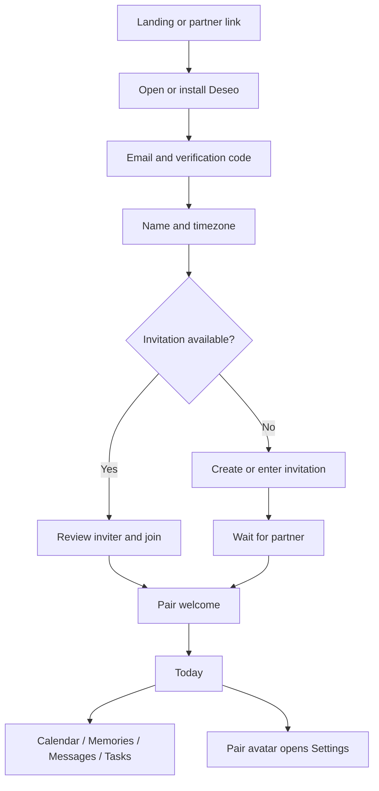

# Documentation

Deseo has a React browser portal and an Expo app for Android and iOS.
Both use shared domain contracts and one backend. Public pages remain separate delivery work.

| Read | Use |
|---|---|
| [Architecture](ARCHITECTURE.md) | Modules, data contracts, access, and lifecycle |
| [Development](DEVELOPMENT.md) | Setup, tests, release, and measured handoffs |
| [Screens](#screens) | Product routes and states |
| [Frontend design](#frontend-design) | Owner-approved current frontend scope |
| [Style](../STYLE.md) | Color, type, layout, and controls |
| [Contributor rules](../AGENTS.md) | Change rules |

Keep exactly three Markdown files in docs. Keep visual assets in root design.
Update these sections for new requirements and measured results.

## Visual assets

Use [the current gallery](../design/frontend-2026-10-07/web/index.html) and [capture index](../design/frontend-2026-10-07/web/README.md).
Keep [the historical gallery](../design/web-portal/index.html) as evidence of its recorded source.
Use [the frontend handoff](DEVELOPMENT.md#frontend-design-handoff) for verification and device limits.
The static [visual reference](../design/preview.html) contains sample interactions.

<a id="screens"></a>
## Screens
Status: Expo mobile and React portal. Read the native design, approved portal design, and [STYLE.md](../STYLE.md).

<a id="screens-browser-portal"></a>
### Browser portal

The [route manifest](../apps/web/src/app/route-manifest.ts) defines 39 routes.
The [gallery](../design/web-portal/index.html) covers 119 views at 1440×1000 and 390×844.
The browser uses a sidebar, rail, or drawer. Expo keeps bottom tabs and native stacks.

Entry routes cover Welcome, email codes, profile setup, invitations, joining, waiting, and ended pairs.
Product routes cover Today, Calendar, events, ideas, tasks, lists, Messages, Memories, notifications, and Settings.
Record URLs support reload and browser Back. Changed forms and unsent drafts warn before leaving.

Today shows each upcoming plan's date in the pair timezone. Calendar provides month, agenda, and comparison views.
Messages keeps the composer inside the conversation region. Memories uses browser files, preparation, private uploads, and explicit downloads.
Settings supports profile edits, pair state, preferences, end-pair verification, and local or global sign-out.
Settings remains available to unpaired accounts and former pair members.

Browser shared rows, private images, and drafts stay in memory. A reload discards browser drafts.
Supabase stores browser Auth sessions through its supported browser storage.
Failed writes preserve their immutable command and input until the user resolves them.

Account export, deletion, avatar backend work, pair-timezone writes, and public pages remain separate delivery work.
The future native and public-site requirements below do not add portal controls for those capabilities.

See [the portal design](README.md#browser-portal-design) and [handoff](DEVELOPMENT.md#portal-handoff).

<a id="screens-1-main-journey"></a>
### 1. Main journey



Resume the original invitation after authentication. Do not restart onboarding after an email code expires.

<a id="screens-2-public-site"></a>
### 2. Public site

| Page | Content | Main action | Required states |
|---|---|---|---|
| `/` | Product name, short promise, real app preview, planning, messages, memories, privacy summary | Download for iOS / Android | Store unavailable before release; desktop QR after launch |
| `/invite` | Generic invitation explanation and installation instructions | Open Deseo | Installed, not installed, expired link after native validation |
| `/support` | Pairing, permissions, failed uploads, contact method | Contact support | Support address must exist before launch |
| `/privacy` | Actual collection, processors, retention, export, deletion, operator | Open data controls | Owner-approved policy required |
| `/terms` | Actual service terms and operator | Read support options | Owner-approved terms required |
| `/delete-account` | Independent email verification and deletion request | Request deletion | Code sent, invalid code, confirmed, processing, complete |

Landing headline: **Your plans. Your memories. Your space.**

Supporting copy: **Plan your days, share a note, and keep the moments you want to remember.**

Use a real app screenshot once the product works. Mark prototype imagery as a preview before then.

Show three short product sections and one privacy section. Include a small FAQ and clear footer links.

Use the selected icon, pastel panels, dark text, and generous photo space. Keep the page useful at 360px.

Do not show fake reviews, invented usage counts, urgency banners, or unimplemented features.

Before store approval, use an honest Coming soon state. Do not collect a waitlist without a separate need.

Invitation links carry an opaque token in the query string. The public page does not fetch partner details.

Set `Referrer-Policy: no-referrer`. Exclude invitation URLs from analytics and scrub their queries from access logs.

After installation, tell users to reopen the original invitation. Do not promise automatic transfer through an app store.

<a id="screens-3-authentication-and-entry"></a>
### 3. Authentication and entry

| Screen | Content and behavior |
|---|---|
| Launch | Selected icon on ivory; restore session and check account status |
| Welcome | One sentence, Continue with email, privacy and terms links |
| Email | Visible Email label, email keyboard, Continue, inline format error |
| Verification | One six-digit field, paste/autofill, email shown, Change email, resend countdown |
| Profile | Required display name; detected timezone with edit control; optional avatar |
| Pair choice | Invite your partner or Enter invitation; explain shared content |
| Session expired | Explain sign-in is required; preserve encrypted drafts for the same account |

Use one email-code flow for new and returning accounts. Configure a ten-minute expiry and a 60-second resend delay.

Show a general response after requesting a code. Do not reveal whether an email has an account.

Verify codes with the backend. The visible countdown does not replace server rate limits.

Avoid separate password creation, reset, and confirmation screens.

Changing the email field preserves the pending invitation. A new valid code replaces the prior attempt.

Ask for photo access only when the person selects an avatar or memory photo.

<a id="screens-4-pairing"></a>
### 4. Pairing

<a id="screens-create-an-invitation"></a>
#### Create an invitation

Show a 12-character invitation code in three groups. Offer Copy and the native share sheet.

State the 24-hour expiry. Show Regenerate and Cancel invitation.

The share sheet opens only after a user action. The app never sends an invitation without that action.

<a id="screens-accept-an-invitation"></a>
#### Accept an invitation

Accept either the complete link or its code. Trim separators and normalize letter case.

After sign-in, show the inviter's display name and avatar. Show no calendar, message, or photo content.

Explain: **Your partner will see shared events, tasks, messages, and memories. Private events stay private.**

Use Join pair as the only primary action. Keep Cancel available.

<a id="screens-waiting-and-failure-states"></a>
#### Waiting and failure states

| State | UI behavior |
|---|---|
| Waiting | Invitation details and explicit refresh; realtime can update the state |
| Partner joined | Confirm both names; proceed to the pair welcome |
| Wrong or expired | Use one generic error; offer to enter a new invitation |
| Already used | Explain that the invitation is unavailable |
| Self-invitation | Explain that a second account is required |
| Already paired | Open current pair settings; never switch pairs silently |
| Pending pair exists | Allow cancellation of the empty pending pair before joining |
| Race lost | Return the current server state; do not display a third member |
| Offline | Keep the code as a local draft; do not claim it was accepted |

<a id="screens-pair-welcome"></a>
#### Pair welcome

Show both names, the selected icon, and **Your space is ready**.

Offer Add your first event. Put Add an important date beneath it as an optional action.

Allow Continue to Today. Do not require anniversaries, birthdays, or relationship history.

<a id="screens-5-native-shell"></a>
### 5. Native shell

Use Today, Calendar, Memories, Messages, and Tasks in the bottom tab bar.

Use labels and one consistent outline icon set. Keep the bar above the device safe area.

Put the pair avatar and unread reminder indicator in the header. The avatar opens Settings.

Preserve each tab's scroll position. Use native stack navigation for details and full-screen forms.

Android Back closes the keyboard or current screen before leaving the app. Warn only when unsaved input would be lost.

Save drafts before tab changes or app backgrounding. Revalidate membership before restoring shared content on resume.

Do not turn every interaction into a modal. Use native menus for short action lists.

<a id="screens-6-today"></a>
### 6. Today

Order: greeting and date, next three events, latest memory, latest note, due tasks, next important date.

Use the current pair's names. Do not use generated compliments or relationship summaries.

Show Add event as the main action. Each section links to its full tab.

Show up to three unfinished tasks due today or earlier. Use See tasks for the full list.

Show one latest pinned note. A link opens all pinned notes in Messages.

Show one upcoming important date with its absolute date. Compute the countdown in the pair timezone.

When data is empty, show a short prompt and its creation action. Omit empty decorative cards.

Display reminder permission problems beside the reminder area. Do not block use of the app.

<a id="screens-7-calendar"></a>
### 7. Calendar

Default to an agenda grouped by date. Offer Month as a second view.

Use filters for All, Me, Partner, and Together. Include visible owner names beside colors.

A private event appears only to its author. Mark it with a lock and Private label.

The event detail shows title, date, time, timezone, people, visibility, location, description, and the viewer's reminder.

| Form field | Rule |
|---|---|
| Title | Required; 1–120 characters |
| All-day | Switches between date fields and date/time fields |
| Start / End | End follows start; all-day UI shows the last included day |
| Timezone | Detected default; editable IANA zone |
| People | Me, Partner, Together; private events use Me |
| Visibility | Shared or Private; defaults to Shared |
| Location | Optional text; 200 characters; no background location access |
| Description | Optional plain text; 2,000 characters |
| Important date | Available for all-day events; offers yearly repeat |
| Your reminder | None, 15 minutes, one hour, or one day before |

Convert the inclusive all-day end shown in the form to an exclusive stored end date.

All-day reminder offsets count back from 09:00 in the event timezone. Show the reference time and offset before saving.
The one-day offset means 24 elapsed hours. Across daylight-saving changes, it can differ from 09:00 on the previous day.

Use the pair timezone as the default for important dates. Timed events default to the creator's timezone.

Show a conflict screen when the stored version changed. Offer Reload saved version or return to the preserved draft.

Do not silently overwrite the other person's edit. Do not automatically merge text fields.

Delete shared events through a confirmation that names the event. Cancel future reminder jobs on the server.

<a id="screens-date-ideas"></a>
#### Date ideas

Open Saved ideas from the Calendar header menu.

Each idea has a required title, optional note, and optional HTTPS link.

Plan date prefills a shared event. Save the event and its source idea link in one transaction.

Mark the idea Planned after confirmation. On deletion of the future event, return it to Saved.

Allow manual archive. Do not scrape URLs, infer budgets, book venues, or generate suggestions.

<a id="screens-8-tasks"></a>
### 8. Tasks

Start with one General list. Allow named lists, including a user-created grocery list.

Allow list rename and deletion, except General. Require an empty list; offer Move tasks to General before removal.

Each row shows a checkbox, title, assignee, and optional due date. Make the whole checkbox label easy to tap.

Quick add requires only a title. Open details for list, assignment, due date, or reminder.

Use Me, Partner, or Unassigned. Both members can complete shared tasks regardless of assignment.

Keep completed items in a collapsed group. Allow Undo after completion.

On a failed completion, restore the prior state and show Retry beside the task.

Use version checks for text edits. Completion uses an explicit desired state, never a server-side toggle.

Offer Delete task in its detail menu, with a confirmation naming the task.

A due date does not create a push without the person's reminder preference.

<a id="screens-9-messages-and-notes"></a>
### 9. Messages and notes

Use one chronological conversation. Load the latest 50 messages, then page backward.

The composer supports plain text up to 4,000 characters. Keep Send reachable above the keyboard.

Show Sending, Sent, or Failed beside the sender's message. Failed items keep their original text and UUID.

Show a new-message affordance when the reader is viewing older messages. Do not force scrolling.

Unread count reflects durable messages beyond the viewer's read cursor. Do not expose that cursor as partner read receipts.

Allow authors to delete their own messages after confirmation. Do not allow editing sent messages in this release.

Each member can pin one of their own messages. Replacing it removes the previous pin in one transaction.

Pin actions say **Pin as note**. The conversation contains the authoritative message.

Show both pins above the conversation. Today displays the most recent pin.

Do not add a sticker store, reaction picker, typing indicator, or online status.

<a id="screens-10-memories"></a>
### 10. Memories

Use a feed grouped by month. Each entry shows date, photo, caption, and author.

Native Add memory opens the photo picker. Browser Add memory opens a file input. Select one to five photos.

Require the memory date. Keep the caption optional, with a 1,000-character limit.

Show each photo's upload state. Publish only after every selected photo has completed.

Allow removing a failed photo before submission. Native encrypted drafts survive closure; browser drafts last while the tab remains open.

Keep uploads in the foreground for the first release. Explain interruption and offer explicit retry.

The detail screen shows full images without the card crop. Allow saving a copy through a deliberate action.

The author can change the caption or delete the memory. The partner can view and save a copy.

Explain that saved copies remain outside Deseo after deletion or disconnect.

<a id="screens-11-settings"></a>
### 11. Settings

| Group | Controls |
|---|---|
| You | Display name, avatar, timezone, system date/time format |
| Your pair | Partner identity, stable owner colors, pair timezone, invitation state |
| Notifications | Device permission, event/task reminders, message alerts, quiet hours |
| Your data | Export shared-access data while paired; export own contributions after disconnect |
| Help | Short help pages, support contact, app version |
| Account | Change email with verification, sign out, sign out all devices, delete account |
| Pair | End pair, separated from ordinary edits |

Keep partner colors fixed as blush and mint in the first release. Names identify people independently of color.

Timezone changes affect future display and quiet hours. Do not reinterpret stored event instants.

A pair timezone change affects all-day reminder instants. Show the new time and recalculate unsent jobs.

Default quiet hours are off. Let each person set start and end in their own timezone.

Defer suppressed pushes until quiet hours end. Expire an event push when its event has already started.

<a id="screens-destructive-actions"></a>
#### Destructive actions

End pair explains access loss and the 30-day own-contribution export window. Require fresh email verification and confirmation.

Delete account explains that it also ends the pair. Disable access immediately and show deletion progress independently of app login.

A remote account deletion request uses the same backend flow as the native app.

<a id="screens-12-common-states"></a>
### 12. Common states

| State | Rule |
|---|---|
| Loading | Keep layout stable; show a short progress state |
| Empty | Explain the missing content and offer one relevant action |
| Offline | Preserve drafts; label unsubmitted content; do not queue writes automatically |
| Failed read | Keep the screen structure and show Retry |
| Failed write | Preserve input; report the affected item; reuse its command ID |
| Conflict | Show that someone changed the record; preserve both saved data and local draft |
| Permission denied | Explain the feature impact and link to operating system settings |
| Pair ended | Clear shared views and open the end-pair notice |
| Account disabled | Clear session and shared caches; do not restore private screens |
| Expired media link | Request a new authorized link once; show a recoverable error if access fails |

<a id="screens-13-accessibility-and-device-behavior"></a>
### 13. Accessibility and device behavior

Use at least 48dp touch targets. Keep visible labels on fields and navigation.

Support Dynamic Type, VoiceOver, TalkBack, keyboard focus, and Android hardware Back.

Announce save failures and send results. Do not move focus on every realtime update.

Use platform date pickers where suitable. Provide explicit timezone and all-day labels around them.

Test long names, large text, small phones, safe areas, and the keyboard over the composer.

Keep gesture-only actions available through visible controls. Do not use swipe as the only delete or reply action.

Use the system font and native text rendering. See STYLE.md for native token mapping.


<a id="browser-portal-design"></a>
## Browser portal scope

The approved portal uses React DOM beside Expo Android and iOS.
It shares domain contracts, accounts, pair content, and backend access rules.
Keep the 39 routes, reload/Back behavior, lazy feature loading, and each feature's stylesheet ownership.
Browser drafts and private rows remain in memory. Browser Auth uses the supported Supabase session storage.
Keep failure input, immutable pending commands, current authority checks, and private-state cleanup.
Use system fonts, 48px shared controls, 1440px content, 720px forms, and 960px messages.
Keep sidebar, tablet rail, phone drawer, visible labels, keyboard focus, and accessible dialogs.
Browser push, service workers, offline content storage, installation prompts, and public pages remain outside portal scope.
Use the Screens, frontend design, and architecture sections for the current detailed requirements.

<a id="frontend-design"></a>
## Frontend design
Date: 7 October 2026.

Status: Owner-approved scope. Tasks 1–6 passed scoped review. Final gallery and source checks passed; whole-branch review remains pending.

<a id="frontend-design-1-intent"></a>
### 1. Intent

Improve the existing browser and native interfaces for two partners who plan days, share messages, and save memories.

Apply Anthropic's frontend-design skill across the implemented product. Keep Deseo's pastel colors and Two voices icon.

Give planning content a compact layout. Give photos more space. Make notes look like personal content.

Success means clear actions, consistent controls, readable content, and complete screen coverage on both platforms.

Follow [STYLE.md](../STYLE.md), [Architecture](ARCHITECTURE.md#architecture), and [Data](ARCHITECTURE.md#data-contract).

<a id="frontend-design-2-scope"></a>
### 2. Scope

Cover `apps/web`, `apps/mobile`, shared brand tokens, and the design documentation that guides those interfaces.

Use the existing browser route manifest as the coverage list. It contains 39 routes and 119 views.

Cover the corresponding native routes and native controls, including permission states and keyboard layouts.

Keep the current product flows, route addresses, feature interfaces, data contracts, and access rules.

Use the implemented settings controls. Pending backend work does not authorize new account controls in this design.

The planned public site remains a separate delivery. Apply these brand rules when that delivery starts.

Preserve unrelated working changes and local user data. Keep historical screenshots as evidence of their recorded source.

<a id="frontend-design-3-approach"></a>
### 3. Approach

| Approach | Benefit | Cost | Decision |
|---|---|---|---|
| Shared controls, then screen composition | Consistent product with distinct content layouts | Requires review of both platforms | Select |
| Screen corrections alone | Smaller first change | Leaves inconsistent controls and typography | Reject |

Start with tokens and shared platform controls. Complete each layer before changing feature screens.

Use the current libraries and components. Add a component only when multiple callers need the same structure.

<a id="frontend-design-4-visual-rules"></a>
### 4. Visual rules

<a id="frontend-design-color"></a>
#### Color

Retain the semantic colors in `brand/tokens.json`. Use these six colors as the visual foundation.

| Role | Value | Use |
|---|---|---|
| Canvas | `#FAF7F5` | Page background |
| Ink | `#383547` | Main text |
| Action | `#DDD4EE` | Primary actions and selection |
| Partner A surface | `#F5E3EB` | Partner A content |
| Partner B surface | `#DEF0E9` | Partner B content |
| Note surface | `#FAEDDF` | Pinned notes and personal dates |

Use the existing dark foregrounds on pastel surfaces. Keep owner names beside their stable partner colors.

Keep white surfaces for forms and grouped planning content. Use the existing lilac surface for shared content.

Reserve error, warning, and success colors for their defined states. Recheck contrast after changing opacity or composition.

<a id="frontend-design-type-and-dimensions"></a>
#### Type and dimensions

Use the system sans-serif stack specified in STYLE.md. Remove the browser's separate Inter preference.

Keep the approved type scale, spacing tokens, and corner sizes. Align browser section headings with the 20px specification.

Use native system fonts and supported weights. Respect Dynamic Type and keep 48dp native targets.

Use 48px browser targets for shared controls. Keep form text at 16px and labels visible.

Keep text left aligned. Use tabular numbers for times and countdowns. Let long names and titles wrap.

<a id="frontend-design-content-hierarchy"></a>
#### Content hierarchy

Use the couple's photos as the main visual focus. Use compact event rows and task rows for planning.

Give notes their existing peach surface. Use borders to separate groups, and spacing to separate content within groups.

Reserve shadows for dialogs, popovers, and selected navigation. Avoid decorative gradients and repeated entrance animations.

Use existing feedback durations for user actions. Follow AGENTS.md's motion rule; do not add reduced-motion variants.

<a id="frontend-design-5-layout"></a>
### 5. Layout

Keep the browser sidebar, tablet rail, and phone drawer. Keep native bottom tabs and stack navigation.

Keep the browser's 1440px content cap, 720px form cap, and 960px message cap.

Keep one main action in each page header. Move it below the heading before either becomes crowded.

Desktop Today uses a flexible planning column and a 360px personal column when both fit.

```text
Navigation | Today and date                         Add event
           | Upcoming plans       | Latest memory
           | Due tasks            | Pinned note
           |                      | Important date
```

Single-column Today uses the approved personal-content order. Change browser structure so keyboard order matches visual order.

```text
Today and date
Add event
Upcoming plans
Latest memory
Pinned note
Due tasks
Important date
```

Keep 16px phone page padding. Use 20px card padding on phones and 24px on desktop.

Native screens respect safe areas, the keyboard, and font scaling. Keep the final content item clear of navigation.

<a id="frontend-design-6-screen-coverage"></a>
### 6. Screen coverage

| Area | Design treatment |
|---|---|
| Welcome and authentication | Selected icon, concise introduction, focused email-code form, one primary action |
| Pair setup and invitations | Clear steps, partner names, readable code, visible expiry, distinct waiting and failure states |
| Today | Compact schedule, prominent memory, peach note, due tasks, important date with absolute date |
| Calendar | Clear date controls and owner filters; readable month, agenda, and comparison layouts |
| Events | Group required fields first; show ownership, visibility, timezone, reminder, and local validation |
| Date ideas | Distinct saved, planned, and archived states; keep planning actions beside the idea |
| Memories | Month headings, reserved image space, 3:2 feed crops, full images in details |
| Memory forms | Caption and photo selection, progress per photo, local failure and Retry controls |
| Messages | Stable sender colors, grouped messages, timestamps, delivery states, reachable composer |
| Pinned notes | Peach surface, author, note text, pin time, Reply and applicable author actions |
| Tasks and lists | Full-row completion targets, readable completion state, assignment, due date, list actions |
| Notifications | Plain source labels, dates, unread state, and actionable unavailable or permission states |
| Settings | Separate profile, pair, preferences, and account actions; isolate destructive controls |
| Dialogs and route failures | Focused action, clear Cancel or recovery action, visible focus and state explanation |

Review empty, loading, error, conflict, unknown-outcome, and unavailable states beside each area's normal state.

Keep inputs after failures. Keep pending actions distinct from confirmed success. Preserve existing retry and reconciliation rules.

Describe draft storage according to the platform. Browser drafts stay in memory and do not survive reload.

<a id="frontend-design-7-module-and-data-rules"></a>
### 7. Module and data rules

Keep browser controls in `apps/web/src/components/ui`. Keep native controls in `apps/mobile/src/components/ui`.

Map existing brand tokens through browser CSS and the native theme. Keep feature styles inside their owning application.

Keep data access in feature queries and commands. Present existing results through display components.

Reuse each platform's EventRow, MemoryCard, NoteCard, and TaskRow across their existing callers.

Use the current dialog and navigation mechanisms. Preserve focus return, Escape behavior, Back behavior, and draft warnings.

Preserve lazy route loading and feature stylesheet ownership. A route must render correctly after a direct browser load.

Do not add UI contracts to `packages/domain`. Do not add a second query cache or cross-platform UI abstraction.

Remove obsolete styles when replacing them. Do not keep compatibility selectors or introduce new product dependencies for this update.

<a id="frontend-design-8-writing"></a>
### 8. Writing

Apply stop-slop to UI text and changed documentation. Use short sentences, concrete states, and consistent action names.

Keep instructions within 20 words. Use sentence case. Remove decorative labels that do not help users choose an action.

Use event, memory, message, note, task, and reminder with their existing meanings.

Use the same action name through its form and result. Keep destructive effects explicit before confirmation.

Keep the existing sample language. Preserve layout space for longer translated text without adding a new language system.

<a id="frontend-design-9-verification"></a>
### 9. Verification

Use [the verification plan](DEVELOPMENT.md#verification) and the current development commands.

Run `npm run verify:web`, `npm run verify:mobile`, and `npm run test:domain` on the final implementation.

Export native Android and iOS JavaScript after shared frontend changes. Record physical-device checks as separate evidence.

Extend existing tests only for missing high-importance behavior. Rate proposed tests before writing them.

| Behavior | Importance | Check |
|---|---:|---|
| Keyboard navigation and dialog focus | 95 | Existing browser acceptance and manual focus review |
| Draft retention and failure recovery | 95 | Existing browser and native feature suites |
| Long text, enlarged text, and narrow layouts | 92 | Existing layout suite and rendered screenshots |
| Today content and keyboard order | 90 | Browser order check and native screen review |
| Exact decoration and shadow values | 25 | Visual review; no new automated test |

Inspect browser pages at 320, 390, 768, 1024, and 1440px. Check 200% text sizing and keyboard access.

Review all route-manifest views at desktop and phone widths. Use existing controlled fixtures for failure and destructive states.

Regenerate the portal gallery after final changes. Check coverage, links, image dimensions, and source revision.

Review native screens at phone widths and large text sizes. Check VoiceOver, TalkBack, safe areas, and keyboard access on devices.

Keep source checks, browser evidence, native exports, and device evidence separate. Do not claim device acceptance from source tests.

<a id="frontend-design-10-delivery-order"></a>
### 10. Delivery order

1. Align tokens, type, platform controls, and shell layouts.
2. Complete authentication, pair setup, settings, and their states.
3. Complete Today, Calendar, events, and date ideas.
4. Complete tasks, lists, notifications, and preferences.
5. Complete memories, messages, and pinned notes.
6. Run final checks, capture screens, and record coverage and remaining device checks.

Keep each completed layer usable. Review both platforms before moving to the next layer.

<a id="frontend-design-11-design-review"></a>
### 11. Design review

The selected treatment follows Deseo's existing palette, icon, ownership labels, and planning structure.

Photos provide the main visual focus. Notes and planning rows retain different shapes and density.

The implementation must verify current source through new captures. Earlier captures can differ from current styles.

The owner must approve this written spec before implementation planning. The plan must then receive its required review.

<a id="frontend-design-references"></a>
### References

- [Anthropic frontend-design skill](https://github.com/anthropics/skills/blob/main/skills/frontend-design/SKILL.md)
- [Stop-slop skill](https://github.com/hardikpandya/stop-slop/blob/main/SKILL.md)
- [Screen guide](README.md#screens)
- [Approved browser design](README.md#browser-portal-design)


<a id="sources"></a>
## Sources
Reviewed on 4 October 2026. Product pages can change. Treat feature lists as vendor descriptions, not independent usability evidence.

<a id="sources-product-references"></a>
### Product references

| Source | Observed feature | Deseo decision |
|---|---|---|
| [Cupla product overview](https://www.cupla.app/the-app/) | Shared schedules, tasks, date planning, important dates, saved ideas | Keep manual shared planning, reminders, and user-written date ideas |
| [Cupla calendar explanation](https://www.cupla.app/help/en/articles/15051425-whats-the-difference-between-a-shared-calendar-on-ical-or-google-and-using-cupla) | External calendar aggregation and schedule comparison | Defer provider sync; do not promise complete availability |
| [Couply homepage](https://www.couply.io/) | Questions, quizzes, and relationship content | Retain warmth; exclude scoring and coaching |
| [Couply FAQ](https://www.couply.io/faqs) | Date planner, photo journal, love notes, important-date reminders | Combine these needs with shared planning |

Deseo's screen, data, and architecture decisions are original proposals. They are not claims about either app's internal implementation.

<a id="sources-skills-applied"></a>
### Skills applied

| Skill | Use |
|---|---|
| [Improve Codebase Architecture](https://github.com/mattpocock/skills/blob/main/skills/engineering/improve-codebase-architecture/SKILL.md) | Review module responsibilities before scaffold work |
| [Codebase Design](https://github.com/mattpocock/skills/blob/main/skills/engineering/codebase-design/SKILL.md) | Keep interfaces small and related rules together |
| [Stop Slop](https://github.com/hardikpandya/stop-slop/blob/main/SKILL.md) | Remove vague promises, filler, and formulaic copy |

The architecture review adapts an existing-code skill to a new project. No installer or remote script was executed.

<a id="sources-platform-and-library-sources"></a>
### Platform and library sources

| Source | Planning implication |
|---|---|
| [Expo Router](https://docs.expo.dev/router/introduction/) | Use file-based native navigation and typed links |
| [Expo monorepos](https://docs.expo.dev/guides/monorepos/) | Use supported workspace configuration; avoid custom Metro workarounds |
| [Expo linking](https://docs.expo.dev/linking/overview/) | Configure native links and public installation handoff |
| [Expo development builds](https://docs.expo.dev/develop/development-builds/introduction/) | Validate native modules in development builds |
| [Expo push](https://docs.expo.dev/push-notifications/overview/) | Use one push integration for APNs and FCM |
| [Expo push delivery](https://docs.expo.dev/push-notifications/sending-notifications/) | Track tickets, receipts, retries, and invalid device tokens |
| [Expo SecureStore](https://docs.expo.dev/versions/latest/sdk/securestore/) | Keep keys small; account for native storage failures and reinstall behavior |
| [MMKV](https://github.com/mrousavy/react-native-mmkv) | Use explicit encryption and account-scoped storage; it is plaintext by default |
| [TanStack Query on React Native](https://tanstack.com/query/latest/docs/framework/react/react-native) | Connect query refresh to network and foreground state |
| [Astro](https://docs.astro.build/en/concepts/why-astro/) | Keep the public site static and focused on content |
| [Supabase Expo guide](https://supabase.com/docs/guides/getting-started/tutorials/with-expo-react-native) | Use the supported client integration; do not copy its public-profile example policies |
| [Supabase email codes](https://supabase.com/docs/guides/auth/auth-email-passwordless) | Use verified email codes for a passwordless entry flow |
| [Supabase row security](https://supabase.com/docs/guides/database/postgres/row-level-security) | Enforce record access in PostgreSQL |
| [Supabase Cron](https://supabase.com/docs/guides/cron) | Schedule bounded reminder and cleanup work |
| [Supabase changelog](https://supabase.com/changelog) | Recheck SDK, keys, and database changes before provisioning |

The Markdown changelog endpoint failed during this review. The main changelog loaded.

Its reviewed database changes concern existing extension usage. No current Deseo database exists to upgrade.

Recheck current documentation before implementation. Pin the versions selected by the working scaffold, not guessed versions in this plan.

<a id="sources-store-requirements"></a>
### Store requirements

- [Apple account deletion](https://developer.apple.com/support/offering-account-deletion-in-your-app/): include an in-app deletion path.
- [Google Play account deletion](https://support.google.com/googleplay/android-developer/answer/13327111): include the required external deletion resource.

Verify the complete current submission rules before release. These links do not establish legal compliance for an unspecified operator or region.
