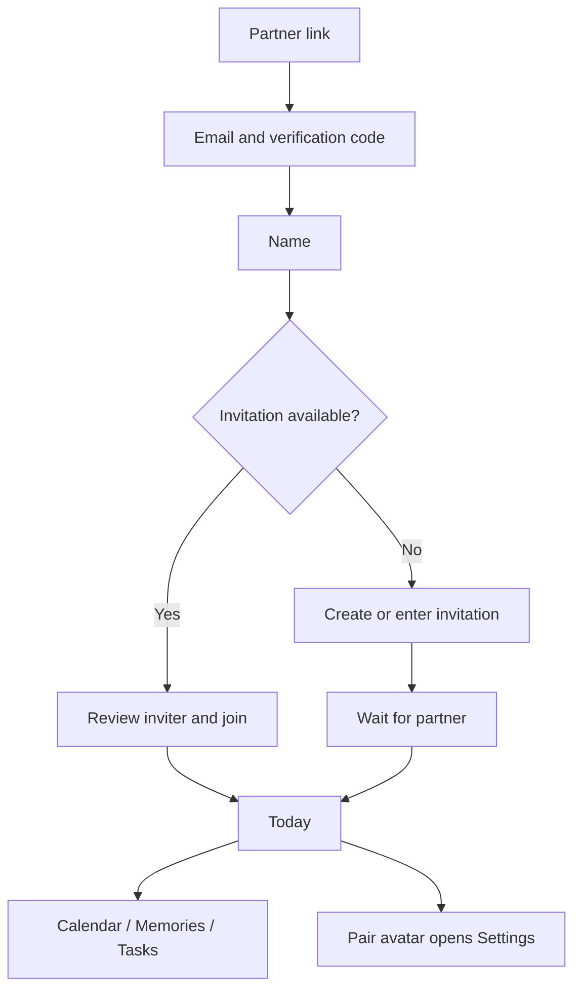

# Documentation

Deseo has a React browser portal and an Expo app for Android and iOS.
Both use shared domain contracts and one backend. Work targets the portal first; the Expo app is frozen.

| Read | Use |
|---|---|
| [Architecture](ARCHITECTURE.md) | Modules, data, access, and lifecycle rules |
| [Development](DEVELOPMENT.md) | Setup, verification, remaining work, and release |
| [Product](../PRODUCT.md) | Purpose, scope, open decisions, and glossary |
| [Design](../DESIGN.md) | Colors, type, layout, components, and states |
| [Contributor rules](../AGENTS.md) | Change rules |

Keep three Markdown files in `docs/`. Put visual assets in `design/`; do not add folders inside `docs/`.
Update the relevant section for new decisions, requirements, or check results.

## Screens

Check [remaining work](DEVELOPMENT.md#remaining-work) before you treat a requirement as an available feature.
[Public site](#public-site) lists the static public pages.

### Browser portal

The [router](../apps/web/src/app/router.tsx) defines the browser routes.
The browser uses a sidebar, rail, or drawer. Expo keeps bottom tabs and native stacks.

Entry routes cover sign-in, email codes, profile setup, invitations, joining, waiting, and ended pairs.
Product routes cover Today (with Messages), Calendar (with date ideas), events, ideas, tasks, lists, Memories, and Settings.
The portal has no reminder or notification screens. The browser receives no push.
Record URLs support reload and browser Back. Changed forms and unsent drafts warn before leaving.

Browser shared rows, private images, and drafts stay in memory. Leaving the form or a reload discards a browser draft.
Supabase stores browser Auth sessions through its supported browser storage.
A failed write keeps its input. A retry of the same input reuses its command ID.
Settings stays available to unpaired accounts and former pair members.

### Main journey

Resume the original invitation after sign-in. Do not restart onboarding after an email code expires.

### Public site

`apps/site` builds `/`, `/invite`, `/support`, `/privacy`, `/terms`, and a 404 page as static HTML without JavaScript.
The policy pages state that no policy is published. The support page states that no support address exists.
`/delete-account` waits for the backend deletion flow.
Add store links, app links, canonical URLs, a sitemap, `robots.txt`, and absolute Open Graph URLs at launch.

### Authentication and entry

| Screen | Content and behavior |
|---|---|
| Sign in | Story panel with one sentence; Email address field, Send code, inline format error |
| Verification | One six-digit field, paste and autofill, email shown, Change email, resend countdown |
| Profile | Required display name; the browser timezone, changed in Settings |
| Pair choice | Invite your partner or Enter invitation; explain shared content |

Use one email-code flow for new and returning accounts. Codes expire after ten minutes; resend waits 60 seconds.
After a code request, show a general response. Do not reveal whether an email has an account.
The backend verifies codes. The visible countdown does not replace server rate limits.
Changing the email keeps the pending invitation.

### Pairing

Invite your partner creates the pair and its invitation in one action, then opens the waiting page.
The waiting page shows the 12-character code once, Copy invitation link, and the 24-hour expiry.
It offers Replace invitation code, Check pair status, and Cancel pending pair. Never send an invitation without a user action.

Accept the full link or its code. Trim separators and normalize letter case.
After sign-in, show only the inviter's name. Show no calendar, message, or photo content.
Explain: **Your partner will see shared events, tasks, messages, and memories. Private events stay private.**
Use Join pair as the only primary action. Keep Cancel available.

| State | Behavior |
|---|---|
| Waiting | Code, expiry, and explicit refresh; realtime can update the state |
| Partner joined | Open Today; the header shows both names |
| Wrong or expired | One generic error; offer to enter a new invitation |
| Already used | Explain that the invitation is unavailable |
| Self-invitation | Explain that a second account is required |
| Already paired | Open current pair settings; never switch pairs silently |
| Pending pair exists | Allow cancellation of the empty pending pair before joining |
| Race lost | Show the current server state; never show a third member |

After a join, both partners open Today. Its empty sections offer the first actions.

### Today

Today holds the conversation (see [Messages and notes](#messages-and-notes)) and an Our day panel.
Panel order: next plan, next three events with a seven-day strip, due tasks, next important date, latest memory.
Below 1200px the panel becomes links above the conversation: next plan, due task count, countdown.
Show each plan's date in the viewer's timezone. Each section links to its full page.
Show up to three unfinished tasks due today or earlier.
Show one upcoming important date with its absolute date. Count down in the viewer's timezone.
For empty data, show a short prompt and its creation action. Omit empty decorative cards.

### Calendar

Calendar offers month and agenda views. Filter by All, Me, Partner, and Together.
The header holds Add event. Date ideas follow the calendar.
Show owner names beside colors. A private event appears only to its author, with a lock and Private label.

| Form field | Rule |
|---|---|
| Title | Required; 1–120 characters |
| All-day | Switches between date fields and date-time fields |
| Start / End | End follows start; all-day UI shows the last included day |
| Who | Together, Me, Partner, or Private (just me); default Together |
| Location | Optional; 200 characters |
| Description | Optional plain text; 2,000 characters |
| Important date | In More details; one all-day date; Repeat every year |

Store the inclusive all-day end as an exclusive end date.
Each person enters and reads times in their profile timezone. Events store no timezone.
When the stored version changed, show a conflict screen. Offer Reload saved version or return to the draft.
Never overwrite the partner's edit silently. Never merge text fields.
Opening an event shows its edit form with Delete event.
Delete through a confirmation that names the event. The server cancels its future reminder jobs.

Date ideas list saved ideas under the calendar, newest first. A title field adds an idea. Each row has Plan date.
Each idea has a title, an optional note, and an optional HTTPS link.
Opening an idea shows its edit form with Plan date, View planned event, and Archive idea.
Planned ideas show as their events. Archived ideas leave the list.
Plan date fills a shared event. Save the event and the idea link in one transaction; the idea becomes Planned.
When the future event is deleted, the idea returns to Saved. Do not scrape links or generate suggestions.

### Tasks

Start with one General list. Allow named lists. General cannot be renamed or deleted.
The list tabs end with New list. A named list shows List settings: Rename and Remove list.
Remove list moves its tasks to General, then removes the empty list, after one confirmation.
Each row shows a checkbox, title, assignee, and optional due date. The whole label is the target.
Quick add is the only add path. It needs a title; assignee and due date are optional. Either member can complete any task.
Opening a task shows its edit form with Delete.
Keep completed tasks in a collapsed group. Clear the checkbox to reopen a task.
A failed completion restores the prior state and shows Retry beside the task.
Text edits use version checks. Completion sends the desired state, never a toggle.

### Messages and notes

The conversation lives on Today. There is no separate Messages page.
Use one conversation. Load the latest 50 messages, then page backward.
The composer accepts plain text up to 4,000 characters. It stays inside the conversation region.
Show Sending or Failed beside a pending message. Failed messages keep their text and UUID.
Show Sent only on the viewer's latest message. Show the character count after 3,600 characters.
Show a new-message control when the reader views older messages. Do not force scrolling.
Unread counts use the viewer's read cursor. Do not show it as a partner read receipt.
Authors can delete their own messages after confirmation. Sent messages cannot be edited.
Each member can pin one own message with **Pin as note**. A new pin replaces the old one in one transaction.
Show both pins above the conversation.

### Memories

Use a feed grouped by month. Each entry shows date, photo, caption, and author.
Add memory opens a file input. Select one to five photos. The date is required; the caption is optional, up to 1,000 characters.
Show each photo's upload state. Publish only after every photo completes.
Allow removing a failed photo before submission. Browser drafts last while the form stays open.
The memory page shows full images. Downloads need an explicit action.
For the author, the date and caption fields follow the photos, with Save changes and Delete memory. Saved copies stay outside Deseo after deletion.

### Settings

| Group | Controls |
|---|---|
| Profile | Display name, timezone |
| Your pair | Partner identity, owner colors |
| Account | Sign out, sign out of all devices |
| End this pair | End pair, apart from ordinary edits |

Partner colors are blush and mint. Names identify people without color.
Timezone changes affect future display. They never move stored event instants.
Settings is one page with these sections.
End pair sends a fresh email code and opens one dialog. The dialog explains access loss and takes the code.

### Common states

| State | Rule |
|---|---|
| Loading | Keep the layout stable; show a short progress state |
| Empty | Explain the missing content and offer one action |
| Offline | Keep drafts; show Retry on failed writes; do not queue writes |
| Failed read | Keep the screen structure and show Retry |
| Failed write | Keep input; name the affected item; reuse its command ID |
| Conflict | Say that someone changed the record; keep saved data and the draft |
| Pair ended | Clear shared views and open the end-pair notice |
| Account disabled | Clear the session and shared caches |
| Expired media link | Request a new link once; show a recoverable error if it fails |

### Accessibility

Follow the [DESIGN.md](../DESIGN.md) target, focus, and announcement rules. Give every gesture a visible control.
The [Two voices icon](../brand/icon-source.png) and [brand tokens](../brand/tokens.json) are the visual sources.

## Sources

Check current official documentation before you change dependencies or prepare a release.

| Source | Use |
|---|---|
| [Supabase email codes](https://supabase.com/docs/guides/auth/auth-email-passwordless) | Passwordless entry |
| [Supabase row security](https://supabase.com/docs/guides/database/postgres/row-level-security) | Record access in PostgreSQL |
| [Supabase Cron](https://supabase.com/docs/guides/cron) | Bounded reminder and cleanup work |
| [Supabase local development](https://supabase.com/docs/guides/local-development) | CLI commands for the local stack |
| [Expo development builds](https://docs.expo.dev/develop/development-builds/introduction/) | Native modules in development builds |
| [Expo push](https://docs.expo.dev/push-notifications/overview/) | One push integration for APNs and FCM |
| [MMKV](https://github.com/mrousavy/react-native-mmkv) | Explicit encryption; plaintext by default |

Use [unslop](https://github.com/michael-denyer/pstack-claude/blob/main/plugins/pstack/skills/unslop/SKILL.md) for documentation and UI text.
See [store preparation](DEVELOPMENT.md#store-preparation) for store sources.
