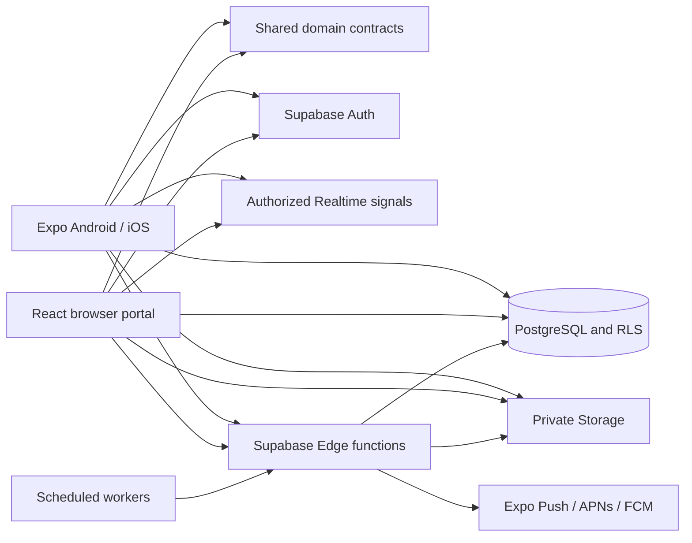

# Architecture

Status: React web and Expo mobile share domain contracts and the existing Supabase backend.
Read [the approved portal design](../superpowers/specs/2026-10-05-deseo-web-portal-design.md) and [measured handoff](../handoffs/web-portal.md).

## 1. Applications

Expo owns Android and iOS screens, native storage, photo selection, and push registration.
React DOM owns browser screens, URLs, file inputs, and browser session lifecycle.
The planned Astro site owns public information and installation handoff.
PostgreSQL owns durable content, permissions, pairing, versions, and transactions.



## 2. Stack

| Area | Choice |
|---|---|
| Native | Expo, React Native, TypeScript, Expo Router |
| Browser | React DOM, TypeScript, Vite, React Router |
| Queries | TanStack Query; one client per application |
| Forms | React Hook Form and Zod resolver |
| Dates | Luxon and shared date rules |
| Backend | Supabase Auth, PostgreSQL, RLS, Storage, Realtime, Edge functions |
| Brand | `brand/tokens.json` and Two voices icon |

Keep exact package pins and one root lockfile. Use Node 24.18.0 and npm 11.16.0.

## 3. Module structure

```text
apps/mobile/src/
  app/                      Expo route files and providers
  features/                 Native screens, queries, commands, capabilities
  components/ui/            Native controls
  theme/                    Native brand mapping
  lib/                      Native client, encrypted storage, lifecycle
apps/web/src/
  app/                      Browser router, providers, gate, shell, manifest
  features/                 Browser pages, queries, commands, controls
  components/ui/            Browser controls
  styles/                   Browser tokens and feature styles
  lib/                      Browser client, media, drafts, lifecycle
apps/web/tests/             Real-browser acceptance and gallery capture
packages/domain/src/       Shared schemas, types, payloads, date rules, results
supabase/
  migrations/              Authoritative schema and transactions
  functions/               Narrow server operations and workers
  tests/                   SQL, access, and race checks
  dev/                     Guarded local stack and synthetic pair fixtures
brand/                     Shared tokens and icon
docs/design/web-portal/     Gallery, records, and JPEG evidence
```

Keep native UI and browser UI separate. Extract only contracts both applications use.
Remove old contract copies and compatibility exports when moving shared code.
Shared domain modules must not import React Native, Expo, MMKV, browser storage, or application routes.

## 4. Dependency rules

1. Routes import feature pages, screens, and UI controls.
2. Feature commands and queries import that application's backend client and shared contracts.
3. Features import another feature's public interface, not its internal files.
4. Today reads one `get_today` summary and public feature queries. Screens do not call database tables.
5. UI controls import platform libraries and brand values, not feature data.
6. Backend functions share code only where multiple functions use it.
7. Public pages import brand assets, not signed-in application screens.

The pair module owns membership. Messages owns notes. Calendar owns events, important dates, and date ideas.
Each application owns its client and lifecycle. Avoid a second global copy of query data.
Use the installed Supabase query builder without a generic repository layer.

## 5. Reads, writes, and refresh

Read: page or screen → feature query → authenticated request → RLS → typed result → Query cache.
Write: form → feature command → transaction → confirmed result → targeted invalidation.
Refresh: authorized Realtime signal → invalidation → authenticated read.
Photo: selection → preparation → reservation → private upload → server validation → publication.
Push: durable job → scheduled worker → current access check → Expo → receipt processing.

Scope keys to account and pair. Abort old reads and clear private caches before account or pair changes.
Revalidate server authority after focus and reconnect. Reset queries again if verified authority changes.
On native resume, cover the mounted screens and keep the cache until the account and pair checks pass.
Keep each Realtime authority channel owned by a stable verified account ID.
Ignore only signals represented by the latest fully server-verified snapshot, with exact identity, state, version, and slot checks.
Revalidate incomplete signals and genuine changes. Never skip account disable or membership departure.
Reject removed prior-user callbacks before they can interrupt a new account's requests.
Keep stable command IDs and immutable input while an outcome remains unknown.
Offer explicit retry or reconciliation. Confirm success only after a durable server result.

## 6. Platform storage

Native uses SecureStore for its encryption key and encrypted MMKV for Auth sessions and scoped drafts.
Handle storage failure by explaining the failure and requiring sign-in. Do not add plaintext fallback storage.
Native photos use private temporary files. Purge them on discard, scope change, and sign-out.

Browser Auth uses Supabase's supported browser session storage.
Shared rows, private images, and drafts stay in memory. Browser drafts do not survive reload.
Use no-store media requests and scoped blobs. Release object URLs after use and on authority loss.
Warn before navigation or reload discards changed input. Explicit or forced sign-out clears private state immediately.
A failed global Auth sign-out remains visible after local session removal.

Keep fetched shared content in memory on both platforms. Revalidate account status and membership before displaying it.

## 7. Browser navigation and loading

Use ordinary links, reloadable record URLs, browser Back, document titles, and visible active navigation.
Use a 256px sidebar from 1024px, a 72px rail from 768px, and a drawer below 768px.
Keep navigation and account controls outside route loading boundaries.
Load route pages with React lazy and Suspense. The route boundary reports loading and handles load failures.

Keep shared form rules in `controls.css` and shared text wrapping in `base.css`.
Each page loads its feature styles. Do not depend on a previously visited feature's stylesheet.

Keep one router blocker with memory-scoped dirty registrations. Retain unresolved input when the user cancels leaving.
Do not add service workers, offline content storage, browser push, or installation prompts.

## 8. Server authorization

RLS checks current account status and membership. Ignore editable JWT metadata for authorization.
Restricted helpers check JWT session IDs against Auth sessions. Global sign-out blocks revoked sessions.
Use ordinary RLS reads and named transactions for multi-record invariants.
In row policies, compare `pair_id` with `(select private.actor_pair())`. PostgreSQL then checks membership once per statement, not once per row.
Expose narrow invoker wrappers around hardened private implementations.
Revoke default execution, grant required roles, set an empty search path, and check callers.
Keep internal tables outside exposed schemas. Do not accept client-supplied trusted actor IDs.
Keep server keys inside verified server jobs and test processes.

Server `WEB_APP_ORIGIN` permits one browser origin. Native requests can omit Origin.
The local Supabase gateway uses wildcard CORS headers and intercepts OPTIONS.
The function still rejects unknown and null origins before Auth or action work.
Direct helper tests prove handler policy; they do not prove external gateway headers.
Server `PUBLIC_SUPABASE_URL` supplies reachable signed links. Injected `SUPABASE_URL` remains internal.

See [DATA.md](DATA.md) for access, lifecycle, retention, and race rules.

## 9. Platform acceptance

Use separate local and hosted projects. Local fixtures reject non-loopback addresses.
Keep the named Anna and Marek pair usable. Remove only fixtures with proven ownership.
Replay migrations in a new isolated project; preserve populated web and integration stacks.

Expo Go cannot verify MMKV. Physical devices must verify native storage, permissions, photos, notifications, and lifecycle changes.
JavaScript exports do not compile native binaries. Windows cannot run an iOS simulator.
Use macOS with Xcode or authorized EAS builds for iOS native work.

Account export, deletion, avatar backend work, and public pages remain separate delivery work.
The portal uses current supported backend commands without adding incomplete account controls.

## 10. References

See [the architecture review](REVIEW.md), [ADR 0001](../adr/0001-mobile-stack-and-module-structure.md), and [research sources](../research/REFERENCES.md).
