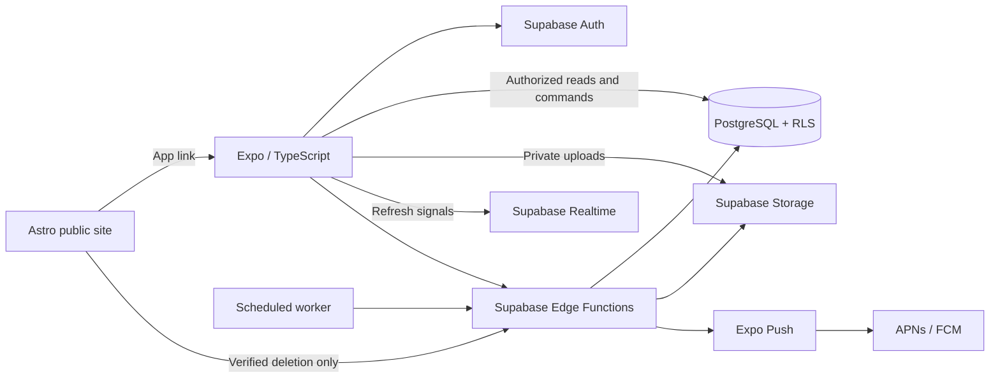

# Architecture

Status: Proposed. The owner selected Expo, TypeScript, Android, and iOS.

## 1. Smallest complete system

Use one native application, one static public site, and one Supabase backend.

The app owns native interaction. The site owns public information and installation handoff. The backend owns durable shared data.



No separate general-purpose backend, message broker, GraphQL layer, or microservices are needed.

## 2. Stack

| Area | Choice | Reason |
|---|---|---|
| Native app | Expo, React Native, TypeScript | One codebase for both requested platforms |
| Navigation | Expo Router | Native stacks, tabs, and typed links |
| Native UI | React Native primitives and StyleSheet | Direct control of the approved style |
| Shared visual data | `brand/tokens.json` and approved icon source | Actual reuse by mobile and site |
| Public site | Astro, TypeScript, static output | Semantic public pages without app state |
| Server state | TanStack Query | Query lifecycle, invalidation, retry, and pagination |
| Forms | React Hook Form and Zod | Field state and explicit input validation |
| Backend | Supabase Auth, PostgreSQL, Storage, Realtime | One account and access model |
| Scheduled work | Supabase Cron and Edge Functions | Durable reminders, cleanup, and export jobs |
| Push | Expo Notifications and Expo Push | Shared Android/iOS delivery integration |
| Dates | Luxon and Expo Localization | IANA timezone conversion and local formatting |
| Images | Expo Image, Image Picker, Image Manipulator | Native selection, display, and prepared uploads |
| Secrets on device | Expo SecureStore | Encryption keys and small secrets |
| Local session and drafts | Encrypted MMKV | Larger encrypted values without SecureStore size assumptions |
| App tests | Jest Expo and React Native Testing Library | User-visible behavior at feature interfaces |
| Device flows | Maestro | Native flows across development builds |
| Database tests | pgTAP through Supabase CLI | Real access and transaction checks |
| Website tests | Playwright | Public routes, handoff, and deletion flow |

Use the current stable Expo SDK at scaffold time. Install its compatible React Native and Expo package versions together.

Pin exact dependency versions and commit one lockfile. Record selected versions in DEVELOPMENT.md after installation.

Do not guess current SDK numbers from a planning document. Confirm compatibility with Expo Doctor before accepting the scaffold.

Use npm workspaces for `apps/mobile` and `apps/site`. Do not add a workspace orchestrator.

The proposed dependencies are not installed yet. Add each feature dependency when its delivery task needs it.

## 3. Folder map

This is the target structure. Product files do not exist yet.

```text
deseo/
  AGENTS.md
  README.md
  STYLE.md
  GLOSSARY.md
  package.json                       Workspace scripts and package manager version
  package-lock.json
  brand/
    tokens.json                      Colors, spacing, radii, typography values
    icon-source.png                  Approved Two voices source
  apps/
    mobile/
      app.config.ts                  Bundle IDs, permissions, links, Expo plugins
      eas.json                       Development, preview, production build profiles
      package.json
      tsconfig.json
      assets/                        Platform icon, splash, notification assets
      src/
        app/
          _layout.tsx                Providers and native root stack
          index.tsx                  Session and pair entry routing
          (auth)/                    welcome, email, verify, profile
          (pair)/                    start, invite, join, waiting, welcome, ended
          (tabs)/                    today, calendar, memories, messages, tasks
          events/                    new, [eventId], [eventId]/edit
          ideas/                     index, new, [ideaId]
          memories/                  new, [memoryId], [memoryId]/edit
          tasks/                     new, [taskId]/edit, lists
          settings/                  index, profile, pair, notifications, data, account
          invite.tsx                 External invitation entry
        features/
          auth/                      Session, email code, account status
          pair/                      Membership and invitation flows
          calendar/                  Events, important dates, date ideas
          tasks/                     Lists and task commands
          messages/                  Conversation, read cursor, pinned notes
          memories/                  Upload state, memory feed, private media
          notifications/             Device registration and viewer preferences
          account/                   Export, disconnect, deletion, profile settings
          today/                     Read composition and Today screen
        components/ui/               Button, Field, Screen, Status, Avatar, Badge
        theme/                       Typed native mapping of brand tokens
        lib/
          supabase.ts                One publishable-key client
          database.types.ts          Generated schema types
          query-client.ts            Query defaults and session reset
          private-storage.ts         Encrypted session/draft storage lifecycle
          links.ts                   Allowed links and entry intent
          result.ts                  Shared command result and error types
        test/                        Shared fixtures and test setup
      e2e/                           Maestro flows
    site/
      astro.config.mjs
      package.json
      src/
        pages/                       index, invite, support, privacy, terms, delete-account
        components/                  Header, Footer, DownloadLinks, AppPreview
        styles/                      Tokens and public page styles
        scripts/                     Invitation handoff and verified deletion
      public/.well-known/            Apple and Android association files
      tests/                         Playwright flows
  supabase/
    config.toml
    migrations/                      Current schema evolution, not compatibility layers
    seed.sql                         Synthetic local accounts and pair fixtures only
    functions/
      _shared/                       Verified caller, response errors, job helpers
      finalize-memory/               Upload validation and atomic publication
      verify-sensitive-action/       Fresh email verification and action-bound proof
      dispatch-notifications/        Claim jobs, recheck access, submit push
      check-push-receipts/            Delivery errors and token cleanup
      request-export/                Authorize and create export jobs
      process-exports/               Build bounded export parts
      delete-account/                Verify recent authentication and disable access
      process-deletions/             Purge records, storage, then Auth account
      cleanup/                       Expired uploads, exports, invitations, ended pairs
    tests/                           RLS, constraints, transactions, and concurrency
  docs/                              Product, architecture, plans, design, research
  .github/workflows/                 Verification and controlled build jobs
```

Create files as their task starts. Do not add empty feature packages or placeholder screens.

## 4. Feature module shape

Start a feature with `screens/`, `queries.ts`, `commands.ts`, `schema.ts`, and `types.ts` only when each has real content.

Keep related tests beside these files. Create a feature `components/` folder only for controls used by that feature.

Export public queries, commands, view types, and screens from `index.ts`.

Keep route files as imports and navigation configuration. Do not put database calls inside route files or UI primitives.

Do not add repository interfaces around Supabase's query builder. Add a seam only when a real alternative exists.

Use feature commands to hide validation, retry identifiers, version checks, and cache invalidation from screens.

Read generated database types at the data edge. Return feature view types where display needs differ from stored rows.

## 5. Dependency rules

1. Routes import feature screens and UI primitives.
2. Feature commands and queries import the configured backend client.
3. Features may import another feature's public interface, not its internal files.
4. Today reads public feature queries and never writes feature tables directly.
5. UI primitives import theme values and native libraries, not feature data.
6. Backend functions share only code used by at least two functions.
7. The public site imports brand tokens and image assets, not mobile screens.

The pair module owns current membership. The messages module owns notes. The calendar module owns important dates and date ideas.

Do not create a global mutable store for copied query data.

## 6. Data paths

**Read:** Screen → feature query → authenticated Supabase request → RLS → typed result → TanStack Query.

**Write:** Form → feature command → backend validation/transaction → confirmed result → targeted query invalidation.

**Live update:** Realtime signal → invalidate affected pair query → authenticated read.

**Push:** Database command/trigger → durable job → scheduled worker → current access check → Expo → receipt processing.

**Photo:** Picker → prepared private files → pending upload record → private upload → server validation → published memory.

Queries include account and pair identifiers in their cache keys. Clear all shared caches before switching accounts or pairs.

Use session lifecycle and network state with TanStack Query's React Native integration.

## 7. Storage and offline contract

Generate an encryption key using the operating system's cryptographic randomness. Keep it in SecureStore.

Use encrypted MMKV for the larger Auth session and account-scoped drafts. Never use plaintext fallback storage.

On storage failure, explain the problem and require sign-in again. Do not silently lose a confirmed draft.

Separate session storage from pair-scoped drafts. Clear the relevant drafts on disconnect, sign-out, and account deletion.

A session restore must validate server account status and membership before showing shared content.

Keep fetched shared rows in memory only. Use memory-only caching for private images.

While offline, allow drafting but disable submission. Retrying requires a deliberate action after reconnect.

Photos selected for a draft use private temporary app files. Purge them on draft discard, disconnect, or sign-out.

## 8. Server authorization

RLS checks current account status and membership, not editable JWT metadata.

A restricted helper also checks the JWT session ID against Auth sessions. Global sign-out must block old sessions.

Use ordinary RLS-scoped reads for feature lists. Use named transactions for multi-record invariants.

For privileged transactions, expose a narrow invoker wrapper around a hardened private implementation.

Revoke default function execution. Grant only required roles. Use a fixed empty search path and explicit caller checks.

Keep internal tables in a non-exposed schema. A public wrapper must not accept a trusted actor ID from the client.

Use secret backend keys only inside verified server jobs. Bind every privileged action to a verified account or scheduled job identity.

See [DATA.md](DATA.md) for table permissions, state machines, and race handling.

## 9. Build and environment choices

Use separate development, staging, and production Supabase projects. Never run local fixtures against production.

Use development builds from the first native task. Push and native storage must be tested outside Expo Go.

Use EAS for iOS builds from Windows. Native iOS simulator work requires macOS; use a real iPhone or macOS CI.

Use app links on the production domain and a custom scheme for development.

Do not change stable app identifiers after release. Choose the actual domain and identifiers before production credentials exist.

## 10. Applied architecture review

See [the skill review](REVIEW.md) and [ADR 0001](../adr/0001-mobile-stack-and-module-structure.md).

Sources and verified platform capabilities appear in [REFERENCES.md](../research/REFERENCES.md).
