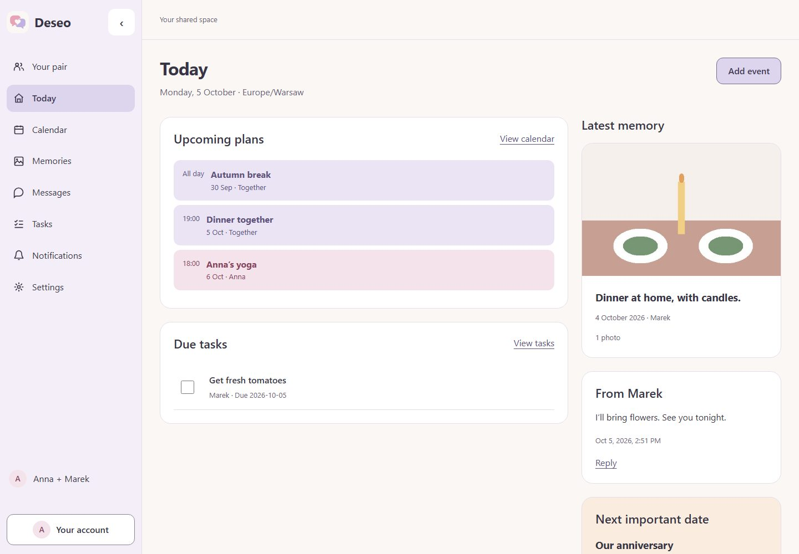
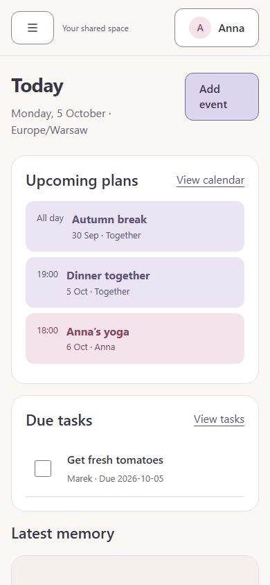

# React web portal handoff

Date: 6 October 2026. Status: Automated verification complete. Controller review remains required.

## Source and scope

Final browser Code HEAD: `50bac2e59309f6b3422aea554c740e5bd84a5303`.
Task 11 baseline: `d4837a81cb108abf43772608461e316463974fac`.
Initial source correction: `67775e7`, `fix: complete portal verification corrections`.
Shared-style and capture correction: `0db22a6`, `fix: own common styles across lazy portal routes`.
Lifecycle correction: `50bac2e`, `fix: retain commands after represented realtime signals`.
The final documentation commit uses `docs: record portal verification and platform architecture`.

The portal uses React DOM, Vite, React Router, and separate browser pages.
Expo remains the Android and iOS application. Both applications import `packages/domain` and use the same backend.
Shared contracts contain schemas, payloads, types, date rules, and command results.
Native capabilities and browser capabilities stay inside their applications.

The portal includes sign-in, pairing, Today, Calendar, events, ideas, tasks, lists, Messages, Memories, notifications, and Settings.
It retains private-event isolation, immutable retry commands, conflicts, author-only memory changes, and authority cleanup.
Browser Auth uses supported Supabase session storage. Rows, drafts, blobs, and object URLs remain memory-scoped.

Account export, deletion, avatar backend work, and public pages remain separate delivery tasks.
The portal adds no service worker, offline content storage, browser push prompt, or installation prompt.

## Final commands and results

All commands ran from the portal worktree root, except Expo's workspace command.
Each row records its actual Code HEAD. Physical device checks remain separate.
Native, domain, backend, and race sources have no changes between `67775e7` and `50bac2e`.
Their earlier checks remain valid for those unchanged modules. The final browser run uses committed `50bac2e`.

| Command | Measured result | Exit | Code HEAD |
|---|---|---:|---|
| `npm run verify:mobile` | 46 suites, 209 tests passed; TypeScript and lint passed | 0 | `67775e7` |
| `npm run test:domain` | 2 suites, 7 tests passed | 0 | `67775e7` |
| `npm run verify:web` | TypeScript, lint, build passed; 228 tests passed, zero failed, two opt-in capture skips; 27.6 minutes | 0 | `50bac2e` |
| `npm run test:web:db` | 13 files, 505 assertions passed on populated 55722 | 0 | `0db22a6` |
| Fresh replay `supabase db reset --local` | 12 current migrations applied, including idea-update locals | 0 | `d4837a8` |
| Fresh replay `supabase test db --local` | 13 files, 505 assertions passed | 0 | `67775e7` |
| `npm run test:db:race` | Three Node harnesses passed: pairing, planning, messages | 0 | `0db22a6` |
| `npm run test:memories:race` | One Node harness passed on isolated replay API 55821 | 0 | `67775e7` |
| `npm run test:notifications:race` | One Node harness passed on guarded API 55721 | 0 | `0db22a6` |
| `npm run test:memories:functions` | 22 tests passed | 0 | `67775e7` |
| `npm run typecheck:memories:functions` | Three Edge entrypoints checked | 0 | `67775e7` |
| `npm run test:notifications:functions` | 15 tests passed | 0 | `67775e7` |
| `npm run typecheck:notifications:functions` | Two worker entrypoints checked | 0 | `67775e7` |
| Sensitive function Deno check with its local config | Entrypoint checked | 0 | `67775e7` |
| Android and iOS Expo export | One Hermes bundle per platform; 5.2 MB Android and 5.0 MB iOS | 0 | `67775e7` |
| Final compiled module and asset scan | 218 modules; 19 dependency paths; zero server/native/fixture/audit matches | 0 | `50bac2e` |
| Named Anna and Marek UI smoke | Both email-code logins; create, partner edit, reload, and owned-task deletion passed | 0 | `50bac2e` |
| `git diff --check` | No whitespace errors | 0 | `50bac2e` |

The replay reset used baseline migrations. Task 11 changed SQL tests, not migration files.
The two opt-in gallery regeneration cases remain explicit skips in ordinary verification.
Gallery declarations and physical JPEG validation run during ordinary verification.
The final complete run passed both validation cases in each viewport. It did not regenerate unchanged captures.

Sensitive function command:

```powershell
npm exec --yes --package deno@2.9.6 -- deno check --frozen --config supabase/functions/verify-sensitive-action/deno.json supabase/functions/verify-sensitive-action/index.ts
```

Native export command:

```powershell
npm exec --workspace @deseo/mobile -- expo export --platform android --platform ios --output-dir ../../.superpowers/sdd/2026-10-05-deseo-web-portal-implementation/native-export
```

Focused source corrections passed: Today dates 2/2; live authenticated origin checks 2/2.
The origin test used real valid actors. Unknown and null origins returned 403 without creating verification mail.
The same actor's native no-Origin request returned 200 and created one mail message.

The final named smoke at `50bac2e` created one new task and removed that task through the normal UI.
It changed no existing named content. Its journal retained the task ID and confirmed deletion.

## Backend preservation and replay

The populated `deseo-web` project uses API 55721, DB 55722, and mail 55724.
The separate integration project uses 55620–55629. This task did not reset either project.
The named pair and unknown older screenshot remnants remain intact.
Cleanup used only recorded fixture IDs and checked returned errors.

The replay used a new `deseo-web-replay` Postgres-only project.
Its copied config used DB 55822 and shadow DB 55820, with the absent seed disabled.
Docker labels, workdir, config, port, and creation time identified its database before reset.
Supported `db start`, `db reset --local`, and `test db --local` commands produced the replay evidence.
The controller approved this separate replay method before startup.

Six SQL suites needed fixture-scoped assertions: tasks, devices, end-pair, memories, memories-quota, and notification-jobs.
Memory cleanup assertions select the fixture's job from supported bounded claims.
Explicit JSON column aliases prevent a correlated outer job from replacing a new lease.
The tests retain actual RLS denials and roll back transactions. This task changed no production SQL policy or migration.

Core and notification races use guarded API 55721. Notification races require an empty notification table.
The populated stack has unknown queued memory cleanup jobs. Its memory harness must not globally claim them.
Memory races used the new replay API 55821 with DB, Auth, Kong, PostgREST, and Storage only.
The installed CLI short-circuited startup with its existing Postgres-only container.
A verified replay-only stop preserved its data; the next minimal startup added those services.
The replay excludes Edge runtime. The original Edge process remained unchanged.
After saving evidence, a verified replay-only stop preserved its two labeled database/storage volumes for controller cleanup.
Replay ports 55821 and 55822 have no listeners. The original web and integration stacks remain unchanged.
The test process reads keys from ignored local status JSON and does not print them.

## Browser configuration and gateway

Browser variables: `VITE_SUPABASE_URL` and `VITE_SUPABASE_PUBLISHABLE_KEY`.
Server variables: `WEB_APP_ORIGIN` and `PUBLIC_SUPABASE_URL`.
Runtime-injected `SUPABASE_URL` remains the internal server address.
Invitations use `location.origin`; the unused planned `VITE_SITE_URL` setting was not added.

Development uses origin `http://127.0.0.1:5174`; tests use `http://127.0.0.1:4174`.
One guarded Edge process serves one origin per start. Stop it before switching modes.
The public backend address must be reachable from browser and mobile devices in a deployed environment.

Measured local gateway behavior:

| Request | External response |
|---|---|
| Allowed-origin OPTIONS | 200, `Access-Control-Allow-Origin: *` |
| Allowed-origin unauthenticated POST | 401 UNAUTHENTICATED, no-store, wildcard header |
| Unknown/null-origin POST | 403 FORBIDDEN, no-store, wildcard header |
| Direct helper allowed OPTIONS | 204, exact configured origin |
| Direct helper unknown/null request | 403 |

Local Kong intercepts OPTIONS and overrides response CORS headers.
The controller retained provider gateway behavior and exact function request policy.
No gateway patch, proxy, extra allowed origin, or browser-Origin override was added.
These results do not prove deployed gateway headers or deployment acceptance.
See [Supabase CORS guidance](https://supabase.com/docs/guides/functions/cors) and [the official gateway config](https://github.com/supabase/supabase/blob/master/docker/volumes/api/kong.yml).

## Bundle and dependency findings

The lockfile SHA256 stayed `2DB5CF4C6E0EF087EE97F4BC1D69E195AFD9F9CFDAF754BF47375D9F55AE3E7C`.
The shared audit reports 66 package findings: 50 high, 16 moderate, and zero critical.
The workspace/omit-dev audit still includes the shared graph. Its 61 findings do not mean 61 web production vulnerabilities.

The production dependency tree contains 34 paths. None intersect the audit's vulnerable node paths.
A no-write compilation of the actual web entry contains 218 modules and 19 installed package paths.
Those compiled paths also intersect no reported vulnerable node path.
This finding describes this lockfile and entry; it does not remove the shared native/tooling advisories.

The asset scan found no local server key, secret key, JWT secret, or S3 secret value.
It found no fixture helper/token path, native import, private-storage path, or obsolete site-URL path.
The compiled resolver imports use Zod and contain no AJV module.
The root AJV 6 optional-peer warning remains; adding unused AJV 8 would not improve the Zod path.
No package manifest, package pin, or lockfile changed during this task.

React lazy route loading replaced the former large entry chunk.
The final entry is 218.95 kB, gzip 68.23 kB. The largest chunk is 303.55 kB, gzip 77.42 kB.
The build reports no size warning. This task did not increase the warning threshold.

## Screenshots and named pair

Open [the HTML gallery](../design/web-portal/index.html), [Markdown index](../design/web-portal/README.md), and [coverage records](../design/web-portal/coverage.json).
The gallery contains 39 routes, 119 views, 238 viewport records, and 324 JPEGs, including 88 full-page images.
Captures use 1440×1000 and 390×844. Layout tests cover 320, 390, 768, 1024, and 1440px with normal and 200% text.
Text enlargement evidence does not claim operating-system scaling or browser toolbar zoom.
The display clock is 5 October 2026, 10:00 Europe/Warsaw; backend and Auth clocks keep real time.

Today now labels each upcoming plan with its date.
The existing gallery runner refreshed only its two planning captures after that source change.
After the common-style correction, it regenerated all ten Memory create/edit records and their full-page images.
After the lifecycle correction, it refreshed twelve invitation and profile records.
The helper saves current SDK state after owner/profile verification. It changes no Auth token field.
All Memory form headings match their requested view; no account-error page remains mislabeled in the gallery.
Normal captures use Anna and Marek. Other states use disposable fixtures or controlled transport failures.
Captures mask codes; gallery URLs contain no invitation token or verification proof.
Browser confirmation prompts belong to browser UI; navigation tests cover their behavior.





## Retained failures and limits

Task 8's earlier full run passed 153/158. Task 9's pre-fix full run passed 194/196.
Those runs remain separate from the final current-source run.
The first Task 11 full run at `67775e7` passed 222 tests, failed two layouts, and skipped two capture cases.
Both failures exposed Memory form styles that depended on an eagerly loaded planning stylesheet.
Common form rules now live in `controls.css`. Shared text wrapping lives in `base.css`.
Focused layouts and real multiline messages passed 4/4 before the committed-source full rerun.
The second full run at `0db22a6` passed 221 tests, failed three lifecycle cases, and skipped two capture cases.
Late Realtime signals interrupted profile recovery in both viewports and ordinary invitation delivery in the narrow viewport.
Deterministic tests delayed real server frames and reproduced both command-settlement failures before the fix.
The provider now skips only signals represented by its latest fully server-verified snapshot.
It checks exact user, row, state, version, and slot. Incomplete, disabled, left, and new-state signals still revalidate.
Channels follow the verified account ID. Removed prior-user callbacks cannot interrupt a new user's commands.
Focus, reconnect, Auth, and genuine authority changes retain cancellation and private-state cleanup.
The corrected source passed 22 focused cases, including real events, original failures, and privacy cancellation.
The final complete run at `50bac2e` passed 228 tests with zero failures and two explicit capture skips.
Driver-only subscription, link, and drawer precondition failures remain separate from the valid regression RED.
An initial capture refresh returned expired saved state after SDK validation. Its default images showed an account error.
The corrected helper returned current SDK state, then both capture runs passed all ten Memory scenes.
The named smoke retained a wrong-selector failure and a too-early OTP attempt before complete success.
An unquoted pipe regex failed command parsing before gallery tests. The whole coverage file passed 4/4 with two explicit capture skips.
The bundle scan's ENOENT attempt overlapped preview rebuilding. Its later scan passed after build completion.
Earlier Task 5 memory-finalization transport failure remains unclassified; no instance occurred during current verification.
SQL diagnostics retained failed runs with 409, 457, and 505 executed assertions before the passing 505-assertion run.
The first sensitive Deno command used the wrong shared config and failed import resolution.
Its corrected command used the existing function-local map and passed. No dependency changed.
Windows PowerShell wrapped ordinary stderr test/build output as NativeCommandError text; recorded process exits determine results.

Android and iOS JavaScript exports do not prove native binaries, devices, push delivery, or store readiness.
Physical checks remain unverified for encrypted storage, process termination, photo permissions, media download, deep links, accessibility, and push.
Windows cannot run an iOS simulator. Use macOS/Xcode or an authorized EAS build and a physical iPhone.
Hosted Auth, SMTP, gateway behavior, public URL reachability, and deployment remain unverified.
Controller task review and independent whole-branch review remain required before integration.

## Raw evidence

The owned execution folder is `.superpowers/sdd/2026-10-05-deseo-web-portal-implementation`.
It contains `task-11-report.md`, command logs, audit JSON/tree files, compiled module details, and native export metadata.
Keep it through review. This handoff preserves commands, counts, source IDs, and limits if scratch files are later removed.
