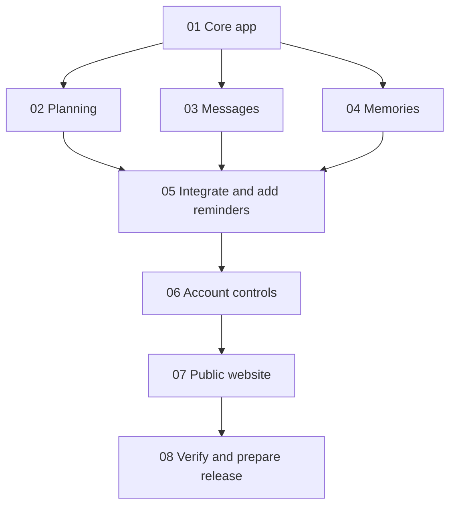

# Implementation across eight AI chats

Use this guide to run the existing [implementation plan](../superpowers/plans/2026-10-04-deseo-implementation.md) across separate chats.

The guide changes task ordering and file ownership. It does not add product scope.

No implementation chats, worktrees, branches, or product files have been created by this guide.

## 1. Numbered work list

Each prompt file contains materials, ownership rules, completion checks, and one ready-to-paste prompt.

| Chat | Work | Master tasks | Start after | Can run with | Prompt |
|---|---|---|---|---|---|
| 01 | Foundation, authentication, pairing, first calendar, and Today | 1–5 | Nothing | Run alone | [Core app](prompts/01-core.md) |
| 02 | Shared lists, tasks, important dates, and saved date ideas | 6–7 | 01 integrated | 03 and 04 | [Planning](prompts/02-planning.md) |
| 03 | Messages, unread state, and pinned love notes | 11–12 | 01 integrated | 02 and 04 | [Messages](prompts/03-messages.md) |
| 04 | Private photo uploads, memories, and media cleanup | 13–14 | 01 integrated | 02 and 03 | [Memories](prompts/04-memories.md) |
| 05 | Integrate 02–04, finish shared navigation/Today, then build reminders | 8–10 plus deferred shared integration | 02, 03, and 04 ready | Run alone | [Integration and reminders](prompts/05-integration-reminders.md) |
| 06 | Settings, profile, export, disconnect completion, and account deletion | 15–17 | 05 integrated | Run alone | [Account controls](prompts/06-account.md) |
| 07 | Landing, support, legal pages, invitation handoff, and web account deletion | 18 | 06 integrated | Run alone | [Public website](prompts/07-site.md) |
| 08 | Device testing, accessibility, usability review, operations, and release candidate | 19–20 | 07 integrated | Run alone | [Verification and release](prompts/08-release.md) |

Do not confuse chat numbers with master task numbers. Chat 03 implements master Tasks 11–12.

## 2. Execution order

Only 02, 03, and 04 form a parallel group. Start them from the same completed core commit.

Chat 05 integrates the group before later work starts. Feature branches do not merge each other.

The public website waits for account deletion because its external deletion flow needs a working backend.

Reminders wait for calendar, task, and message records because their jobs depend on those sources.

Account export and deletion wait for all content types because partial coverage can leave private data behind.

### Smaller operating steps

1. Open Chat 01 and paste its prompt.
2. Read its handoff and confirm the core checks have evidence.
3. Open Chats 02, 03, and 04 from the same core baseline.
4. Let those three chats work in separate Git worktrees.
5. Open Chat 05 after all three handoffs are ready.
6. Run Chats 06, 07, and 08 in order.

Keep the same chat for corrections to its task. Do not start a duplicate chat for unfinished work.

## 3. Common materials

Every chat must read these local documents. The task briefs add narrower sections.

| Material | Purpose |
|---|---|
| [AGENTS.md](../../AGENTS.md) | Contributor rules and test threshold |
| [Product design](../superpowers/specs/2026-10-04-deseo-design.md) | Scope and product decisions |
| [Master implementation plan](../superpowers/plans/2026-10-04-deseo-implementation.md) | Detailed tasks and interfaces |
| [Architecture](../architecture/ARCHITECTURE.md) | Target folders, dependency rules, and stack |
| [Data contract](../architecture/DATA.md) | Permissions, transactions, limits, and retention |
| [Screen guide](../product/SCREENS.md) | Native and public user flows |
| [STYLE.md](../../STYLE.md) | Pastel tokens, native mapping, and selected icon |
| [Glossary](../../GLOSSARY.md) | Stable product names |
| [Development](../engineering/DEVELOPMENT.md) | Environment and command contract |
| [Testing](../engineering/TESTING.md) | Required checks and test importance |
| [Release](../engineering/RELEASE.md) | External inputs and release checks |
| [Research](../research/REFERENCES.md) | Official product, platform, and skill sources |

Visual materials:

- [Selected icon 05](../design/icons-round-2/icon-05-two-voices.png).
- [Desktop reference](../design/desktop.jpg) and [mobile reference](../design/mobile.jpg).
- [Calendar reference](../design/mobile-calendar.jpg) and [message reference](../design/mobile-messages.jpg).
- [HTML reference](../design/preview.html), which contains sample behavior only.

The new chats must inspect current code before implementing. The documents describe planned files, not installed capabilities.

## 4. Worktree and branch rules

Chat 01 initializes Git if needed and records the integration branch in its handoff.

Suggested integration branch: `codex/deseo-integration`. Preserve an existing suitable branch instead of resetting it.

Chats 02–04 each create or reuse an isolated worktree from that branch's verified core baseline.

| Chat | Suggested feature branch | Writes outside its feature |
|---|---|---|
| 02 | `codex/deseo-02-planning` | Its migrations, generated types, dependency files, and own handoff |
| 03 | `codex/deseo-03-messages` | Its migrations, generated types, dependency files, and own handoff |
| 04 | `codex/deseo-04-memories` | Its migrations, image functions, generated types, dependency files, and own handoff |

Separate branches inside one checkout are not isolation. Concurrent chats must use separate filesystem worktrees.

Never reset another chat's checkout. Never delete its branch or archive its worktree before integration has passed.

Do not share one running local database between parallel chats.

Use distinct local Supabase project IDs and non-overlapping ports. Record them in each handoff.

Suggested port ranges: 55320–55339 for 02, 55420–55439 for 03, and 55520–55539 for 04.

Check port availability first. Apply the range to every enabled local component, not just PostgreSQL.

Keep local port overrides out of integration commits. Inspect current CLI support before choosing an override method.

If local resources prevent isolated database stacks, serialize database checks. Never report unrun checks as passed.

## 5. Ownership during parallel work

| Shared area | Owner |
|---|---|
| Auth, membership, encryption, result types, base controls, and theme | 01 establishes them; 05 owns later integration changes |
| Calendar feature and its event/idea routes | 02 |
| Tasks feature and its task/list routes | 02 |
| Messages feature and its screen route | 03 |
| Memories feature, its routes, and image functions | 04 |
| Root layout, tab layout, Today composition, and notification navigation | 05 after 01 |
| Account settings and complete retention/deletion | 06 |
| Public website | 07 |
| Final CI, release checks, and cross-feature fixes | 08 |

Chats 02–04 must not edit root/tab layouts, Today composition, shared UI controls, or the frozen core interfaces.

They may add feature routes that the existing router resolves. Test those routes through native deep links.

They must export working feature screens and queries, then document exact integration calls for Chat 05.

Do not add temporary navigation, stub data, or fake success paths to make a branch appear complete.

Dependency manifests, the lockfile, and generated database types are controlled exceptions to shared-file ownership.

Each branch may update these files for reproducible tests. Chat 05 must reconcile them after merging all feature changes.

Do not choose one branch's generated types or lockfile over another. Regenerate them from the combined schema and manifests.

Parallel chats write only their own handoff. They do not edit this guide, master task checkboxes, or shared status documents.

## 6. Core contract required before parallel work

Chat 01 records these concrete exports and behaviors in `docs/handoffs/01-core.md`:

- Actual integration branch, tested commit, worktree path, and available verification commands.
- Account, PairContext, command result, error, and paging types, with their exact file paths.
- `Page<T>` uses `{ items: T[]; nextCursor: string | null }` for feature list results.
- Authentication, current-session checks, fresh verification proofs, and pair membership helpers.
- Invitation and pair-termination transaction interfaces.
- Event input, stored event, agenda item, and time representation.
- Query key conventions and full cache clearing on disconnect or account change.
- Encrypted draft storage interface, including account/pair scoping and purge behavior.
- Theme and UI control exports; native link and route conventions.
- RLS helpers, immutable ownership fields, command receipts, version checks, and migration ordering.

Resolve the core's own dependency order before committing:

- Add partner profile access after membership tables exist. Self-only access works before pairing.
- Create command receipts and fresh verification records before commands use them.
- General task lists are introduced by Chat 02, not by a pairing function that references a missing table.

Chat 02 adds the General-list trigger and initializes lists for already active local pairs.

These are prerequisites, not a request for speculative abstractions. Keep the implementations small.

## 7. Integration checklist for Chat 05

1. Read all four earlier handoffs and verify the recorded branches exist.
2. Verify 02–04 derive from the agreed core baseline.
3. Inspect outstanding changes before merging. Preserve unrelated work.
4. Merge 02, then 03, then 04 into the integration branch.
5. Resolve source conflicts from the data contract and recorded feature interfaces.
6. Reconcile package manifests and regenerate the root lockfile.
7. Check migration ordering and unique version identifiers before applying the combined history.
8. Regenerate only conflicting migrations that have never reached a shared environment, using the documented CLI workflow.
9. Rebuild a disposable integration database. Never reset another chat's database.
10. Regenerate database types from the combined schema.
11. Wire the five tabs, Today sections, feature actions, and shared cache invalidation.
12. Add reminders, message alerts, device registration, notification jobs, and notification navigation.
13. Run feature, database, race, and integrated native checks.
14. Record the integrated commit and remaining external checks.

Do not rewrite migrations already applied to a shared environment. Use a reviewed forward schema change instead.

Shared integration deferred from parallel branches belongs to Chat 05:

- Tasks tab, Today's due tasks, and important-date countdown.
- Messages tab, unread indicator, and Today's pinned note.
- Memories tab and Today's latest memory.
- Notification hooks for all source records and cancellation after disconnect.

Master Tasks 6–7 and 11–14 are not fully complete until these connections pass.

## 8. Handoff contract

Every chat saves its own numbered report under `docs/handoffs/`.

Use the [handoff template](HANDOFF_TEMPLATE.md). Record actual results, not expected results copied from the plan.

Keep statuses distinct:

| Status | Meaning |
|---|---|
| In progress | Implementation or required automated checks remain |
| Blocked | A named dependency prevents the assigned work |
| Ready for integration | Feature code and applicable automated checks pass; branch has not joined the product |
| Integrated | Code is in the integration branch and combined checks pass |
| Device verification pending | Code passed relevant automated checks; named physical-device checks remain unrun |
| Verified | All required checks for that chat have recorded evidence |

Record code/integration status and device status separately. Missing device access must not appear as a passing test.

Downstream coding may use an integrated baseline with pending physical checks. Security and transaction tests must already pass.

Physical and human usability checks remain required before release. Chat 08 cannot replace them with simulated results.

Record the tested code commit, then commit the handoff separately. Report the final branch tip in the chat's final reply.

Start later branches from the integration tip containing the handoff. Verify changes after the tested commit are documentation only.

Do not rely on another chat's hidden history. Use committed files and named interfaces.

## 9. Resources by phase

| Phase | Needed materials |
|---|---|
| 01 | Project docs, icon, Node/npm, Expo tools, local Supabase/Docker, Android/iOS build access |
| 02–04 | Core handoff, same core baseline, isolated worktrees/databases, synthetic test accounts and photos |
| 05 | Three feature handoffs, combined database, authorized push setup, physical device access |
| 06 | Every content type, complete access rules, export fixtures, deletion test accounts |
| 07 | Account deletion interface, working app screenshots, actual domain/support/legal/store inputs before publication |
| 08 | Integrated build, release checklist, signed build access, real devices, consenting testers, operator inputs |

Use available local tools first. Report external inputs that are missing, and continue work that does not depend on them.

Do not expose keys, codes, invitation tokens, or private user content in prompts or handoffs.

## 10. Prompt usage

Open the linked brief and copy its **Prompt** block into a new chat for this project.

Pasting a prompt authorizes implementation of that brief. It does not authorize deployment, store submission, or contacting real users.

The prompts use the saved design as their baseline. They do not ask each chat to repeat product brainstorming.

Do not create more chats or send messages between chats automatically. The owner starts and controls these chats.
