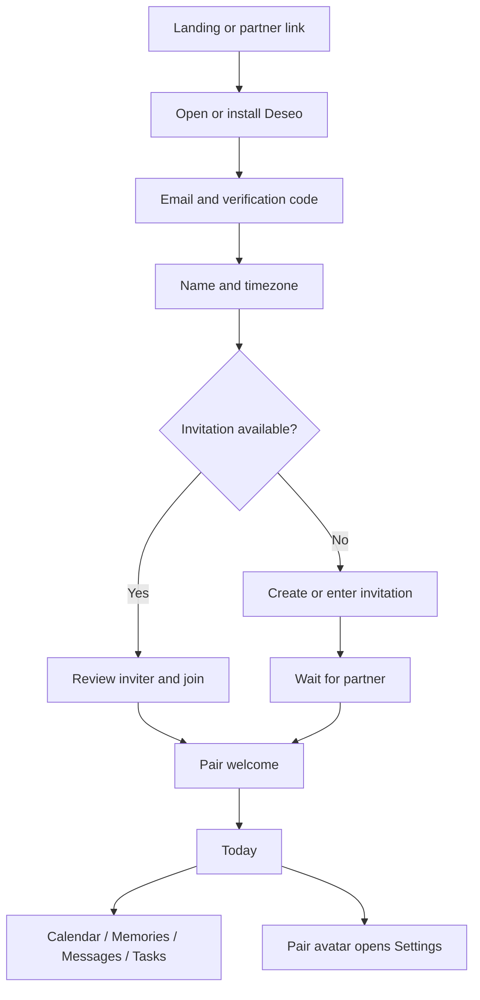

# Screen guide

Status: Expo mobile and React portal. Read the native design, approved portal design, and [STYLE.md](../../STYLE.md).

## Browser portal

The [route manifest](../../apps/web/src/app/route-manifest.ts) defines 39 routes.
The [gallery](../design/web-portal/index.html) covers 119 views at 1440×1000 and 390×844.
The browser uses a sidebar, rail, or drawer. Expo keeps bottom tabs and native stacks.

Entry routes cover Welcome, email codes, profile setup, invitations, joining, waiting, and ended pairs.
Product routes cover Today, Calendar, events, ideas, tasks, lists, Messages, Memories, notifications, and Settings.
Record URLs support reload and browser Back. Changed forms and unsent drafts warn before leaving.

Today shows each upcoming plan's date in the pair timezone. Calendar provides month, agenda, and comparison views.
Messages keeps the composer inside the conversation region. Memories uses browser files, preparation, private uploads, and explicit downloads.
Settings supports profile edits, pair state, preferences, end-pair verification, and local or global sign-out.
Settings remains available to unpaired accounts and former pair members.

Browser shared rows, private images, and drafts stay in memory. A reload discards browser drafts.
Supabase stores browser Auth sessions through its supported browser storage.
Failed writes preserve their immutable command and input until the user resolves them.

Account export, deletion, avatar backend work, pair-timezone writes, and public pages remain separate delivery work.
The future native and public-site requirements below do not add portal controls for those capabilities.

See [the portal design](../superpowers/specs/2026-10-05-deseo-web-portal-design.md) and [handoff](../handoffs/web-portal.md).

## 1. Main journey

Resume the original invitation after authentication. Do not restart onboarding after an email code expires.

## 2. Public site

| Page | Content | Main action | Required states |
|---|---|---|---|
| `/` | Product name, short promise, real app preview, planning, messages, memories, privacy summary | Download for iOS / Android | Store unavailable before release; desktop QR after launch |
| `/invite` | Generic invitation explanation and installation instructions | Open Deseo | Installed, not installed, expired link after native validation |
| `/support` | Pairing, permissions, failed uploads, contact method | Contact support | Support address must exist before launch |
| `/privacy` | Actual collection, processors, retention, export, deletion, operator | Open data controls | Owner-approved policy required |
| `/terms` | Actual service terms and operator | Read support options | Owner-approved terms required |
| `/delete-account` | Independent email verification and deletion request | Request deletion | Code sent, invalid code, confirmed, processing, complete |

Landing headline: **Your plans. Your memories. Your space.**

Supporting copy: **Plan your days, share a note, and keep the moments you want to remember.**

Use a real app screenshot once the product works. Mark prototype imagery as a preview before then.

Show three short product sections and one privacy section. Include a small FAQ and clear footer links.

Use the selected icon, pastel panels, dark text, and generous photo space. Keep the page useful at 360px.

Do not show fake reviews, invented usage counts, urgency banners, or unimplemented features.

Before store approval, use an honest Coming soon state. Do not collect a waitlist without a separate need.

Invitation links carry an opaque token in the query string. The public page does not fetch partner details.

Set `Referrer-Policy: no-referrer`. Exclude invitation URLs from analytics and scrub their queries from access logs.

After installation, tell users to reopen the original invitation. Do not promise automatic transfer through an app store.

## 3. Authentication and entry

| Screen | Content and behavior |
|---|---|
| Launch | Selected icon on ivory; restore session and check account status |
| Welcome | One sentence, Continue with email, privacy and terms links |
| Email | Visible Email label, email keyboard, Continue, inline format error |
| Verification | One six-digit field, paste/autofill, email shown, Change email, resend countdown |
| Profile | Required display name; detected timezone with edit control; optional avatar |
| Pair choice | Invite your partner or Enter invitation; explain shared content |
| Session expired | Explain sign-in is required; preserve encrypted drafts for the same account |

Use one email-code flow for new and returning accounts. Configure a ten-minute expiry and a 60-second resend delay.

Show a general response after requesting a code. Do not reveal whether an email has an account.

Verify codes with the backend. The visible countdown does not replace server rate limits.

Avoid separate password creation, reset, and confirmation screens.

Changing the email field preserves the pending invitation. A new valid code replaces the prior attempt.

Ask for photo access only when the person selects an avatar or memory photo.

## 4. Pairing

### Create an invitation

Show a 12-character invitation code in three groups. Offer Copy and the native share sheet.

State the 24-hour expiry. Show Regenerate and Cancel invitation.

The share sheet opens only after a user action. The app never sends an invitation without that action.

### Accept an invitation

Accept either the complete link or its code. Trim separators and normalize letter case.

After sign-in, show the inviter's display name and avatar. Show no calendar, message, or photo content.

Explain: **Your partner will see shared events, tasks, messages, and memories. Private events stay private.**

Use Join pair as the only primary action. Keep Cancel available.

### Waiting and failure states

| State | UI behavior |
|---|---|
| Waiting | Invitation details and explicit refresh; realtime can update the state |
| Partner joined | Confirm both names; proceed to the pair welcome |
| Wrong or expired | Use one generic error; offer to enter a new invitation |
| Already used | Explain that the invitation is unavailable |
| Self-invitation | Explain that a second account is required |
| Already paired | Open current pair settings; never switch pairs silently |
| Pending pair exists | Allow cancellation of the empty pending pair before joining |
| Race lost | Return the current server state; do not display a third member |
| Offline | Keep the code as a local draft; do not claim it was accepted |

### Pair welcome

Show both names, the selected icon, and **Your space is ready**.

Offer Add your first event. Put Add an important date beneath it as an optional action.

Allow Continue to Today. Do not require anniversaries, birthdays, or relationship history.

## 5. Native shell

Use Today, Calendar, Memories, Messages, and Tasks in the bottom tab bar.

Use labels and one consistent outline icon set. Keep the bar above the device safe area.

Put the pair avatar and unread reminder indicator in the header. The avatar opens Settings.

Preserve each tab's scroll position. Use native stack navigation for details and full-screen forms.

Android Back closes the keyboard or current screen before leaving the app. Warn only when unsaved input would be lost.

Save drafts before tab changes or app backgrounding. Revalidate membership before restoring shared content on resume.

Do not turn every interaction into a modal. Use native menus for short action lists.

## 6. Today

Order: greeting and date, next three events, latest memory, latest note, due tasks, next important date.

Use the current pair's names. Do not use generated compliments or relationship summaries.

Show Add event as the main action. Each section links to its full tab.

Show up to three unfinished tasks due today or earlier. Use See tasks for the full list.

Show one latest pinned note. A link opens all pinned notes in Messages.

Show one upcoming important date with its absolute date. Compute the countdown in the pair timezone.

When data is empty, show a short prompt and its creation action. Omit empty decorative cards.

Display reminder permission problems beside the reminder area. Do not block use of the app.

## 7. Calendar

Default to an agenda grouped by date. Offer Month as a second view.

Use filters for All, Me, Partner, and Together. Include visible owner names beside colors.

A private event appears only to its author. Mark it with a lock and Private label.

The event detail shows title, date, time, timezone, people, visibility, location, description, and the viewer's reminder.

| Form field | Rule |
|---|---|
| Title | Required; 1–120 characters |
| All-day | Switches between date fields and date/time fields |
| Start / End | End follows start; all-day UI shows the last included day |
| Timezone | Detected default; editable IANA zone |
| People | Me, Partner, Together; private events use Me |
| Visibility | Shared or Private; defaults to Shared |
| Location | Optional text; 200 characters; no background location access |
| Description | Optional plain text; 2,000 characters |
| Important date | Available for all-day events; offers yearly repeat |
| Your reminder | None, 15 minutes, one hour, or one day before |

Convert the inclusive all-day end shown in the form to an exclusive stored end date.

All-day reminder offsets count back from 09:00 in the event timezone. Show the reference time and offset before saving.
The one-day offset means 24 elapsed hours. Across daylight-saving changes, it can differ from 09:00 on the previous day.

Use the pair timezone as the default for important dates. Timed events default to the creator's timezone.

Show a conflict screen when the stored version changed. Offer Reload saved version or return to the preserved draft.

Do not silently overwrite the other person's edit. Do not automatically merge text fields.

Delete shared events through a confirmation that names the event. Cancel future reminder jobs on the server.

### Date ideas

Open Saved ideas from the Calendar header menu.

Each idea has a required title, optional note, and optional HTTPS link.

Plan date prefills a shared event. Save the event and its source idea link in one transaction.

Mark the idea Planned after confirmation. On deletion of the future event, return it to Saved.

Allow manual archive. Do not scrape URLs, infer budgets, book venues, or generate suggestions.

## 8. Tasks

Start with one General list. Allow named lists, including a user-created grocery list.

Allow list rename and deletion, except General. Require an empty list; offer Move tasks to General before removal.

Each row shows a checkbox, title, assignee, and optional due date. Make the whole checkbox label easy to tap.

Quick add requires only a title. Open details for list, assignment, due date, or reminder.

Use Me, Partner, or Unassigned. Both members can complete shared tasks regardless of assignment.

Keep completed items in a collapsed group. Allow Undo after completion.

On a failed completion, restore the prior state and show Retry beside the task.

Use version checks for text edits. Completion uses an explicit desired state, never a server-side toggle.

Offer Delete task in its detail menu, with a confirmation naming the task.

A due date does not create a push without the person's reminder preference.

## 9. Messages and notes

Use one chronological conversation. Load the latest 50 messages, then page backward.

The composer supports plain text up to 4,000 characters. Keep Send reachable above the keyboard.

Show Sending, Sent, or Failed beside the sender's message. Failed items keep their original text and UUID.

Show a new-message affordance when the reader is viewing older messages. Do not force scrolling.

Unread count reflects durable messages beyond the viewer's read cursor. Do not expose that cursor as partner read receipts.

Allow authors to delete their own messages after confirmation. Do not allow editing sent messages in this release.

Each member can pin one of their own messages. Replacing it removes the previous pin in one transaction.

Pin actions say **Pin as note**. The conversation contains the authoritative message.

Show both pins above the conversation. Today displays the most recent pin.

Do not add a sticker store, reaction picker, typing indicator, or online status.

## 10. Memories

Use a feed grouped by month. Each entry shows date, photo, caption, and author.

Native Add memory opens the photo picker. Browser Add memory opens a file input. Select one to five photos.

Require the memory date. Keep the caption optional, with a 1,000-character limit.

Show each photo's upload state. Publish only after every selected photo has completed.

Allow removing a failed photo before submission. Native encrypted drafts survive closure; browser drafts last while the tab remains open.

Keep uploads in the foreground for the first release. Explain interruption and offer explicit retry.

The detail screen shows full images without the card crop. Allow saving a copy through a deliberate action.

The author can change the caption or delete the memory. The partner can view and save a copy.

Explain that saved copies remain outside Deseo after deletion or disconnect.

## 11. Settings

| Group | Controls |
|---|---|
| You | Display name, avatar, timezone, system date/time format |
| Your pair | Partner identity, stable owner colors, pair timezone, invitation state |
| Notifications | Device permission, event/task reminders, message alerts, quiet hours |
| Your data | Export shared-access data while paired; export own contributions after disconnect |
| Help | Short help pages, support contact, app version |
| Account | Change email with verification, sign out, sign out all devices, delete account |
| Pair | End pair, separated from ordinary edits |

Keep partner colors fixed as blush and mint in the first release. Names identify people independently of color.

Timezone changes affect future display and quiet hours. Do not reinterpret stored event instants.

A pair timezone change affects all-day reminder instants. Show the new time and recalculate unsent jobs.

Default quiet hours are off. Let each person set start and end in their own timezone.

Defer suppressed pushes until quiet hours end. Expire an event push when its event has already started.

### Destructive actions

End pair explains access loss and the 30-day own-contribution export window. Require fresh email verification and confirmation.

Delete account explains that it also ends the pair. Disable access immediately and show deletion progress independently of app login.

A remote account deletion request uses the same backend flow as the native app.

## 12. Common states

| State | Rule |
|---|---|
| Loading | Keep layout stable; show a short progress state |
| Empty | Explain the missing content and offer one relevant action |
| Offline | Preserve drafts; label unsubmitted content; do not queue writes automatically |
| Failed read | Keep the screen structure and show Retry |
| Failed write | Preserve input; report the affected item; reuse its command ID |
| Conflict | Show that someone changed the record; preserve both saved data and local draft |
| Permission denied | Explain the feature impact and link to operating system settings |
| Pair ended | Clear shared views and open the end-pair notice |
| Account disabled | Clear session and shared caches; do not restore private screens |
| Expired media link | Request a new authorized link once; show a recoverable error if access fails |

## 13. Accessibility and device behavior

Use at least 48dp touch targets. Keep visible labels on fields and navigation.

Support Dynamic Type, VoiceOver, TalkBack, keyboard focus, and Android hardware Back.

Announce save failures and send results. Do not move focus on every realtime update.

Use platform date pickers where suitable. Provide explicit timezone and all-day labels around them.

Test long names, large text, small phones, safe areas, and the keyboard over the composer.

Keep gesture-only actions available through visible controls. Do not use swipe as the only delete or reply action.

Use the system font and native text rendering. See STYLE.md for native token mapping.
